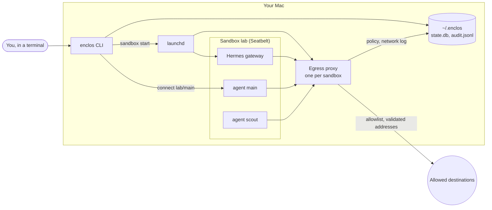

# enclos

*enclos* (French for an enclosure, said "ahn-KLOH") creates sandboxes on your machine, installs agent runtimes in them and runs agents there, with a policy and an audit log. It manages only the sandboxes it creates.

> **Status: early development.** Milestone 1 runs [Hermes](https://hermes-agent.nousresearch.com) agents in Seatbelt sandboxes on a Mac. Nothing is released yet, and state is not kept across development builds.

## Why

Agents such as Hermes install tools, run code and reach the network on their own. enclos gives each runtime a sandbox of its own, so a misled agent cannot read your SSH keys, delete your files or talk to hosts you did not allow:

- **Files:** it writes only to its own home. It reads broadly, except a deny list of sensitive paths: `~/.ssh`, cloud credentials, keychains, browser data, mail, shell history, other agents' configuration, other sandboxes and enclos's own files.
- **Network:** its only way out is its own proxy, which allows listed domains, checks every address they resolve to, and logs every connection. You review what was refused and allow what you trust, without a restart.
- **The rest of your Mac:** opening apps, Apple Events, launchd jobs, preferences, the pasteboard and signals to other processes are blocked.
- **A record:** every command that changes something is written to a hash-chained audit log.

enclos protects against accidental damage by agents you mostly trust ([threat model](docs/adr/0014-threat-model-accidental-damage.md)). It is not a defense against malicious code exploiting the kernel.

## The words

| Word | Meaning |
| --- | --- |
| **Sandbox** | A named, isolated environment with its own home folder, policy and proxy. The permission boundary. |
| **Runtime** | The software installed in a sandbox to run its agents, such as Hermes. One per sandbox. |
| **Agent** | A named identity of the runtime, with its own configuration, memory, skills, sessions and channels. Agents in a sandbox share its runtime, policy, proxy and secrets. |
| **Policy** | What a sandbox may do with files, network and host services, stored as immutable snapshots. |

More in the [glossary](GLOSSARY.md).

## Architecture



Each sandbox runs under macOS Seatbelt with a policy compiled from layers (defaults, a template, the runtime's endpoints, your overrides). Its only network route is an egress proxy on the host. Background services are plain launchd jobs; there is no enclos daemon. See [architecture](docs/architecture.md) for the components and a session step by step.

## Quick start

On a Mac with Rust and a ChatGPT subscription:

```bash
cargo install --path .
enclos init
enclos sandbox create lab
enclos runtime install hermes --sandbox lab   # Hermes's own installer, inside the sandbox
enclos runtime login lab                      # device-code login, opened on your Mac
enclos agent add lab/main
enclos policy test lab                        # escape probes; every one must fail
enclos sandbox start lab                      # proxy and gateway in the background
enclos connect lab/main                       # talk to the agent
enclos net log lab/main                       # what it connected to
```

The [getting started guide](docs/getting-started.md) explains each step and what does not work yet.

## Commands

| Command | What it does |
| --- | --- |
| `enclos init` | Create `~/.enclos`, the state database and the audit log |
| `enclos sandbox create \| list \| show \| start \| stop \| restart \| rm` | Manage sandboxes and their background services |
| `enclos runtime install \| login` | Install a runtime in a sandbox and log it in |
| `enclos agent add \| list \| rm` | Manage a sandbox's agents |
| `enclos connect <sandbox>[/<agent>]` | Talk to an agent, or open a shell, inside a sandbox |
| `enclos policy show \| allow \| test` | Read or widen a sandbox's policy, and run its escape probes |
| `enclos net log \| denied` | The network log, and what was refused |
| `enclos logs <sandbox>` | The background services' logs |
| `enclos audit [verify]` | The audit log, and a check that nobody edited it |

## Documentation

- [Getting started](docs/getting-started.md): from install to talking to an agent.
- [Architecture](docs/architecture.md): what runs where, and the code's components.
- [Design](docs/design.md): what enclos is meant to be, the threat model, milestones and open questions.
- [Decisions](docs/adr/): one short record per architecture decision.
- [Glossary](GLOSSARY.md): the words enclos uses.
- [Security policy](SECURITY.md): how to report a vulnerability.

## Development

Rust, with the version pinned in `rust-toolchain.toml`. [just](https://github.com/casey/just) runs the same checks as CI:

```bash
just ci   # cargo fmt --check, clippy -D warnings, tests, cargo deny
```

On macOS, the Seatbelt tests run real `sandbox-exec`. Unit tests never touch your launchd: services go through a fake.

## License

[MIT](LICENSE).
