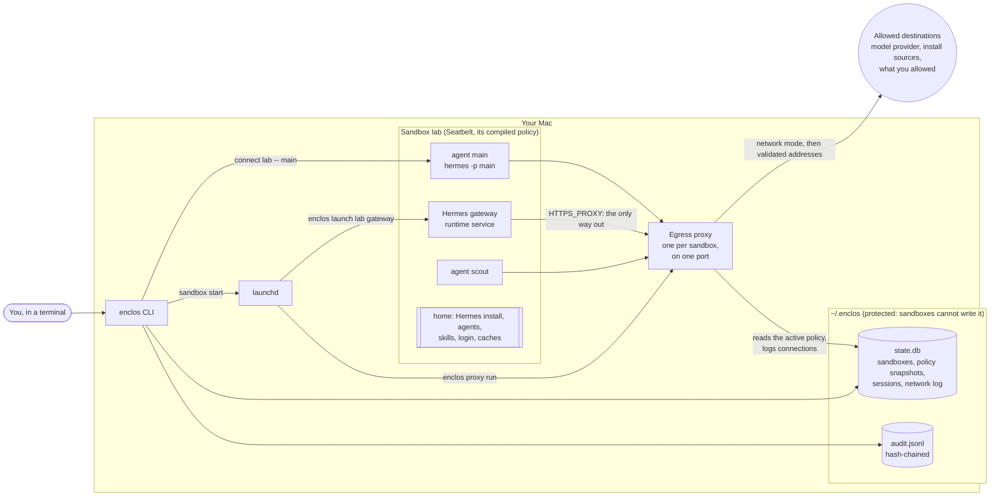
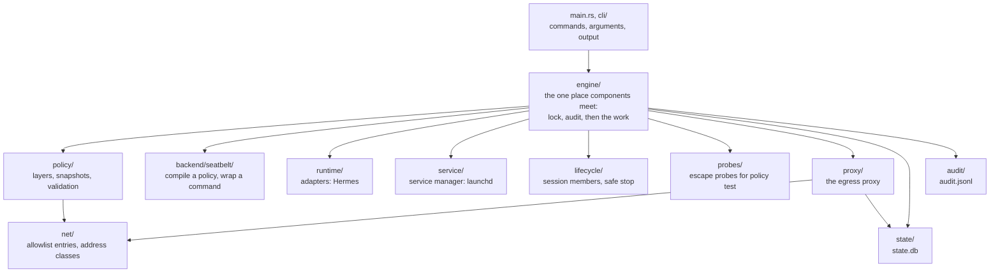
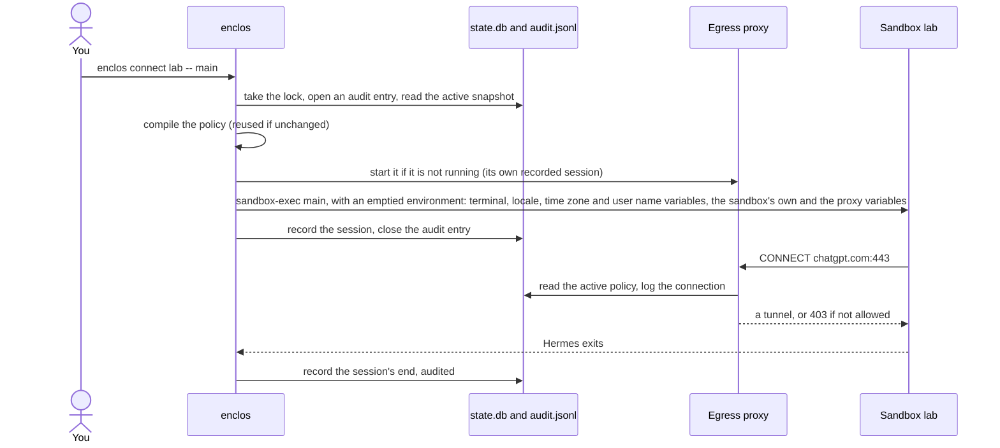

# Architecture

How enclos is put together in milestone 1, on a Mac with the Seatbelt backend. The [design](design.md) says what enclos is meant to be and why; the [ADRs](adr/) record each decision. Words such as sandbox, runtime, agent and policy are defined in the [glossary](../GLOSSARY.md).

## The big picture

<picture>
  <source media="(prefers-color-scheme: dark)" srcset="diagrams/architecture-dark.svg">
  
</picture>

The drawing is made by [`diagrams/architecture.py`](diagrams/architecture.py): edit its boxes and run `uv run --no-project python docs/diagrams/architecture.py` to redraw both themes.

## What runs on your Mac

- **The sandbox** is the permission boundary ([ADR 0003](adr/0003-sandbox-is-the-permission-boundary.md)). Every process in it runs under `sandbox-exec` with the sandbox's compiled policy: it writes only to its home and to devices, cannot read the sensitive deny list (`~/.ssh`, keychains, browser data, the host's own agent configuration such as `~/.hermes`, `~/.claude` and `~/.codex`, other sandboxes, enclos's files), connects only to its proxy's ports, and cannot reach host services such as LaunchServices, Apple Events, launchd, preferences or the pasteboard, or signal processes outside it. Agents of the same sandbox share its home, so each can read the others' files: the sandbox is the boundary, not the agent.
- **The runtime** (Hermes) is installed inside the sandbox's home by its own installer, run in the sandbox ([ADR 0020](adr/0020-runtimes-installed-per-sandbox.md)). Its **agents** share it, the policy, the proxy, the login and, from milestone 2, the secrets; each has its own configuration, memory, skills and sessions.
- **The egress proxy** runs on the host, outside the sandbox. It allows what the policy's network mode allows (the public web on ports 80 and 443, or only the allowlist; [ADR 0025](adr/0025-public-web-by-default-for-assistants.md)), resolves names itself, connects only to addresses it has validated ([ADR 0017](adr/0017-proxy-connects-only-to-validated-addresses.md)), and logs every connection it decides on, as long as `state.db` can be written ([design §6](design.md#6-network)). It reads the active policy for each new connection, so `enclos policy allow` applies without a restart. Each sandbox has one proxy port, so the network log is per sandbox ([ADR 0024](adr/0024-agents-reached-through-the-runtime.md)).
- **Services**: `enclos sandbox start` installs a sandbox's services with the host's service manager (launchd on macOS): its proxy, and each background service its runtime declares. Hermes declares one, its gateway, which serves every agent ([ADR 0021](adr/0021-one-runtime-service-per-sandbox.md)). There is no enclos daemon ([ADR 0002](adr/0002-no-daemon.md)). Interactive sessions run in your terminal and use the same proxy.
- **State and audit**: `state.db` (SQLite) holds the sandboxes, every policy snapshot, sessions and the network log; `audit.jsonl` holds one hash-chained entry per state-changing command ([ADR 0010](adr/0010-sqlite-state-and-jsonl-audit.md)).

## The code

Every client calls the `Engine` in `src/engine.rs`. A command that changes anything takes the state lock, opens an audit entry, does the work, saves the state and closes the entry, also on failure. Each component sits behind one interface (`Backend`, `RuntimeAdapter`, `ServiceManager`, `StateStore`, `AuditLog`), so a new backend or runtime is one new implementation. Typed records shared between components live in `model/`. A runtime adapter also lists the agents its runtime has in a sandbox, read on the host without following links, so enclos can report agents made inside the sandbox and adopt them with `enclos agent add` ([ADR 0023](adr/0023-agents-made-inside-a-sandbox.md)). It also names the runtime's own import command, so `enclos agent add --from` can bring in an export the runtime made on the host: the runtime extracts it inside the sandbox, and enclos only copies the archive beside the home and records the agent.

A sandbox's policy is resolved from four layers: built-in defaults, a template (`assistant`), the runtime adapter's endpoints, and the sandbox's own `policy.toml`. The result is an immutable snapshot identified by its hash ([ADR 0018](adr/0018-immutable-policy-snapshots.md)), and the backend compiles it into a `.sb` file under `sandboxes/<name>/compiled/`.

## A session, step by step

`enclos connect lab -- main`, which runs Hermes's own command for the agent `main`:

`enclos sandbox stop lab` ends every member it can find of every recorded session, services included: the program each session started, what it started, and the shell jobs of an interactive shell. A process that leaves its group and loses its parent between two looks (a daemon's double fork), or loses its parent after the program exited, is not found, and keeps running under its Seatbelt restrictions after `stop` succeeds ([design §8](design.md#8-lifecycle), known gaps). It signals a process, or a group through its leader, only after checking right before the signal that the process is still the same one (same pid and start time), so a pid already reused is not signalled. A member it cannot end is reported with why (only counted, never signalled; still running after KILL; or a signal that could not be sent), and the sandbox stays `failed` until a later stop finds none left.
