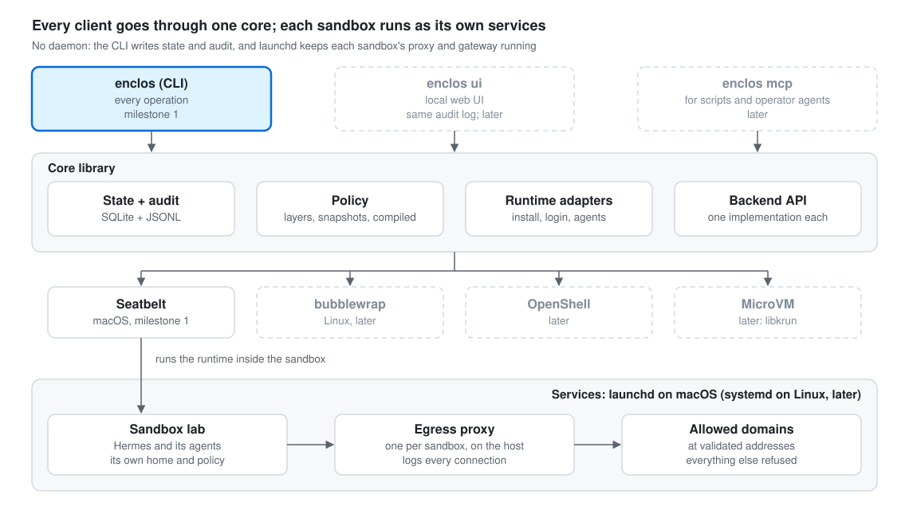

# enclos — design

*enclos* (French for an enclosure, said "ahn-KLOH") is an open-source CLI that creates sandboxes, installs agent runtimes in them (Hermes first, then Claude Code, Codex, OpenClaw) and runs agents there, and keeps a proper state and an audit log of every command. It manages only the sandboxes it creates.

Status: milestone 1 (§13) is in development. The code implements only what §13 lists for milestone 1; anything else described here comes later. Some sections also say where milestone 1 does less than the design. Target platforms: macOS on Apple Silicon first, then Linux (including Raspberry Pi). Windows through WSL2 later.

This document describes what enclos is and how it works. Decisions that are hard to reverse, and why they were made, are recorded in [`docs/adr/`](adr/). When this document and an ADR disagree, fix one of them in the same change. Three kinds of statement appear below: **decided** (an accepted ADR or plain design text), **proposed** (an ADR with `status: proposed`), and **to verify** (behavior the design depends on that no prototype has shown yet, listed in §14). What the throwaway milestone 1 prototype (`prototype/m1/`, macOS 26.5.2, Hermes 0.22.2) showed is marked "shown by the prototype", and holds only for what it probed, on one Mac.

---

## 1. Threat model and principles

**Threat model** ([ADR 0014](adr/0014-threat-model-accidental-damage.md)). enclos primarily prevents accidental damage by agents the user mostly trusts: deleting the wrong files, reading credentials, reaching unexpected hosts, or leaving something running outside the sandbox. It is not designed to contain deliberately malicious code exploiting the kernel; that belongs in a VM backend.

1. **Control, not coordinate.** enclos isolates and governs agents. It never routes tasks between agents, delegates work, or models organizations.
2. **The CLI is the product.** Every operation is a command with readable and `--json` output. The web UI, an MCP server and scripts are clients of the same core and write the same audit log.
3. **Manage only what you create.** No background collector, and no scanning the host for agents enclos did not start. Inside a sandbox it created, enclos reads the runtime's own list of agents, to report the ones made there ([ADR 0023](adr/0023-agents-made-inside-a-sandbox.md)), and it imports an agent from the host only from an archive the user names, made with the runtime's own export ([ADR 0026](adr/0026-agents-imported-through-the-runtimes-own-export.md)).
4. **Interfaces everywhere.** Each component has one job behind one interface. A new sandbox technology, secret store or runtime is one new implementation, with no change in the core.
5. **Typed models at every boundary.** Nothing untyped crosses a component boundary. Files on disk carry a `schema_version`.
6. **Never claim isolation that is not enforced or tested.** If a backend cannot enforce a policy field, enclos says so and refuses unless told otherwise. `enclos policy test` checks enforcement with probes that must fail, and reports only what it probed. A probe counts as closed only with a proof that the policy refused it: its control, a harmless check run outside the sandbox, worked, or, for the probes through the proxy, the proxy answered 403. The one exception is a route Seatbelt itself closes whatever the compiled policy says, such as running a setuid program: it is reported closed with a note that Seatbelt, not an enclos rule, closed it. A probe whose failure has another cause is reported inconclusive; a probe that could not run or be checked fails the test, and so does a test where no probe was shown closed by an enclos rule. The report ends with a verdict: `READY` when the test passed, with how many probes were shown closed and how many could not be checked, or `NOT READY` with every reason it failed. The report names the routes no probe tries yet.
7. **Network is enforced by enclos, not by the backend.** Each sandbox reaches the outside only through its own egress proxy, which applies the policy's network mode (the public web, or only a domain allowlist), connects only to validated addresses and logs every connection it decides on (§6 says when a record can be missing). Proposed exception ([ADR 0028](adr/0028-a-runtime-listens-and-its-sessions-reach-its-service.md)): a sandbox whose runtime declares a listening service may listen, so what it serves can be reached, from the host's network too, and can answer over what it accepted, without the proxy or the network log; and its sessions also reach that service's port.
8. **Readable code first.** Small files, explicit registration, no clever abstractions until a third implementation needs them.

## 2. Scope

**v1 goals**

- Create, start, stop, connect to and remove sandboxes from the CLI.
- Per-sandbox policy for files, network, programs, secrets and resources: edit, diff, roll back, test, with an active and a pending version.
- Install a runtime in a sandbox and run several of its agents there, starting with several Hermes sandboxes on a Mac, each with several agents running as background services.
- See each sandbox's network log, denied connections and other denials.
- Keep a state of every sandbox, its sessions and their processes, and an audit entry for every state-changing command.
- Seatbelt backend on macOS first, running while the user is logged in; then bubblewrap on Linux.

**Non-goals**

- Agent-to-agent delegation, task routing, organizations, pull request workflows.
- A collector, or discovery on the host of agents enclos did not create. Agents made inside an enclos sandbox are reported (§9).
- Remote control over chat channels.
- Writing our own isolation primitives: backends wrap OS features and existing VMs.
- Containing deliberately malicious code on the shared-kernel backends.
- Running sandboxes while the user is logged out (for now).
- Managing another host from this one (for now): run enclos on each host, over your own SSH session if needed.
- Hosting agents for other people (multi-tenant).

## 3. Concepts

| Concept | What it is | Example |
| --- | --- | --- |
| Host | A machine where the CLI runs and keeps its state. Each host is managed locally, by running enclos on it. | `mac`, `pi` |
| Sandbox | A named, persistent isolated environment created by enclos: backend, policy, home folder, mounts, lifecycle state. | `home` (Seatbelt), `pi-bot` (bubblewrap) |
| Policy | What a sandbox may do. Layered on a template, stored as immutable snapshots, compiled per backend. A sandbox has one active policy and at most one pending policy. | `extends = "assistant"` plus overrides |
| Runtime | The software installed in a sandbox to run its agents. One runtime per sandbox. | Hermes, Claude Code, Codex |
| Agent | A named identity of the sandbox's runtime, with its own configuration, memory, skills, sessions and channels. It shares the sandbox's runtime, policy, proxy and secrets. It is not a process and not a permission boundary: the runtime adapter decides how many processes run it, and the sandbox is the boundary. A runtime may have a built-in agent, which exists as long as the runtime is installed and which enclos neither adds nor removes (Hermes's `default`); a runtime without several agents (Claude Code, Codex) has only that one. | agent `main` in sandbox `home` |
| Session | One run inside a sandbox (an interactive `connect`, an `exec`, or a runtime service) with every process it starts. Each session records the policy snapshot it started under. | `enclos connect home -- main` |
| Audit entry | One record per state-changing command: time, user, host, command, state before and after, result. Append-only, hash-chained. | `enclos policy allow home api.telegram.org` |

Templates are reusable policies: `minimal`, `mcp-only`, `assistant`, `coding`.

**The sandbox is the permission boundary, the agent is not** ([ADR 0003](adr/0003-sandbox-is-the-permission-boundary.md)). Agents in one sandbox can read each other's files, because they share one policy. Agents that need different permissions go in different sandboxes.

## 4. Architecture

There is no daemon ([ADR 0002](adr/0002-no-daemon.md)). The CLI is a thin layer over a core library. A sandbox's services, its proxy and its runtime's, are ordinary launchd agents (macOS, in the user's login session) or systemd user units (Linux) that `sandbox start` installs. A `connect` with no proxy running and no services installed starts one as a plain process and records it as a session, which `sandbox stop` ends. Interactive sessions run in the user's terminal.

<picture>
  <source media="(prefers-color-scheme: dark)" srcset="diagrams/architecture-dark.svg">
  
</picture>

Every session runs inside the sandbox's policy, under the snapshot it started with.

Each sandbox has a proxy service, `enclos.<install>.<sandbox>.proxy`, and one service per background process its runtime declares, `enclos.<install>.<sandbox>.<service>`, while the user is logged in. A runtime adapter declares zero, one or several services, each under a stable name; Hermes declares one, `gateway`, because its gateway serves every agent ([ADR 0021](adr/0021-one-runtime-service-per-sandbox.md)). `enclos sandbox start` installs them, replacing those already installed, so they come back at each login; if one cannot start, none stays installed. `enclos sandbox stop` removes every service installed under the sandbox's prefix, and `enclos sandbox rm` refuses while any remains, even one with no session recorded. Services are removed outside the state lock, because a runtime service told to end records its end under it. So `sandbox stop`, and `sandbox start` before it installs and when it undoes a failed install, write two audit entries around the removal when the sandbox has services installed (none when it has none): `services remove`, naming the services about to be removed, closed as `ok` before the first goes, then `services removed`, with what was removed and, when a removal fails, what is still installed. If the first cannot be written, for example because the lock was not free in time, `sandbox stop` and `sandbox start` remove nothing and fail; the undo of a failed install removes the services anyway, since none may stay installed and the start's own entry records the attempt. If the second cannot be written, the first still shows the removal began, and the command fails saying whether every service was removed. `<install>` is the first 8 hex digits of the SHA-256 of the enclos data folder with links and `.` resolved: launchd labels are shared by every enclos install of the user (`ENCLOS_HOME`), a sandbox name is unique only within one, and every spelling of the folder must name the same services. Each service runs with the variables that resolve the same folders (`ENCLOS_HOME`, or both XDG folders). The service manager is chosen per system: launchd on macOS; other systems refuse to start services until their manager is implemented. A runtime service starts the runtime only once the sandbox's own proxy holds its port: `proxy run --record` records itself after binding it, so a proxy session whose process still runs is the proof. Its service runs `enclos launch <sandbox> <service>`, which runs outside the sandbox, records the session with the service's name, and runs the declared command under the compiled policy in a process group of its own. A `launch` killed before it recorded its end (at logout, by a crash, or by the service manager's timeout) leaves its session open and maybe its runtime running, and the service manager starts `launch` again; so before it starts the command, `launch` stops every session of the same service still open, with the checked stop of §8, and ends each one it stopped; its audit entry names them, also when the start then fails. It stops them rather than refusing to start: the service manager starts a service again to replace what it last started, and a refusal would fail at every restart while the old runtime ran on with nothing to stop it. A member that survives refuses the start instead: its session stays open, and the refusal names each such process (pid and command) for the user to end, after which the service manager's next restart starts the service. Sessions of the sandbox's other services are left alone. The command's process group is not the service manager's to signal, so when `launch` is told to end (TERM, as launchd's stop sends) it stops every member of the session, TERM then KILL, before recording the end; the service's stop timeout gives the service manager's wait room for both and for recording the end. A program still running after both, or one `launch` cannot stop because `ps` fails, is recorded as a failed end that says why, and its session stays open. Interactive sessions (`enclos connect <sandbox>`, a shell or the command after `--`) run the same way in the user's terminal. Secrets never sit in a service manager's file. The proxy has one listener port, reserved for the sandbox when it is created, so adding an agent never changes the compiled policy, and the network log is per sandbox ([ADR 0024](adr/0024-agents-reached-through-the-runtime.md)). Ports are the host's, but the reservation is the install's: proxy ports come from 41000 to 41999 ([ADR 0028](adr/0028-a-runtime-listens-and-its-sessions-reach-its-service.md)), and creating a sandbox skips the ports its own install's sandboxes have and those something listens on, so another install or user can reserve the same port while this sandbox's proxy is not running. The second proxy to start then cannot listen. It says that another program holds its port and that recreating the sandbox gets another: `connect` refuses with that message, and a proxy service writes it to its log (`enclos logs`) and is started again until the port is free. `enclos logs` shows the last 40 lines of each of the sandbox's service logs, and follows them with `-f`. What the services print comes from the sandbox: the runtime's output, or in the proxy's log what the sandbox asked for. So each line is escaped as `enclos status` escapes the home's text (§9), but not cut, and a log cannot drive the terminal; a line longer than 64 KB is shown in pieces.

## 5. Isolation backends

The table says what each backend is designed to enforce. Only Seatbelt is implemented, in milestone 1; bubblewrap comes in milestone 3.3, OpenShell and a microVM in 3.5. A Seatbelt cell that starts with "planned" is not in milestone 1, which refuses a policy that sets it.

| Policy field | Seatbelt (macOS) | bubblewrap (Linux) | OpenShell | MicroVM (libkrun, Firecracker) |
| --- | --- | --- | --- | --- |
| Isolation level | process, shared kernel | process, shared kernel | container, shared kernel | VM, own kernel |
| File writes | yes | yes (mount namespace + Landlock) | yes | yes |
| File read deny list | yes | yes (paths not mounted) | yes | yes |
| Programs allowed | planned: `process-exec` rules; milestone 1 refuses an `[exec]` section | partial (mounted binaries + Landlock execute) | yes | yes |
| Network (via proxy) | yes (TCP to the sandbox's proxy port on loopback only, where the proxy holds both 127.0.0.1 and `[::1]`; for a runtime that declares a listening service, also its service's port on 127.0.0.1, proposed, [ADR 0028](adr/0028-a-runtime-listens-and-its-sessions-reach-its-service.md)) | yes (own network namespace, Unix socket to proxy) | yes | yes (vsock or host IP) |
| Host-service delegation blocked | most routes shown by the prototype and probed by `policy test` (the host-service routes only with `--host-services`, as in CI); the rest to verify (§5, §14) | planned: host sockets masked (§5), to verify in milestone 3 | yes | yes |
| CPU and memory limits | planned for milestone 2, and then only partial (`ulimit`, `taskpolicy`); milestone 1 refuses a `[resources]` section | yes (cgroups via `systemd-run --user`) | yes | yes |
| Tracking every process | partial: process groups, parent chain and recorded members; known gaps in §8 | yes (cgroup) | yes | yes |
| Change without restart | network only | network only | network only | network only |
| Subscriptions work as-is | to verify (§12) | to verify (§12) | needs token delivery | needs token delivery |

**Security level, honestly stated.** Seatbelt and bubblewrap share the host kernel and user: they are designed to stop a misled agent from reading `~/.ssh` or deleting repos, not deliberately malicious code exploiting a kernel bug. That fits the threat model. Agents that read untrusted outside content with a shell, or run untrusted code, belong in a container or microVM backend. Most real risk is an agent misusing permissions it was given (exfiltration through an allowed destination, deleting its workspace), which only a narrow policy and logging address, on every backend.

**Filesystem defaults** ([ADR 0015](adr/0015-broad-reads-narrow-writes.md)). Reads are broad, except a sensitive-path deny list. Writes go only to the sandbox home and to workspaces the user grants. A workspace is a folder of its own: `validate` refuses one inside the sandbox home or inside another workspace, and one whose path goes through a symlink that sits inside the home or a workspace, since the sandbox could point that link elsewhere. A symlink the user made outside every folder the sandbox writes is fine: the sandbox cannot change it. The sandbox may change anything inside its home and each workspace, but not the folder itself: the compiled policy denies removing, renaming (swaps included) or creating the home and each workspace at its exact path, so each stays the folder the policy was compiled for and never becomes a link elsewhere (on Seatbelt, `file-write-unlink` and `file-write-create` on a `literal` path; shown by tests with `sandbox-exec`, and probed by `policy test`). So a workspace must exist before the sandbox uses it: the sandbox cannot create it, and `policy test` reports one not made yet as not run. The initial deny list on macOS covers `~/.ssh`, `~/.gnupg`, `~/.aws`, `~/.azure`, `~/.config/gcloud`, `~/.kube`, `~/.docker`, `~/.netrc`, `~/.npmrc`, `~/.pypirc`, `~/.git-credentials`, `~/.config/gh`, other tools' logins (`~/.config/hub`, `~/.config/glab-cli`, `~/.config/rclone` and `~/.rclone.conf`, `~/.cargo/credentials.toml` and `~/.cargo/credentials`, `~/.gem/credentials`, `~/.pgpass`, `~/.my.cnf`, `~/.mylogin.cnf`, `~/.vault-token`, Terraform's `~/.terraform.d/credentials.tfrc.json`, the Vercel CLI's folder, Hugging Face's token files at their default location), shell, REPL and pager history files (`~/.local/share/atuin` included), `~/Library/Keychains`, `~/Library/LaunchAgents` (the prototype showed Hermes reading the host's own service definitions there, because it finds the home through the password database rather than `HOME`), browser data folders (Chrome and its Beta, Canary and Dev channels, Chromium, Brave, Edge, Arc, Firefox, Vivaldi, Opera, Orion, and Safari's `~/Library/Safari` and its container), the site data apps keep through macOS's web stack (`~/Library/Cookies`, `~/Library/HTTPStorages`, `~/Library/WebKit`), `~/Library/Mail` and Mail's container, `~/Library/Messages`, the data of Notes, Contacts, Calendar and the default Photos library, password-manager folders (1Password and its CLI, Bitwarden and its CLI, Proton Pass, KeePassXC's settings, `pass`), the configuration and logins of the host's own assistant tools (`~/.claude`, Claude Desktop, `~/.codex`, `~/.hermes`, `~/.gemini`, Cursor, opencode), other sandboxes and enclos's protected paths. Apple's apps are on the list although TCC usually hides their data, because a terminal with Full Disk Access passes that access on (below). Some folder names on the list have not been checked against the apps yet (§14). An entry hides only the place it names: a KeePassXC database, a Photos library elsewhere, or a token moved by an environment variable needs a policy's `read_deny_add`. `~` here is the user's home, never the sandbox home, so files of the same names inside the sandbox home stay the sandbox's own. Paths on the deny list cannot be written either, even inside a granted workspace or the sandbox home: the compiler puts these denials after every write and read allow, so no grant covers them, and `policy test` probes a write of each deny-list path that exists under a write grant. A denial names a path, so the folders that would carry a denied path elsewhere cannot move: the sandbox home, every workspace, and every folder inside them that holds a deny-list entry cannot be renamed, swapped, removed or cloned, while the other files and folders in them can still be made, renamed, removed and cloned. Renaming one would otherwise put what it holds under a path no denial names, or move a workspace into the home; cloning one copies everything under it in a single call, so it would copy denied paths with it. Only the sandbox's own moves are stopped: a folder renamed from outside the sandbox, by the user or another sandbox, no longer matches a denial that names its old path. Policies can add entries; removing a default entry is an explicit, audited change. Milestone 1 has no such change, so a policy that leaves out a default entry is refused. The agent installs skills, dependencies and tools into its home: `HOME`, `TMPDIR`, caches, Python and Node environments and a `bin/` on `PATH` all point inside it, and programs installed there may run. The shared runtime under `runtimes/` stays read-only (milestone 1 installs each runtime in its sandbox's home instead, [ADR 0020](adr/0020-runtimes-installed-per-sandbox.md)). Writes to device files the runtime needs (`/dev/null`, `/dev/tty` and similar) are part of every backend's baseline. Terminal devices are not: a session opens only the terminal it runs in, through `/dev/tty` or by its name, and terminals it opens itself, not the user's other terminal tabs and windows (see the routes table below, including its known gap). A service or a probe opens no terminal by name but those its own sandbox opens.

**Protected paths.** Whatever the policy says, every backend denies the sandbox write access anywhere in the enclos data and config folders (`~/.enclos` on macOS; `$XDG_DATA_HOME/enclos` and `$XDG_CONFIG_HOME/enclos` on Linux) except its own `home/`, and read access to `state.db`, `state.lock`, `audit.jsonl` and its `audit.jsonl.torn-*` files, `config.toml`, the file secret store, the proxies' control sockets and other sandboxes' folders. The compiler adds these rules itself, and `validate` rejects a policy that tries to grant them, including through a broad path such as `~` or a workspace that contains them. `validate` compares paths after resolving symlinks and `..`, so a workspace symlinked into these folders is rejected too. `validate` also rejects a write or deny-list path holding a double quote or a backslash, which the Seatbelt compiler refuses rather than escape, so such a policy never becomes active. A symlink can change after a policy is stored, and the compiler resolves paths as they are when it runs, so each time enclos compiles a policy it checks again: the write checks of `validate` on the paths as they are then, and that the sandbox home is still a real folder, not a link, a file or missing. If either fails, enclos refuses to compile the policy, so no new session, service or `policy test` starts in the sandbox until the user fixes it; what already runs keeps the policy it started with, and `status` and `sandbox show` report the refusal. This is also why the agent cannot widen its own policy. See [ADR 0010](adr/0010-sqlite-state-and-jsonl-audit.md).

**Host-service delegation** ([ADR 0016](adr/0016-seatbelt-blocks-host-service-delegation.md)). On macOS a sandboxed process can ask a host service to act for it, outside the sandbox. Whatever the Seatbelt baseline, the compiled policy must deny these routes with the Seatbelt operation that actually governs each one (`mach-lookup` for named services, `appleevent-send` for Apple Events, and `job-creation` for launchd job submission, which goes through the bootstrap port rather than a named service), with executable denials only as an extra layer. The routes are:

| Route | Rule in the compiled policy | Evidence (the milestone 1 prototype unless noted) |
| --- | --- | --- |
| LaunchServices: `open`, opening apps, documents and URLs | `(deny lsopen)` | `open <url>` refused. Denying the coreservicesd and launchservicesd lookups alone did not stop it. |
| Apple Events: `osascript`, scripting Terminal or any other app | `(deny appleevent-send)` and a `mach-lookup` deny on `com.apple.coreservices.appleevents` | Either rule alone stops an event to Finder. |
| launchd: submitting or bootstrapping jobs, `launchctl` (through the bootstrap port, not a named service) | `(deny job-creation)` | `launchctl submit`, `bootstrap` and `load` were already refused under `(allow default)`, and an explicit `(allow job-creation)` opened them, so the deny keeps them closed. Writing `~/Library/LaunchAgents` is denied by the write rules and, since it is on the deny list, under any write grant too. With `--host-services`, `policy test` probes it with a file launchd would not load (no `.plist` suffix, not a property list), removed at once if it was written; whether Background Task Management reacts to such a file is **to verify** (§14, VM). Bootstrapping or loading a job is not probed yet. |
| Login items through ServiceManagement | `mach-lookup` denies on the background-task and login-item services | Only the lookups were shown refused; registering an item is **to verify**. |
| cfprefsd, which writes `~/Library/Preferences` for the caller, so the file-write rules never see it | `(deny user-preference-write)` | Without it, `defaults write` wrote the host's preferences folder. |
| The Keychain (the security daemon) | `~/Library/Keychains` on the deny list, and `mach-lookup` denies on the security daemon's services | Either alone makes `security show-keychain-info` on the login keychain fail. Reading an item is **to verify** (§14, milestone 2). |
| Unix sockets to host services, such as the SSH agent and the Docker socket | `(deny network*)`, allowing only the proxy port and Unix sockets inside the sandbox home (and the service's port on 127.0.0.1, for a runtime that declares a listening service, [ADR 0028](adr/0028-a-runtime-listens-and-its-sessions-reach-its-service.md)) | `connect()` refused. |
| Programs listening on the host's loopback other than the proxy, over TCP or UDP | `(deny network*)`, allowing outbound only to `(remote tcp "localhost:<proxy port>")`, and the proxy listening on that port on both 127.0.0.1 and `[::1]` | Not shown by the prototype. Checked by hand with `sandbox-exec` on macOS 26.5.2: `remote tcp` and `remote ip` both open the port on `[::1]` as well as 127.0.0.1, so a program listening on `[::1]` at that port would be reached around the proxy; the proxy therefore holds both, and refuses to start if either is taken. `remote ip` also let UDP datagrams through to that port on both addresses, where the proxy holds nothing; `remote tcp` refuses them. `remote ip4` and `remote tcp4` open 127.0.0.1 only, and a `remote ip6` deny after `remote ip` refuses both addresses; but on CI's macOS 14 runner `remote ip4` did not let the sandbox reach 127.0.0.1 at all, and Seatbelt accepts only `localhost` or `*` as the host. The Seatbelt backend tests, which CI runs on macOS 15 and 26, check that the sandbox reaches 127.0.0.1 at the proxy port, that `[::1]` at another port is refused, and that no UDP datagram reaches the proxy port on either address. Where `[::1]` is not configured (binding it fails with "address not available"), no program can listen there, so the proxy holds 127.0.0.1 alone (reasoned, not tested); it does not look again, so if IPv6 loopback is turned on later the proxy must be restarted. `policy test` probes `[::1]` at the port: from the sandbox, it must reach the proxy (403) or nothing, and the same request from the host must reach the proxy, which shows the proxy holds `[::1]`; otherwise the probe is inconclusive. |
| Listening on TCP, and reaching the service's port, for a runtime whose adapter declares a listening service ([ADR 0028](adr/0028-a-runtime-listens-and-its-sessions-reach-its-service.md), proposed) | `(allow network-bind network-inbound (local tcp "localhost:*"))`, then `(deny network-bind (local tcp "*:<port>"))` for each port of the proxy range, 41000 to 41999; and `(if (param "ENCLOS_SERVICE") (allow network-outbound (remote tcp4 (param "ENCLOS_SERVICE"))))`, the parameter set to `localhost:<port>` for a session started while the service listens | Listening is in this build: the backend test `a_sandbox_that_listens_binds_any_port_but_the_proxy_ports` shows that without `listen` nothing binds TCP, and that with it port 0 binds on 127.0.0.1, 0.0.0.0, `[::1]` and `[::]` while a proxy port, held or free, is refused on each, and that `policy test`'s bind probes read closed under the compiled policy and open without its deny rules. The service's port is in this build too: in the same test, a session given it reaches a listener there on 127.0.0.1, not `[::1]` at that port when another program holds it (skipped where `[::1]` cannot be bound), nor another listener's port, and a session given none reaches neither; with Hermes 0.22.3, `hermes -p scout chat` through `connect` opened a session in `scout`'s own list (issue #64). Checked by hand with `sandbox-exec` on macOS 26.5.2 (issue #64): the bind needs both operations; `localhost:0` is refused as an invalid port, so Hermes's bind on port 0 needs `localhost:*`; that rule also allows a bind on `0.0.0.0`, and a client on the host's LAN address reached it; no inbound rule on the peer's address (`remote ip`, allow and deny pairs) refused that client while allowing loopback; an exact-port deny after the allow holds on `127.0.0.1`, `0.0.0.0` and `[::1]`, and Seatbelt refuses before the port is found in use, so a refused bind reports `Operation not permitted` even on a port another program holds, where the host gets `Address already in use`; Seatbelt takes no port range or pattern (`*:41000-41999` and `*:41*` are invalid ports), and exact rules cost little up to a point: 1,000 load in about 0.03 s, 2,000 in 0.07 s, 8,000 in 0.9 s; a second sandbox allowed only its own proxy port could not reach a listener held for the first; `(remote tcp4 (param "ENCLOS_SERVICE"))` with `localhost:<port>` reached that port on 127.0.0.1 and not on `[::1]`, and without the parameter neither. So listening on the network is open, not closed, for such a sandbox. |
| Name lookups through mDNSResponder | `(deny network*)`, which closes the `/var/run/mDNSResponder` socket, plus a `mach-lookup` deny on `com.apple.dnssd.service` | `getaddrinfo` and `dscacheutil` fail. The `mach-lookup` deny alone does not stop them. Every lookup happens in the proxy. |
| `at` and `crontab` | none needed | Any Seatbelt policy refuses to exec setuid binaries. Shown on macOS 26.5.2 for PR #52, with read-only commands: under `(version 1)(allow default)` alone, `crontab -l`, `at -l` and `atq` fail, the shell printing `/bin/sh: /usr/bin/atq: Operation not permitted`. So the `crontab` and `at` probes show Seatbelt's own refusal, not an enclos rule: they count as closed only on that refusal to run the program, and the report says Seatbelt closed them. Installing a crontab or submitting a job needs these same programs; no probe tries it. |
| Synthetic keyboard and mouse events through WindowServer, and the pasteboard | `mach-lookup` denies on WindowServer and the pasteboard, `(deny hid-control)`, an IOKit deny | Lookups refused and `pbpaste` fails. Posting an event is **to verify**, and writing the pasteboard is not probed yet. |
| Typing into the terminal a session runs in (the `TIOCSTI` ioctl), which the user's shell would read and run after the session ends | `(deny hid-control)`, and `(deny file-ioctl (ioctl-command TIOCSTI))` | Shown on macOS 26.5.2 in the review of PR #19, not by the prototype: allowed under `(allow default)`, refused by either rule alone, while termios and window-size calls still work. A backend test checks the compiled policy refuses it; no `policy test` probe tries it yet (§14). |
| Other terminal tabs and windows: reading what the user types there, or writing into them | `(deny file-read* file-write*)` on every `/dev/ttys*` device, then allowed for the session's own terminal, which `wrap` names as a `sandbox-exec` parameter, and for terminals the sandbox opens through `/dev/ptmx` (the `com.apple.sandbox.pty` extension macOS grants for them; a `file-issue-extension` deny on that class keeps the sandbox from granting it to itself for another terminal) | Shown on macOS 26.5.2 by backend tests, not by the prototype: another terminal device is refused for reading and writing, with or without a session terminal, while `/dev/tty`, the session's terminal by name (`tty`), `/dev/null` and a terminal opened inside the sandbox (`script`) still work. Without the `file-issue-extension` deny, the sandbox issues itself the extension for another terminal and opens it; with the deny, it cannot. A CLI test shows `connect` run in a terminal opening it by name, and an engine test that a service is named no terminal. `policy test` probes the rule with a terminal it opens itself, opened to read and to write apart, and counts it closed only on Seatbelt's refusal. Known gap: a member that outlives its session keeps the right to open its terminal's name, which macOS may give to a tab opened later. |
| Signals to processes outside the sandbox | `(deny signal)` with `(allow signal (target same-sandbox))` | Hermes in the sandbox listed the host's own Hermes gateway by PID; signalling a process outside the sandbox without this rule was not tried (§14, VM). `policy test` probes the rule. |

macOS privacy permissions (TCC) are not part of the sandbox: a process started from Terminal is attributed to Terminal, so it inherits whatever Full Disk Access, Accessibility or Automation grants Terminal has. The read deny list and the rules above must hold without relying on TCC.

The rules above are what the milestone 1 prototype showed, except where a row names another source; the routes still to verify are listed in §14, and `enclos policy test` runs a probe for each route it covers. On the user's Mac, `enclos policy test` runs only probes that cannot act on the host even if a rule does not hold (reads of the sensitive files, and writes of those under a write grant; enclos's files, including the sandbox's own `policy.toml`, or creating it when it is missing, and `compiled/`; other sandboxes; renaming and cloning the folders that cannot move; network, DNS, host sockets, signals, other terminals, Keychain, pasteboard, reading the crontab and listing the `at` queue); the ones that could (LaunchServices, Apple Events, launchd, preferences, and a write in `~/Library/LaunchAgents`, whose effect on Background Task Management is not shown) run only with `--host-services`, which CI's macOS runners ask for by name (`ENCLOS_HOST_SERVICE_PROBES=1`). A probe of a file that matters, the sandbox's `policy.toml` or a deny-listed file under a grant, only opens it for writing and writes nothing, so it changes nothing even if the rule does not hold. A deny-list entry that is neither a file nor a folder (a socket or FIFO, which a probe could wait on) is not probed, and the report names it. Some routes are refused by more than one rule, such as the write rules and the protected paths for enclos's files, or the write rules and the deny list for `~/Library/LaunchAgents`: their probe shows the route closed, not that each rule alone holds. Every probe except those through the proxy has a control, run on the host first: the same read, listing or connection with its output discarded, the same open for writing of a file that matters, a check that a folder is writable, or, for a host service, a read-only check that the service is there (Finder running, the user's launchd domain, cfprefsd). A failure that happens anyway, such as reading the crontab of an account without one, or a folder macOS privacy protection (TCC) already hides, is reported inconclusive, not closed. LaunchServices and Apple Events count as closed only with the refusal the rule was shown to give (-54, -600). The rename and clone probes rename and clone each such folder into itself, which the filesystem refuses whatever the policy (`Invalid argument`), so nothing moves or is copied: Seatbelt's refusal (`Operation not permitted`) comes first and closes them, the filesystem's means the call got past Seatbelt, and the same call on the host, which the filesystem refuses there, is their control (when it is not refused that way, the report says how it failed or that it succeeded); launchd jobs, preferences, files written outside and the signal probe's target are checked from the host before and after the probe, and what a probe left is removed, the report saying whether removing it worked. Each probe's script prints a marker first, so a sandbox that never ran it is reported as not run, not as a refusal. Logins therefore use a device-code flow: the runtime prints a URL and a code, and the user opens the URL on the host.

**Linux networking.** A bubblewrap sandbox has its own, empty network namespace, and the proxy is reached through a Unix socket bound into it. Most HTTP clients (Python `httpx` and `requests`, Node, Go) need a TCP address in `HTTPS_PROXY`, so `wrap` starts a small relay inside the sandbox (enclos itself) that listens on `127.0.0.1:<port>` and forwards to the socket. Each sandbox gets one socket and one relay. The relay is the enclos binary, so bubblewrap always mounts it read-only and the program allowlist always permits it, even with `shell = false`. The agent can kill or replace its relay, which is harmless: the relay can only reach the proxy socket.

**Linux host services.** Linux has its own routes out: the D-Bus session bus, the `systemd --user` manager (which can start units outside the sandbox), and host sockets such as the SSH agent and Docker. A network namespace does not block Unix sockets that live on the filesystem, and a read-only mount does not stop a process from connecting to one, so broad reads must not expose them: bubblewrap masks `/run/user/<uid>` (which also holds the Wayland socket), `/tmp/.X11-unix` (X11 allows keystroke injection), the Docker socket and any socket named in `SSH_AUTH_SOCK`, and the escape probes cover them.

### Seatbelt specifics (first backend)

- `compile` renders a compiled policy (`.sb` file). The current plan is `(allow default)`, then: `(deny file-write*)` with writes allowed only to the sandbox home, granted workspaces and the device files the runtime needs; terminal devices denied but the session's own and those the sandbox opens (§5); reads of the sandbox's own home allowed; then `(deny file-read* file-write*)` on the sensitive deny list, after those allows so no grant or the home overrides it (later rules win), an entry that holds the home leaving the home out; `(deny file-write-unlink file-clone)` on each `literal` folder that cannot move (above), because a rename needs `file-write-unlink` on its source, and on its destination when that exists, a removal needs it too, and `clonefile` of a folder needs `file-clone` on it (shown on macOS 26.5.2 by the backend tests: `mv`, a `RENAME_SWAP`, `rmdir` and a `clonefile` of such a folder refused, a workspace that holds no deny-list entry included; `mkdir -p`, `touch`, renames, swaps, removals and clones of the other files and folders inside them still working); `(deny network*)`, which also denies Unix sockets, then outbound TCP allowed only to the sandbox's reserved proxy port on loopback (`remote tcp`, which on macOS 26.5.2 opens `[::1]` too, so the proxy listens on both, above), and for a runtime whose adapter declares a listener, TCP listening on any port but those of the proxy range, and outbound to its service's port on 127.0.0.1 for a session given that port as a parameter (in this build; proposed, [ADR 0028](adr/0028-a-runtime-listens-and-its-sessions-reach-its-service.md)); binding, accepting and connecting to Unix sockets allowed only inside the sandbox home (Hermes's gateway binds its control sockets under its home; shown to need this rule); the host-service denials above, including signals outside the sandbox; an optional `process-exec` allowlist when `shell = false` (planned, not in milestone 1); and last, so no policy rule can override them, the protected paths and a `(deny file-write-unlink file-write-create)` on the exact paths of the home and each workspace. [ADR 0006](adr/0006-seatbelt-deny-by-default.md) proposes starting from `(deny default)` instead; milestone 2 decides on evidence, not on Hermes merely running. Milestone 1 uses `(allow default)` with these rules, less the planned allowlist.
- `wrap` runs `/usr/bin/sandbox-exec -f <compiled.sb> <cmd> [args]`, with no `-D` parameter but a session's terminal (below) and, for a runtime that declares a listening service, its service's port (§6, proposed, [ADR 0028](adr/0028-a-runtime-listens-and-its-sessions-reach-its-service.md)), in the sandbox home with an emptied environment: only terminal, locale, time zone and user name variables come from the host (`TERM`, `TERMINFO`, `TERMINFO_DIRS`, `COLORTERM`, `LANG`, `LC_*`, `TZ`, `USER`, `LOGNAME`), so tokens in the user's shell never reach the agent; `TERM` becomes `xterm-256color` when the sandbox would find no terminal description for the host's. For a session, when enclos runs in a terminal, it also passes `-D ENCLOS_TERMINAL=<device>`, the first of its standard input, output and error that is a `/dev/ttys` device, so the session can open that terminal by name; a service or a probe gets no such parameter, even when `enclos launch` runs in a terminal. It then sets the sandbox's own: `HOME`, `TMPDIR`, the XDG folders and the tool caches inside the home, `PATH` (the home's `bin` folders first, then the host's system folders), `SHELL` and `ENCLOS_SANDBOX`, and the proxy set for every common client: `HTTPS_PROXY`, `HTTP_PROXY`, `ALL_PROXY` and their lowercase forms (curl reads only lowercase `http_proxy`), an empty `NO_PROXY` and `no_proxy`, plus `NODE_USE_ENV_PROXY=1` for Node's built-in `fetch`. Clients that ignore all of these cannot connect. The prototype showed curl, Python (`urllib`, `httpx`, `requests`), uv, git, Node `fetch` and npm working through the proxy with DNS denied; Node's `https.get` ignores the variables and hangs rather than failing.
- **System temp.** macOS's `/usr/bin/mktemp` (with no template, `-d` or `-t`) and Foundation's `NSTemporaryDirectory()` ignore `TMPDIR` and use the per-user `/var/folders/…/T`, which the write rules refuse (shown: the Hermes installer failed there). The Hermes adapter puts a `mktemp` shim in the home's `bin/` that turns those calls into templates under `TMPDIR` (shown to fix the installer). Programs using Foundation's directory have no such fix: Chrome for Testing did not start, apparently for this reason (to verify, §14).
- **Short home path.** A Unix socket path is limited to 104 bytes on macOS. Hermes binds `<HERMES_HOME>/gateway.sock` and `<HERMES_HOME>/state/gateway.loop-tick.<pid>.sock`, falling back to `TMPDIR`, then `/tmp`. The sandbox home path must leave room for these under each agent's folder (the prototype's longer path failed with `AF_UNIX path too long`). Nothing checks this yet.
- A compiled Seatbelt policy is fixed for the life of the process and its children. Network allowlist changes are live because the proxy enforces them; file, program and resource changes need a restart, which enclos asks for, and which stays pending if the user declines (§7).
- **Denials.** Two sources:
  1. The proxy log: every connection the proxy decides on, with its destination and verdict. This is the main network view.
  2. The macOS unified log: the kernel logs Seatbelt denials, for example `Sandbox: python3(4182) deny(1) file-read-data /Users/alice/.ssh/id_ed25519`. Every deny rule carries `(with message "enclos:<sandbox>")`, which puts the tag in the line, so `log stream --predicate 'sender == "Sandbox" AND eventMessage CONTAINS "enclos:<sandbox>"'` attributes denials to a sandbox, and an admin user can stream without sudo (shown by the prototype). The persisted log (`log show`) keeps only sandboxd's violation reports for some operations (seen for `mach-lookup`), not the kernel's file-write denials, so a history of denials needs a live, bounded consumer of the stream (never an unbounded file: a looping process can log millions of denials); which process runs it is open (§15). Whether a non-admin user can stream is to verify. macOS collapses repeated identical denials.
- `sandbox-exec` is marked deprecated by Apple but still ships and is used by major tools. Track it as a risk.

## 6. Network

**Destinations** ([ADR 0007](adr/0007-network-through-a-proxy-per-sandbox.md), [ADR 0017](adr/0017-proxy-connects-only-to-validated-addresses.md), [ADR 0025](adr/0025-public-web-by-default-for-assistants.md)). The proxy accepts a CONNECT (or a plain-HTTP request) for a host and port, normalizes the host (lowercase, trailing dot removed), and checks it against the policy's network mode. In `public` mode, the `assistant` template's, any host on port 80 or 443 passes this check, and so does anything on the allowlist. In `allowlist` mode, the built-in default, only what the allowlist lists passes. Allowlist entries default to port 443 unless they name a port. Either way, the addresses are checked next, the same way. It then resolves the host itself, since the sandbox is meant to have no DNS of its own (§5, to verify), and validates every IPv4 and IPv6 address it gets:

- always blocked: every entry in the IANA IPv4 and IPv6 special-purpose address registries that is not globally reachable, apart from the IPv4-carrying forms and private ranges below, including loopback, unspecified and `0.0.0.0/8`, link-local (and with it cloud metadata addresses), multicast, broadcast, benchmarking (`198.18.0.0/15`), documentation ranges, the deprecated IPv4-compatible `::/96`, the dummy prefix `100:0:0:1::/64`, and the whole local-use NAT64 prefix `64:ff9b:1::/48`, since an operator may use a longer prefix inside it and where it carries an IPv4 address is then unknown;
- also blocked: any IPv6 address outside `2000::/3`, the only block IANA allocates for global unicast, other than the IPv4-carrying forms and unique-local `fc00::/7` below. This covers a block reserved after this list was written outside `2000::/3`; a block reserved later inside `2000::/3` is taken as global until it is added to the list;
- IPv6 forms that carry an IPv4 address at a fixed place (IPv4-mapped, the well-known NAT64 prefix `64:ff9b::/96`, 6to4 `2002::/16`, Teredo `2001::/32`) are checked as the IPv4 address they carry;
- private ranges (RFC 1918, carrier-grade NAT `100.64.0.0/10`, unique-local IPv6 `fc00::/7`) are blocked unless the host is both on the allowlist and named in the policy's `private` opt-in. The opt-in unlocks only these private ranges, never loopback, link-local or multicast, and applies the same way to IP literals and to hostnames that resolve to private addresses.

The proxy connects only to addresses that passed, by address. Falling back from one address to the next uses the same validated list, and a retry that resolves again validates again. If no address passes, the connection is denied with the reason `blocked-address`.

**International names.** Hosts are compared in ASCII. Milestone 1 does no IDNA conversion: the proxy answers a request for a host that is not ASCII with `400` and logs it denied as `bad-request`, and an allowlist entry or `private` entry that is not ASCII is refused, with a message asking for its `xn--` form. The network log shows such a name escaped, so only its `xn--` form can be given to `enclos policy allow`. Clients that convert the name themselves before asking the proxy are unaffected. Converting such a name to its `xn--` form (IDNA) instead of refusing it is planned, in no milestone yet.

**Server name check** (milestone 2, not implemented yet: milestone 1's proxy does not read the ClientHello, so it closes no tunnel for a mismatch and logs no server name). For a TLS tunnel, the proxy reads the server name in the client's first, unencrypted message (the ClientHello), without decrypting anything. If it differs from the host the tunnel was opened for, the tunnel is closed with the reason `name-mismatch`. If no name is visible, because it is absent or encrypted (Encrypted Client Hello), the tunnel is allowed, since its host and address were already checked, and the log records that no name was seen. This stops simple attempts to reach another site through an allowed one, not fronting through an encrypted name.

**Unknown destinations.** A destination the policy does not allow (in `public` mode, another port; in `allowlist` mode, anything not listed) is denied at once and logged; nothing is held waiting for an answer. `enclos net denied <sandbox>` lists denied destinations with counts and times, and the user allows what is needed from the host with `enclos policy allow`, which takes effect without a restart: the proxy reads the sandbox's active policy from `state.db` for each new connection (milestone 1; reloads over its control socket come later). The agent cannot widen its own policy: the proxy listener serves only proxy traffic, its control socket (none in milestone 1) will sit in a folder the sandbox can neither read nor write, and enclos's state is not writable from the sandbox.

**What the network log shows.** For HTTPS, one record per tunnel: the host and port asked for, the address connected to, the verdict and reason, bytes each way, and duration; with the server name check (milestone 2), also the server name seen in the ClientHello, or that none was visible. The proxy does not see the HTTP requests inside an encrypted tunnel, so the log never shows paths, methods or the number of requests made through one tunnel. For plain HTTP, a connection carries one request, and the proxy also records its method and host. It forwards that request with the host it checked as `Host`, the length it read as the one `Content-Length`, and `Connection: close`, then the body its `Content-Length` gives (none without one) and nothing after it: once the client sends more, such as a second request, which could name another site on the same address, the proxy drops it and tells the server the client is done. A plain-HTTP request whose head a server could split another way is refused as a bad request, and recorded with its destination: a `Transfer-Encoding`, lengths that are not one number, or a header line that is not `Name: value` with a token for a name and no control character but a tab in its value (a bare CR or LF, whitespace around the name, a folded line). A tunnel's bytes are relayed as they are, so the proxy looks for no body there. A connection's record is written when the proxy decides on it, so a long tunnel shows while it is open; its bytes and duration are filled in when it closes, with the reason `idle` when the proxy closed it at the idle limit (see Limits), and a tunnel cut off by stopping the proxy keeps none. When the policy allows a destination but the proxy cannot reach it, because the name does not resolve or no address answers, the record says the connection was allowed and failed: it is not a denial and does not appear in `enclos net denied`. The proxy writes its standard error to the sandbox's `logs/proxy.log`, whether its service or a session started it, and `enclos logs <sandbox>` shows that file first. When the proxy cannot get the sandbox's active policy (`state.db` cannot be read, or the sandbox has no active policy), it refuses every connection with the reason `policy-unreadable`, and that log says why: `enclos net denied` lists those refusals as nothing to allow, and `enclos status` suggests `enclos logs <sandbox>` instead of counting them among refused destinations. A proxy probe of `enclos policy test` refused this way shows only that the proxy failed closed, not that the policy refused it; the probes do not tell the two apart yet. Every connection the proxy decides on gets a record, unless writing it fails (a full disk, or a `state.db` it cannot write): the proxy then says so in its log, and the connection goes ahead without a record. A connection over the proxy's limit (`503`), and a request whose request line the proxy cannot read or that never names a destination (`400`), are refused without a record. Whether a connection whose record cannot be written should be refused instead is proposed in [ADR 0027](adr/0027-network-log-completeness-and-retention.md); how long records are kept is open (nothing removes them yet, except removing the sandbox; ADR 0027 lists options). A request whose host is neither a name nor an address is refused as a bad request, and its record keeps only the text after the last `@` and before the first `/`, `\`, `?` or `#`, escaped and cut to 255 characters, so a user or password, path, query or fragment written there is not kept; when nothing is left, an `@` follows the cut, or the host holds a `%` (percent-encoding can hide any of these delimiters), the record holds `<invalid>` instead. Destinations are shown as `host:port`, with an IPv6 address in brackets, so the text can be given to `enclos policy allow` as is; a bad request's record is the exception: it is refused whatever the policy says, so `enclos net denied` lists it as nothing to allow.

**Limits.** The proxy serves at most 100 connections at once per sandbox, on both loopback addresses together, and answers any more with `503`. A client has 30 seconds to send its whole request head. Resolving a destination's name and connecting to its addresses take at most 10 seconds in all, the address families taking turns; the proxy stops waiting for a lookup at that deadline, whatever the host's resolver does, and records the connection as allowed and failed with `resolve-failed`. A lookup it stopped waiting for still counts until it returns, and at most 32 run at once, so that the connections and the lookups together stay within the 256 file descriptors launchd gives a service, even if each lookup holds one while the resolver waits; while 32 are running, a new lookup fails at once and is recorded the same way. The network log does not tell these causes from a name that does not resolve, so the proxy says on its stderr, which goes to its log in the sandbox's folder, when a lookup timed out, could not start, or found the lookups full. A tunnel or plain-HTTP connection that moves no byte either way for 10 minutes, or whose client or server reads nothing for 10 minutes, is closed, and its record gets the reason `idle`. A plain-HTTP client that got no byte of an answer is first sent a `504` saying so; a tunnel's client already had its `200`, so the record is all it gets. The limit is generous because runtimes keep long-lived streams (model output, chat long-polling, websockets), and a model request sent without streaming can wait minutes for its answer: 10 minutes is the request timeout of the common model-provider SDKs. The policy is checked only when a connection opens: one opened before a policy change removed its destination stays open until it ends or goes idle.

**What the proxy can and cannot promise.** enclos constrains the connections the sandbox makes, not what the services it reaches do. A remote browser, a search service, an MCP server, or the model provider's own tools (a hosted web search, for example) can fetch other sites on the agent's behalf. Allowing such a service grants that capability: the policy and `enclos policy show` describe it as "remote fetching through <service>", not as network isolation. The same applies to any allowed destination that relays data.

**Host services.** Services on the host's loopback interface or local network are unreachable: there is no loopback exception. Reaching one (a local MCP server, for example) needs a host-service forward: a narrowly scoped mechanism that exposes one named host address and port to one sandbox through its own listener, logged and audited. Decided: no host-service forward before milestone 3.1, and then only one named host port to one sandbox per grant; the exact mechanism is still open (§15).

**The runtime's own service** (proposed, [ADR 0028](adr/0028-a-runtime-listens-and-its-sessions-reach-its-service.md), issue #64; the listening, the service's port, `connect` starting the service, and `status` showing the dashboard and naming listeners are in this build). Hermes 0.22.3's chat reaches its gateway only over a WebSocket on a loopback port the gateway picks at start: each client finds the gateway, gets a ticket for its own agent over the gateway's Unix socket in the home, and dials the port the gateway gives. So a runtime adapter can declare its listening service (Hermes: `gateway`). Such a sandbox may listen (§5), and a session started while that service listens is given its port: `wrap` passes `-D ENCLOS_SERVICE=localhost:<port>`, and the compiled policy, the same for every session, allows outbound TCP to that port on 127.0.0.1 alone. enclos takes the port from its records of the service's session, never from a file the sandbox writes: the one TCP port at 127.0.0.1 (not every address, where another program of the user could hold 127.0.0.1 at that port) in the system's ephemeral range that the program it started for the service holds, and no other process holds 127.0.0.1 at that port (a socket sharing it with `SO_REUSEPORT` would get the session's connections) (a bind on port 0 lands there; a port the runtime binds by number, such as Hermes's API server or webhooks, does not), checked to be the same process before and after reading its ports, so a reused PID is not taken for it, and none when there is none or several. Hermes then works as it does outside enclos, each agent and client as itself. `connect` makes sure the service listens first, since a session reaches it only on the port it held when the session started. When the service itself is not installed (nothing of the sandbox is, or only its proxy, as when it was started before its runtime was installed), it installs the sandbox's services as `sandbox start` does, so they start again at each login until `sandbox stop`, and says so on stderr, along with the open sessions' connections being cut when its proxy runs (one an earlier `connect` started, or the proxy service), since the new proxy service replaces it; `--dry-run` says both. A start that fails after removing the services it replaces leaves none; when the proxy service was among them, the session is told so, with `enclos sandbox start` to get them back. When the service is installed, or a session of it is open but not listening yet (one still starting), it only waits: installing the sandbox's services again would stop that service and the proxy. It waits up to 60 seconds for the service to listen, gives up after 15 seconds while no session of it is open, as when it exits at once, and at once for what waiting does not fix (several ports, a port another process shares); a start that fails ends the wait too, and in each case it says why and connects anyway. One `connect` of a sandbox at a time decides and waits, under a lock file in enclos's `run` folder. It starts nothing when the runtime's files are gone from the home (the path its adapter names for `status`), since the service could not run, nor when whether they are there cannot be told, which it says. `policy show` and `policy test` say that such a sandbox's listening is open, and `status` names what in it listens beyond loopback. This is not a loopback exception: a session reaches its own proxy and the port its own sandbox's service held when it started, and nothing else on the host's loopback, until the service restarts, when whatever then holds that port at 127.0.0.1 is reachable from it ([ADR 0028](adr/0028-a-runtime-listens-and-its-sessions-reach-its-service.md), Consequences).

## 7. Policy

A policy is TOML that extends a template and overrides only what differs ([ADR 0008](adr/0008-layered-policy-with-declared-enforcement.md)). Layers resolve in order: built-in defaults, template, the endpoints the runtime adapter needs, the sandbox's `policy.toml`. Lists replace (`allow = [...]`) or extend (`allow_add = [...]`).

```toml
# ~/.enclos/sandboxes/home/policy.toml
extends = "assistant"

[filesystem]
write_add = ["~/Documents/notes"]        # a granted workspace
read_deny_add = ["~/dev/work"]

[network]
mode = "allowlist"                       # only what is listed; the assistant template's "public" also opens ports 80 and 443
allow_add = ["api.telegram.org", "printer.lan"]
private = ["printer.lan"]                # must also be allowed; unlocks private ranges only for these hosts
log = "metadata"                         # per tunnel: host, port, address, bytes, duration; never contents
listen = false                           # TCP listening, any port but the proxy ports (ADR 0028, proposed); the Hermes adapter sets true

[resources]                              # milestone 2, like [secrets]; milestone 1 refuses both sections
memory = "2G"
cpu = 2.0

[secrets]                                # every session in the sandbox receives these
env = { TELEGRAM_BOT_TOKEN = "secret:home/telegram" }
```

| Template | Writes | Programs | Network | Use for |
| --- | --- | --- | --- | --- |
| `minimal` | own home | the runtime only | model provider only | a starting point |
| `mcp-only` | own home | runtime and its MCP servers | model provider + listed remote MCP endpoints | assistants working on outside data |
| `assistant` | own home | any, including what the agent installs in its home | the public web (any public address on ports 80 and 443), plus the runtime's endpoints and listed APIs | personal agents such as Hermes |
| `coding` | own home + the selected project folder, written in place | any | model provider, Git hosts, package registries | Claude Code, Codex, a dev agent |

Every template reads the host broadly, minus the sensitive deny list (§5). Validation: no loopback or link-local entries; a wildcard may only cover the subdomains of a named domain (`*.example.com`), never everything (`*`) or a public suffix (`*.com`, `*.co.uk`); private addresses only through `private`, for hosts that are also on the allowlist; no filesystem grant may cover the protected paths. Each runtime adapter contributes the endpoints its runtime needs to work at all (for Hermes: the model provider, its login endpoints and its install sources, shown by the prototype for Hermes 0.22.2: the install needed `github.com`, `api.github.com`, `release-assets.githubusercontent.com`, `releases.astral.sh`, `pypi.org`, `files.pythonhosted.org`, `registry.npmjs.org`, `nodejs.org`, `cdn.playwright.dev`, `storage.googleapis.com` and `ffmpeg.martin-riedl.de`; the device-code login and token refreshes need `auth.openai.com`; model calls and the model list need `chatgpt.com`), so the runtime also works in `allowlist` mode. An adapter's layer may also set `listen`, and nothing else besides its endpoints (a `mode`, a `log`, a list it replaces or a filesystem rule is refused): Hermes's sets `listen = true`, for its gateway ([ADR 0028](adr/0028-a-runtime-listens-and-its-sessions-reach-its-service.md), proposed). A sandbox's `policy.toml` may set `listen` too: `true` lets a sandbox listen whatever its runtime, and `policy allow` lists it as a change to accept. `runtime install` shows it with the destinations, as what the runtime brings, not as a change to confirm, and a sandbox's `policy.toml` can set `listen = false`, which leaves that runtime's gateway unable to start, and `runtime install` then says so. No template or adapter contributes a weather service or any task-specific API: in `public` mode the agent reaches one on its own, through the logged proxy.

**Snapshots** ([ADR 0018](adr/0018-immutable-policy-snapshots.md)). A snapshot is the fully resolved policy together with its inputs (enclos version and built-in defaults, template name and content hash, adapter version and contributed endpoints, and the overrides), identified by the SHA-256 of both. Snapshots are insert-only, and identical content reuses the existing snapshot. A sandbox's history is an append-only list of numbered policy versions, each pointing to a snapshot and recording who made it, when, and which version it restores if it is a rollback. Audit entries and session records reference both the version number and the snapshot hash.

- **Active and pending.** New sessions use the active snapshot. A file, program, resource or secret change applies at once if no session is running; if sessions are running, it needs a restart and asks first; if the user declines, it becomes the pending snapshot, the active one stays, and `enclos policy show` and `enclos sandbox show` display both. `enclos policy apply` restarts and makes the pending snapshot active; `enclos policy discard` drops it. A change mixing restart-requiring and network parts is pending as a whole. A network-only change takes effect at once as a new active snapshot, and if a change is pending, it is re-resolved into a new pending snapshot that includes the network change.
- **Updates.** A new enclos version or template never silently changes grants: launch uses the active snapshot as stored. `enclos policy refresh` resolves again against the current template and adapter and turns any difference into a change for the user to accept. Until refresh and pending changes arrive (milestone 2), `enclos policy allow` resolves the whole `policy.toml` against the current template and adapter; when the result changes more than the entry asked for (edits not applied yet, or a newer template or built-in defaults), it lists each extra change and asks first.
- **Rollback.** `enclos policy rollback --to <version>` makes that snapshot's effective policy the target again, as a new version recording what it restores, and restores its overrides so later edits start from it. It follows the restart rules above. A rollback or refresh made while a change is pending replaces that pending change, after showing it and asking.

## 8. Lifecycle

**Members** ([ADR 0019](adr/0019-sandbox-members-and-effective-policy.md)). Every process inside a sandbox is a member: interactive sessions, the agent, browsers and helpers it starts, installers, and all their children. Each session is recorded with its target, kind (interactive, service with the service's name, or the sandbox's proxy), the snapshot and compiled policy it started under, its start time, and its members.

- **Linux:** members are the processes in the sandbox's cgroup.
- **macOS (milestone 1):** a session's members are the program it started, every child of a member, and every process in a group a member leads: an interactive shell puts itself and each of its shell jobs (in the POSIX job-control sense) in groups of their own. While a session runs, `enclos` looks at its processes twice a second and records its sure members (pid and start time), so one whose parent exited is still found. The group the program started in also counts: a group `enclos` made for it (without a terminal: a script, CI) once its leader, the program, is gone; and, in a terminal, the job `enclos` leads, where only processes that lost their parent count (a pager piped from `enclos` is the caller's) and `enclos` itself is not a member. Those are counted, never signalled. `stop` signals a group through its leader when that leader is a sure member and any other sure member alone; right before each signal it checks that the target is still the same process (same pid and start time, read in UTC), so a pid already reused is not signalled. It sends TERM, waits, sends KILL, and reports each member that remains with why: only counted, still running after KILL, or a signal that could not be sent. A `ps` that fails is an error, never an empty listing: `stop` then leaves the sessions open and marks the sandbox `Failed`. Asked about one pid, `ps` answers "no such process" by printing nothing, on stdout or stderr, and exiting 1; any other failure, or output it does not parse, in that answer or in a whole listing, is a failure too. When the program a session started exits but leaves members, the session stays open, so `show` lists them and `rm` refuses, until they are gone. A gone session is one whose end nothing was left to record (a crash, a restart of the Mac, `enclos` killed, or the members a session left exiting on their own): its root and every member it recorded are gone (no longer listed, or listed with another start time) and nothing else counts as its member. `sandbox show` and `enclos status` are reads: they show a gone session as gone, not recorded, and change nothing. `sandbox stop` records its end under the lock and names it in its audit entry; a session that still ran when `stop` started, such as the proxy service's, which ends when its service is removed, counts as stopped. `stop` then marks the sandbox `Stopped` when no member survived, as when it ends every session itself. `sandbox rm` removes a sandbox whose open sessions are all gone and names them in its audit entry; while any other session still runs, it refuses and records nothing. `connect` waits for its program through Ctrl-C and a hangup, as `system(3)` does, so the session's end is recorded. Known gaps: a process that leaves its group and loses its parent before the next look (a daemon's double fork), and one that loses its parent after the program exited, when `enclos` no longer looks, are not seen; they keep their Seatbelt restrictions. The prototype refuted a per-sandbox marker checked with `sandbox_check` (it answers the same for every process).

**Stop and restart.** `stop` ends every member: a signal, a grace period, then a forced kill, then a check that no member remains. Survivors are reported, and the sandbox is marked `Failed` instead of `Stopped`. The sessions' ends and the sandbox's new state are written in one transaction, so a crash or a failed write never leaves one without the other. `restart` stops every member and starts the sandbox's services again under the active snapshot; an interactive session ends and the CLI tells the user to reconnect.

**Effective policy.** Network rules follow the active snapshot live; file, program and resource rules, and secrets (milestone 2), are fixed when a session starts. `enclos sandbox show` lists each session with both, for example `network: v7 (live)  files, programs, resources: v5 (at launch)`, and flags a session as needing a restart only when its file, program or resource rules differ from the active snapshot's, not merely because the version number moved; in milestone 1, when the compiled policy it runs under differs from the one the active snapshot compiles to. A pending snapshot never applies to anything running.

**Starting a session: `enclos connect home -- main`, step by step**

1. Take the state lock; open an audit entry. (Proposed in [ADR 0028](adr/0028-a-runtime-listens-and-its-sessions-reach-its-service.md): first, for a runtime that declares a listening service, start the sandbox's services when no session of that service is open, and wait for it to listen; give the session its port in step 5.)
2. Load the record and the active snapshot; compile it if no compiled policy exists for this snapshot and this enclos version (an upgrade recompiles, which is how stricter enclos-owned rules reach new sessions without asking; `enclos doctor` lists what changed); `prepare`.
3. Start the proxy if it is not running, with the active network policy and the proxy's address, and record it beside the sessions (the proxy service when the sandbox is started; otherwise a process this `connect` starts).
4. Record the session with its snapshot and compiled-policy hashes, and the sandbox as `Running`, in one transaction; close the audit entry; release the lock.
5. Read the secrets the session's snapshot grants (milestone 2), wrap the command (the one after `--`; a login shell when none is given) and run it in the terminal, tracking its members. `enclos launch <sandbox> <service>` does the same for a runtime service, for the service manager, after stopping any session of the same service still open (§4).
6. When the session ends, take the lock, record the end and any surviving members, and append an audit entry.
7. On failure at any step: end the program it started, save `Failed { reason }`, named after the command (`connect failed: …`, `launch failed: …` for a service, and so on for the commands that run a program the same way, such as `runtime installer failed: …`), and close the audit entry as failed, in the same write. A proxy it started stays recorded and running, as after a `connect` that succeeds, until `stop`. A failure before step 1, such as `launch` giving up on a proxy that never started, records nothing. A later `connect` or `launch` that succeeds marks the sandbox `Running` again.

`enclos sandbox start <name>` does the same for the proxy and every service the runtime declares.

## 9. Component APIs

Sketches in Rust. The `Engine` is the only code that combines components.

**Models**

```rust
pub struct SandboxName(String);              // [a-z][a-z0-9-]{1,40}
pub enum BackendKind { Seatbelt, Bubblewrap, OpenShell, Libkrun }
pub enum RuntimeKind { Hermes, ClaudeCode, Codex, OpenClaw }

pub struct AgentName(String);                // same rules; "default" for runtimes without several agents

pub struct SandboxSpec { pub name: SandboxName, pub backend: BackendKind, pub template: TemplateName,
                         pub workspaces: Vec<PathBuf>, pub runtime: Option<RuntimeKind> }
pub struct SandboxRecord { pub spec: SandboxSpec, pub state: SandboxState,
                           pub active_policy: SnapshotId, pub pending_policy: Option<SnapshotId>,
                           pub agents: Vec<AgentRecord>, pub created_at: Timestamp }
pub struct AgentRecord { pub name: AgentName, pub autostart: bool, pub state: SandboxState }
pub enum SandboxState { Created, Running, Stopped, Failed { reason: String } }

pub struct AgentRef { pub sandbox: SandboxName, pub agent: AgentName }    // "home/main", in the agent commands

pub struct SnapshotId([u8; 32]);             // SHA-256 of the resolved policy and its inputs
pub struct PolicySnapshot { pub id: SnapshotId, pub inputs: PolicyInputs, pub policy: Policy }   // insert-only
pub struct PolicyVersion { pub version: u32, pub snapshot: SnapshotId, pub by: Actor, pub at: Timestamp,
                           pub restores: Option<u32> }    // append-only history; set by a rollback
pub struct PolicyInputs { pub enclos_version: Version, pub defaults: ContentHash,
                          pub template: (TemplateName, ContentHash),
                          pub adapter: Option<(RuntimeKind, Version, ContentHash)>, pub overrides: ContentHash }

pub struct SessionRecord { pub id: SessionId, pub target: Target, pub kind: SessionKind,  // Interactive | Exec | Service
                           pub version: u32, pub snapshot: SnapshotId, pub compiled: ContentHash,
                           pub started_at: Timestamp, pub ended_at: Option<Timestamp> }
pub struct Member { pub pid: u32, pub session: Option<SessionId>, pub command: String, pub started_at: Timestamp }

pub struct Policy { pub fs: FsPolicy, pub exec: ExecPolicy, pub net: NetPolicy,
                    pub resources: Resources, pub secrets: Vec<SecretGrant> }
pub enum Enforcement { Enforced, Partial { note: String }, Unsupported }
pub struct Capabilities { pub isolation: Isolation, pub fs: Enforcement, pub exec: Enforcement,
                          pub resources: Enforcement, pub members: Enforcement, pub live: Vec<PolicyArea> }
```

**Policy** (pure functions)

```rust
pub fn resolve(inputs: &ResolvedInputs) -> Result<PolicySnapshot, PolicyError>;   // defaults, template, adapter, overrides
pub fn validate(policy: &Policy, caps: &Capabilities) -> Vec<Finding>;
pub fn diff(before: &Policy, after: &Policy) -> PolicyDiff;
pub fn needs_restart(diff: &PolicyDiff, caps: &Capabilities) -> bool;
```

**Backend** (prepares, wraps and finds members; never supervises)

```rust
pub trait Backend {
    fn kind(&self) -> BackendKind;
    fn probe(&self) -> Probe;
    fn capabilities(&self) -> Capabilities;
    fn compile(&self, policy: &Policy, ctx: &SandboxContext) -> Result<Compiled>;   // pure; adds protected paths and host-service blocks
    fn prepare(&self, sb: &SandboxRecord, compiled: &Compiled) -> Result<()>;
    fn wrap(&self, sb: &SandboxRecord, session: &SessionRecord, cmd: &Command) -> Result<Command>;
    fn members(&self, sb: &SandboxRecord) -> Result<Vec<Member>>;
    fn signal_members(&self, sb: &SandboxRecord, signal: StopSignal) -> Result<()>;   // Term | Kill
    fn denials(&self, sb: &SandboxRecord, since: Timestamp) -> Result<Vec<Denial>>;
    fn teardown(&self, sb: &SandboxRecord, keep_data: bool) -> Result<()>;
    fn up(&self, _sb: &SandboxRecord) -> Result<()> { Ok(()) }     // a VM boots here
    fn down(&self, _sb: &SandboxRecord) -> Result<()> { Ok(()) }
}
```

Escape probes are not part of the backend: `probes/` builds them and the engine runs each through the backend's `wrap`. They are macOS commands today; the bubblewrap backend will bring its own set.

**Egress proxy**

```rust
pub fn decide(net: &NetPolicy, host: &Host, port: u16) -> Decision;                // Allow | Deny { reason }
pub fn validate_addrs(net: &NetPolicy, host: &Host, addrs: &[IpAddr]) -> Vec<IpAddr>; // only addresses that passed
pub struct ProxyConfig { pub sandbox: SandboxName, pub listen: SocketAddr,
                         pub control: PathBuf, pub net: NetPolicy, pub events: PathBuf }
pub struct NetEvent { pub at: Timestamp, pub sandbox: SandboxName, pub host: String, pub port: u16,
                      pub addr: Option<IpAddr>, pub server_name: Option<String>,   // from the ClientHello, if visible (milestone 2)
                      pub verdict: Verdict, pub reason: Option<DenyReason>,
                      pub bytes_up: u64, pub bytes_down: u64, pub duration: Duration }
pub enum ProxyRequest { Reload { net: NetPolicy }, Stats }
```

**Service manager**

```rust
pub trait ServiceManager {
    fn install(&self, unit: &ServiceUnit) -> Result<()>;
    fn uninstall(&self, name: &ServiceName) -> Result<()>;
    fn start(&self, name: &ServiceName) -> Result<()>;
    fn stop(&self, name: &ServiceName, grace: Duration) -> Result<()>;
    fn status(&self, name: &ServiceName) -> Result<ServiceStatus>;
}
```

**Secret store**

```rust
pub trait SecretStore {
    fn put(&self, r: &SecretRef, value: SecretValue) -> Result<()>;
    fn get(&self, r: &SecretRef) -> Result<SecretValue>;   // zeroized on drop, prints "***"
    fn delete(&self, r: &SecretRef) -> Result<()>;
    fn list(&self) -> Result<Vec<SecretRef>>;
}
```

**State store and audit log.** A write requires a `StateLock`, so writing outside the lock does not compile; an `AuditTicket` is consumed by `finish`. Snapshots are insert-only and versions append-only.

```rust
pub trait StateStore {
    fn lock(&self) -> Result<StateLock>;
    fn get(&self, name: &SandboxName) -> Result<Option<SandboxRecord>>;
    fn list(&self) -> Result<Vec<SandboxRecord>>;
    fn put(&self, lock: &StateLock, rec: &SandboxRecord) -> Result<()>;
    fn remove(&self, lock: &StateLock, name: &SandboxName) -> Result<()>;
    fn create_sandbox(&self, lock: &StateLock, rec: &SandboxRecord, snap: &PolicySnapshot,
                      by: &Actor) -> Result<PolicyVersion>;                  // the record and version 1, in one transaction
    fn add_version(&self, lock: &StateLock, name: &SandboxName, snap: &PolicySnapshot,
                   by: &Actor, restores: Option<u32>) -> Result<PolicyVersion>;   // stores the snapshot if new
    fn snapshot(&self, id: &SnapshotId) -> Result<PolicySnapshot>;
    fn policy_history(&self, name: &SandboxName) -> Result<Vec<PolicyVersion>>;
    fn put_session(&self, lock: &StateLock, session: &SessionRecord) -> Result<()>;
    fn sessions(&self, name: &SandboxName, running_only: bool) -> Result<Vec<SessionRecord>>;
}

pub trait AuditLog {
    fn begin(&self, lock: &StateLock, intent: Intent) -> Result<AuditTicket>;
    fn finish(&self, ticket: AuditTicket, outcome: Outcome) -> Result<()>;
    fn entries(&self, filter: &AuditFilter) -> Result<Vec<AuditEntry>>;
    fn verify(&self) -> Result<VerifyReport>;
}
```

**Runtime adapter**

```rust
pub trait RuntimeAdapter {
    fn kind(&self) -> RuntimeKind;
    fn supports_multiple_agents(&self) -> bool;                                 // Hermes: yes; Claude Code, Codex: no
    fn endpoints(&self) -> &str;  fn version(&self) -> &str;                    // the destinations it needs, as a layer that adds nothing else; versioned, recorded in snapshot inputs
    fn installer(&self) -> Installer;                                           // downloaded on the host over HTTPS only, as the runtime serves it, its SHA-256 in the audit entry, run inside the sandbox (milestone 1, ADR 0020, ADR 0029)
    fn home_files(&self) -> Vec<HomeFile>;                                      // files enclos stages beside the home; copied in from inside the sandbox
    fn login(&self) -> String;                                                  // the runtime's own login and setup, shown as `connect <sandbox> -- <this>`, never run by enclos

    fn create_agent(&self, agent: &AgentName) -> SandboxCommand;                // run inside the sandbox; a `SandboxCommand` can be started nowhere else
    fn agent_files(&self, agent: &AgentName) -> String;                         // where the runtime keeps the agent's files, for messages
    fn configure(&self, sb: &SandboxRecord, agent: &AgentName, cfg: &AgentConfig) -> Result<ConfigDiff>;
    fn services(&self) -> Vec<RuntimeService>;                                 // its background processes, each named; Hermes: one gateway
    fn listener(&self) -> Option<RuntimeListener> { None }                     // proposed (ADR 0028): the service that listens, whose port the sandbox's sessions reach
    fn agents_in(&self, home: &Path) -> Result<Vec<RuntimeAgentName>, Unreadable>;   // read on the host; Err: cannot tell, and why
    fn builtin_agent(&self) -> Option<BuiltinAgent> { None }                     // the agent it always has: Hermes's `default`, a valid agent name
    fn delete_agent(&self, agent: &AgentName) -> Option<SandboxCommand> { None }  // the runtime's own delete, run in the sandbox; None: files stay
    fn import_agent(&self, agent: &AgentName, archive: &Path) -> Option<SandboxCommand> { None }   // the runtime's own import of its export, run in the sandbox

    // For `enclos status`: `HomePath`s (plain components inside the home), read by the engine. Defaults name nothing.
    fn disk_parts(&self) -> Vec<(DiskPart, HomePath)> { Vec::new() }             // Runtime | Cache
    fn runtime_facts(&self) -> RuntimeFacts { RuntimeFacts::default() }          // version, login file, install path
    fn agent_facts(&self, agent: &RuntimeAgentName) -> AgentFacts { AgentFacts::default() }   // folder, model, activity files
}
```

For Hermes, each agent is a Hermes profile of the same name (Hermes's word for it): all live under the sandbox's Hermes home and run the sandbox's own Hermes install (ADR 0020), and `command` selects the profile. Hermes's own `default` profile, the root of its home, is its built-in agent `default`. Without `-p`, `hermes` uses the profile `hermes profile use` last saved, which may be another, so enclos names it with `-p default`, in `talk` and in the login, which every agent shares: enclos lists it without a record, refuses to add or remove it, never reports it as untracked, and points at it with `enclos connect <sandbox> -- hermes -p default`. Another runtime names its own built-in agent, or none. Hermes's own installs of skills, packages and tools are configured to land in the sandbox home, never in the shared runtime.

**Agents made inside a sandbox** ([ADR 0023](adr/0023-agents-made-inside-a-sandbox.md)). Anything run in the sandbox can create or delete agents with the runtime's own commands, such as `hermes profile create` in an `enclos connect` shell. They work, under the same policy, but enclos has no record of them, so `agent list` and `sandbox show` miss them. `agents_in` lists the agents the runtime has, the way the runtime itself does (for Hermes: a folder under `~/.hermes/profiles/`, other than `default`, with a valid id, one of its identity files, and no marker under `.deleted/`), read on the host. What it reads is written by the sandbox: it never follows a link (each folder is opened by its descriptor, so a link planted before or during the read leads nowhere), reads a bounded number of entries, and answers `Unreadable`, with the path and the reason, rather than guess. A name it returns is a `RuntimeAgentName`: one printable word, wider than an agent name, safe in a message. enclos compares the list with its records in `agent list`, `sandbox show`, after each `connect` session (there without the names it cannot use, which only a rename inside the sandbox changes) and when `agent rm` names an agent it does not track, and reports agents it does not track, names that are not valid agent names, and tracked agents the runtime no longer has, each with the command that fixes it. When the list cannot be read, each of these says so instead, and `agent add` refuses to act. `enclos agent add` adopts an agent the runtime already has: it records it without creating it again, re-checking under the lock. enclos never adopts or removes an agent on its own. After `agent rm --keep-data`, whose files stay, the runtime still has the agent and enclos reports it as one it does not track. `agent rm` without it runs the runtime's own delete only when the runtime's list has the agent, checks the list again afterwards, and refuses when the list cannot be read.

**Agents imported from the host** (issue #34, [ADR 0026](adr/0026-agents-imported-through-the-runtimes-own-export.md)). An agent that already runs on the host comes into a sandbox through the runtime's own export and import, never through an archive format of enclos's own: the user exports it on the host with the runtime's own command (`hermes profile export default -o main.tar.gz`), and `enclos agent add <sandbox>/<agent> --from <archive>` brings it in. It is refused, before the archive is read, for a runtime without an import command, the runtime's built-in agent's name, a name enclos tracks, a name the runtime already has in the sandbox (`agent add` without `--from` records that one as it is), a name that is a command on the sandbox's PATH, and when the runtime's list of agents cannot be read. The archive must be a plain file outside every sandbox's folder: enclos opens it without following a last link and refuses a link, anything but a plain file, and a file that, with every link resolved, is under `sandboxes/`, whose homes sandboxes write; the host must never copy what a sandbox put or pointed at into a sandbox, and an export made inside a sandbox is copied out first. A workspace a sandbox may write is not checked: naming an archive there is the user's call. enclos opens the archive once and copies it beside the sandbox home, into `installers/`, which the sandbox reads and cannot write (a backend test shows it), as a new file per enclos process, hashing the bytes as they go; that step is audited (`agent import`, with the archive's absolute path, its SHA-256 and the copy's path), so the archive is in the audit log before the runtime runs. It then runs the adapter's `import_agent` command in a session in the sandbox, under its policy (for Hermes, `hermes profile import <copy> --name <agent>`), so the runtime, not the host, extracts it; removes the copy, also when anything after the copy fails, and reports a copy it could not remove, with why; and records the agent, with the same path and hash in the `agent add` entry. Three things never cross. The login: enclos copies no host login in, and secrets stay on the host ([ADR 0022](adr/0022-secrets-granted-per-sandbox.md)); the imported agent is meant to use the sandbox's login (to verify, §14), and until secrets are granted per sandbox, values its configuration needs, such as a bot token, go in its files inside the sandbox. What the archive holds is the runtime's export to decide: Hermes's leaves out `auth.json`, `.env` and its browser data (`bot-desktop`) and scrubs secret-shaped strings from its text files, by its code; that it does so for the exports people make is to verify (§14). Network grants: nothing in an archive widens the policy, since the sandbox cannot write its own policy file, so what the imported configuration reaches shows in `net log` and what was refused in `net denied`. The host runtime: enclos never runs the host's Hermes or reads `~/.hermes` on its own, which stays on the read deny list; the export is the user's step, on an archive the user names (§1, principle 3). `default` is the sandbox's built-in agent, so enclos refuses it as a name (Hermes would too), and the host's built-in agent comes in as a named agent. The reverse direction needs nothing new: `enclos connect <sandbox> -- hermes profile export <agent> -o <agent>.tar.gz` writes the archive in the sandbox home, which the host can read and copy out.

**Status** (issue #29). `enclos status [<sandbox>]` shows what is on the host, what it costs on disk and what the user could do. It is a read: no lock, no audit entry, and nothing runs in a sandbox, so it works on stopped ones. From enclos's records (trusted) it takes each sandbox's state, policy version, running sessions (`ps` says which still have a member running; the others are shown gone, not recorded) and whether one runs under a compiled policy the active one replaced (the proxy applies network rules live and never counts), the last `connect`, the last connection tried, the destinations refused in the last 7 days and the last refusal because the proxy could not read the policy (which suggests `enclos logs` rather than `enclos net denied`); from the service manager, the state of its services. A sandbox enclos cannot look at is listed with why, and the others still show. From the sandbox home it takes sizes and the runtime's facts, under ADR 0023's rules: adapters only name `HomePath`s, plain components inside the home; the engine opens every folder and file through its parent's descriptor without following a link, checks a file with `fstat` and reads at most 256 KB of it (a link, a FIFO or a growing file put in place before or during the read leads nowhere), escapes in what it shows, by Unicode's own data, controls, format characters (bidi, zero-width, tags), line and paragraph separators, private-use, unassigned and default-ignorable code points, and the characters that attach to the one before when they are not on a character shown as it is (more than 4 combining marks and variation selectors on one; a variation selector not right after a character of its kind: an emoji for U+FE0E and U+FE0F, a Mongolian character for the Mongolian ones, an ideograph for the others; a zero width joiner not between two emoji both shown), shows everything else as it is, blank-looking characters such as U+3000 included, and cuts it to 120 characters, and answers "cannot tell", with why, rather than guess. Each fact is known, absent, "cannot tell" or not provided by the adapter, in the text and in `--json`. One walker measures the sandbox folder by descriptor: each entry `lstat`ed, allocated blocks, each hard link once, at most a million entries counted as they are read. A read that fails, or the budget running out, makes every size a lower bound (`≥`) and says why; hard-linked files with links outside the folder are counted apart, since removing it does not free them (APFS clones are not told apart). Agents are the runtime's built-in agent, enclos's records and `agents_in`: each is built in, tracked (present, gone, or unknown when the list cannot be read), untracked, or untrackable, the same findings as `check_agents`, worded for a table; when the list cannot be read, status says why. Suggestions are fixed rules, each naming an existing command; "unused" means nothing runs now and, for 30 days, no `connect` or service session started or ended and no connection was tried, by enclos's own records. A runtime whose adapter names nothing still gets sizes and every suggestion that does not need its facts, including "no agents" for a runtime that lists none. For Hermes: runtime `.hermes/{hermes-agent,tools,installs}`, and installed while `.hermes/hermes-agent` exists; caches `.hermes/cache`, `.npm`, `.cache`, `tmp`; logged in when `.hermes/auth.json` exists (never read); each agent's model from `model.default` (or `model.model`) in its `config.yaml`, and its last activity from its `.hermes_history`, `state.db` and `state.db-wal`. The built-in `default` agent's folder is the root `.hermes`: the runtime install, caches and other agents' folders under it are counted on their own, so its size is its own data (shown with a clone of a real Hermes home: about 5 MB of 2.5 GB). For a runtime that declares a listener ([ADR 0028](adr/0028-a-runtime-listens-and-its-sessions-reach-its-service.md), proposed), status shows the page its service serves on the host, at the port sessions are given (Hermes's dashboard: `dashboard http://127.0.0.1:<port>/`), while a session of the service runs; when that port cannot be told, or cannot be trusted (several ports, one another process shares), it says why instead. For every sandbox with open sessions, status names each of their members (the proxy runs on the host and is not one) listening on an address beyond loopback, which the host's network can reach (`your network can reach <command> (pid <pid>), listening on *:<port>`), from one `lsof` of that sandbox's members' pids, each checked after it to be the same process (pid and start time), so a pid reused meanwhile is not named; the command is escaped like everything else the sandbox names, and when `lsof` or `ps` cannot look, it says so. It names them and stops nothing: Seatbelt cannot hold a listener to loopback.

**Engine** — the API every client calls. Reads are not audited. Every write takes the lock, opens an audit entry, does the work, saves state and closes the entry, also on failure. Removing a sandbox's services is done outside the lock, which a runtime service told to end needs, and is audited before and after instead (§4). `Confirm::DryRun` returns the plan without changing anything.

```rust
impl Engine {
    pub fn list(&self) -> Result<Vec<SandboxView>>;
    pub fn show(&self, name: &SandboxName) -> Result<SandboxView>;     // sessions, members, active and pending policy
    pub fn policy(&self, name: &SandboxName, compiled: bool) -> Result<PolicyView>;
    pub fn net_log(&self, name: &SandboxName, since: Timestamp) -> Result<Vec<NetEvent>>;
    pub fn net_denied(&self, name: &SandboxName, since: Timestamp) -> Result<Vec<DeniedDestination>>;
    pub fn denials(&self, name: &SandboxName, since: Timestamp) -> Result<Vec<Denial>>;

    pub fn create(&self, by: &Actor, spec: SandboxSpec, confirm: Confirm) -> Result<Planned<SandboxRecord>>;
    pub fn add_agent(&self, by: &Actor, sandbox: &SandboxName, agent: AgentName, confirm: Confirm) -> Result<Planned<AgentAdded>>;   // created, or adopted when made inside
    pub fn check_agents(&self, name: &SandboxName) -> Result<AgentCheck>;   // Compared(the differences) or Unreadable(why)
    pub fn status(&self, only: Option<&SandboxName>) -> Result<StatusView>;  // a read: records, sizes, suggestions
    pub fn remove_agent(&self, by: &Actor, sandbox: &SandboxName, agent: &AgentName, keep_data: bool, confirm: Confirm) -> Result<Planned<AgentRemoved>>;   // Deleted, or RecordOnly with why
    pub fn start(&self, by: &Actor, name: &SandboxName) -> Result<SandboxRecord>;   // proxy + the runtime's services
    pub fn stop(&self, by: &Actor, name: &SandboxName) -> Result<StopReport>;       // every member; survivors reported
    pub fn remove(&self, by: &Actor, name: &SandboxName, keep_data: bool, confirm: Confirm) -> Result<Planned<()>>;
    pub fn change_policy(&self, by: &Actor, name: &SandboxName, change: PolicyChange, confirm: Confirm) -> Result<Planned<PolicyApplied>>;
    pub fn apply_pending(&self, by: &Actor, name: &SandboxName, confirm: Confirm) -> Result<Planned<PolicyApplied>>;
    pub fn discard_pending(&self, by: &Actor, name: &SandboxName) -> Result<()>;
    pub fn refresh_policy(&self, by: &Actor, name: &SandboxName, confirm: Confirm) -> Result<Planned<PolicyApplied>>;
    pub fn rollback_policy(&self, by: &Actor, name: &SandboxName, to: u32, confirm: Confirm) -> Result<Planned<PolicyApplied>>;
    pub fn test_policy(&self, by: &Actor, name: &SandboxName) -> Result<TestReport>;
    pub fn connect(&self, by: &Actor, name: &SandboxName, command: Vec<OsString>) -> Result<Command>;   // a shell, or the command
    pub fn exec(&self, by: &Actor, name: &SandboxName, cmd: Command) -> Result<Command>;
    pub fn launch(&self, target: &Target, kind: SessionKind) -> Result<Infallible>;   // every session goes through here
}
```

**Readability rules**

1. One interface per file; each implementation in its own folder with its tests and fixtures.
2. No inheritance beyond the interface; implementations registered in one explicit list.
3. A command is three steps: parse arguments into a model, call one engine function, print the result.
4. Side effects only behind interfaces, so tests use fakes.
5. Typed errors that say what to do next.
6. Files of about 300 lines at most.

**Code layout**

```text
src/
  main.rs          CLI: parse args into models, call Engine, print the result
  cli/             one file per command group (policy.rs, ...): its arguments and output
  lib.rs           the core library every client uses
  engine.rs        the API above; the only place components meet; engine/ holds its parts (policy.rs, ...)
  error.rs         the engine's typed errors and their exit codes
  layout.rs        where enclos keeps its files (§11);  config.rs  config.toml
  model/           sandbox.rs  policy.rs  session.rs  net.rs  audit.rs
  policy/          mod.rs (resolve, snapshots)  file.rs (one TOML layer)  paths.rs  validate.rs  templates/*.toml
  net/             addr.rs (which addresses are reachable, ADR 0017)  host.rs (allowlist entries); shared by policy and proxy
  lifecycle/       sessions.rs  stop.rs
  probes/          mod.rs (escape probes for `policy test`, run by engine/probe.rs)
  backend/         mod.rs (trait)  fake/  seatbelt/{compile.rs, wrap.rs, host-services.sb, members.rs, denials.rs}
  proxy/           decide.rs (pure checks)  request.rs  server.rs  control.rs (later)
  service/         mod.rs (trait)  launchd.rs  systemd.rs
  secrets/         mod.rs (trait)  keychain.rs  file.rs
  state/           mod.rs (trait)  sqlite/
  audit/           mod.rs (trait)  jsonl/
  runtime/         mod.rs (trait)  hermes.rs  claude_code.rs  codex.rs
```

## 10. CLI

Every operation is `enclos <noun> <verb>`. Readable output in a terminal, JSON when piped or with `--json` (milestone 2; in milestone 1 only `status` has `--json`, and piped output is text). Exit codes: 0 ok, 1 error, 2 refused by policy, 3 needs confirmation. Refused by policy covers a policy enclos never accepts for what it grants or reaches (loopback, link-local or localhost, a private address without its opt-in, a wildcard over everything or over a public suffix, writes to enclos's own files, a dropped built-in read-deny entry) or for a path the backend cannot put in a compiled policy, as checked when the policy is stored, and a backend the host cannot run ([ADR 0009](adr/0009-refuse-what-cannot-be-enforced.md)). Input that is not written right, such as a TOML syntax error, an unknown field, a destination that does not parse or a `private` opt-in for a host not on the allowlist, is an error, also when it comes with a refusal; so is a compiled policy that fails at start. Changes print a diff and ask; `--yes` skips, `--dry-run` only shows. Commands act on the local host only.

The block lists the designed commands. Milestone 1 has `init`, `audit`, `sandbox`, `connect`, `runtime install`, `agent`, `policy show | allow | test`, `net`, `logs` and `status`, and JSON output only with `status --json`; the rest comes later (§13).

```text
enclos init | doctor
enclos backend list | probe <name>

enclos sandbox create <name> --backend seatbelt --template assistant [--workspace ~/dev/x]
enclos sandbox list | show <name>                            show: sessions, members, active and pending policy
enclos sandbox start | stop | restart <name>...              one or more sandboxes, in order
enclos sandbox rm <name> [--keep-data]
enclos connect <name> [-- <command...>]       a shell, or a command such as the runtime's own, in the sandbox
enclos exec <name> -- <cmd...>
enclos logs <name> [-f]

enclos agent add <name>/<agent> [--model ...]   also adopts an agent made inside the sandbox
enclos agent add <name>/<agent> --from <archive>   imports an export the runtime's own command made on the host
enclos agent list <name>                      with what differs from the runtime's own list: agents made inside, names enclos cannot use, agents gone
# no `agent start | stop | restart`: services belong to the sandbox (ADR 0021)
enclos agent rm <name>/<agent> [--keep-data]   deletes its files with the runtime's own command unless --keep-data

enclos policy show <name> [--compiled] [--pending]
enclos policy edit <name>
enclos policy allow <name> <domain> | deny-read <name> <path>
enclos policy apply | discard <name>          the pending change
enclos policy refresh <name>                  re-resolve against current templates and adapters
enclos policy diff | history | rollback <name> [--to <version>]
enclos policy test <name>                     enforcement and escape probes
enclos template list | show <template>

enclos runtime install <type> --sandbox <name> [--version x]
enclos runtime configure <name>[/<agent>] [--model ...] [--mcp-add name=https://...] [--channel ... [--token-env VAR]]

enclos secret set | list | rm <ref>
enclos net log <name> [-f] | net denied <name>
enclos denials <name>

enclos status [<name>] [--json]              what is here, what it costs on disk, what you could do
enclos state check | repair <name>
enclos audit [<name>] [--since 7d] | audit verify

enclos apply -f stack.toml
enclos ui
enclos mcp
```

**The first working flow** (milestone 1): two sandboxes, each with two Hermes agents running as background services.

```bash
enclos init
enclos sandbox create home --backend seatbelt --template assistant
enclos runtime install hermes --sandbox home
enclos agent add home/main
enclos agent add home/research
enclos connect home -- hermes -p default setup  # Hermes's own setup: provider, login (a URL to open on the host), model

enclos sandbox create lab --backend seatbelt --template assistant
enclos runtime install hermes --sandbox lab
enclos agent add lab/scout
enclos agent add lab/writer
enclos connect lab -- hermes -p default setup

enclos policy test home                         # probes: ~/.ssh and the other sandbox unreadable, writes outside home refused,
enclos policy test lab                          # `open` and osascript refused, unlisted ports, loopback, metadata and private addresses refused
enclos sandbox start home lab                   # each proxy and each Hermes gateway, under launchd
enclos sandbox show home                        # agents, sessions, members, policy each started under

enclos connect home -- main                     # Hermes's own command for the agent main
#   > What's the weather right now in Paris, Cali and Tokyo?
enclos net log home                             # every tunnel the sandbox opened
enclos net denied home                          # what was refused; allow what you trust with `enclos policy allow`
enclos sandbox stop home lab                    # every member, services and sessions alike
```

**Later** (milestones 2 and 3): agents that answer on Telegram with the sandbox's secrets, a dev sandbox writing to a project folder, and a community sandbox whose agents reach their data through a remote MCP server.

```bash
enclos secret set home/telegram-main
enclos policy edit home   # [secrets] env = { TELEGRAM_BOT_TOKEN_MAIN = "secret:home/telegram-main" }
enclos runtime configure home/main --channel telegram --token-env TELEGRAM_BOT_TOKEN_MAIN   # the agent's bot; routing is to verify (§14)

enclos sandbox create dev --backend seatbelt --template coding --workspace ~/dev/app
enclos runtime install claude-code --sandbox dev

enclos sandbox create community --backend seatbelt --template mcp-only
enclos runtime install hermes --sandbox community
enclos agent add community/support
enclos runtime configure community --mcp-add data=https://mcp.example.org/data  # every agent; a remote endpoint
enclos policy allow community mcp.example.org
```

## 11. State, audit and files

```text
~/.enclos/
  config.toml                  default backend, secret store, UI port, allowed UI actions
  state.db                     SQLite: sandbox records, policy snapshots, sessions and members, network log, denials
  state.lock                   held while a command changes state
  audit.jsonl                  append-only and hash-chained: one line when a state-changing command starts, one when it ends
  runtimes/<runtime>/<version>/  shared, read-only to every sandbox (planned; milestone 1 installs each runtime in its sandbox's home instead, ADR 0020)
  templates/                   user templates
  run/<sandbox>/               proxy control sockets
  sandboxes/<name>/
    (the record in state.db)   backend, template, runtime, agents, created_at (ADR 0010; no sandbox.toml)
    policy.toml                overrides: the input to the next policy change (snapshots in state.db)
    compiled/<snapshot>-<enclos version>/   what the backend received (.sb, bwrap argv)
    installers/                the runtime's installer and files for the home, checked on the host; the sandbox reads, never writes them
    home/                      the runtime's home: agents, skills, environments, bin/, caches, tmp/
    logs/                      its services' output
```

On Linux: `config.toml` and `templates/` in `$XDG_CONFIG_HOME/enclos`, everything else in `$XDG_DATA_HOME/enclos`. `ENCLOS_HOME` puts everything in one folder instead, on either system. Every state-changing command takes a lock, records its intent, does the work, then records result and new state; removing a sandbox's services is done outside the lock, with entries of its own (§4). A crash leaves an unfinished entry, which `enclos audit verify` lists as a warning. A crash in the middle of writing a line leaves that line incomplete: `audit verify` warns about it, and the next state-changing command moves it to `audit.jsonl.torn-<line>` and records the move, with the removed bytes' hash and the file's name, as a `recovered` line in the chain. A crash before the line is cut off leaves both the line and the file, so the next state-changing command runs the move again: a file there holding exactly the incomplete line is reused, and anything else, such as part of the line or a file that cannot be read, is kept as it is, with a note on stderr, while the line goes to the next `audit.jsonl.torn-<line>.<n>`, reusing one that already holds exactly the line. A crash after the cut but before the `recovered` line leaves the file with no record in the chain, and `audit verify` does not report it. A crash therefore never blocks subsequent audited writes; a file that cannot be created or written does, and the refused write names it. Any other damage still stops every write until it is repaired. `sandbox start` and `sandbox stop`, which remove services before they take the lock, check the log first, so a refused one leaves the services as they were. `sandbox create` writes the sandbox's folder, home and `policy.toml` first, then its record and version 1 of its policy in one transaction, so a crash never leaves a record without an active policy: at worst a folder with no record, which `sandbox list` does not show and the next `sandbox create` of that name reuses as it does a folder kept by `sandbox rm --keep-data`, keeping the home and writing `policy.toml` again from the template. A record left without an active policy by an older build is refused with the steps that make it again from its own backend and template. `enclos state check` (milestone 2) will compare records with reality (service units, sessions and their members, files, compiled policy).

There is no command to repair a damaged audit log yet. To go on, keep `audit.jsonl` under another name that starts with `audit.jsonl`, such as `audit.jsonl.damaged`, so that no sandbox can read it. A missing `audit.jsonl` starts a new chain, so the next state-changing command writes its first line. Nothing in the new chain links it to the old one: the kept file is the only record of what came before. The refused write and `enclos audit verify` both give this step.

## 12. Secrets and subscriptions

- Secrets live in the macOS Keychain, libsecret, or a `0600` file on a headless machine, referenced as `secret:<sandbox>/<name>`, and reach a sandbox only as environment variables, set up on the host when a session starts ([ADR 0022](adr/0022-secrets-granted-per-sandbox.md); milestone 2, not implemented yet). They are granted per sandbox: every session, whichever agent it runs, and the runtime's services receive the same variables, and agents that must not share a secret go in different sandboxes. enclos never writes their values to a service manager's file or the sandbox home; a runtime that receives one may still save it in its home. The sandbox itself is meant to have no Keychain access (Seatbelt denies the security daemons and the keychain files, and the `keychain` probe shows reading the login keychain's settings is refused; that no item can be read is to verify, §14).
- **Subscriptions, v1 (host backends):** the runtime's own login runs inside the sandbox and stays in its home. The first is Hermes with an existing ChatGPT subscription, through Hermes's supported login flow; its login endpoints come from the Hermes adapter. Because the sandbox cannot open a browser on the host, enclos supports only device-code logins: Hermes prints a URL and a short code, and the user opens the URL on the host. enclos makes no network exception for logins (no localhost callback port), and does not copy tokens in from a login made on the host. Hermes documents this login (its OpenAI Codex provider, "ChatGPT OAuth") as a device-code flow, and stores the credential in its own home (`~/.hermes/auth.json` inside the sandbox). Hermes can also import a host Codex CLI login from `~/.codex/auth.json`; inside the sandbox that path is on the read deny list, so the import is unavailable by design. Shown by the prototype: `hermes auth add openai-codex --no-browser` completed inside the sandbox through the proxy, contacting only `auth.openai.com`; how long the credential keeps working is to verify (§14). Once logged in, every agent in the sandbox shares the login (shown by the prototype: agents with no `auth.json` of their own used the sandbox's) and can read the runtime's refresh token; enclos will flag it.
- **Subscriptions, v2:** one refresh owner on the host keeps the renewable credential; sandboxes get only short-lived access tokens.

## 13. Milestones

Each milestone holds only what its goal needs; everything else waits for a later one.

1. **Hermes sandboxes on a Mac** — goal: several Hermes sandboxes on the user's Mac, each with several agents running as background services, safe enough to start testing. In scope:
   - a prototype first, which settles the milestone 1 items in §14 before the code depends on them;
   - CLI, `init`, the `~/.enclos` layout, the state store with its lock, and the hash-chained audit log with `audit verify`;
   - the `assistant` template, policy resolution into immutable snapshots (§7), `policy show` and `policy allow`;
   - the Seatbelt backend: write rules, the sensitive deny list, protected paths, host-service blocks and proxy-only network, on the `(allow default)` baseline;
   - the per-sandbox proxy, the network modes (public web and allowlist), immediate deny, address validation, `net log` and `net denied`;
   - the Hermes adapter: an install per sandbox in its home (ADR 0020), agents, and the device-code subscription login;
   - `sandbox create`, `list`, `show`, `rm`; `agent add`, `list`, `rm`; `connect`;
   - launchd agents for each sandbox's proxy and its runtime's services while the user is logged in, `sandbox start`, `stop`, `restart`, and `logs`;
   - sessions and member tracking, with stop over every member;
   - `policy test` with the escape probes listed in the acceptance scenario;
   - releases: a tagged build of the Apple silicon binary with its checksum and provenance, and an installer that always installs the latest release, which the acceptance scenario does not cover.

   Deliberately not yet, with the behavior milestone 1 has instead: a change that needs a restart asks first, and if the user declines nothing changes (the pending policy comes in milestone 2); network changes apply live; there are no secrets, since the only credential is the runtime's own login in the sandbox home.

   Done when the acceptance scenario below passes.
2. **Policy lifecycle, messaging and hardening** — the pending policy with `policy apply` and `discard`; `policy refresh`, `diff`, `history` and `rollback`; the TLS server-name check; secrets granted per sandbox, stored in the Keychain and set up on the host when a session starts (`connect`, `exec` and `enclos launch`); Hermes messaging (Telegram first); `state check` and `repair`; `doctor`; `--json` output for every command, and JSON when piped, errors included; `exec`; resource limits; the `minimal` and `mcp-only` templates; the evidence ADR 0006 asks for, and its decision.
3. **Breadth**, in this order unless needs change:
   1. The host-service forward (one named host port to one sandbox).
   2. Coding agents: Claude Code and Codex adapters (interactive), the `coding` template writing in place to the selected project folder.
   3. Linux: the bubblewrap backend with Landlock, seccomp and cgroups; the same policy file runs on Mac and Pi.
   4. UI: `enclos ui` with sandboxes, policy editor, active and pending policy, live network log, denials, state and audit.
   5. More backends: OpenShell, then a microVM (libkrun first, macOS and Linux). Host-owned subscription refresh.

**Acceptance scenario (milestone 1).** On a Mac, with the user logged in and an existing ChatGPT subscription:

1. The steps in §10's first working flow run without manual edits to files: two sandboxes, each with two Hermes agents, each sandbox logged in once through Hermes's device-code flow, a login its agents share (shown by the prototype: agents with no `auth.json` of their own used the sandbox's login, and a token refresh from one agent was written back to it).
2. `enclos sandbox start` on both sandboxes leaves each proxy and each Hermes gateway running under launchd, and they keep running after the terminal that started them closes. `enclos sandbox show` lists every agent, session and member, and the snapshot each session started under.
3. Through `enclos connect <sandbox> -- <hermes command>`, each agent is asked for the current weather in several locations and answers with conditions for each. Hermes picks its own tools, browser or skills; the scenario neither names a weather provider nor uses MCP, and no template or adapter allows a weather service in advance.
4. Anything Hermes installs on the way (skills, packages, tools, a browser) lands in that sandbox's home, and enclos's files and the other sandbox are unchanged.
5. Every connection the proxy decides on appears in `enclos net log` for the sandbox that made it, as long as `state.db` can be written (§6). Under the `assistant` template's public mode, a weather site Hermes finds on its own is reached without a grant, and the log shows it. If Hermes is refused a destination (another port, or in `allowlist` mode anything not listed), it shows in `enclos net denied`; the user may allow it from the host with `enclos policy allow` and ask again, without a restart. Hermes cannot allow anything itself. If Hermes gets the weather through a remote service, such as the model provider's own web search, the log shows only that service, and that is reported as a granted capability, not as isolation.
6. `enclos policy test` on each sandbox runs at least these probes, all of which must fail to do what they try: every host-service route in §5 (including DNS), reads of each default sensitive path and protected path, reads and writes of the other sandbox's folder, a write outside the home, removing or renaming the home or a workspace, a connection to a port the policy does not open, a request to the proxy port on `[::1]`, and connections to loopback, the cloud metadata address and a private address through the proxy, which no network mode allows. The report lists every probe run.
7. `enclos sandbox stop` ends every member, including services, interactive sessions and any browser or installer Hermes started, and `enclos sandbox show` reports none left.
8. `enclos audit verify` passes, and the audit log holds an entry for every state-changing command in the scenario.

## 14. Awaiting prototype verification

The design depends on these, and they have not been shown yet. Items the milestone 1 prototype (`prototype/m1/`, issue #5) settled moved into the sections above, with what was shown: how Hermes keeps agents and shares one login per sandbox, its single gateway ([ADR 0021](adr/0021-one-runtime-service-per-sandbox.md)), the host-service rules (§5), the device-code login and its endpoints, DNS through the proxy only, the proxy variables, and denials in the unified log. Items marked **VM** run in a disposable macOS VM: escape probes that could act on the host, and member-tracking experiments, no longer run on a development Mac.

**On a development Mac**:

- The acceptance weather task with Hermes choosing its own tools. In the prototype, asked for the weather with every tool available, Hermes answered without calling any tool: the network log shows only the model provider and nothing records a search, so the answer cannot be shown to be live. Told to use its terminal tool with `curl`, it fetched through the proxy. Whether Hermes reaches live data on its own under public mode ([ADR 0025](adr/0025-public-web-by-default-for-assistants.md)), and how the scenario checks that from the tool calls and the network log, is open.
- How long the subscription credential keeps working beyond one refresh (§12; the refresh is in §13's acceptance scenario, step 1).
- That the Hermes adapter's `agents_in` lists what `hermes profile list` lists (the id rule, the identity files, `.deleted/` markers, `default` left out) for the Hermes version the installer serves ([ADR 0023](adr/0023-agents-made-inside-a-sandbox.md)): the rules were read in Hermes 0.22.2's source, not compared against a run.
- That a sandboxed Hermes gateway run with `--external-supervisor` exits for the service manager to restart it on an in-chat restart or update, rather than starting a replacement ([ADR 0021](adr/0021-one-runtime-service-per-sandbox.md)). What Hermes runs as a background service, one gateway serving every agent beside `connect` sessions, was shown by the prototype (issue #5) and is recorded there.
- That Hermes's setup wizard, `hermes setup`, completes inside the sandbox through the proxy: the prototype logged in with `hermes auth add openai-codex --no-browser`, which covers only the login. A wizard section that acts on the host (installing a launchd job, for example) would be refused.
- Where Hermes records its version on disk: `hermes-agent/pyproject.toml` says `0.0.0`, so `enclos status` shows no version yet.
- Which files reliably change when a Hermes agent is used: `sessions/` stayed empty after an agent was used, while `.hermes_history` and `state.db` changed; `status` uses those two and `state.db`'s write-ahead log, `state.db-wal`.
- What `hermes profile delete <name> --yes`, which `enclos agent rm` runs, removes beside the profile folder (its wrapper on the sandbox PATH, Hermes's own records): `agent rm` checks only that Hermes no longer lists the agent afterwards.
- That Hermes's gateway binds its control sockets under each agent's folder once the sandbox home path is short enough (§5, short home path).
- Whether the headless browser Hermes installs can run under the write rules at all: Chrome for Testing did not start, apparently because it writes in Foundation's temp directory (§5, system temp); and then whether it needs its own sandbox disabled, which would leave only enclos's.
- Whether other runtimes (Cocoa programs, Hermes's tools) need writes to system temp or cache folders beyond `TMPDIR`, besides `mktemp`, which the shim fixes.
- Which endpoints skill downloads need; the install's are known (§7).
- Agents imported from the host (§9): that `hermes profile import` completes under Seatbelt, including the wrapper it writes to `~/.local/bin` in the home, and refuses an archive that reaches outside the agent's folder; that Hermes's export of the host's built-in agent leaves out `auth.json`, `.env` and the browser's data and scrubs secret-shaped strings, and what an export of a named agent carries besides (its database, history and logs, by Hermes's code); that an agent imported from the host's built-in agent runs with the sandbox's login, and that its cron jobs run under the sandbox gateway once `sandbox start` runs, since they would start acting at once; and that a configuration written by a newer host Hermes loads in the version the pinned installer gives, keeping that compatible is Hermes's job, and when it is not, enclos should say so plainly.
- That the default deny list names the folders these apps really keep their data in: KeePassXC (`~/Library/Application Support/KeePassXC`), Orion (`~/Library/Application Support/Orion`), glab (`~/.config/glab-cli`, and its older location), Calendar on macOS 14 and later (`~/Library/Group Containers/group.com.apple.calendar`), and Safari's and Mail's containers (`~/Library/Containers/com.apple.Safari`, `~/Library/Containers/com.apple.mail`). A misnamed entry passes every test, since the tests plant their own files at the listed paths.
- For the runtime's own service ([ADR 0028](adr/0028-a-runtime-listens-and-its-sessions-reach-its-service.md), proposed): that each of Hermes's clients reaches the gateway as its own agent on its port (`hermes -p <agent> chat`, the TUI, sessions prune and discard, `/compress`); that the gateway's API port is the only one it holds in the ephemeral range with its API server or webhook adapters turned on; whether Hermes Desktop on the host can attach to a sandboxed gateway; and the listening and `tcp4` rules on macOS 15, CI's oldest runner.
- Whether `enclos policy test`'s host-side controls, which read each deny entry that exists, bring up macOS privacy prompts for Apple's containers and group containers when the terminal has no Full Disk Access, rather than only coming back inconclusive (§5).

**VM**:

- Re-running every host-service escape probe in §5 with the final rules, and probes for the routes no probe tries yet, which `policy test` names: bootstrapping or loading a launchd job, installing a crontab, submitting an `at` job, registering a login item, posting synthetic input events, writing the pasteboard and typing into the terminal (TIOCSTI) ([ADR 0016](adr/0016-seatbelt-blocks-host-service-delegation.md)); reading a keychain item is under Milestone 2 below.
- That a file without a `.plist` suffix, written in `~/Library/LaunchAgents` and removed at once, triggers nothing (launchd, Background Task Management, a login-item notice): until then the probe that writes it runs only with `--host-services`.
- That when a `launch` running a sandboxed Hermes gateway is killed, launchd starts it again and the new `launch` stops the gateway the killed one left before starting its own (§4). Tests show the engine's part with a stub runtime; a launchd restart with Hermes has not been run.
- A member-tracking mechanism that also covers a double fork, and how `enclos state check` finds processes that escaped tracking (§8, known gaps).
- Whether a non-admin user can stream Seatbelt denials from the unified log.
- That a process under `(allow default)` without the signal rule can signal the user's other processes, which is why the rule exists; `policy test` already probes the rule itself.

**Milestone 2**:

- The evidence ADR 0006 needs to decide between `(allow default)` and `(deny default)`.
- Whether Hermes's single gateway can take each agent's channel secret (such as one Telegram bot token per agent) from environment variables, since secrets reach a sandbox only that way ([ADR 0022](adr/0022-secrets-granted-per-sandbox.md)).
- That no keychain item can be read from inside a sandbox: the `keychain` probe shows only that reading the login keychain's settings is refused.
- That `enclos launch`, run by the service manager, can read a sandbox's secrets from the Keychain without a prompt, including after an enclos upgrade changes its code signature: a service has nobody to answer one.

## 15. Open decisions

Decided since the first draft: Rust as the language; a domain-level CONNECT proxy without TLS interception ([ADR 0007](adr/0007-network-through-a-proxy-per-sandbox.md)); one runtime per sandbox ([ADR 0003](adr/0003-sandbox-is-the-permission-boundary.md)); launchd and systemd user units ([ADR 0002](adr/0002-no-daemon.md)); the threat model ([ADR 0014](adr/0014-threat-model-accidental-damage.md)); unknown destinations denied without asking; the public web by default for the `assistant` template ([ADR 0025](adr/0025-public-web-by-default-for-assistants.md)); stricter enclos-owned rules apply on upgrade without asking ([ADR 0018](adr/0018-immutable-policy-snapshots.md)); device-code logins only (§12); a server name check on TLS tunnels (§6); secrets granted per sandbox ([ADR 0022](adr/0022-secrets-granted-per-sandbox.md)); each host managed locally, with no `--host` option for now.

| Decision | Recommendation |
| --- | --- |
| Where denials are read (§5) | The persisted log lacks file-write denials, so a live, bounded stream consumer is needed. Open: which process runs it, given there is no daemon. Recommendation: the sandbox's proxy unit, which already runs whenever the sandbox does. |
| Writes to Foundation's temp directory (§5) | Chrome for Testing, and possibly other Cocoa programs, write in the per-user `/var/folders/…/T`, which ignores `TMPDIR`. Options: grant writes there (shared with every host process of the user), or do without such programs in the sandbox. Decide once the cause is confirmed (§14). |
| Network log completeness and retention (§6) | A connection whose record cannot be written goes ahead today, and records are never removed while the sandbox exists. Recommendation: refuse such connections ([ADR 0027](adr/0027-network-log-completeness-and-retention.md), proposed). How to bound the log is still open; ADR 0027 lists options. |
| Host-service forward mechanism | Decided: milestone 3.1, one named host port to one sandbox per grant, never a loopback range. Open: how it is exposed. Recommendation: its own listener (a Unix socket on Linux, a dedicated localhost port on macOS), logged per connection and audited when granted. |
