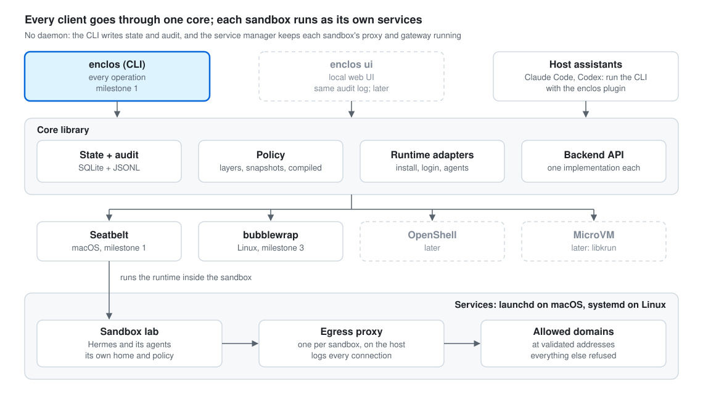

# enclos — design

*enclos* (French for an enclosure, said "ahn-KLOH") is an open-source CLI that creates sandboxes, installs agent runtimes in them (Hermes first, then OpenClaw, Claude Code, Codex, DeepSeek Harness and more) and runs agents there, and keeps a proper state and an audit log of every command. It manages only the sandboxes it creates.

Status: milestones 1 and 2 (§13) are done: their acceptance scenarios passed on 2026-10-22 and 2026-11-01, and 0.1.0 is the first release. Anything else described here comes later. Some sections also say where milestone 1 does less than the design. Target platforms: macOS on Apple Silicon first, then Linux (including Raspberry Pi). Windows through WSL2 later.

This document describes what enclos is and how it works. Decisions that are hard to reverse, and why they were made, are recorded in [`docs/adr/`](adr/). When this document and an ADR disagree, fix one of them in the same change. Three kinds of statement appear below: **decided** (an accepted ADR or plain design text), **proposed** (an ADR with `status: proposed`), and **to verify** (behavior the design depends on that no prototype has shown yet, listed in §14). What the throwaway milestone 1 prototype (`prototype/m1/`, macOS 26.5.2, Hermes 0.22.2) showed is marked "shown by the prototype", and holds only for what it probed, on one Mac.

---

## 1. Threat model and principles

**Threat model** ([ADR 0014](adr/0014-threat-model-accidental-damage.md)). enclos primarily prevents accidental damage by agents the user mostly trusts: deleting the wrong files, reading credentials, reaching unexpected hosts, or leaving something running outside the sandbox. It is not designed to contain deliberately malicious code exploiting the kernel; that belongs in a VM backend.

1. **Control, not coordinate.** enclos isolates and governs agents. It never routes tasks between agents, delegates work, or models organizations.
2. **The CLI is the product.** Every operation is a command with readable and `--json` output. The web UI, an MCP server and scripts are clients of the same core and write the same audit log.
3. **Manage only what you create.** No background collector, and no scanning the host for agents enclos did not start. Inside a sandbox it created, enclos reads the runtime's own list of agents, to report the ones made there ([ADR 0023](adr/0023-agents-made-inside-a-sandbox.md)), and it imports an agent from the host only from an archive the user names, made with the runtime's own export ([ADR 0026](adr/0026-agents-imported-through-the-runtimes-own-export.md)).
4. **Interfaces everywhere.** Each component has one job behind one interface. A new sandbox technology, secret store or runtime is one new implementation, with no change in the core.
5. **Typed models at every boundary.** Nothing untyped crosses a component boundary. Files on disk carry a `schema_version`.
6. **Never claim isolation that is not enforced or tested.** If a backend cannot enforce a policy field, enclos says so and refuses unless told otherwise. `enclos policy test` checks enforcement with probes that must fail, and reports only what it probed. A probe counts as closed only with a proof that the policy refused it: its control, a harmless check run outside the sandbox, worked, or, for the probes through the proxy, the proxy answered 403. The one exception is a route Seatbelt itself closes whatever the compiled policy says, such as running a setuid program: it is reported closed with a note that Seatbelt, not an enclos rule, closed it. A probe whose failure has another cause is reported inconclusive; a probe that could not run or be checked fails the test, and so does a test where no probe was shown closed by its route's rule: one the `(deny default)` baseline closed, on something it refuses the tool before the rule is reached (likely a lookup; not traced), is reported closed with that said, and does not count, since it reads closed with the rule gone. The report ends with a verdict: `READY` when the test passed, with how many probes were shown closed and how many could not be checked, or `NOT READY` with every reason it failed. A field the host cannot enforce, once its acceptance is recorded, is named in the verdict ([ADR 0038](adr/0038-a-memory-limit-the-host-cannot-hold-runs-unapplied-once-accepted.md)). The report names the routes no probe tries yet.
7. **Network is enforced by enclos, not by the backend.** Each sandbox reaches the outside only through its own egress proxy, which applies the policy's network mode (the public web, or only a domain allowlist), connects only to validated addresses and logs every connection it decides on (§6 says when a record can be missing). The exception ([ADR 0028](adr/0028-a-runtime-listens-and-its-sessions-reach-its-service.md)): a sandbox whose runtime declares a listening service may listen, so what it serves can be reached, and can answer over what it accepted, without the proxy or the network log; and its sessions also reach that service's port. On macOS what it serves can be reached from the host's network too; on Linux the host reaches it only while `enclos dashboard` runs, and only for the user running it ([ADR 0040](adr/0040-on-linux-enclos-dashboard-opens-a-sandboxs-service-to-its-user.md)).
8. **Readable code first.** Small files, explicit registration, no clever abstractions until a third implementation needs them.

## 2. Scope

**v1 goals**

- Create, start, stop, connect to and remove sandboxes from the CLI.
- Per-sandbox policy for files, network, programs, secrets and resources: edit, diff, roll back, test, with an active and a pending version.
- Install a runtime in a sandbox and run several of its agents there, starting with several Hermes sandboxes on a Mac, each with several agents running as background services.
- See each sandbox's network log, denied connections and other denials.
- Keep a state of every sandbox, its sessions and their processes, and an audit entry for every state-changing command.
- Seatbelt backend on macOS first, running while the user is logged in; then bubblewrap on Linux.

**Non-goals**

- Agent-to-agent delegation, task routing, organizations, pull request workflows.
- A collector, or discovery on the host of agents enclos did not create. Agents made inside an enclos sandbox are reported (§9).
- Remote control over chat channels.
- Writing our own isolation primitives: backends wrap OS features and existing VMs.
- Containing deliberately malicious code on the shared-kernel backends.
- Running sandboxes while the user is logged out (for now). The one case where they do is a Linux host where the user turned lingering on (`loginctl enable-linger`): enclos never turns it on itself, and `doctor` says whether it is on and what follows from it (§10).
- Managing another host from this one (for now): run enclos on each host, over your own SSH session if needed.
- Hosting agents for other people (multi-tenant).

## 3. Concepts

| Concept | What it is | Example |
| --- | --- | --- |
| Host | A machine where the CLI runs and keeps its state. Each host is managed locally, by running enclos on it. | `mac`, `pi` |
| Sandbox | A named, persistent isolated environment created by enclos: backend, policy, home folder, mounts, lifecycle state. | `home` (Seatbelt), `pi-bot` (bubblewrap) |
| Policy | What a sandbox may do. Layered on a template, stored as immutable snapshots, compiled per backend. A sandbox has one active policy and at most one pending policy. | `extends = "assistant"` plus overrides |
| Runtime | The software installed in a sandbox to run its agents. One runtime per sandbox. | Hermes, Claude Code, Codex |
| Agent | A named identity of the sandbox's runtime, with its own configuration, memory, skills, sessions and channels. It shares the sandbox's runtime, policy, proxy and secrets, and may be granted secrets of its own, such as its bot's token ([ADR 0036](adr/0036-an-agent-has-its-own-bot.md)). It is not a process and not a permission boundary: the runtime adapter decides how many processes run it, and the sandbox is the boundary. A runtime may have a built-in agent, which exists as long as the runtime is installed and which enclos neither adds nor removes (Hermes's `default`); a runtime without several agents (Claude Code, Codex) has only that one. | agent `main` in sandbox `home` |
| Session | A single use of a sandbox from start to end (an interactive `connect`, an `exec`, or a runtime service) with every process it starts. Each session records the policy snapshot it started under. | `enclos connect home -- main` |
| Audit entry | One record per state-changing command: time, user, host, command, state before and after, result. Append-only, hash-chained. | `enclos policy allow home api.telegram.org` |

Templates are reusable policies: `minimal`, `assistant`, `coding`.

**The sandbox is the permission boundary, the agent is not** ([ADR 0003](adr/0003-sandbox-is-the-permission-boundary.md)). Agents in one sandbox can read each other's files, because they share one policy. Agents that need different permissions go in different sandboxes.

## 4. Architecture

There is no daemon ([ADR 0002](adr/0002-no-daemon.md)). The CLI is a thin layer over a core library. A sandbox's services, its proxy and its runtime's, are ordinary launchd agents (macOS, in the user's login session) or systemd user units (Linux) that `sandbox start` installs. A `connect` with no proxy running and no services installed starts one as a plain process and records it as a session, which `sandbox stop` ends. On Linux the folder units go in comes from the caller's `XDG_CONFIG_HOME`, and the user's manager searches by its own environment: `sandbox start` refuses, before anything is written, when the manager's `UnitPath` does not hold that folder, and a sandbox recorded running with nothing in the folder is refused the same way, since its units may be running from another one. A unit restarts 1 second after a failure, the delay growing to 10 seconds over a crash loop. Interactive sessions run in the user's terminal.

<picture>
  <source media="(prefers-color-scheme: dark)" srcset="diagrams/architecture-dark.svg">
  
</picture>

Every session runs inside the sandbox's policy, under the snapshot it started with.

Each sandbox has a proxy service, `enclos.<install>.<sandbox>.proxy`, and one service per background process its runtime declares, `enclos.<install>.<sandbox>.<service>`, while the user is logged in. A runtime adapter declares zero, one or several services, each under a stable name; Hermes declares one, `gateway`, because its gateway serves every agent ([ADR 0021](adr/0021-one-runtime-service-per-sandbox.md)). `enclos sandbox start` installs them, replacing those already installed, so they come back at each login; if one cannot start, none stays installed. `enclos sandbox stop` removes every service installed under the sandbox's prefix, and `enclos sandbox rm` refuses while any remains, even one with no session recorded. Services are removed outside the state lock, because a runtime service told to end records its end under it. So `sandbox stop`, and `sandbox start` before it installs and when it undoes a failed install, write two audit entries around the removal when the sandbox has services installed (none when it has none): `services remove`, naming the services about to be removed, closed as `ok` before the first goes, then `services removed`, with what was removed and, when a removal fails, what is still installed. If the first cannot be written, for example because the lock was not free in time, `sandbox stop` and `sandbox start` remove nothing and fail; the undo of a failed install removes the services anyway, since none may stay installed and the start's own entry records the attempt. If the second cannot be written, the first still shows the removal began, and the command fails saying whether every service was removed. `<install>` is the first 8 hex digits of the SHA-256 of the enclos data folder with links and `.` resolved: launchd labels are shared by every enclos install of the user (`ENCLOS_HOME`), a sandbox name is unique only within one, and every spelling of the folder must name the same services. Each service runs with the variables that resolve the same folders (`ENCLOS_HOME`, or both XDG folders). The service manager is chosen per system: launchd on macOS, systemd user units on Linux; other systems refuse to start services. A runtime service starts the runtime only once the sandbox's own proxy holds its port: `proxy run --record` records itself after binding it, so a proxy session whose process still runs is the proof. Its service runs `enclos launch <sandbox> <service>`, which runs outside the sandbox, records the session with the service's name, and runs the declared command under the compiled policy in a process group of its own. A `launch` killed before it recorded its end (at logout, by a crash, or by the service manager's timeout) leaves its session open and maybe its runtime running, and the service manager starts `launch` again; so before it starts the command, `launch` stops every session of the same service still open, with the checked stop of §8, and ends each one it stopped; its audit entry names them, also when the start then fails. It stops them rather than refusing to start: the service manager starts a service again to replace what it last started, and a refusal would fail at every restart while the old runtime ran on with nothing to stop it. A member that survives refuses the start instead: its session stays open, and the refusal names each such process (pid and command) for the user to end, after which the service manager's next restart starts the service. Sessions of the sandbox's other services are left alone. The command's process group is not the service manager's to signal, so when `launch` is told to end (TERM, as launchd's stop sends) it stops every member of the session, TERM then KILL, before recording the end; the service's stop timeout gives the service manager's wait room for both and for recording the end. A program still running after both, or one `launch` cannot stop because `ps` fails, is recorded as a failed end that says why, and its session stays open. While the service runs, `launch` also reads the files its runtime reads only as its services start, Hermes's `config.yaml` and `.env` for the home and each agent ([ADR 0031](adr/0031-a-service-restarts-when-its-runtime-settings-change.md)). It reads them every 2 seconds, as `enclos status` reads the home (§9), without following a link and at most 1 MB each, and compares them by content. Once one has changed and read the same for 5 seconds, and no interactive session's program runs in the sandbox, checked under the state lock under which `connect` starts and records its program (the runtime's setup saves each answer as it is given, and its TUI is served by the service), it records a `service restart` audit entry naming the files and sends the program the runtime's restart signal (Hermes: `USR1`, its graceful restart), once, after checking it is still the same process; the program exits and `launch` exits non-zero (75 when the program exited 0), so the service manager starts the service again. A restart that could not be recorded or sent is asked again after the next change, or a minute later, then two, four and so on up to about an hour. In a VM (macOS 26.6.2, Hermes 0.22.4), a line added to `.env` from a `connect` session restarted the gateway once, and a gateway left alone was not restarted, so Hermes does not rewrite these files as it starts; a session that wrote `.env`, then `config.yaml` 20 seconds later, got one restart, a second after it ended. Hermes's own in-chat `/restart` ends the same way: a sandboxed gateway exited 75 and launchd started it again (a development Mac, 2026-10-22). Interactive sessions (`enclos connect <sandbox>`, a shell or the command after `--`) run the same way in the user's terminal, and `enclos exec <sandbox> -- <command>` runs one command the same way for a script or another program. An exec session does not hold back a settings restart, as no person is in a setup or a TUI there. Secrets never sit in a service manager's file. The proxy has one listener port, reserved for the sandbox when it is created, so adding an agent never changes the compiled policy, and the network log is per sandbox ([ADR 0024](adr/0024-agents-reached-through-the-runtime.md)). Ports are the host's, but the reservation is the install's: proxy ports come from 41000 to 41999 ([ADR 0028](adr/0028-a-runtime-listens-and-its-sessions-reach-its-service.md)), and creating a sandbox skips the ports its own install's sandboxes have and those something listens on (enclos sees a listener by connecting; a connection the system gave the very port it connects to, which Linux's ephemeral range allows, reached itself, counts as nothing listening and is reset so that it leaves the port free), so another install or user can reserve the same port while this sandbox's proxy is not running. The second proxy to start then cannot listen. It says that another program holds its port and that recreating the sandbox gets another: `connect` refuses with that message, and a proxy service writes it to its log (`enclos logs`) and is started again until the port is free. `enclos logs` shows the last 40 lines of each of the sandbox's service logs, and follows them with `-f`. What the services print comes from the sandbox: the runtime's output, or in the proxy's log what the sandbox asked for. So each line is escaped as `enclos status` escapes the home's text (§9), but not cut, and a log cannot drive the terminal; a line longer than 64 KB is shown in pieces.

**The bridge** (proposed, [ADR 0042](adr/0042-a-bridge-on-each-host-serves-the-mobile-app.md); milestone 4). One more service, the install's rather than a sandbox's: `enclos.<install>.bridge`, which listens on the host's loopback for the mobile app, reached over the user's tailnet through `tailscale serve`. It dials into each sandbox, to a Unix socket in the sandbox home that the runtime's channel plugin listens on, one per agent, so no sandbox gets a new way out. Only paired devices reach it, each with a key in its own hardware, a Noise handshake on every connection and the caller's tailnet identity checked; the agent's plugin accepts only the bridge. The protocol between them is enclos's, `docs/protocol.md`. None of this is built, and the socket in the sandbox home is to verify on both backends (§14).

**Archived conversations** (proposed, [ADR 0049](adr/0049-conversation-archives-belong-to-the-bridge.md)). The bridge keeps archived state alongside a conversation's name and read position, owned by the person who started it and synchronized to that person's paired devices. Ordinary direct and group conversations share the same archive/unarchive operation. Home cannot be archived, so its scheduled output and notices keep a permanent place in the active Inbox; the bridge refuses it and the app omits its Archive action. An owner may still unarchive a Home archived by an older bridge, retaining its identity and history; there is no automatic migration of that legacy state. The app sets an archived conversation aside from its active Inbox and unread counts, with an Archived view for search and restoration. Its id, history, attachments, name, read position and members remain; new activity leaves it archived and group work continues. Nothing calls a runtime's archive API, resets its context, stops its work or changes its saved memory. A future OpenClaw plugin therefore uses the same device protocol without an archive-specific method.

**Sandbox policy requests** (proposed, [ADR 0046](adr/0046-the-hosts-person-approves-sandbox-policy-scopes-from-the-phone.md)). The bridge collects proxy allowlist and private-address refusals and requests from an agent's plugin. Host-attributed diagnostic probe traffic remains blocked and logged but does not enter the approval inbox; ordinary traffic to the same address is still eligible. Policy tests register an expiring random marker in protected diagnostic metadata, which the proxy verifies when logging each attempt. The host's person sees them above Groups in the app inbox and may review one destination or writable path, approve its persistent scope or deny it. Only that person's still-paired devices may decide, and no decision is accepted while the transport cannot identify the host's person. Existing pairings of that person carry this policy authority; a lost phone must be unpaired. The engine rechecks the preview under the state lock and refuses unrelated edits, pending changes, stale previews and protected paths. Filesystem grants follow the existing sandbox restart rules; network-only grants take effect through the proxy. Both decisions are audited, and active grants are supplied to every agent's plugin as advisory context, at reconnect and after a decision. A decision never executes an agent's command on the host or automatically replays the attempted action. Sensitive read denials cannot be removed by this surface. Hermes detects concrete file tool denials and has an explicit request tool; arbitrary shell filesystem denials require that tool. This is not complete OS denial telemetry.

**Policy management from the phone** (proposed, [ADR 0047](adr/0047-the-hosts-person-manages-sandbox-policy-from-the-phone.md)). The sandbox page shows active access, accepted grants and inherited settings. The host's person can add, edit and remove filesystem and network entries and change resource limits for that sandbox; shared templates are unchanged. A host-generated preview names every effect and any restart, and the engine rechecks the exact edit under its state lock. Protected built-in read denials remain locked; secret references are read-only. All operations require a still-paired owner device; edits are audited and refresh every agent's active-policy context.

**Static HTML artefacts** (proposed, [ADR 0048](adr/0048-artefacts-are-static-html-attachments.md)). An agent sends a self-contained UTF-8 HTML file through the existing conversation attachment path, and the app opens it in a separate offline viewer. Inline CSS and data images or fonts provide the page's layout; scripts, network access, local files, forms, automatic outgoing navigation and native bridges are unavailable. Same-page anchors stay in the viewer; deliberately tapping a main-frame HTTP(S) link opens the website in the preferred browser's Custom Tab on Android where supported, using the browser's normal state and capabilities. Redirects, subframes, navigation without a user gesture and other schemes cannot launch the browser from the private page. Message text remains native markdown with literal HTML. The channel hint teaches agents to send a page with `MEDIA:/absolute/path/page.html` and describes these limits. The bridge stores and delivers it as any other attachment, with the same conversation ownership checks and no page service. The app's spec owns the platform rendering details; the restrictions still need platform probes (§14).


**Routines** (proposed, [ADR 0050](adr/0050-routines-stay-with-the-runtime.md)). An agent's runtime keeps and executes its scheduled tasks; the app manages them through an optional typed `routines` channel capability. The bridge authorizes live, correlated controls from the host's person on a still-paired device and validates app delivery targets against that person's direct/Home conversations with the same agent. It never keeps a second schedule or executes a supplied command. Hermes is the first adapter; another runtime, including OpenClaw, can implement the same contract with its own scheduler. The editor offers the runtime's supported advanced settings, preserves native settings it does not understand and uses the runtime's reported scheduling timezone. Editable-definition revisions reject stale saves. Dispatched controls are not queued or automatically retried after a lost reply; the person refreshes before deciding whether to retry. Scripts and working directories remain subject to the sandbox's policy. [Research evidence](research/hermes-routines.md) distinguishes source-confirmed behaviour from the private mobile app's supplied screenshots.

**Agent display names** (proposed, [ADR 0051](adr/0051-agent-display-names-belong-to-the-bridge.md)). The bridge keeps an optional shared human name for each listed agent, independently of its stable identifier. The host's person can set or clear it from a still-paired device; all paired people who can see that agent see the same confirmed name. For example, `comptoir-dev` can appear as **Gégé Commit**, while its address and `@comptoir-dev` handle keep working. The operation changes no runtime identity, path, configuration, memory or prompt. The bridge persists and records edits with a per-agent revision; clearing retains the revision, and apps keep the newest observed name across cache, lists and broadcasts. This generic presentation metadata needs no runtime-specific plugin method. [The wire contract](protocol.md#agent-display-names) defines validation, capability detection and stale-edit handling.

## 5. Isolation backends

The table says what each backend is designed to enforce. Seatbelt is implemented, since milestone 1. bubblewrap is milestone 3's: Linux builds register it, so `sandbox create --backend bubblewrap` works where its probe passes, and its cells say what it is designed to enforce; its own escape probes, which `policy test` runs, show what holds on the host they run on (below, bubblewrap's escape probes). OpenShell and a microVM come in 4.4. A Seatbelt cell that starts with "planned" is not in milestone 1, which refuses a policy that sets it.

| Policy field | Seatbelt (macOS) | bubblewrap (Linux) | OpenShell | MicroVM (libkrun, Firecracker) |
| --- | --- | --- | --- | --- |
| Isolation level | process, shared kernel | process, shared kernel | container, shared kernel | VM, own kernel |
| File writes | yes | yes (mount namespace, and Landlock where the kernel has it; the mounts alone where it does not, [ADR 0037](adr/0037-landlock-where-the-kernel-has-it.md)) | yes | yes |
| File read deny list | yes | yes (paths not mounted; inside a grant, masked empty) | yes | yes |
| Programs allowed | planned: `process-exec` rules; milestone 1 refuses an `[exec]` section | partial (mounted binaries + Landlock execute; mounted binaries alone where the kernel has no Landlock, where an `[exec]` section is accepted only explicitly and not applied, [ADR 0037](adr/0037-landlock-where-the-kernel-has-it.md)) | yes | yes |
| Network (via proxy) | yes (TCP to the sandbox's proxy port on loopback only, where the proxy holds both 127.0.0.1 and `[::1]`; for a runtime that declares a listening service, also its service's port on 127.0.0.1, [ADR 0028](adr/0028-a-runtime-listens-and-its-sessions-reach-its-service.md)) | yes (one network namespace per sandbox, joined by its sessions, a Unix socket to the proxy; a runtime's service is reached on that namespace's 127.0.0.1, [ADR 0039](adr/0039-a-bubblewrap-sandbox-has-one-network-namespace-its-sessions-join.md)) | yes | yes (vsock or host IP) |
| Host-service delegation blocked | most routes shown by the prototype and probed by `policy test` (the host-service routes only with `--host-services`, as in CI); the rest to verify (§5, §14) | the sandbox's own `/run`, `/tmp` and network namespace, and masks (§5); `policy test` probes the buses, the `systemd --user` manager and every Unix socket that answers the user on the host (shown in CI on GitHub's Ubuntu runners, and on a Raspberry Pi with a desktop session, §5); at each launch `wrap` also masks every socket listening under the user's home outside the sandbox's own home and workspaces | yes | yes |
| Resource limits | partial: per process, open files, set with `ulimit` as the session starts; CPU time, a memory limit, a file size or a share of the CPU is refused, since a process may ignore SIGXCPU and run past its CPU time, macOS refuses to set a memory limit with `setrlimit`, and does not hold appends to a file size (all three shown on macOS 26.5.2), and enclos has no means to hold a sandbox to a CPU share ([ADR 0033](adr/0033-a-limit-the-backend-cannot-enforce-is-refused-outright.md)) | partial: open files on each process, set with `ulimit` as on Seatbelt; memory and a CPU share on the sandbox as a whole, set on its slice before each of its programs starts; CPU time and a file size refused, not set yet; on a host whose memory controller is missing or not delegated, `memory` accepted only explicitly and not applied ([ADR 0038](adr/0038-a-memory-limit-the-host-cannot-hold-runs-unapplied-once-accepted.md)); what runs have shown is in §7 | yes | yes |
| Tracking every process | partial: process groups, parent chain, recorded members and markers ([ADR 0030](adr/0030-session-processes-hold-a-marker.md)); known gaps in §8 | yes (cgroup) | yes | yes |
| Host processes hidden | no: a sandbox lists the host's processes and reads each one's details through `sysctl`; a `sysctl-read` deny on `kern.proc.` hides the listings but not a read of each pid in turn (shown on macOS 26.5.2), and Hermes lists processes with psutil, so reads are not narrowed | planned: each session its own PID namespace ([ADR 0039](adr/0039-a-bubblewrap-sandbox-has-one-network-namespace-its-sessions-join.md)); a host process is out of a session's sight, its `/proc/<pid>` missing and signals and `ptrace` to it getting ESRCH, and so is another session's of the same sandbox (shown on GitHub's Ubuntu 24.04 runners; `prototype/m3/README.md`); `policy test` probes signals to and `ptrace` of the process it starts on the host (shown in CI, §5, bubblewrap's escape probes); every process still to show (§14) | yes | yes |
| Other processes' start-up environment hidden | no: any process of the user reads it through `kern.procargs2`, Apple's own programs aside, and no Seatbelt rule covers it (shown on macOS 26.5.2, also under `(deny default)`); a `sysctl-read` deny that names it changes nothing; a service whose runtime reads a secrets file (Hermes) gets them through it instead ([ADR 0034](adr/0034-a-service-reads-its-secrets-from-a-file-its-sandbox-alone-reads.md)) | planned: each session its own PID namespace ([ADR 0039](adr/0039-a-bubblewrap-sandbox-has-one-network-namespace-its-sessions-join.md)); a host process's `/proc/<pid>` is missing, so its environment cannot be read, and the prototypes found no process outside the session to read, another session of the same sandbox included (shown on GitHub's Ubuntu 24.04 runners; `prototype/m3/README.md`); `policy test` probes the environment of the process it starts on the host and of a process of each other sandbox that runs one (shown in CI, §5, bubblewrap's escape probes); every process still to show (§14) | yes | yes |
| Change without restart | network only | network only | network only | network only |
| Subscriptions work as-is | to verify (§12) | to verify (§12) | needs token delivery | needs token delivery |

**Security level, honestly stated.** Seatbelt and bubblewrap share the host kernel and user: they are designed to stop a misled agent from reading `~/.ssh` or deleting repos, not deliberately malicious code exploiting a kernel bug. That fits the threat model. Agents that read untrusted outside content with a shell, or run untrusted code, belong in a container or microVM backend. Most real risk is an agent misusing permissions it was given (exfiltration through an allowed destination, deleting its workspace), which only a narrow policy and logging address, on every backend. On macOS, sharing the user also means a sandbox can read the start-up environment of the user's other processes, Apple's own programs aside, and of other sandboxes' sessions, which Seatbelt cannot deny (the table above): a secret exported in the user's shell to another tool is readable from a sandbox, and enclos gives a Hermes service its secrets through a file instead ([ADR 0034](adr/0034-a-service-reads-its-secrets-from-a-file-its-sandbox-alone-reads.md)). On Linux, the Chromium that Hermes installs runs in a bubblewrap sandbox only with its own sandbox off (`--no-sandbox`): with it on, Chromium aborts at start, since the sandbox makes no user namespace. So the browser rests entirely on enclos's sandbox, with no isolation of its own around a renderer (shown on GitHub's Ubuntu 24.04 runners; `prototype/m3/README.md`).

**Filesystem defaults** ([ADR 0015](adr/0015-broad-reads-narrow-writes.md)). Reads are broad, except a sensitive-path deny list. Writes go only to the sandbox home and to workspaces the user grants. A workspace is a folder of its own: `validate` refuses one inside the sandbox home or inside another workspace, and one whose path goes through a symlink that sits inside the home or a workspace, since the sandbox could point that link elsewhere. A symlink the user made outside every folder the sandbox writes is fine: the sandbox cannot change it. The sandbox may change anything inside its home and each workspace, but not the folder itself: the compiled policy denies removing, renaming (swaps included) or creating the home and each workspace at its exact path, so each stays the folder the policy was compiled for and never becomes a link elsewhere (on Seatbelt, `file-write-unlink` and `file-write-create` on a `literal` path; shown by tests with `sandbox-exec`, and probed by `policy test`). On bubblewrap, enclos runs first inside the sandbox, applies Landlock where the kernel has it, then runs the command; the home and each workspace are mount points under a read-only parent, so renaming either is refused (EROFS), and a write anywhere else is refused by the mounts before Landlock is reached, with Landlock and without; Landlock's execute rule refuses a program in a workspace (EACCES), which runs without Landlock (shown on GitHub's Ubuntu 24.04 runners; `prototype/m3/README.md`). The `/proc` rule, without Landlock's `TRUNCATE` right, refuses Chromium's writes to its renderers' `oom_score_adj`: pages load, but Chromium cannot rank a renderer to be killed before the browser when memory runs short; a shell's write there with `O_TRUNC` is refused without `TRUNCATE` and passes with it (shown on GitHub's Ubuntu 24.04 runners; `prototype/m3/README.md`). `enclos inside` grants `TRUNCATE` on `/proc`, as `inside.py --proc-truncate` does; whether that ends Chromium's refusals is still unshown. So a workspace must exist before the sandbox uses it: the sandbox cannot create it, and `policy test` on Seatbelt reports one not made yet as not run. The initial deny list on macOS covers `~/.ssh`, `~/.gnupg`, `~/.aws`, `~/.azure`, `~/.config/gcloud`, `~/.kube`, `~/.docker`, `~/.netrc`, `~/.npmrc`, `~/.pypirc`, `~/.git-credentials`, `~/.config/gh`, other tools' logins (`~/.config/hub`, `~/.config/glab-cli`, `~/.config/rclone` and `~/.rclone.conf`, `~/.cargo/credentials.toml` and `~/.cargo/credentials`, `~/.gem/credentials`, `~/.pgpass`, `~/.my.cnf`, `~/.mylogin.cnf`, `~/.vault-token`, Terraform's `~/.terraform.d/credentials.tfrc.json`, the Vercel CLI's folder, Hugging Face's token files at their default location), shell, REPL and pager history files (`~/.local/share/atuin` included), `~/Library/Keychains`, `~/Library/LaunchAgents` (Hermes reads the host's own service definitions there, because it finds the home through the password database rather than `HOME`), browser data folders (Chrome and its Beta, Canary and Dev channels, Chromium, Brave, Edge, Arc, Firefox, Vivaldi, Opera, Orion, and Safari's `~/Library/Safari` and its container), the site data apps keep through macOS's web stack (`~/Library/Cookies`, `~/Library/HTTPStorages`, `~/Library/WebKit`), `~/Library/Mail` and Mail's container, `~/Library/Messages`, the data of Notes, Contacts, Calendar and the default Photos library, password-manager folders (1Password and its CLI, Bitwarden and its CLI, Proton Pass, KeePassXC's settings, `pass`), the configuration and logins of the host's own assistant tools (`~/.claude`, Claude Desktop, `~/.codex`, `~/.hermes`, `~/.gemini`, Cursor, opencode), other sandboxes and enclos's protected paths. Milestone 3 adds Linux's places (browser data under `~/.config` and `~/.mozilla`, client certificates in `~/.pki`, snap and Flatpak apps' data in `~/snap` and `~/.var/app`, mail, messaging apps, the keyrings in `~/.local/share/keyrings`, KWallet, password managers and their SSH agents' sockets, the user's systemd units and autostart entries, rootless Docker's and Podman's sockets and storage, LXD's and Incus's folders) to the same list, and the messaging apps' places on macOS: it is one list for both systems, where an entry for the other system names a path that does not exist, so a `policy.toml` resolves to the same policy on a Mac and on Linux (§13, milestone 3's acceptance scenario, step 2). Apple's apps are on the list although TCC usually hides their data, because a terminal with Full Disk Access passes that access on (below). Some folder names on the list have not been checked against the apps yet (§14). An entry hides only the place it names: a KeePassXC database, a Photos library elsewhere, or a token moved by an environment variable needs a policy's `read_deny_add`. Two entries move with their variable, for writes: on Linux enclos also protects `$XDG_CONFIG_HOME/systemd/user` and `$XDG_DATA_HOME/systemd/user`, as the variables stand where the policy is checked or compiled, so a write grant at, inside or holding one is refused and a compiled policy denies writes there, because the user's manager runs what those folders hold outside the sandbox. `~` here is the user's home, never the sandbox home, so files of the same names inside the sandbox home stay the sandbox's own. Paths on the deny list cannot be written either, even inside a granted workspace or the sandbox home: the compiler puts these denials after every write and read allow, so no grant covers them, and `policy test` probes a write of each deny-list path that exists under a write grant. So a write grant, other than the sandbox home, at or inside a deny-list path is an error, both when the policy is stored and each time it is compiled: nothing could be written there, though the grant would read as if it could; a grant that holds a deny-list path, such as a workspace with a denied file in it, is fine. On Linux a grant is the real folder, so such a path cannot be left out of it: at session launch, after the grant's bind, bubblewrap mounts a read-only empty tmpfs over a denied folder and a read-only empty file over a denied file, and the rest of the grant stays as granted. The path then exists but is empty, where on Seatbelt its reads are refused, and the same `policy.toml` works on both (§13, milestone 3's acceptance scenario, step 2). In a writable workspace, a file planted under a masked folder cannot be read (ENOENT), a masked file reads empty, neither can be written (EROFS), a masked folder cannot be renamed, being a mount point (EBUSY), and the rest of the workspace reads, writes and renames, with Landlock and seccomp or with bubblewrap alone (shown on GitHub's Ubuntu 24.04 runners; `prototype/m3/README.md`). A denied path that does not exist in a workspace gets the tmpfs too, so the sandbox cannot make it: being on the real folder, the mount point leaves an empty folder on the host, which stays there, and a later file of that name finds a folder in its way. A workspace that holds entries of the shared list, such as `~/.cargo`, gets one such folder for each of them missing there. A denied path that does not exist in a read-only grant gets no mask: the sandbox cannot make it, and if the user makes it on the host during the session it is visible until the next one. A denial names a path, so the folders that would carry a denied path elsewhere cannot move: the sandbox home, every workspace, and every folder inside them that holds a deny-list entry cannot be renamed, swapped, removed or cloned, while the other files and folders in them can still be made, renamed, removed and cloned (on Linux, for the folders inside them, by a bind of each on itself, not yet shown: §15). Renaming one would otherwise put what it holds under a path no denial names, or move a workspace into the home; cloning one copies everything under it in a single call, so it would copy denied paths with it. Only the sandbox's own moves are stopped: a folder renamed from outside the sandbox, by the user or another sandbox, no longer matches a denial that names its old path. Policies can add entries; removing a default entry is an explicit, audited change. Milestone 1 has no such change, so a policy that leaves out a default entry is refused. The agent installs skills, dependencies and tools into its home: `HOME`, `TMPDIR`, caches, Python and Node environments and a `bin/` on `PATH` all point inside it, and programs installed there may run. The shared runtime under `runtimes/` stays read-only (milestone 1 installs each runtime in its sandbox's home instead, [ADR 0020](adr/0020-runtimes-installed-per-sandbox.md)). Writes to device files the runtime needs (`/dev/null`, `/dev/tty` and similar) are part of every backend's baseline. Terminal devices are not: a session opens only the terminal it runs in, through `/dev/tty` or by its name, and terminals it opens itself, not the user's other terminal tabs and windows (see the routes table below, including its known gap). A service or a probe opens no terminal by name but those its own sandbox opens.

**Protected paths.** Whatever the policy says, every backend denies the sandbox write access anywhere in the enclos data and config folders (`~/.enclos` on macOS; `$XDG_DATA_HOME/enclos` and `$XDG_CONFIG_HOME/enclos` on Linux) except its own `home/`, and read access to `state.db`, `state.lock`, `audit.jsonl` and its `audit.jsonl.torn-*` files, `config.toml`, the file secret store, the proxies' control sockets and other sandboxes' folders. The compiler adds these rules itself, and `validate` rejects a policy that tries to grant them, including through a broad path such as `~` or a workspace that contains them. `validate` compares paths after resolving symlinks and `..`, so a workspace symlinked into these folders is rejected too. `validate` also rejects a write or deny-list path holding a double quote or a backslash, which the Seatbelt compiler refuses rather than escape, so such a policy never becomes active. A symlink can change after a policy is stored, and the compiler resolves paths as they are when it runs, so each time enclos compiles a policy it checks again: the write checks of `validate` on the paths as they are then, and that the sandbox home is still a real folder, not a link, a file or missing. If either fails, enclos refuses to compile the policy, so no new session, service or `policy test` starts in the sandbox until the user fixes it; what already runs keeps the policy it started with, and `status` and `sandbox show` report the refusal. This is also why the agent cannot widen its own policy. See [ADR 0010](adr/0010-sqlite-state-and-jsonl-audit.md).

**Host-service delegation** ([ADR 0016](adr/0016-seatbelt-blocks-host-service-delegation.md)). On macOS a sandboxed process can ask a host service to act for it, outside the sandbox. Whatever the Seatbelt baseline, the compiled policy must deny these routes with the Seatbelt operation that actually governs each one (`mach-lookup` for named services, `appleevent-send` for Apple Events, and `job-creation` for launchd job submission, which goes through the bootstrap port rather than a named service), with executable denials only as an extra layer. The routes are:

| Route | Rule in the compiled policy | Evidence (the milestone 1 prototype unless noted) |
| --- | --- | --- |
| LaunchServices: `open`, opening apps, documents and URLs | `(deny lsopen)` | `open <url>` refused. Denying the coreservicesd and launchservicesd lookups alone did not stop it. Under `(deny default)` the probe closes only on the baseline refusing something `open` needs, likely a lookup (-10661; not traced); the rule itself is shown by the `(allow default)` comparison in CI. |
| Apple Events: `osascript`, scripting Terminal or any other app | `(deny appleevent-send)` and a `mach-lookup` deny on `com.apple.coreservices.appleevents` | Either rule alone stops an event to Finder. Under `(deny default)` the probe closes only on the baseline refusing something `osascript` needs to reach Finder, likely a lookup (-1728; not traced); the two rules together are shown by the `(allow default)` comparison in CI, each alone only by the prototype. |
| launchd: submitting or bootstrapping jobs, `launchctl` (through the bootstrap port, not a named service) | `(deny job-creation)` | `launchctl submit`, `bootstrap` and `load` were already refused under `(allow default)`, and an explicit `(allow job-creation)` opened them, so the deny keeps them closed. Writing `~/Library/LaunchAgents` is denied by the write rules and, since it is on the deny list, under any write grant too. With `--host-services`, `policy test` probes it with a file launchd would not load (no `.plist` suffix, not a property list), removed at once if it was written; in a VM (§14), that probe left the folder empty and no new launchd job, and the Background Task Management dump held no items before or after. Bootstrapping or loading a job is not probed by `policy test`; tried by hand in a VM (§14), `launchctl bootstrap` and `load` from a session loaded nothing. |
| Login items through ServiceManagement | `mach-lookup` denies on the background-task and login-item services | The lookups were shown refused. In a VM (§14), registering a login item through Apple Events from a session failed (`-54`), and the Background Task Management dump held no items before or after. |
| cfprefsd, which writes `~/Library/Preferences` for the caller, so the file-write rules never see it | `(deny user-preference-write)` | Without it, `defaults write` wrote the host's preferences folder. |
| The Keychain (the security daemon) | `~/Library/Keychains` on the deny list, and `mach-lookup` denies on the security daemon's services | Either alone makes `security show-keychain-info` on the login keychain fail. With a sandbox's own secret in the login Keychain, `security find-generic-password` run in the sandbox finds nothing while the host reads it, and `policy test`'s "read a keychain item" probe (route `keychain`), which reads an item the host stores for it in the default keychain, comes back closed (macOS 26.5.2). The tests run that probe against a keychain file outside `~/Library/Keychains`, which shows the security daemon's block alone. |
| Unix sockets to host services, such as the SSH agent and the Docker socket | `(deny network*)`, allowing only the proxy port and Unix sockets inside the sandbox home (and the service's port on 127.0.0.1, for a runtime that declares a listening service, [ADR 0028](adr/0028-a-runtime-listens-and-its-sessions-reach-its-service.md)) | `connect()` refused. |
| Programs listening on the host's loopback other than the proxy, over TCP or UDP | `(deny network*)`, allowing outbound only to `(remote tcp "localhost:<proxy port>")`, and the proxy listening on that port on both 127.0.0.1 and `[::1]` | Not shown by the prototype. Checked by hand with `sandbox-exec` on macOS 26.5.2: `remote tcp` and `remote ip` both open the port on `[::1]` as well as 127.0.0.1, so a program listening on `[::1]` at that port would be reached around the proxy; the proxy therefore holds both, and refuses to start if either is taken. `remote ip` also let UDP datagrams through to that port on both addresses, where the proxy holds nothing; `remote tcp` refuses them. `remote ip4` and `remote tcp4` open 127.0.0.1 only, and a `remote ip6` deny after `remote ip` refuses both addresses; but on CI's macOS 14 runner `remote ip4` did not let the sandbox reach 127.0.0.1 at all, and Seatbelt accepts only `localhost` or `*` as the host. The Seatbelt backend tests, which CI runs on macOS 15 and 26, check that the sandbox reaches 127.0.0.1 at the proxy port, that `[::1]` at another port is refused, and that no UDP datagram reaches the proxy port on either address. Where `[::1]` is not configured (binding it fails with "address not available"), no program can listen there, so the proxy holds 127.0.0.1 alone (reasoned, not tested); it does not look again, so if IPv6 loopback is turned on later the proxy must be restarted. `policy test` probes `[::1]` at the port: from the sandbox, it must reach the proxy (403) or nothing, and the same request from the host must reach the proxy, which shows the proxy holds `[::1]`; otherwise the probe is inconclusive. |
| Listening on TCP, and reaching the service's port, for a runtime whose adapter declares a listening service ([ADR 0028](adr/0028-a-runtime-listens-and-its-sessions-reach-its-service.md)) | `(allow network-bind network-inbound (local tcp "localhost:*"))`, then `(deny network-bind (local tcp "*:<port>"))` for each port of the proxy range, 41000 to 41999; and `(if (param "ENCLOS_SERVICE") (allow network-outbound (remote tcp4 (param "ENCLOS_SERVICE"))))`, the parameter set to `localhost:<port>` for a session started while the service listens | Listening is in this build: the backend test `a_sandbox_that_listens_binds_any_port_but_the_proxy_ports` shows that without `listen` nothing binds TCP, and that with it port 0 binds on 127.0.0.1, 0.0.0.0, `[::1]` and `[::]` while a proxy port, held or free, is refused on each, and that `policy test`'s bind probes read closed under the compiled policy and open without its deny rules. The service's port is in this build too: in the same test, a session given it reaches a listener there on 127.0.0.1, not `[::1]` at that port when another program holds it (skipped where `[::1]` cannot be bound), nor another listener's port, and a session given none reaches neither; with Hermes 0.22.3, `hermes -p scout chat` through `connect` opened a session in `scout`'s own list (issue #64). Checked by hand with `sandbox-exec` on macOS 26.5.2 (issue #64): the bind needs both operations; `localhost:0` is refused as an invalid port, so Hermes's bind on port 0 needs `localhost:*`; that rule also allows a bind on `0.0.0.0`, and a client on the host's LAN address reached it; no inbound rule on the peer's address (`remote ip`, allow and deny pairs) refused that client while allowing loopback; an exact-port deny after the allow holds on `127.0.0.1`, `0.0.0.0` and `[::1]`, and Seatbelt refuses before the port is found in use, so a refused bind reports `Operation not permitted` even on a port another program holds, where the host gets `Address already in use`; Seatbelt takes no port range or pattern (`*:41000-41999` and `*:41*` are invalid ports), and exact rules cost little up to a point: 1,000 load in about 0.03 s, 2,000 in 0.07 s, 8,000 in 0.9 s; a second sandbox allowed only its own proxy port could not reach a listener held for the first; `(remote tcp4 (param "ENCLOS_SERVICE"))` with `localhost:<port>` reached that port on 127.0.0.1 and not on `[::1]`, and without the parameter neither. So listening on the network is open, not closed, for such a sandbox. |
| Name lookups through mDNSResponder | `(deny network*)`, which closes the `/var/run/mDNSResponder` socket, plus a `mach-lookup` deny on `com.apple.dnssd.service` | `getaddrinfo` and `dscacheutil` fail. The `mach-lookup` deny alone does not stop them. Every lookup happens in the proxy. |
| `at` and `crontab` | none needed | Any Seatbelt policy refuses to exec setuid binaries. Shown on macOS 26.5.2 for PR #52, with read-only commands: under `(version 1)(allow default)` alone, `crontab -l`, `at -l` and `atq` fail, the shell printing `/bin/sh: /usr/bin/atq: Operation not permitted`. So the `crontab` and `at` probes show Seatbelt's own refusal, not an enclos rule: they count as closed only on that refusal to run the program, and the report says Seatbelt closed them. Installing a crontab or submitting a job needs these same programs; no probe tries it, and tried by hand in a VM (§14), both were refused the same way. |
| Synthetic keyboard and mouse events through WindowServer, and the pasteboard | `mach-lookup` denies on WindowServer and the pasteboard, `(deny hid-control)`, an IOKit deny | Lookups refused and `pbpaste` fails. No `policy test` probe posts an event or writes the pasteboard; in a VM (§14), a key event posted from a session was denied the WindowServer lookup (`com.apple.windowserver.active`), and `pbcopy` failed with the pasteboard unchanged. |
| Typing into the terminal a session runs in (the `TIOCSTI` ioctl), which the user's shell would read and run after the session ends | `(deny hid-control)`, and `(deny file-ioctl (ioctl-command TIOCSTI))` | Shown on macOS 26.5.2 in the review of PR #19, not by the prototype: allowed under `(allow default)`, refused by either rule alone, while termios and window-size calls still work. A backend test checks the compiled policy refuses it; no `policy test` probe tries it yet; tried by hand in a VM (§14), it got `EPERM` in a session while the same program outside pushed the character. |
| Other terminal tabs and windows: reading what the user types there, or writing into them | `(deny file-read* file-write*)` on every `/dev/ttys*` device, then allowed for the session's own terminal, which `wrap` names as a `sandbox-exec` parameter, and for terminals the sandbox opens through `/dev/ptmx` (the `com.apple.sandbox.pty` extension macOS grants for them; a `file-issue-extension` deny on that class keeps the sandbox from granting it to itself for another terminal) | Shown on macOS 26.5.2 by backend tests, not by the prototype: another terminal device is refused for reading and writing, with or without a session terminal, while `/dev/tty`, the session's terminal by name (`tty`), `/dev/null` and a terminal opened inside the sandbox (`script`) still work. Without the `file-issue-extension` deny, the sandbox issues itself the extension for another terminal and opens it; with the deny, it cannot. A CLI test shows `connect` run in a terminal opening it by name, and an engine test that a service is named no terminal. `policy test` probes the rule with a terminal it opens itself, opened to read and to write apart, and counts it closed only on Seatbelt's refusal. Known gap: a member that outlives its session keeps the right to open its terminal's name, which macOS may give to a tab opened later. |
| Signals to processes outside the sandbox | `(deny signal)` with `(allow signal (target same-sandbox))` | Hermes in the sandbox listed the host's own Hermes gateway by PID; in a VM (§14), under `(allow default)` alone a sandboxed `kill` ended another process of the user, which enclos's policy refused (`Operation not permitted`). `policy test` probes the rule. |

macOS privacy permissions (TCC) are not part of the sandbox: a process started from Terminal is attributed to Terminal, so it inherits whatever Full Disk Access, Accessibility or Automation grants Terminal has. The read deny list and the rules above must hold without relying on TCC.

The rules above are what the milestone 1 prototype showed, except where a row names another source; the routes still to verify are listed in §14, and `enclos policy test` runs a probe for each route it covers. On the user's Mac, `enclos policy test` runs only probes that cannot act on the host even if a rule does not hold (reads of the sensitive files, and writes of those under a write grant; enclos's files, including the sandbox's own `policy.toml`, or creating it when it is missing, and `compiled/`; other sandboxes; renaming and cloning the folders that cannot move; network, DNS, host sockets, signals, other terminals, Keychain, pasteboard, reading the crontab and listing the `at` queue); the ones that could (LaunchServices, Apple Events, launchd, preferences, and a write in `~/Library/LaunchAgents`, which in a VM left no launchd job and no Background Task Management item, §14) run only with `--host-services`, which CI's macOS runners ask for by name (`ENCLOS_HOST_SERVICE_PROBES=1`). A probe of a file that matters, the sandbox's `policy.toml` or a deny-listed file under a grant, only opens it for writing and writes nothing, so it changes nothing even if the rule does not hold. A deny-list entry that is neither a file nor a folder (a socket or FIFO, which a probe could wait on) is not probed, and the report names it. Some routes are refused by more than one rule, such as the write rules and the protected paths for enclos's files, or the write rules and the deny list for `~/Library/LaunchAgents`: their probe shows the route closed, not that each rule alone holds. Every probe except those through the proxy has a control, run on the host first: the same read, listing or connection with its output discarded, the same open for writing of a file that matters, a check that a folder is writable, or, for a host service, a read-only check that the service is there (Finder running, the user's launchd domain, cfprefsd). A failure that happens anyway, such as reading the crontab of an account without one, or a folder macOS privacy protection (TCC) already hides, is reported inconclusive, not closed. LaunchServices and Apple Events count as closed only with the refusal the rule was shown to give (-54, -600). The rename and clone probes rename and clone each such folder into itself, which the filesystem refuses whatever the policy (`Invalid argument`), so nothing moves or is copied: Seatbelt's refusal (`Operation not permitted`) comes first and closes them, the filesystem's means the call got past Seatbelt, and the same call on the host, which the filesystem refuses there, is their control (when it is not refused that way, the report says how it failed or that it succeeded); launchd jobs, preferences, files written outside and the signal probe's target are checked from the host before and after the probe, and what a probe left is removed, the report saying whether removing it worked. Each probe's script prints a marker first, so a sandbox that never ran it is reported as not run, not as a refusal. Logins therefore use a device-code flow: the runtime prints a URL and a code, and the user opens the URL on the host.

**Linux networking.** A bubblewrap sandbox has its own, empty network namespace, and the proxy is reached through a Unix socket bound into it. Most HTTP clients (Python `httpx` and `requests`, Node, Go) need a TCP address in `HTTPS_PROXY`, so a small relay in the sandbox's namespace (enclos itself) listens on `127.0.0.1:<port>` and passes each connection to the socket. Each sandbox gets one socket and one relay ([ADR 0039](adr/0039-a-bubblewrap-sandbox-has-one-network-namespace-its-sessions-join.md): its namespace holder runs it, outside every session's PID namespace; A session's namespaces, below). A session sees only `run/<sandbox>/visible/`, read-only, which holds the proxy's socket; the rest of `run/<sandbox>/` is host-only (§11). The relay is the enclos binary, run by the namespace holder, so no program allowlist of a session has to permit it, even with `shell = false`, and the agent cannot kill or replace it: it is outside every session's PID namespace, where a session finds no process but its own (as the prototype showed of another session's processes, and CI's `bubblewrap` job of another session's environment), and it can only reach the proxy socket. With no DNS in the sandbox, curl, Python's `urllib`, `httpx` and `requests`, `pip`, uv, git, Node's `fetch` (with `NODE_USE_ENV_PROXY=1`) and npm reach the proxy through it, and a destination the policy does not list gets the proxy's refusal, with Landlock and without (shown on GitHub's Ubuntu 24.04 runners; `prototype/m3/README.md`).

The relay runs in the namespace holder, `enclos holder serve`, on the sandbox's proxy port (A session's namespaces, below); the hidden command `enclos relay --port <port> --socket <path>` runs the same relay on its own, which the tests use. It listens on 127.0.0.1 alone, opens nothing of the enclos folder, and passes each connection to the socket, reading none of it. Each direction runs on its own, so a slow reader slows its sender and holds up neither the other direction nor other connections, and nothing is held beyond one read and the kernel's socket buffers. An end of input ends one direction only, so a client that has finished sending still gets its answer. A failed upload ends the upload alone, so a client whose body the proxy refused unread still gets the refusal; a failed download ends both. A socket nobody answers on closes the connection and is tried again for the next, so a proxy can restart under a relay. How many connections it carries at once comes from its soft `RLIMIT_NOFILE`, two descriptors each, as the proxy's limits do; one over that is closed with nothing said to its client, since the relay does not speak the protocol it carries, and the relay's log says once that it is full, not again until a connection has been carried since. A quiet connection stays: a limit on reading would cut a long download or upload, and the proxy holds the limit on what it serves. The relay applies the proxy's idle limit to what the proxy cannot see: a write that moves nothing for that long fails, and once the proxy has ended a connection a client that sends nothing more has that long before the relay closes it. Its tests run over a loopback port and a Unix socket, outside any sandbox: curl and Python's `urllib` through it to the proxy, a destination the policy does not list refused, also on a large upload it does not read, 64 MB both ways at once through a server that answers while it reads, a half-close from either end, and a stalled reader stopping its sender long before 64 MB. CI's `bubblewrap` job has carried requests through it from a session to the proxy's socket (below, What CI's `bubblewrap` job has shown). Its one-line notices go to the log of the namespace holder's service, in the sandbox's `logs/` folder, which `enclos logs` shows and no session reads, never to a session's terminal.

The proxy runs on the host and opens its socket, `run/<sandbox>/visible/proxy.sock`, with the same decisions, limits and log as on TCP. A bubblewrap sandbox's proxy serves that socket alone, with no TCP listener, so the sandbox's reserved port stays free for `enclos dashboard` ([ADR 0040](adr/0040-on-linux-enclos-dashboard-opens-a-sandboxs-service-to-its-user.md)); it opens the socket once it holds `proxy.lock` in the sandbox's run folder (§11), which only one proxy of the sandbox holds, as the port does for a Seatbelt sandbox's proxy, which opens the socket once it holds its port. It takes over a socket nothing answers on, as after a proxy that was killed. What happens when it cannot open the socket, for a path too long for a Unix socket, a folder it cannot make or anything else, goes by the sandbox's backend. A Seatbelt session reaches the proxy over TCP, so its proxy says so on stderr and serves its port alone, and the sandbox loses nothing. On every other backend a session has no other way out, so the proxy does not start, and says why.

**A session's namespaces** ([ADR 0039](adr/0039-a-bubblewrap-sandbox-has-one-network-namespace-its-sessions-join.md)). A bubblewrap sandbox has one network namespace, and every session of it, its runtime's service included, joins it. So a session reaches its runtime's service ([ADR 0028](adr/0028-a-runtime-listens-and-its-sessions-reach-its-service.md)) on 127.0.0.1, as on macOS, and whatever else another session listens on, and nothing on the host's loopback or of another sandbox. Each session keeps its own PID and IPC namespaces, so it sees no other session's processes.

- A namespace holder keeps the namespace in being: a process in bubblewrap, without `--dev /dev`, which would nest a second user namespace, in user, PID and network namespaces of its own. It is a service of its own, `enclos.<install>.<sandbox>.holder`: the service manager runs `enclos holder run <sandbox>`, which binds the namespace holder's two sockets in the sandbox's host-only run folder, this user's alone, `holder.sock` and its way in from the host, `inward.sock` ([ADR 0040](adr/0040-on-linux-enclos-dashboard-opens-a-sandboxs-service-to-its-user.md)), and runs bubblewrap running `enclos holder serve` in those namespaces, with both handed over in one message on its stdin. That listens on both from inside, so `holder.sock`'s peer credentials name it, runs the sandbox's relay on 127.0.0.1 at the sandbox's proxy port, relays each connection on its way in to 127.0.0.1 in the namespace at the port the connection names first (§6, The runtime's own service on Linux), and hands each connection to `holder.sock` the descriptors of its user then its network namespace, with its namespace's ephemeral ports. `sandbox start` installs it with the other services, and a session of a sandbox that was never started (`connect`, `exec`, an installer, an agent command) installs it alone and waits for it; it stays until `sandbox stop`. Nothing enclos does replaces one that answers: `sandbox start` keeps it, as a new one would split the sandbox, and `sandbox stop` and `sandbox restart` end it with the sessions and services. One that exits is started again by the service manager, as any service is, which splits the sandbox until `enclos sandbox restart` (below, the service's port). A runtime may not name a service of its own `holder`.
- A session joins the `nsenter` way, with no `nsenter`: its first step, a service's included, is `enclos holder join`, which runs `enclos holder enter`. That, in a process with one thread, as entering a user namespace needs, asks the namespace holder for its descriptors, received closed on `exec`, enters its user namespace, which gives it every capability there, then its network namespace, which that user namespace owns, and becomes bubblewrap. `join` stays on the host, in none of the sandbox's namespaces, and waits for bubblewrap, its child, to start it again when its setup meets a mount that changed (below, What `wrap` does at each launch). bubblewrap, run by a user with no capability once it is exec'd, makes the session's nested user namespace and its own PID and IPC namespaces, and no network namespace: the compiled arguments hold no `--unshare-net`. A namespace holder that does not answer stops the session before bubblewrap runs. No process of a session holds a namespace descriptor.
- enclos reads the service's port from the host, as ADR 0028 says, from the namespace holder's `/proc/<pid>/net/tcp` and `tcp6`, its pid taken from the socket's peer credentials, and the socket descriptors of the service's program, which is the second process of its session's PID namespace: bubblewrap runs `enclos inside` as the first, and the command is the first process that one starts. Another session can listen in the ephemeral range too, so the port is the one that program holds, and only when no other process of the namespace holds 127.0.0.1 there; the ephemeral range is the namespace's own, which the namespace holder reads and hands out, not the host's (no host whose own range is not the kernel's default has been tried). enclos's proxy ports are on the host's loopback, so a service holding one in the namespace is not refused. A service that is not in the namespace holder's network namespace, as after the namespace holder started again, is refused, and the message names `enclos sandbox restart`. A session is given no port: it reaches the service on 127.0.0.1 whenever the service listens, so `connect` waits only while it does not, and a session open across a restart of the service reaches its new port.
- A session sees `run/<sandbox>/visible/` of the sandbox's run folder, read-only, which holds the proxy's socket. The namespace holder's sockets, which hand out the sandbox's namespace descriptors and are the host's way to the service, and the port records stay in the host-only `run/<sandbox>/`, which no session mounts.
- Every bubblewrap session names its loopback in `NO_PROXY` and `no_proxy` (`127.0.0.1,localhost,::1`): that loopback is the sandbox's own, so a client reaches the runtime's service, and what another session listens on, directly, not through the proxy, which refuses loopback. A Seatbelt session's loopback is the host's, so its `NO_PROXY` stays empty.
- Abstract sockets belong to a network namespace, so a sandbox's sessions share them and only Landlock's scope separates them: without Landlock, as on Raspberry Pi OS, sessions reach each other's.

Shown on GitHub's Ubuntu 24.04 runners, x86_64 and arm64, and Ubuntu 26.04 runner, x86_64, with Landlock and without (`prototype/m3/README.md`). A joined session reached the service on 127.0.0.1, could not find its process, and kept seccomp, `--disable-userns` and no capability over the namespace; Hermes 0.22.5's chat, in another session and PID namespace than its gateway, reached the gateway and went on to the model without starting a gateway of its own. A namespace holder restart splits the sandbox, so the namespace holder restarts only with its sessions and services (ADR 0039).

What this build does is shown by CI's `bubblewrap` job (below, What CI's `bubblewrap` job has shown) and on a Raspberry Pi 5 with Raspberry Pi OS (Debian 13, kernel 6.18.50+rpt, no Landlock, bubblewrap 0.12.0, systemd 257), with Hermes installed and logged in: `sandbox start` installed the proxy, the namespace holder and the gateway as services; the gateway was the second process of its session's PID namespace and in the namespace holder's network namespace, and neither it, `enclos inside` nor the bubblewrap that runs them held a namespace descriptor, while the namespace holder held its two; and `enclos exec <sandbox> -- hermes -p default chat -q "Say hello"` started with no wait, its chat reached the gateway's WebSocket on 127.0.0.1 from another session, and the model answered through the gateway and the relay.

**Linux host services.** Linux has its own routes out: the D-Bus session bus, the `systemd --user` manager (which can start units outside the sandbox), and host sockets such as the SSH agent and Docker. A network namespace does not block Unix sockets that live on the filesystem, and a read-only mount does not stop a process from connecting to one, so broad reads must not expose them: bubblewrap masks `/run/user/<uid>` (which also holds the Wayland socket), `/tmp/.X11-unix` (X11 allows keystroke injection), the Docker socket and any socket named in `SSH_AUTH_SOCK`, and the bubblewrap backend's own escape probes cover them (below). The system bus (`/run/dbus/system_bus_socket`) is a route too: through it, polkit can let an active local user act through system services (mounting disks, changing the network, powering off) without a password. So is systemd-resolved's socket, a name lookup outside the proxy as mDNSResponder is on macOS. Abstract Unix sockets, such as X11's and some session buses', belong to a network namespace, so the sandbox's own namespace closes them. `AF_VSOCK` is a route a network namespace does not hold: a new namespace's vsock mode is `global` unless the host set `child_ns_mode` first, so on a host that is itself a VM a session could reach the hypervisor at CID 2, or another listener there, past the proxy, its log and the network mode. The filter's `socket_families` is the families a session may open, so it refuses this one and any nobody named (§14). Sockets inside the user's home folder would be reached through the home's mask, which binds folders back read-only, so at each launch `wrap` masks every socket listening under the home (below, What `wrap` does at each launch); 1Password's SSH agent (`~/.1password/agent.sock`) and Bitwarden's (`~/.bitwarden-ssh-agent.sock`) also have deny-list entries, which hold them when they do not listen too. Rootless Docker's and Podman's sockets are not among them by default: both live in the user's runtime folder (`$XDG_RUNTIME_DIR/docker.sock`, `$XDG_RUNTIME_DIR/podman/podman.sock`), and the deny list has no way to name one user's folder, so it names `/run/user`; what the two keep in the home (Docker Desktop's sockets under `~/.docker`, Podman's logins and storage, rootless Docker's storage) has entries of its own. LXD and Incus are as much a way to root as Docker for a user in their group, and their sockets sit outside the home and outside what the sandbox's own tmpfs covers (`/var/snap/lxd/common/lxd/unix.socket`, `/var/lib/lxd/unix.socket`, `/var/lib/incus/unix.socket`), so the list names `/var/snap/lxd`, `/var/lib/lxd` and `/var/lib/incus`, which `wrap` masks after its `/` bind (no run has shown it). A Landlock right that refuses connecting to a socket made outside the sandbox (`LANDLOCK_ACCESS_FS_RESOLVE_UNIX`, Landlock ABI 9) would close them all on kernels that have it, but the rules are written for ABI 6's rights, so no host applies it yet and masking holds them everywhere. On a server install, giving the sandbox its own empty `/run`, `/tmp` and `/dev/shm` covers them: every named socket the user can connect to (the system bus, Docker's, snapd's, systemd-resolved's, journald's, and under `/run/user/<uid>` the user's bus, `systemd --user`'s private socket and gpg-agent's) lives under `/run`, `/var/run` or `/tmp`, and the sandbox reaches none of them, abstract ones included, nor those of an X server, a session bus, GNOME Keyring and an ssh agent started on the host, while a socket in the home outside the deny list is reached (shown on GitHub's Ubuntu 24.04 runners; `prototype/m3/README.md`), which `wrap` now masks at each launch (below, What `wrap` does at each launch). On a Raspberry Pi's desktop session, `policy test`'s probes found the desktop's sockets out of reach too (below, bubblewrap's escape probes); a desktop of Ubuntu or Debian is still to show (§14).

**bubblewrap's escape probes** (`src/backend/bubblewrap/probes/`). `policy test` runs the probes every backend shares and bubblewrap's own, each in a scope of the sandbox's slice as a session's program runs (§8). None could act on the host if a rule did not hold, so none waits for `--host-services`, and each has a control on the host. Linux's own are: the session bus, the system bus and the `systemd --user` manager, each through its own client at the address the host has; every Unix socket listening on the host that answers the user, listed from `/proc/net/unix` as the test starts, less the sandbox's proxy socket and those inside what it may write (enclos connects to each and closes the connection at once, which starts a service that systemd starts on demand, as any client would); abstract sockets, the host's, one enclos listens on for the test, and those listening in each other sandbox's network namespace, read from its namespace holder's `/proc/<pid>/net/unix`, whose control is that the socket is listed there, as the host cannot reach it either (a sandbox's own sessions' abstract sockets are not probed: they share them, [ADR 0039](adr/0039-a-bubblewrap-sandbox-has-one-network-namespace-its-sessions-join.md)); a program enclos listens with on the host's 127.0.0.1; `socket(AF_VSOCK)`; a name lookup through the host's resolver (`getent`); `ptrace` of the process the host starts for the signal probe, and the start-up environment of that process and of a process of each other sandbox that runs one; another sandbox's `secrets/` folder; TIOCSTI on a terminal the probe makes its own; `chage -l`, which reads `/etc/shadow` only with its set-group-ID, and `crontab -l` and `atq`, which bubblewrap's `no_new_privs` closes whatever the policy, as the report says; making a user namespace; mounting; and writing the probe's pid in the user manager's `cgroup.procs`, out of the session's cgroup. The calls go through perl, which `perl-base` puts on every Debian and Ubuntu host, and are read by the errno they get, not by a message in the host's language. Where the host refuses a call too, its control is that it gets as far there as the sandbox refuses it: mounting on a path that is nowhere gets `ENOENT` outside, before any capability is asked, where the filter answers `EPERM`; TIOCSTI gets `EIO` outside where `dev.tty.legacy_tiocsti` is off; `ptrace` gets `EPERM` from Yama outside, and `ESRCH` inside, where the process is not in the session's PID namespace. A path the sandbox may not see is closed when the sandbox reads nothing of it, as a mask is empty, and inconclusive when the host reads nothing of it either, such as an empty `state.lock`. A folder that cannot move is renamed onto a folder beside it that the probe makes and fills, so the filesystem refuses the rename whatever the policy and nothing moves: the home and each workspace have a read-only parent (`EROFS`, which the kernel checks first), and a folder that holds a mask is bound on itself (`EBUSY`); the sandbox home is also removed while it holds `tmp/`, which the filesystem refuses as well. What enclos itself says on a probe's session, such as `enclos inside`'s line that the kernel has no Landlock, is set apart from the probe's answer and said once in the report.

In CI's `bubblewrap` job (runs 42199836519 and 42209106590; GitHub's `ubuntu-24.04` and `ubuntu-24.04-arm` runners with bubblewrap 0.9.0, systemd 255 and kernel 7.0.0-1017-azure, and `ubuntu-26.04` with bubblewrap 0.11.1, systemd 259 and kernel 7.0.0-1019-azure, each with Landlock ABI 8), with a denied folder in the user's home, a workspace holding a denied folder and a denied file, and another sandbox whose session listened on an abstract socket with its `secrets/` folder there, `policy test` was READY on each: 81 of 82 probes closed on 24.04 and 99 of 100 on 26.04 in the first run, two of them by bubblewrap itself, the one left the empty `state.lock`, inconclusive, and none open; every route above was closed, `at` aside, which the runners do not install. The second run added a socket listening in the runner's home, which no deny entry names: its probe read closed, as `wrap` masks it (below, What `wrap` does at each launch), with 82 of 83, 83 of 84 (arm64) and 100 of 101 probes closed. The test fails if any probe reads open or does not run, and requires each route closed. On a Raspberry Pi 5 with Raspberry Pi OS and a desktop session (Debian 13, kernel 6.18.50+rpt, no Landlock, bubblewrap 0.12.0, systemd 257), beside a sandbox whose Hermes gateway ran, `policy test` was NOT READY: 105 of 109 probes closed, two by bubblewrap itself, three inconclusive (an empty `~/.local/share/keyrings`, an empty `~/.netrc` and `state.lock`), and one open, the proxy socket of another enclos install made with `ENCLOS_HOME` in the user's home, which no deny entry named. The desktop's sockets (Wayland's, PipeWire's and PulseAudio's, X11's at its path and its abstract name, GNOME Keyring's, gcr's and OpenSSH's agents, gpg-agent's), the user's bus and manager, Docker's, and the other sandbox's gateway sockets and process were each out of reach, and TIOCSTI, mounting and `AF_VSOCK` got the filter's `EPERM` on that kernel without Landlock. The report said once that the kernel has no Landlock. Once `wrap` masked the home's listening sockets (below, What `wrap` does at each launch), `policy test` on the same Pi, in an install of its own, was READY: 99 of 103 probes closed, two by bubblewrap itself, four inconclusive (the same empty files, and enclos's `run/`, which held the sandbox's own folder alone), none open; the other install's proxy socket and the Pi's own install's sockets were closed.

**Linux seccomp filter.** enclos applies a seccomp filter in the sandbox after Landlock. It refuses at least TIOCSTI and TIOCLINUX, `keyctl`, `bpf`, `perf_event_open`, `userfaultfd`, io_uring, the mount calls and making namespaces. Of these, `keyctl`, `bpf`, `perf_event_open`, `userfaultfd`, `io_uring_setup`, making a user namespace and TIOCSTI's ioctl get EPERM from the filter where the host and bubblewrap alone answer otherwise; bubblewrap already refuses `mount`, and the sandbox's own PID namespace leaves `ptrace` and signals nothing outside to reach (ESRCH), though that says nothing of PID 1 inside (§14). Hermes's installer, `hermes`, pip, uv, git, Node, npm and Chromium (its own sandbox off, driven over the DevTools protocol) run under it (shown on GitHub's Ubuntu 24.04 runners; `prototype/m3/README.md`).

**Linux hosts.** enclos needs systemd 254 or later on Linux, since a session's program runs through `systemd-run --expand-environment=no` (§8) and that option came in 254. Before a session's program starts, enclos reads `systemd-run --version`; below 254, or unreadable, it refuses with no program started, and `doctor` shows the version found and reports the same as a failure. Debian 12, whose systemd is 252, is not a supported target; Debian 13 and Ubuntu 24.04 are.

`sandbox create --backend bubblewrap` and every session of such a sandbox ask the backend's probe first, and are refused where it fails ([ADR 0009](adr/0009-refuse-what-cannot-be-enforced.md)), saying what was found and what to do: Linux; `/usr/bin/bwrap` there (the `bubblewrap` package), at 0.9.0 or later, read from `bwrap --version` (the host's package, never a copy shipped with enclos; 0.9.0 is Ubuntu 24.04's, the oldest any supported target packages and the oldest CI runs; one whose version cannot be read is refused too); user namespaces allowed (`user.max_user_namespaces` above 0, and `kernel.unprivileged_userns_clone` not 0 where the kernel has it); systemd 254 or later, read from `systemd-run --version`, as above; and bubblewrap starting a program with `bwrap --ro-bind / / true`, which needs a user namespace too, so AppArmor's restriction on Ubuntu 24.04 is found there, and named with the profile `docs/getting-started.md` gives. The probe runs once per process, and `doctor` shows each check it made, up to the first that fails, with its fix. Landlock is not required ([ADR 0037](adr/0037-landlock-where-the-kernel-has-it.md)): the backend's capabilities, which `doctor` prints, declare the weaker controls where the kernel has none or an older ABI, read by asking the kernel which rights it supports, which restricts nothing. Linux builds register bubblewrap after Seatbelt; `--backend` still defaults to `seatbelt`, and a Mac's build registers Seatbelt alone.

What the milestone 3 host survey showed (`prototype/m3/README.md` gives each measurement and its source): 64-bit Raspberry Pi OS's kernel does not build Landlock, so no boot option turns it on, and its firmware turns the memory cgroup controller off, so only `cpu` and `pids` reach the user's manager; there the backend runs without those controls, see "Degraded controls on Linux" below. Ubuntu 24.04 restricts unprivileged user namespaces through AppArmor and installs no rule for bubblewrap, so bubblewrap needs one; GitHub's Ubuntu 26.04 runner already has one, and adding 24.04's rule there makes bubblewrap fail (shown on GitHub's Ubuntu 24.04 and 26.04 runners; `prototype/m3/README.md`). On 24.04, bubblewrap as installed fails (`bwrap: loopback: Failed RTM_NEWADDR: Operation not permitted`) and runs once an AppArmor profile for `/usr/bin/bwrap` holds `userns,`, with the restriction left on, and Landlock is active with ABI 8 (shown on GitHub's Ubuntu 24.04 runners; `prototype/m3/README.md`). Debian turns on neither the restriction nor a rule. The bubblewrap packaged ranges from 0.9.0 (Ubuntu 24.04) to 0.12.0 (Debian 13 and Raspberry Pi OS); each one's `bwrap --help` lists every option the prototype's arguments use, and only Ubuntu 24.04's 0.9.0 has run them (`prototype/m3/README.md`). The backend's list is `src/backend/bubblewrap/compile.rs`'s, these same options, which CI's `bubblewrap` job has run under 0.9.0 and 0.11.1 (§5, What CI's `bubblewrap` job has shown).

**Degraded controls on Linux** ([ADR 0037](adr/0037-landlock-where-the-kernel-has-it.md), [ADR 0038](adr/0038-a-memory-limit-the-host-cannot-hold-runs-unapplied-once-accepted.md)). Two controls of the bubblewrap backend depend on the host, not on the backend alone, and where the host lacks one the backend still runs without it:

- **Landlock.** It is applied whenever the kernel has it. Where its ABI is older than the backend's rules need, the rights that ABI has apply as a layer over the mounts, and the rights and scopes it lacks are not held: what they would add rests on the mounts alone, and no mount holds `IOCTL_DEV` or a scope. No run has shown this yet. Whether execute rules apply there is open (§15). Where it is missing, as on Raspberry Pi OS, writes are held by bubblewrap's mounts alone, the seccomp filter is the same, as `policy test`'s probes of TIOCSTI, mounting and `AF_VSOCK` showed there, each refused with the filter's `EPERM` (§5, bubblewrap's escape probes; the filter's other calls are still to show there, §14), and the backend's capabilities declare the weaker execute control: programs are allowed by what is mounted. `policy show --compiled` still shows the compiled Landlock rules there, and says after them, from the same check `doctor` reports, that none of them applies on this host, or, on an older ABI, that they apply only in part (on stderr, and in `--json` as `not_applied_here`); compiling stays pure.
- **The memory controller.** Without it, or without it delegated to the user's manager, a `memory` limit is not applied.

A policy that sets what the host does not enforce (an `[exec]` section, `memory`) is stored, and its sandbox created and started, only with an explicit acceptance (`--accept-unenforced exec` or `memory`), recorded in the audit log as [ADR 0009](adr/0009-refuse-what-cannot-be-enforced.md) asks. Every start then prints one line saying what is not applied, and `sandbox start`'s audit entry lists it ([ADR 0038](adr/0038-a-memory-limit-the-host-cannot-hold-runs-unapplied-once-accepted.md)). `policy edit`, `policy rollback`, `policy refresh` and `sandbox start` take `--accept-unenforced memory`; `exec` joins it once a policy can hold an `[exec]` section. The backend says which fields of a policy its host does not enforce, and the acceptance is kept with the sandbox at the field's value, so later stores and starts need none until the value changes; each acceptance has an audit entry of its own, `accept-unenforced`, naming the sandbox, the field, its value, the policy version and the host's reason. A policy that sets such a field with no acceptance is refused when stored, naming the field, the host's reason and the flag; a start with none, as on a host that lost the controller after the policy was stored, is refused and names `enclos sandbox start <name> --accept-unenforced memory`. `memory` accepted so is not set on the sandbox's slice. One assessment says, for a sandbox's active policy, each field the host does not enforce and its acceptance: kept at the field's value, given by the command running, kept at another value, or missing; every start, `policy test` and `doctor` read it. `sandbox start` says each field in the foreground once its services are installed, whether or not the sandbox has a runtime, and its `--json` lists them; each session's start says them too, so a runtime's service says them in its log. `policy test` runs its probes without such a field, as the sandbox runs, and does not refuse to run when one is not accepted: accepted, the verdict stays `READY` and names the field, as ADR 0038 spells out; not accepted, or accepted at another value, it is `NOT READY`, naming the field and `sandbox start --accept-unenforced`. The text and `--json` list each field with its value, the host's reason and its acceptance. These are shown by tests on a stand-in backend whose host lacks the memory controller, not yet on a host. The host is read as each command asks: `memory` in `/sys/fs/cgroup/cgroup.controllers` and in the user manager's, `user@<uid>.service`. Shown on a Raspberry Pi (Debian 13, kernel 6.18.50+rpt-rpi-2712, systemd 257, whose root cgroup lists `cpuset cpu io pids`) at commit `94eaf37`: a `policy edit` setting `memory = "256M"` was refused (exit 2) naming the field, the missing controller and the flag; with `--accept-unenforced memory` it was stored as policy v2, with an `accept-unenforced` entry naming the sandbox, the field, its value, v2 and the reason; the sandbox's slice then had `MemoryMax=infinity` and no memory files. With `cpu = "0.25"` the slice's `cpu.max` was `25000 100000`, and two sessions spinning at once in its two scopes got 0.13 and 0.14 of a core, against 0.99 and 0.98 with no share. An earlier run, with the limits on each session's scope, also showed each later session saying `memory` is not applied, a 512M allocation going through, `sandbox start` needing no flag with its entry ending `not enforced on this host: resources.memory (accepted)`, and a changed value refused again.

`doctor` reports each degraded control on the host with what is not enforced, the risk and the fix (§10): Landlock, read from the ABI the kernel answers, the active LSMs in `/sys/kernel/security/lsm` and the kernel's build configuration in `/boot/config-<release>`, and the `memory` and `cpu` controllers, read from the root's and the user manager's `cgroup.controllers`, `/proc/cmdline` and whether `/boot/firmware/cmdline.txt` is there: a controller missing from the root while the kernel's command line has `cgroup_disable=` for it, as Raspberry Pi OS's firmware passes for `memory`, is said to be turned off at boot, not missing from the kernel. Each is tested on fixtures of those files, Raspberry Pi OS's as the host survey measured it among them. For each sandbox, it lists each field its active policy sets that the host does not enforce, with its value, the host's reason and its acceptance, from the same assessment as its starts (above), in text and in `--json`; one not accepted, or accepted at another value, says how to accept it and is a problem, as its next start is refused. The same reading of the memory controller decides whether `memory` is applied. The fixes were checked against the sources in `prototype/m3/README.md`; none has been tried yet (§14).

| Degraded control | What is not enforced | Risk | Fix `doctor` gives |
| --- | --- | --- | --- |
| No Landlock: not built (`CONFIG_SECURITY_LANDLOCK` unset), or not in the active LSM list (`/sys/kernel/security/lsm`) | Landlock's execute rules, so an `[exec]` section; the second layer on writes; the separation of a sandbox's sessions' abstract sockets ([ADR 0039](adr/0039-a-bubblewrap-sandbox-has-one-network-namespace-its-sessions-join.md)) | Any program the sandbox can read can run, including one it downloaded or wrote into its home or a workspace; a path mounted writable by mistake has no second check | A kernel built with `CONFIG_SECURITY_LANDLOCK=y`. Where it is built but not active, `landlock` added to the `lsm=` boot option, keeping the modules already listed (the kernel's Landlock documentation). No Raspberry Pi OS kernel has it, so there it takes a kernel the user builds. Untried |
| Landlock's ABI older than the backend's rules need | The rights and scopes that ABI lacks. The rights it has stay applied as a layer over the mounts. Whether execute rules apply there, and so whether an `[exec]` section needs acceptance, is open (§15) | What the lacking rights would add rests on the mounts alone, and no mount holds device `ioctl`s or the scopes | A kernel whose Landlock has the ABI needed; `doctor` names the ABI, 6, and the kernel version that brings it, Linux 6.12 (landlock(7)). Untried |
| No memory controller: `memory` missing from `/sys/fs/cgroup/cgroup.controllers` | A `memory` limit | No memory cap: a runaway agent can exhaust the host's RAM | On Raspberry Pi OS, whose firmware passes `cgroup_disable=memory` (it is not in `cmdline.txt`, so there is nothing to remove there): add ` cgroup_enable=memory` to the end of the single line in `/boot/firmware/cmdline.txt`, reboot, and check that `memory` is listed. Raspberry Pi OS's kernels parse `cgroup_enable=` after the firmware's arguments; `cgroup_memory=1` is not a parameter of theirs and is not needed. Elsewhere, `cgroup_disable=memory` removed from the boot loader's kernel command line. Untried |
| Memory controller not delegated: in the root's `cgroup.controllers` but missing from the user manager's (`/sys/fs/cgroup/user.slice/user-<uid>.slice/user@<uid>.service/cgroup.controllers`) | A `memory` limit | As above | Only where `systemctl cat user@.service` shows a `Delegate=` without `memory` (Debian 13's and Ubuntu 24.04's already delegate `pids memory cpu`): a drop-in, `/etc/systemd/system/user@.service.d/delegate.conf`, holding `[Service]` and `Delegate=pids memory cpu` (`systemd.resource-control(5)`), then `sudo systemctl daemon-reload` and a reboot, since a lingering user's manager outlives a logout. Untried |

**A session's environment.** Every backend gives a sandboxed program the same variables, listed under `wrap` below; what they name on the host comes from the host's system. On macOS, the shell is `/bin/zsh`, and `connect` runs it as a login shell; `PATH` goes on with `/opt/homebrew/bin`, `/usr/local/bin`, `/usr/bin`, `/bin`, `/usr/sbin` and `/sbin`, those that exist; terminal descriptions are looked for in `/usr/share/terminfo`. On Linux, the shell is `/bin/bash`, or `/bin/sh` where there is no bash, and `connect` does not run it as a login shell, since Debian's `/etc/profile` sets `PATH`, which would drop the home's `bin` folders, though Ubuntu's does not (a test pins the shell's arguments on every host, and another runs the shell and reads its `PATH`, which can fail only on a host whose `/etc/profile` sets it); `PATH` goes on with the same folders but Homebrew's; terminal descriptions are looked for in `/etc/terminfo`, `/lib/terminfo` and `/usr/share/terminfo`. The bubblewrap backend's compiled arguments keep these folders mounted, read-only, under `--ro-bind / /`; no run has shown a session using them yet (CI's `bubblewrap` job is to). What Linux has still to show here is in §14, milestone 3.

**What compiling for bubblewrap gives** (`src/backend/bubblewrap/compile.rs`; every line here is what the file says, not what a run has shown). A pure function of the policy and the `SandboxContext`: it reads no file and lists no folder, so paths stay as written, never resolved through a link, and the output is the same on every system. One JSON file, stored in `compiled/` by content:

- **bubblewrap's arguments**, with the masks of the user's home left for `wrap` to make at each launch: which entries the home holds is the host's, and a compiled file is kept per snapshot. A session's variables are `wrap`'s too: it empties bubblewrap's own environment and sets them there, since bubblewrap passes on what it is given, and `--setenv` would put a secret on a command line any process of the host reads; the file holds no `--clearenv`. `--new-session` is not compiled (§14).
- **The protected paths and masked host paths**, added whatever the policy says. A protected folder in the user's home joins the deny list; one elsewhere gets a tmpfs of its own, sealed read-only. A root behind a link, such as a data folder on another disk, is two folders: `SandboxContext` holds each root's real path, read when the context is made so that compiling stays pure, and the real folder is hidden the same way, since `--ro-bind / /` shows it whatever its spelling is masked with. For a bubblewrap sandbox, `policy test` also probes each protected file at its real path, as a read of the spelled path can fail for the mask alone. `/tmp`, `/var/tmp`, `/run` and `/dev/shm` are the sandbox's own, so a deny entry under one, such as the default list's `/run/user`, needs no mask. Of enclos's files, only the sandbox's home, `compiled/`, its `secrets/` folder (read-only, for this sandbox alone, and only while it exists: ADR 0034, ADR 0036) and `run/<sandbox>/visible` (read-only) are bound back, so `members/`, other sandboxes and the rest of `run/` stay out. The socket named in `SSH_AUTH_SOCK` is the host's to name, so `wrap` masks it at each launch.
- **`denied_elsewhere`:** a deny entry outside the user's home that nothing the sandbox mounts covers, such as the default list's `/var/snap/lxd`, or a Mac policy's `/opt/secrets`. `wrap` masks each after the `/` bind: a tmpfs on a folder, `/dev/null` on a file, nothing if it is missing, since that area is read-only to the sandbox. A read-only mount does not stop `connect`, so a mask is what closes a socket there, on every host, those without Landlock included; `wrap` uses the same mask for the socket named in `SSH_AUTH_SOCK`. Not shown by any run (§14).
- **Refused:** an entry holding `..`, which `validate` applies after resolving links and the text cannot, so it could name another path than the one checked; a deny entry that cannot be held (the user's home or what holds it, anything under `/dev` or `/proc`, which the sandbox mounts its own of after any mask, or anything at or inside the `secrets/`, `compiled/` or `run/<sandbox>/visible` that compile binds back, where calling it hidden already would be false), a workspace at or inside a deny entry, a workspace that holds or lies inside a protected path, and a workspace that would bring back what the sandbox's own places hide: one at or holding `/tmp`, `/var/tmp`, `/run`, `/var/run`, `/dev/shm`, `/dev` or `/proc`, or inside `/run`, `/var/run`, `/dev` or `/proc`. `/tmp/proj` and `/var/tmp/proj` are allowed. Compile looks at paths as written, and `validate`'s checks on real paths refuse a grant at or inside a deny entry, not one that reaches an entry through a link the user made (§14). These places are the backend's own (`Backend::own_places`), and the workspaces are bound after them, by a bind that follows a link at the workspace's name inside the sandbox: bubblewrap resolves the source on the host and the destination in the sandbox's tree, so `~/alias -> ../../run`, made outside every grant, would put the host's `/run` back over the sandbox's (shown by CI's `bubblewrap` job, below; an absolute link resolves from bubblewrap's own setup root, where, from its source, the bind fails and the session does not start). So `validate` refuses a workspace at, holding or inside one of these places as written and where its links lead, relative or absolute, when a policy is stored and each time it is compiled, and `wrap` again at each launch (below). A Seatbelt sandbox has no such places and takes the same link as any workspace.
- **The order `wrap` keeps:** the host's files, read-only; the masks over them; the sandbox's own places, the protected folders outside the user's home, the writable binds and what is bound read-only; the files enclos staged in the sandbox's `installers/` folder for this launch, each `--ro-bind` on itself (below); the folders inside a writable bind that hold a mask, each bound on itself; the masks inside the writable binds, which a mask made before its bind would not survive; then `--remount-ro` on each folder it made and on each folder of `sealed`, the protected roots outside the user's home that compile gave a tmpfs, so a staged file's mount point can still be made in one. The options whose place does not matter (the namespaces, `--die-with-parent`, `--chdir`) are held apart, and the compiled file holds the arguments in this order.
- **Staged files:** the data folder is hidden, so the files an install stages beside the home (the installer, the home's files) and an import's copy of its archive are not otherwise there. The engine hands `wrap` the files a launch reads, and `wrap` binds each one read-only at its own path, never the folder, so another import's archive stays hidden, and refuses any path that is not a file of the sandbox's own `installers/`. A session that reads nothing staged sees none of it. The installer that runs is the file whose SHA-256 the audit entry names, and the sandbox cannot change it. Not yet shown by a run of bubblewrap (§14). On macOS nothing changes: Seatbelt reads broadly and ignores the list.
- **No `--unshare-net`:** a session joins the sandbox's network namespace before bubblewrap runs ([ADR 0039](adr/0039-a-bubblewrap-sandbox-has-one-network-namespace-its-sessions-join.md); A session's namespaces, above), and the namespace holder serves the one relay, so the compiled file names no relay. A compiled file run without that join would share the host's network, so `wrap` always puts it first.
- **`--as-pid-1`:** what bubblewrap runs is PID 1, so no unconfined reaper is left in the namespace (§14). That program, `enclos inside`, confines itself, then stays as PID 1 and reaps (What a session runs first).
- **`seccomp`:** the calls and `ioctl`s refused, and `socket_families`, the families `socket` may open (§14), for the program bubblewrap runs first to apply.
- **`in_sandbox_home`:** a deny entry inside the sandbox's home, listed whether or not it exists, for `wrap` to mask.
- **Workspaces** are bound with `--bind-try`, so one not made yet does not stop the session, as on Seatbelt, where `policy test` reports it as not run (above). The sandbox's home is enclos's own and stays a strict `--bind`. `wrap` makes no mask for a workspace that is missing, and its Landlock rule has nothing to apply to.
- **`unmovable`:** the folders inside the sandbox's home or a workspace that hold a mask, for `wrap` to bind on themselves (§15).
- **`in_workspace`:** a deny entry inside a workspace, so a workspace that holds one works, as on Seatbelt. It stays out of the home's masks, and `wrap` masks it after the workspace's bind, whether or not it exists (§15). Each entry is sorted here before the arms for the sandbox's own places and the protected paths, or a workspace's bind would bring back what they call hidden.
- **The Landlock rules and the seccomp filter**, which `enclos inside`, the program bubblewrap runs first, applies (below). Programs may run from the system's folders and the sandbox's home, not from a workspace in general. A workspace under one of them can run programs: Landlock's rights add up, so `/opt` grants execute to `/opt/proj` beneath it. The calls of another architecture stay in the list, so the output does not depend on the one that compiles it.
- **`unenforced`:** the policy's fields nothing holds, and on which hosts. Each dependence on ADRs 0037 to 0039 and 0041 is in `src/backend/bubblewrap/proposed.rs`, named while they were proposed, the capabilities included, which depend on the host's Landlock ABI ([ADR 0037](adr/0037-landlock-where-the-kernel-has-it.md)). Files read enforced where the kernel has Landlock with the ABI the rules need, and members on every host, since bubblewrap's escape probes read READY in CI and on a Raspberry Pi without Landlock (above, bubblewrap's escape probes); files stay `Partial` where Landlock is missing or older, saying what stays degraded, as do the network, where `listen = false` is not held, and programs and limits, which no escape probe shows yet. `enclos policy test` shows what holds on the host it runs on. An ABI older than the rules need says what that ABI has, not "no second layer", since the program bubblewrap runs first applies it. `listen = false` is listed there, and each session's start says so in one line on stderr ([ADR 0041](adr/0041-listen-false-on-bubblewrap-runs-declared-and-said-at-each-start.md); §15): ``sandbox <name>: `listen = false` is not held on bubblewrap: nothing refuses bind or listen in the sandbox's network namespace, which its sessions share (enclos doctor)``.

**What `wrap` does at each launch** (`src/backend/bubblewrap/wrap.rs`; tests build its arguments from homes made for them, with stand-ins for bubblewrap; CI's `bubblewrap` job runs it for real, below, and §14 lists what no job tries). Every recorded session starts through `start_session`, as on Seatbelt: the compile, the proxy for a command, `tmp`, the secrets, then `wrap`, the marker, the program in its cgroup scope (§8). `wrap` reads the compiled file and the host as they are at that moment:

- **The home's masks:** each folder from the user's home down that holds a deny entry, or the socket `SSH_AUTH_SOCK` names, becomes an empty tmpfs with its other entries bound back read-only (`--ro-bind-try`, as one may go before bubblewrap starts) and its links made again as links, so a denied path does not exist there. A folder a workspace's bind replaces, whichever name reaches it, is not listed. A folder that cannot be listed refuses the session, since what it holds could not be hidden.
- **Links, resolved at launch:** each workspace and deny entry is resolved with `real_path`. A workspace at, holding or inside one of the sandbox's own places (above, Refused), as written or where its link leads now, refuses the session, whether or not it is there yet, since its bind would follow the link and put the host's place back. An entry whose real path a workspace holds is masked at `<workspace as written>/<relative path>` (`~/cargo -> ~/.cargo`), and a workspace that reaches a deny entry through a link refuses the session. A link between a grant and an entry inside it refuses the session too, as the sandbox could have made it and the mask would follow it. Where an entry leads through a link, as the entry itself (`~/.ssh -> dotfiles/ssh`) or as a folder above it (`~/.config -> ../data` with `~/.config/google-chrome`), is masked too, wherever it is, as Seatbelt denies the resolved path (§15): in the home by the home's masks, in the sandbox's home or a workspace after its bind, elsewhere after the `/` bind, and under the sandbox's own tmpfs, `/dev` or `/proc` not at all, since the host's is not shown there. An entry outside the home that is itself a link is masked where it leads alone, as a mount would follow it there. An entry that leads to the user's home or above it refuses the session. The socket `SSH_AUTH_SOCK` names is resolved and placed by the same rule: inside a grant, the folders between the grant and the socket are bound so they cannot move, and a socket at the home or above it refuses the session.
- **Kinds:** a folder gets a tmpfs; anything else gets bubblewrap's own `/dev/null` bound read-only, which bubblewrap mounts without its device, so the path opens to nothing and a socket there takes no connection: in CI's `bubblewrap` job a file so masked in a workspace read as nothing and took no write, and a socket so masked in the home took no connection (§5, bubblewrap's escape probes). Inside a grant a missing entry gets a tmpfs too, so the sandbox cannot make it; outside one a missing entry gets nothing, as the sandbox cannot make it there.
- **The home's listening sockets:** a read-only mount does not stop a connection, and the home's mask binds back folders that may hold a socket no deny entry names, such as another enclos install's proxy socket. At each launch `wrap` reads the host's listening sockets from `/proc/net/unix`, with no walk of the home, and masks each one whose real path is under the user's home with `/dev/null`, after the home's mask: not one in the sandbox's home or a workspace, which are its own, nor one the home's mask leaves out already, nor one gone since the table was read. Sockets outside the home are as before: the sandbox's own `/run` and `/tmp` hold the host services' (above, Linux host services). In CI's `bubblewrap` job (run 42209106590), a socket listening in the runner's home, which the host connected to, took no connection from a session (§5, bubblewrap's escape probes); on a Raspberry Pi, the proxy socket of another enclos install under the home, which a session had reached, was closed too.
- **The join:** the command starts with `enclos holder join --socket <socket> --`, which runs `enclos holder enter`, which enters the namespace holder's namespaces and becomes bubblewrap (A session's namespaces, above).
- **A mount that changed while bubblewrap set up** (`src/backend/bubblewrap/setup.rs`). bubblewrap before 0.13, which Ubuntu 24.04 (0.9.0) and 26.04 (0.11.1) ship, makes the host's `/` read-only in steps: it binds the whole tree, reads the mount table, then remounts each mount it read. A mount the host takes away in between, as systemd does with a service's credentials under `/run/credentials`, fails its remount, and bubblewrap exits 1 having run nothing: `bwrap: Can't bind mount /oldroot/ on /newroot/: Unable to apply mount flags: remount "…": No such file or directory` (its `bind-mount.c`; CI's `bubblewrap` job met it in run 42408297555, a probe of `policy test` not run). bubblewrap 0.13 sets the flags with one `mount_setattr` call (its source and release notes, not run). So every bubblewrap enclos starts is started again when it exits 1 with that message before its program ran, for a mount found gone (`No such file or directory`, or `Invalid argument` where its folder stayed; a remount refused, `Operation not permitted`, would fail again and is not), up to five starts, 50, 100, 200 and 400 ms apart: a session's through `holder join`, the namespace holder's through `holder run`, and the backend's probe. A session started again says so once on its stderr, before its program's own words; one that met a changed mount at every start is refused with bubblewrap's message, and any other failure of bubblewrap's is said at once, as before. How enclos tells that the program never ran: `join` and `holder run` give bubblewrap a pipe for its stderr, and name the stderr they were given in `ENCLOS_BUBBLEWRAP_STDERR`. The program bubblewrap runs first, `enclos inside` or the namespace holder's `serve`, writes on the pipe, before anything else, words no message of bubblewrap's can hold (they start with a NUL byte), then takes that stderr back, through `pidfd_getfd` on itself, as no `unsafe` code takes a descriptor by its number; so the session's output never passes through the pipe, and its command holds no second copy of its stderr and never sees the variable. A bubblewrap whose program said nothing ran nothing, so starting it again never runs a command twice; once the program has spoken, nothing is started again, whatever the command says and however it ends. `join` is the session's first process on the host: bubblewrap's outer process is its child, which `--die-with-parent` ends with it, and a signal that ended bubblewrap ends `join` the same way, so `connect` reports the session's end as before. The service's program is still the second process of the session's PID namespace, found one step further below the session's first process.
- **The environment** is emptied and set on the join's process, which passes it on to bubblewrap, which passes it on: never `--setenv`, which would put a secret on a command line every process of the host reads. `NO_PROXY` names the sandbox's own loopback (above). bubblewrap runs `enclos inside --compiled <file> -- <command>`, the enclos it was run from; one installed inside a deny entry refuses the session. The marker descriptor is inherited, as neither the join nor bubblewrap closes what it is given.
- **Ctrl-C:** bubblewrap's outer process handles only SIGCHLD and stays in the session's process group, so a terminal's Ctrl-C would end it and, through `--die-with-parent`, the whole session, a program that catches SIGINT included (§8). For a command's session `wrap` starts it with SIGINT and SIGQUIT ignored (`sh -c "trap '' INT QUIT; exec ..."`), and `enclos inside --restore-interrupts` hands both back to the command. `--new-session` is not used, so the session keeps its controlling terminal. A service or a probe runs as before. bubblewrap's `--dev` binds the terminal it runs in as `/dev/console`, and the session holds its standard streams; nothing else of the host's `/dev/pts` is mounted (from bubblewrap's source, not run).
- **The service's port** is not passed: a session reaches its runtime's service in the sandbox's network namespace whenever it listens ([ADR 0039](adr/0039-a-bubblewrap-sandbox-has-one-network-namespace-its-sessions-join.md)).

**What CI's `bubblewrap` job has shown** (`tests/bubblewrap.rs`, run 42189374031 on GitHub's `ubuntu-24.04` and `ubuntu-24.04-arm` runners with bubblewrap 0.9.0 and systemd 255, on kernel 7.0.0-1017-azure, and `ubuntu-26.04` with bubblewrap 0.11.1 and systemd 259, on 7.0.0-1019-azure; each with Landlock ABI 8). Its count check asserts that all 14 tests ran; it has since counted the limits' tests (§7) and `policy test` with bubblewrap's own probes (above, bubblewrap's escape probes) too. Through `enclos connect`, with `wrap`'s arguments, the join of the namespace holder and `enclos inside` for real, every session in the sandbox's one network namespace: a sandbox made with `--backend bubblewrap` runs a session, its first installing the namespace holder; a file planted in `~/.ssh` is not there, and a write in the home works; a write outside the home fails; a listener on the host's loopback is out of reach; a page the template allows answers through the relay and the proxy's socket; another session's `/proc/<pid>/environ`, which the host reads, is not there; on a pty, a terminal's Ctrl-C reaches a program that catches it and the session runs to its end, and ends a program that does not; `doctor` reports the backend; a file staged in `installers/` and named in a launch's reads is read, and not written, replaced or removed, with the file beside it hidden, while an ordinary session sees neither; a listener one session holds on 127.0.0.1 is reached from another `connect` session of the sandbox and refused to a session of another sandbox, which reaches a listener of its own the same way; no process of a session holds a namespace descriptor, inside its PID namespace or, read from the host, the bubblewrap that runs it, while the namespace holder holds its user and network namespaces; with a stand-in for Hermes's gateway listening on `127.0.0.1:0` as a service, `connect` starts its session at once, saying nothing of a wait, and reaches the gateway, which the host's loopback does not have; and a session open while that gateway exits and the service manager starts it again reaches its new port. Each has its control on the host. In the same run, the `confinement` job showed `enclos inside` not dumpable, outside a sandbox (`on_a_runner_enclos_inside_is_not_dumpable`). In run 42389673396, on the same three runners (bubblewrap 0.9.0 and 0.11.1), a link made in the runner's home outside every grant, `~/enclos-ci-alias -> ../../run` or `../../proc`: bubblewrap alone, with a `/run` and a `/proc` of its own and the link bound after them as `wrap` binds a workspace, showed the host's user bus and the host's PID 1, and without that bind neither; through enclos, the link as a workspace, relative or absolute (`-> /run`), was refused when the policy was stored (exit 2), and, pointed at `/run` or `/proc` after the policy was stored with it leading to a folder of the home, refused the session before its program ran; leading to that folder, the session wrote there through it, and saw no host bus and its own PID 1 (`tests/bubblewrap/own_places.rs`). In run 42413906147, on the same three runners, with a tmpfs mounted and taken away every millisecond at `/run/enclos-ci-churn` (above, A mount that changed while bubblewrap set up): bubblewrap alone, the control, failed 3 of 140 starts on `ubuntu-24.04`, 3 of 93 on `ubuntu-24.04-arm` and 3 of 28 on `ubuntu-26.04`, each with `Unable to apply mount flags: remount "/newroot/run/enclos-ci-churn": Invalid argument`; under the same churn, 124, 98 and 62 `exec` sessions all started, the first installing the namespace holder, 3 on each runner started again, and each ran its command once (`tests/bubblewrap/mount_race.rs`). The same run showed `holder join`, the parent of a session's bubblewrap, in the host's user and network namespaces, holding no namespace descriptor; and the `confinement` job, `enclos inside` started as `holder join` starts bubblewrap, its command writing to the stderr given, holding it once, at descriptor 2, and never seeing `ENCLOS_BUBBLEWRAP_STDERR` (`tests/inside.rs`).

**What a session runs first** (`src/backend/bubblewrap/inside/`; run under bubblewrap by `wrap`, as CI's `bubblewrap` job has shown; what CI's `confinement` job has shown is below, and §14 lists what neither job tries). The hidden command `enclos inside --compiled <file> -- <command>` is what bubblewrap runs first. It reads the compiled file and works out nothing of its own: a call, an errno or a scope it does not know refuses the session, before anything is applied. Then, in this order:

1. **Landlock**, on the calling process, for good. Every right of ABI 6 is handled, and a path that does not exist has no rule, as `/lib32` on arm64. The relay is not the session's: the namespace holder serves it (A session's namespaces, above), so nothing starts before the rules apply.
2. **The seccomp filter**, with `seccompiler`, the rules for a name this architecture lacks skipped by a list of those names (`ioperm`, `iopl`, `uselib` on arm64), and `socket` refused for any family but the compiled ones. A call of another architecture's ABI ends the process. That covers x32 too, through a small program of enclos's own: x32 shares x86_64's architecture number and numbers its calls from `0x4000_0000`, so seccompiler's filter alone would pass them.
3. **The command**, as a child of its own. `enclos inside` makes itself not dumpable, so no process of the session can attach to it or write its memory, starts the command, the first and only process it starts, so PID 2 of the session's PID namespace, which is how the host finds a service's program (A session's namespaces, above), and stays as PID 1 to reap every orphan of the session until the command ends, then exits with the command's code, or 128 and the signal that ended it, as a shell gives it. A command that were PID 1 would get no signal it does not catch, as the kernel spares a namespace's first process, so a terminal's Ctrl-C would not end a program that leaves SIGINT alone (§8). If it cannot run, the session ends with exit code 125. Under bubblewrap, CI's `bubblewrap` job has shown a terminal's Ctrl-C end a program that leaves SIGINT alone; the `confinement` job has shown `enclos inside` not dumpable, outside a sandbox; no job tries the reaping of orphans under bubblewrap (§14).

**Landlock older or missing** ([ADR 0037](adr/0037-landlock-where-the-kernel-has-it.md)). The kernel's answer decides, and no step of the session changes but what Landlock holds: with no Landlock the session goes on with the mounts and the same filter; with an older ABI it applies what that ABI has, as a layer over the mounts, as ADR 0037 says. Either way it prints one line on the session's stderr saying so, naming on an older ABI that the rights and scopes it lacks are not held, and nothing when every rule held. A kernel with the ABI needed on which the rules still came out partial refuses the session.

**What CI's `confinement` job showed** (`tests/inside.rs`: all 10 of its tests pass on each of x86_64 (Ubuntu 26.04 and 24.04) and arm64 (Ubuntu 24.04), in run 42189374031). Pure tests run the filter's programs through an evaluator for both architectures. In the job, on both: creating a file in a folder no Landlock rule grants is refused (`Permission denied`, the file not made), a write the rules allow works, with no line saying Landlock was older or missing, and a program in a folder with no execute rule is refused. No mount is involved: the job runs no bubblewrap, in a temporary folder where the same write and the same program work with no rules, and the filter refuses no such call, so these refusals are Landlock's. That covers making a file and running a program, not overwriting, truncating, renaming or removing one. TIOCSTI on the session's own terminal and a user namespace both got `EPERM` under the filter, while neither did with no filter. And `enclos inside` started no process but the command. The job printed Landlock's ABI 8, and kernel `7.0.0-1019-azure` on Ubuntu 26.04 and `7.0.0-1017-azure` on 24.04.

### Seatbelt specifics (first backend)

- `compile` renders a compiled policy (`.sb` file). It starts from `(deny default)` and what a sandbox may do on that baseline ([ADR 0006](adr/0006-seatbelt-deny-by-default.md)): run and fork programs, read files (the deny list below takes away what it names), read `sysctl` values, inspect its own processes, use pseudo-terminals and `ioctl` on what it has open, and look up seven named Mach services (logging, user and group records twice, the per-user temporary folder, the network settings, certificate trust twice: for the Security framework and for Apple's LibreSSL) and read the notification center's shared memory, not post through it: a sandbox that looks the notification center up posts notifications a host process waits for (shown on macOS 26.5.2, `notifyutil`), `diagnosticd` serves the unified log to its readers (Apple's description; not probed, since `log` refuses to run in a sandbox), and no workload failed without them; signals stay within the sandbox by the host-service rules. `ENCLOS_SEATBELT_BASELINE=allow-default` compiles from `(allow default)` instead, only so tests can compare the two: only a debug build takes it (as `cargo build` and `cargo test` make), never a release; another value but `deny-default` is an error; a session or probe run under it says so on stderr and in `policy test`'s report, and `enclos doctor` says when it compares against it; the service manager's job file never carries it; and `enclos launch` refuses to start a service while anything but `deny-default` is asked for. Then: `(deny file-write*)` with writes allowed only to the sandbox home, granted workspaces and the device files the runtime needs; terminal devices denied but the session's own and those the sandbox opens (§5); reads of the sandbox's own home allowed; then `(deny file-read* file-write*)` on the sensitive deny list, after those allows so no grant or the home overrides it (later rules win), an entry that holds the home leaving the home out; `(deny file-write-unlink file-clone)` on each `literal` folder that cannot move (above), because a rename needs `file-write-unlink` on its source, and on its destination when that exists, a removal needs it too, and `clonefile` of a folder needs `file-clone` on it (shown on macOS 26.5.2 by the backend tests: `mv`, a `RENAME_SWAP`, `rmdir` and a `clonefile` of such a folder refused, a workspace that holds no deny-list entry included; `mkdir -p`, `touch`, renames, swaps, removals and clones of the other files and folders inside them still working); `(deny network*)`, which also denies Unix sockets, then outbound TCP allowed only to the sandbox's reserved proxy port on loopback (`remote tcp`, which on macOS 26.5.2 opens `[::1]` too, so the proxy listens on both, above), and for a runtime whose adapter declares a listener, TCP listening on any port but those of the proxy range, and outbound to its service's port on 127.0.0.1 for a session given that port as a parameter (in this build; [ADR 0028](adr/0028-a-runtime-listens-and-its-sessions-reach-its-service.md)); binding, accepting and connecting to Unix sockets allowed only inside the sandbox home (Hermes's gateway binds its control sockets under its home; shown to need this rule); the host-service denials above, including signals outside the sandbox; an optional `process-exec` allowlist when `shell = false` (planned, not in milestone 1); and last, so no policy rule can override them, the protected paths and a `(deny file-write-unlink file-write-create)` on the exact paths of the home and each workspace. Milestone 1 used `(allow default)` with these rules, less the planned allowlist.
- `wrap` runs `/usr/bin/sandbox-exec -f <compiled.sb> <cmd> [args]`, with no `-D` parameter but a session's terminal (below) and, for a runtime that declares a listening service, its service's port (§6, [ADR 0028](adr/0028-a-runtime-listens-and-its-sessions-reach-its-service.md)), in the sandbox home with an emptied environment: only terminal, locale, time zone and user name variables come from the host (`TERM`, `TERMINFO`, `TERMINFO_DIRS`, `COLORTERM`, `LANG`, `LC_*`, `TZ`, `USER`, `LOGNAME`), so tokens in the user's shell never reach the agent; `TERM` becomes `xterm-256color` when the sandbox would find no terminal description for the host's. For a session, when enclos runs in a terminal, it also passes `-D ENCLOS_TERMINAL=<device>`, the first of its standard input, output and error that is a `/dev/ttys` device, so the session can open that terminal by name; a service or a probe gets no such parameter, even when `enclos launch` runs in a terminal. It then sets the sandbox's own: `HOME`, `TMPDIR`, the XDG folders and the tool caches inside the home, `PATH` (the home's `bin` folders first, then the host's system folders), `SHELL` and `ENCLOS_SANDBOX`, and the proxy set for every common client: `HTTPS_PROXY`, `HTTP_PROXY`, `ALL_PROXY` and their lowercase forms (curl reads only lowercase `http_proxy`), an empty `NO_PROXY` and `no_proxy`, plus `NODE_USE_ENV_PROXY=1` for Node's built-in `fetch`. Clients that ignore all of these cannot connect. It also sets `BROWSER=/bin/echo`, since no browser opens from a sandbox: a program that would open one, such as Python's `webbrowser`, prints the URL instead of trying each browser through Apple Events, which the policy refuses, each refusal printing macOS's own errors (Hermes's login, macOS 26.5.2). The prototype showed curl, Python (`urllib`, `httpx`, `requests`), uv, git, Node `fetch` and npm working through the proxy with DNS denied; Node's `https.get` ignores the variables and hangs rather than failing.
- **System temp.** macOS's `/usr/bin/mktemp` (with no template, `-d` or `-t`) and Foundation's `NSTemporaryDirectory()` ignore `TMPDIR` and use the per-user `/var/folders/…/T`, which the write rules refuse (shown: the Hermes installer failed there). The Hermes adapter puts a `mktemp` shim in the home's `bin/` that turns those calls into templates under `TMPDIR` (shown to fix the installer). It does so only for a Seatbelt sandbox: a bubblewrap sandbox runs GNU `mktemp`, which follows `TMPDIR`, and gets no shim (shown on a Raspberry Pi with the Hermes sandbox: in a session, `/usr/bin/mktemp` with no template, `-d` and `-t` each made its file or folder under the session's `TMPDIR`, `<sandbox home>/tmp/`, and the home had no `bin/mktemp`). Programs using Foundation's directory have no such fix: Chrome for Testing does not start while its writes there and under `~/Library` are denied (§14, the VM run).
- **Short home path.** A Unix socket path is limited to 104 bytes on macOS. Hermes binds `<HERMES_HOME>/gateway.sock` and `<HERMES_HOME>/state/gateway.loop-tick.<pid>.sock`, falling back to `TMPDIR`, then `/tmp`. The sandbox home path must leave room for these under each agent's folder (the prototype's longer path failed with `AF_UNIX path too long`). Nothing checks this yet.
- A compiled Seatbelt policy is fixed for the life of the process and its children. Network allowlist changes are live because the proxy enforces them; file, program and resource changes need a restart, which enclos asks for, and which stays pending if the user declines (§7).
- **Denials.** Two sources:
  1. The proxy log: every connection the proxy decides on, with its destination and verdict. This is the main network view.
  2. The macOS unified log: the kernel logs Seatbelt denials, for example `Sandbox: python3(4182) deny(1) file-read-data /Users/alice/.ssh/id_ed25519`. Every deny rule carries `(with message "enclos:<sandbox>")`, which puts the tag in the line, so `log stream --predicate 'sender == "Sandbox" AND eventMessage CONTAINS "enclos:<sandbox>"'` attributes denials to a sandbox, and an admin user can stream without sudo (shown by the prototype). The persisted log (`log show`) keeps only sandboxd's violation reports for some operations (seen for `mach-lookup`), not the kernel's file-write denials, so a history of denials needs a live, bounded consumer of the stream (never an unbounded file: a looping process can log millions of denials); which process runs it is open (§15). A non-admin user cannot: `log stream` says "Must be admin to run 'stream' command" (shown in a VM, §14), so on such an account the unified log gives enclos no Seatbelt denials; the proxy's own log still records network refusals. macOS collapses repeated identical denials.
- `sandbox-exec` is marked deprecated by Apple but still ships and is used by major tools. Track it as a risk.

## 6. Network

**Destinations** ([ADR 0007](adr/0007-network-through-a-proxy-per-sandbox.md), [ADR 0017](adr/0017-proxy-connects-only-to-validated-addresses.md), [ADR 0025](adr/0025-public-web-by-default-for-assistants.md)). The proxy accepts a CONNECT (or a plain-HTTP request) for a host and port, normalizes the host (lowercase, trailing dot removed), and checks it against the policy's network mode. In `public` mode, the `assistant` template's, any host on port 80 or 443 passes this check, and so does anything on the allowlist. In `allowlist` mode, the built-in default, only what the allowlist lists passes. Allowlist entries default to port 443 unless they name a port. Either way, the addresses are checked next, the same way. It then resolves the host itself, since the sandbox is meant to have no DNS of its own (§5, to verify), and validates every IPv4 and IPv6 address it gets:

- always blocked: every entry in the IANA IPv4 and IPv6 special-purpose address registries that is not globally reachable, apart from the IPv4-carrying forms and private ranges below, including loopback, unspecified and `0.0.0.0/8`, link-local (and with it cloud metadata addresses), multicast, broadcast, benchmarking (`198.18.0.0/15`), documentation ranges, the deprecated IPv4-compatible `::/96`, the dummy prefix `100:0:0:1::/64`, and the whole local-use NAT64 prefix `64:ff9b:1::/48`, since an operator may use a longer prefix inside it and where it carries an IPv4 address is then unknown;
- also blocked: any IPv6 address outside `2000::/3`, the only block IANA allocates for global unicast, other than the IPv4-carrying forms and unique-local `fc00::/7` below. This covers a block reserved after this list was written outside `2000::/3`; a block reserved later inside `2000::/3` is taken as global until it is added to the list;
- IPv6 forms that carry an IPv4 address at a fixed place (IPv4-mapped, the well-known NAT64 prefix `64:ff9b::/96`, 6to4 `2002::/16`, Teredo `2001::/32`) are checked as the IPv4 address they carry;
- private ranges (RFC 1918, carrier-grade NAT `100.64.0.0/10`, unique-local IPv6 `fc00::/7`) are blocked unless the host is both on the allowlist and named in the policy's `private` opt-in. The opt-in unlocks only these private ranges, never loopback, link-local or multicast, and applies the same way to IP literals and to hostnames that resolve to private addresses.

The proxy connects only to addresses that passed, by address. Falling back from one address to the next uses the same validated list, and a retry that resolves again validates again. If no address passes, the connection is denied with the reason `blocked-address`.

**International names.** Hosts are compared in ASCII. Milestone 1 does no IDNA conversion: the proxy answers a request for a host that is not ASCII with `400` and logs it denied as `bad-request`, and an allowlist entry or `private` entry that is not ASCII is refused, with a message asking for its `xn--` form. The network log shows such a name escaped, so only its `xn--` form can be given to `enclos policy allow`. Clients that convert the name themselves before asking the proxy are unaffected. Converting such a name to its `xn--` form (IDNA) instead of refusing it is planned, in no milestone yet.

**Server name check.** For a TLS tunnel, the proxy reads the server name in the client's first, unencrypted message (the ClientHello), without decrypting anything: it holds the client's first bytes, those sent with the `CONNECT` request included, until they show whether they are TLS and, if they are, the whole ClientHello, which may span several TLS records. Nothing the client sends reaches the server before that, while what the server sends reaches the client from the start, so a protocol in which the server speaks first, such as SMTP, works, provided the client sends its first bytes within 30 seconds. Bytes that start a TLS record are TLS (a server reads them so), and so is an SSLv2-format ClientHello, which servers built on OpenSSL still take for TLS up to 1.2 and which can name no server: it is closed as `hello-unreadable`. TLS must read cleanly as one ClientHello: a first record that is not a handshake, a version that is not TLS's, a handshake that is not a ClientHello, a `server_name` extension that is malformed, names two hosts or a host that is not UTF-8, an extension given twice, an ECH extension that is not an outer hello's, or a hello that is not whole within 64 KiB (as soon as its records say it cannot be), close the tunnel with the reason `hello-unreadable`, since a server could read a name the proxy cannot. If the name differs from the host the tunnel was opened for (compared without case or one final dot; a tunnel opened for an address matches no host name), the tunnel is closed before the hello reaches the server, with the reason `name-mismatch`. Either way its record turns from allowed to denied, with nothing to allow (allowing the other host lets it be reached directly, not through this one), and the proxy's log says so too. A tunnel opened for a host name whose hello names no server is closed with the reason `no-server-name`, since it would reach whichever site the address serves by default; one opened for an address, for which a client names no server, goes on, and its record says no name was seen. A hello carrying Encrypted Client Hello is compared like any other when its visible name is the host (browsers send an ECH extension of no use, GREASE, with the name they ask for); when its visible name is another, the public name of the server that would decrypt the real one, or when it has none (also for a tunnel opened for an address), the name asked for cannot be compared, so the tunnel is closed with the reason `encrypted-hello`, as one that only claims ECH to skip the check is ([ADR 0035](adr/0035-a-tunnel-whose-name-cannot-be-compared-is-closed.md)). Both are denied with nothing to allow. The hello must be whole within 30 seconds of the tunnel opening, however its bytes trickle in, or the tunnel is closed as idle. The check stops a client that names another site through an allowed one in its first ClientHello, or hides it behind ECH; it does not stop one that names the host and asks for another site in the encrypted requests (classic domain fronting), one whose real ECH names a server that is itself the allowed host and asks it for another site behind it, one that names another only in a second ClientHello after the server asks for one (most servers refuse a changed name there), or a protocol that sends something before its TLS starts, such as SMTP's STARTTLS or PostgreSQL's SSLRequest, which is not TLS to the check. Bytes that do not start a TLS record are another protocol, which the check leaves alone and the log records as not TLS. A client done before it sent anything is told the client side is done like any other; one that stops or goes idle partway through its hello sends nothing up, and its record says so. Shown on macOS 26.5.2 against real hosts: `curl https://example.com` through the proxy got its answer, with `example.com` as the name seen, and `curl --connect-to www.iana.org:443:example.com:443 https://www.iana.org/`, which opens a tunnel for `example.com` and asks it for `www.iana.org`, failed its handshake, closed by the proxy and recorded as `name-mismatch` with the name `www.iana.org`. The proxy's tests show the other cases with hellos they build (several records, no name, ECH with its own name and with another, a server that speaks first, each unreadable case, the cap, a client that stops partway, one that trickles past the deadline), and that a refused hello never reaches the server.

**Unknown destinations.** A destination the policy does not allow (in `public` mode, another port; in `allowlist` mode, anything not listed) is denied at once and logged; nothing is held waiting for an answer. `enclos net denied <sandbox>` lists denied destinations with counts and times, and the user allows what is needed from the host with `enclos policy allow`, which takes effect without a restart: the proxy reads the sandbox's active policy from `state.db` for each new connection (milestone 1; reloads over its control socket come later). The agent cannot widen its own policy: the proxy listener serves only proxy traffic, its control socket (none in milestone 1) will sit in a folder the sandbox can neither read nor write, and enclos's state is not writable from the sandbox.

**What the network log shows.** For HTTPS, one record per tunnel: the host and port asked for, the address connected to, the verdict and reason, bytes each way, and duration; with the server name check, also the server name seen in the ClientHello (escaped and cut to 255 characters, as it is the client's own text), or that none was visible, an ECH public name, that the tunnel was not TLS, that its hello could not be read, or that the client stopped first; `-` for plain HTTP, a refused request, a tunnel still open, or one whose client sent nothing. The proxy does not see the HTTP requests inside an encrypted tunnel, so the log never shows paths, methods or the number of requests made through one tunnel. For plain HTTP, a connection carries one request, and the proxy also records its method and host. It forwards that request with the host it checked as `Host`, the length it read as the one `Content-Length`, and `Connection: close`, then the body its `Content-Length` gives (none without one) and nothing after it: once the client sends more, such as a second request, which could name another site on the same address, the proxy drops it and tells the server the client is done. A plain-HTTP request whose head a server could split another way is refused as a bad request, and recorded with its destination: a `Transfer-Encoding`, lengths that are not one number, or a header line that is not `Name: value` with a token for a name and no control character but a tab in its value (a bare CR or LF, whitespace around the name, a folded line). A tunnel's bytes are relayed as they are, so the proxy looks for no body there. A connection's record is written when the proxy decides on it, so a long tunnel shows while it is open; its bytes and duration are filled in when it closes, with the reason `idle` when the proxy closed it at the idle limit (see Limits), and a tunnel cut off by stopping the proxy keeps none. When the policy allows a destination but the proxy cannot reach it, because the name does not resolve or no address answers, the record says the connection was allowed and failed: it is not a denial and does not appear in `enclos net denied`. The proxy writes its standard error to the sandbox's `logs/proxy.log`, whether its service or a session started it, and `enclos logs <sandbox>` shows that file first. When the proxy cannot get the sandbox's active policy (`state.db` cannot be read, or the sandbox has no active policy), it refuses every connection with the reason `policy-unreadable`, and that log says why: `enclos net denied` lists those refusals as nothing to allow, and `enclos status` suggests `enclos logs <sandbox>` instead of counting them among refused destinations. A proxy probe of `enclos policy test` refused this way shows only that the proxy failed closed, not that the policy refused it; the probes do not tell the two apart yet. Every connection the proxy decides on gets a record, unless writing it fails (a full disk, or a `state.db` it cannot write): the proxy then says so in its log, and the connection goes ahead without a record. A connection over the proxy's limit (`503`), and a request whose request line the proxy cannot read or that never names a destination (`400`), are refused without a record. Whether a connection whose record cannot be written should be refused instead is proposed in [ADR 0027](adr/0027-network-log-completeness-and-retention.md); how long records are kept is open (nothing removes them yet, except removing the sandbox; ADR 0027 lists options). A request whose host is neither a name nor an address is refused as a bad request, and its record keeps only the text after the last `@` and before the first `/`, `\`, `?` or `#`, escaped and cut to 255 characters, so a user or password, path, query or fragment written there is not kept; when nothing is left, an `@` follows the cut, or the host holds a `%` (percent-encoding can hide any of these delimiters), the record holds `<invalid>` instead. Destinations are shown as `host:port`, with an IPv6 address in brackets, so the text can be given to `enclos policy allow` as is; a bad request's record is the exception: it is refused whatever the policy says, so `enclos net denied` lists it as nothing to allow.

**Limits.** How many connections and lookups a proxy runs at once comes from the descriptor limit it started with, its soft `RLIMIT_NOFILE`, which it reads as it starts and never raises: the service manager's for a service, the shell's for a proxy `connect` starts itself, which inherits it. It keeps 24 descriptors for itself, and shares the rest between connections, which take two each, and lookups, which may take one, at the rate of 100 to 32, counting no more than 1024 descriptors whatever the limit, because connections and lookups also hold threads. Under launchd's 256 that makes 100 connections and 32 lookups; under systemd's usual soft limit of 1024, 431 and 137. The proxy serves that many connections at once per sandbox, on all its listeners together, and answers any more with `503`. A client has 30 seconds to send its whole request head, and a tunnel's first bytes 30 seconds to show a whole ClientHello (server name check, above). Resolving a destination's name and connecting to its addresses take at most 10 seconds in all, the address families taking turns; the proxy stops waiting for a lookup at that deadline, whatever the host's resolver does, and records the connection as allowed and failed with `resolve-failed`. A lookup it stopped waiting for still counts until it returns, so that the connections and the lookups together stay within the proxy's descriptors, even if each lookup holds one while the resolver waits; while as many as its limit are running, a new lookup fails at once and is recorded the same way. The network log does not tell these causes from a name that does not resolve, so the proxy says on its stderr, which goes to its log in the sandbox's folder, when a lookup timed out, could not start, or found the lookups full. A tunnel or plain-HTTP connection that moves no byte either way for 10 minutes, or whose client or server reads nothing for 10 minutes, is closed, and its record gets the reason `idle`. A plain-HTTP client that got no byte of an answer is first sent a `504` saying so; a tunnel's client already had its `200`, so the record is all it gets. The limit is generous because runtimes keep long-lived streams (model output, chat long-polling, websockets), and a model request sent without streaming can wait minutes for its answer: 10 minutes is the request timeout of the common model-provider SDKs. The policy is checked only when a connection opens: one opened before a policy change removed its destination stays open until it ends or goes idle.

**What the proxy can and cannot promise.** enclos constrains the connections the sandbox makes, not what the services it reaches do. A remote browser, a search service, an MCP server, or the model provider's own tools (a hosted web search, for example) can fetch other sites on the agent's behalf. Allowing such a service grants that capability: the policy and `enclos policy show` describe it as "remote fetching through <service>", not as network isolation. The same applies to any allowed destination that relays data.

**Host services.** Services on the host's loopback interface or local network are unreachable: there is no loopback exception. Reaching one (a local MCP server, for example) needs a host-service forward: a narrowly scoped mechanism that exposes one named host address and port to one sandbox through its own listener, logged and audited. Host-service forwards are deferred beyond milestone 5; when added, each grant exposes only one named host port to one sandbox, and the exact mechanism remains open (§15). A runtime's own gateway is its sandbox's service under ADR 0028, not a host-service forward.

**The runtime's own service** ([ADR 0028](adr/0028-a-runtime-listens-and-its-sessions-reach-its-service.md), issue #64; the listening, the service's port, `connect` starting the service, and `status` showing the dashboard and naming listeners are in this build). Hermes 0.22.3's chat reaches its gateway only over a WebSocket on a loopback port the gateway picks at start: each client finds the gateway, gets a ticket for its own agent over the gateway's Unix socket in the home, and dials the port the gateway gives. So a runtime adapter can declare its listening service (Hermes: `gateway`). Such a sandbox may listen (§5), and a session started while that service listens is given its port: `wrap` passes `-D ENCLOS_SERVICE=localhost:<port>`, and the compiled policy, the same for every session, allows outbound TCP to that port on 127.0.0.1 alone. enclos takes the port from its records of the service's session, never from a file the sandbox writes: the one TCP port at 127.0.0.1 (not every address, where another program of the user could hold 127.0.0.1 at that port) in the system's ephemeral range that the program it started for the service holds, and no other process holds 127.0.0.1 at that port (a socket sharing it with `SO_REUSEPORT` would get the session's connections) (a bind on port 0 lands there; a port the runtime binds by number, such as Hermes's API server or webhooks, does not), checked to be the same process before and after reading its ports, so a reused PID is not taken for it, and none when there is none or several. Hermes then works as it does outside enclos, each agent and client as itself. `connect` makes sure the service listens first, since a session reaches it only on the port it held when the session started. When the service itself is not installed (nothing of the sandbox is, or only its proxy, as when it was started before its runtime was installed), it installs the sandbox's services as `sandbox start` does, so they start again at each login until `sandbox stop`, and says so on stderr, along with the open sessions' connections being cut when its proxy runs (one an earlier `connect` started, or the proxy service), since the new proxy service replaces it; `--dry-run` says both. A start that fails after removing the services it replaces leaves none; when the proxy service was among them, the session is told so, with `enclos sandbox start` to get them back. When the service is installed, or a session of it is open but not listening yet (one still starting), it only waits: installing the sandbox's services again would stop that service and the proxy. It waits up to 60 seconds for the service to listen, gives up after 15 seconds while no session of it is open, as when it exits at once, and at once for what waiting does not fix (several ports, a port another process shares); a start that fails ends the wait too, and in each case it says why and connects anyway. One `connect` of a sandbox at a time decides and waits, under a lock file in enclos's `run` folder. It starts nothing when the runtime's files are gone from the home (the path its adapter names for `status`), since the service could not run, nor when whether they are there cannot be told, which it says. `policy show` and `policy test` say that such a sandbox's listening is open, and `status` names what in it listens beyond loopback. This is not a loopback exception: a session reaches its own proxy and the port its own sandbox's service held when it started, and nothing else on the host's loopback, until the service restarts, when whatever then holds that port at 127.0.0.1 is reachable from it ([ADR 0028](adr/0028-a-runtime-listens-and-its-sessions-reach-its-service.md), Consequences).

**The runtime's own service on Linux** ([ADR 0039](adr/0039-a-bubblewrap-sandbox-has-one-network-namespace-its-sessions-join.md), [ADR 0040](adr/0040-on-linux-enclos-dashboard-opens-a-sandboxs-service-to-its-user.md)). A sandbox's sessions share one network namespace (§5, A session's namespaces), so a session reaches its service on 127.0.0.1 with no relay, and after the service restarts it reaches the new port with no help. enclos reads the service's port in that namespace, so `connect` waits only while the service does not listen there (§5, A session's namespaces). The host cannot reach a listener in that namespace, on 127.0.0.1 or on every address (`prototype/m3/README.md`). So `enclos dashboard <sandbox>` opens the way: it starts `hermes dashboard --no-open --isolated --port 0` as a recorded session, reads the port that session holds from the host, and serves it on the host's 127.0.0.1 at the sandbox's reserved port, through a Unix socket in the host-only `run/<sandbox>/` and a relay in the namespace, to the user running it and no other, until Ctrl-C. That port is free because a bubblewrap sandbox's proxy serves its Unix socket alone, with no TCP listener: none of its sessions can reach the host's loopback, where such a listener would serve only other local programs. On a remote host the user runs it over ssh with `-L`. `status` names that command and gives no URL. No rule needs to keep a bubblewrap sandbox off enclos's proxy ports, which are on the host's loopback.

In this build, a runtime's adapter names its dashboard's command (`RuntimeAdapter::dashboard`; Hermes: `hermes dashboard --no-open --isolated --port 0`, page `/`), and `enclos dashboard` refuses a sandbox whose listeners the host reaches itself, as on Seatbelt, naming `enclos status`. It takes a lock in the sandbox's host-only run folder, `dashboard.lock`, which the kernel drops however the command ends and which holds what a second run names: its pid, session, address and start; a second run is refused with that, and exits 1. It checks that the namespace holder answers on its way in (one started by an enclos without it is refused, naming `enclos sandbox restart`), then starts the command as an exec session, audited as `dashboard`, in a group of its own, with no input and its output appended to the sandbox's `logs/dashboard.log`, which `enclos logs` shows. Its port is the one the session's program holds in the namespace, read as the service's is (§5, A session's namespaces), within 5 minutes. Then it binds the host's 127.0.0.1 at the sandbox's reserved port and prints the address on stdout (one JSON line with `--json`), and what it serves on stderr. For each connection it reads the owner of the client's end from the host's `/proc/net/tcp` and `tcp6`, the one established line from the client's address to the listener's, and closes it unread unless that names this user: another user, root included, and a connection whose owner cannot be told, are refused, said once per owner on stderr. Each other connection goes to `inward.sock`, naming the dashboard's port in two bytes, and the namespace holder relays it to 127.0.0.1 there, as the relay to the proxy carries its connections. TERM, INT (Ctrl-C) or HUP stop the session's members, TERM then KILL, close the listener, and record the end as `dashboard end`, with why; the command then exits 0. A dashboard that exits on its own, does not listen in time, or holds a port that cannot be trusted (several, or one another process shares) ends the same way, saying why, and exits 1.

Shown on GitHub's Ubuntu 24.04 runners, x86_64 and arm64, and Ubuntu 26.04 runner, x86_64 (CI's `bubblewrap` job, `tests/dashboard.rs`), beside the sandbox's own proxy, serving its Unix socket alone, and with a stand-in for Hermes's dashboard that serves a page holding a token of its own on 127.0.0.1:0: the page served at the reserved port to the user running the command; a second user's connection closed with not a byte, while that user's connection to another local server of this user's was served, and the refusal said with that user's uid; `status` naming the command and no address; a second run refused, naming the first's pid, while the first served on; and SIGINT ending it with exit 0, the port closed, no session of it left open, and `dashboard` and `dashboard end` (told to end) audited.

On a Raspberry Pi 5 with Raspberry Pi OS (Debian 13, kernel 6.18, no Landlock, systemd 257), with Hermes 0.23.0, in a sandbox restarted so that its namespace holder had its way in: `hermes dashboard` listened within 10 s, and the command printed the sandbox's reserved port and held it; from curl on the Pi, `GET /` answered 200 with Hermes's page (1385 bytes, "Hermes Agent - Dashboard") and `/api/status` 200; SIGINT ended it with exit 0, the port closed, its session ended, `dashboard` and `dashboard end` (exit 143, told to end) audited, and the sandbox's services ran on. From another host through `ssh -L`, the connection was reset: that Pi's sshd refuses forwarding (`administratively prohibited`). So `enclos dashboard` from another host needs the host's sshd to allow TCP forwarding (`AllowTcpForwarding`).

## 7. Policy

A policy is TOML that extends a template and overrides only what differs ([ADR 0008](adr/0008-layered-policy-with-declared-enforcement.md)). Layers resolve in order: built-in defaults, template, the endpoints the runtime adapter needs, the sandbox's `policy.toml`. Lists replace (`allow = [...]`) or extend (`allow_add = [...]`).

```toml
# ~/.enclos/sandboxes/home/policy.toml
extends = "assistant"

[filesystem]
write_add = ["~/Documents/notes"]        # a granted workspace
read_deny_add = ["~/dev/work"]

[network]
mode = "allowlist"                       # only what is listed; the assistant template's "public" also opens ports 80 and 443
allow_add = ["api.telegram.org", "printer.lan"]
private = ["printer.lan"]                # must also be allowed; unlocks private ranges only for these hosts
log = "metadata"                         # per tunnel: host, port, address, server name, bytes, duration; never contents
# listen = true                          # TCP listening, any port but the proxy ports (ADR 0028); the Hermes adapter sets it, and false stops its gateway

[resources]                              # fixed at each process's start; Seatbelt enforces only open_files
open_files = 1024

[secrets]                                # every session in the sandbox receives these
env = { API_TOKEN = "secret:home/api" }

[secrets.agents.main]                    # for this agent's service; a bot's token goes here
env = { TELEGRAM_BOT_TOKEN = "secret:home/telegram" }
```

[Policy compilation](policy-compilation.md#every-setting) lists every setting.

| Template | Writes | Programs | Network | Use for |
| --- | --- | --- | --- | --- |
| `minimal` | own home | the runtime only, once program rules come; for now any, since a policy with `[exec]` is refused until a backend enforces it | what is listed: from `runtime install` on, the runtime adapter's endpoints (for Hermes: its install sources, and `chatgpt.com` and `auth.openai.com` for a ChatGPT subscription), and what `policy allow` adds, such as another provider's hosts | a starting point |
| `assistant` | own home | any, including what the agent installs in its home | the public web (any public address on ports 80 and 443), plus the runtime's endpoints and listed APIs | personal agents such as Hermes |
| `coding` | own home + the selected project folder, written in place | any | model provider, Git hosts, package registries | Claude Code, Codex, a dev agent |

`mcp-only`, in 0.1.0, had the same rules as `minimal`, so it is gone: a sandbox for remote MCP servers starts from `minimal`, adds each endpoint's host with `policy allow`, and tells the runtime of it with its own commands through `enclos connect`, until `runtime configure --mcp-add` does both. A template for it can return when program rules make it differ.

Every template reads the host broadly, minus the sensitive deny list (§5). Validation: no loopback or link-local entries; a wildcard may only cover the subdomains of a named domain (`*.example.com`), never everything (`*`) or a public suffix (`*.com`, `*.co.uk`); private addresses only through `private`, for hosts that are also on the allowlist; no filesystem grant may cover the protected paths. Each runtime adapter contributes the endpoints its runtime needs to work at all (for Hermes: the model provider, its login endpoints and its install sources, shown by the prototype for Hermes 0.22.2: the install needed `github.com`, `api.github.com`, `release-assets.githubusercontent.com`, `releases.astral.sh`, `pypi.org`, `files.pythonhosted.org`, `registry.npmjs.org`, `nodejs.org`, `cdn.playwright.dev`, `storage.googleapis.com` and `ffmpeg.martin-riedl.de`; on Linux, Hermes 0.22.5's install (shown on GitHub's Ubuntu 24.04 runners; `prototype/m3/README.md`) asked for no `sudo` and no system package, and needed the same without `ffmpeg.martin-riedl.de`, and on arm64 `playwright.download.prss.microsoft.com` instead of `storage.googleapis.com`, for its browser, as it did on a Raspberry Pi; the adapter lists both, so a sandbox in `allowlist` mode installs on each; the device-code login and token refreshes need `auth.openai.com`; model calls and the model list need `chatgpt.com`), so the runtime also works in `allowlist` mode. An adapter's layer may also set `listen`, and nothing else besides its endpoints (a `mode`, a `log`, a list it replaces or a filesystem rule is refused): Hermes's sets `listen = true`, for its gateway ([ADR 0028](adr/0028-a-runtime-listens-and-its-sessions-reach-its-service.md)). A sandbox's `policy.toml` may set `listen` too: `true` lets a sandbox listen whatever its runtime, and `policy allow` lists it as a change to accept. `runtime install` shows it with the destinations, as what the runtime brings, not as a change to confirm, and a sandbox's `policy.toml` can set `listen = false`, which leaves that runtime's gateway unable to start, and `runtime install` then says so. No template or adapter contributes a weather service or any task-specific API: in `public` mode the agent reaches one on its own, through the logged proxy. On Linux, the Chromium Hermes installs, left running, also reaches Google's update, Safe Browsing and GCM services, which `allowlist` mode refuses (shown on GitHub's Ubuntu 24.04 runners; `prototype/m3/README.md`).

**Snapshots** ([ADR 0018](adr/0018-immutable-policy-snapshots.md)). A snapshot is the fully resolved policy together with its inputs (enclos version and built-in defaults, template name and content hash, adapter version and contributed endpoints, and the overrides), identified by the SHA-256 of both. Snapshots are insert-only, and identical content reuses the existing snapshot. A sandbox's history is an append-only list of numbered policy versions, each pointing to a snapshot and recording who made it, when, and which version it restores if it is a rollback. Audit entries and session records reference both the version number and the snapshot hash.

- **Active and pending.** New sessions use the active snapshot. A file, program, resource or secret change applies at once if no session is running; if sessions are running, it needs a restart and asks first; if the user declines, it becomes the pending snapshot, the active one stays, and `enclos policy show` and `enclos sandbox show` display both. `enclos policy apply` restarts and makes the pending snapshot active, asking first only when a session the user started would end (the runtime's services start again on their own), and refusing, before anything stops, when `policy.toml` no longer holds the pending text; `enclos policy discard` drops it, writing back the `policy.toml` the active snapshot was resolved from and keeping the replaced file as `policy.toml.discarded`. enclos prompts for nothing, so the declined case is a change made without `--yes`: `policy edit` saves it as the pending snapshot, while `policy allow`, whose edit is one destination, asks first (exit 3) when the file brings more than it. With `--yes`, a change that itself brings rules running sessions keep restarts the sandbox into it; a change pending before stays pending. A command that resolves `policy.toml` on its own, such as `runtime install`, is refused while a change is pending, and a failed install keeps one that became pending meanwhile pending. A change mixing restart-requiring and network parts is pending as a whole. A network-only change (`policy allow`, or a `policy edit` that changes only network rules) takes effect at once as a new active snapshot, and if a change is pending, it is re-resolved into a new pending snapshot that includes the network change; the part in force must differ from the active policy by exactly that change, else it waits with the pending one. `sandbox restart` restarts sessions under the active policy and leaves a pending one waiting.
- **Resource limits.** `[resources]` limits each member of the sandbox, in its sessions and its runtime's services alike (not the proxy, which runs on the host): `open_files`, the file descriptors (files, sockets, pipes) a process may hold; `cpu_seconds`, the CPU time it may use; and `file_size`, the largest file it writes (a number of bytes, or `512K`, `100M`, `1G`; a whole number of KiB); `memory` and `cpu` hold the sandbox as a whole, its sessions and services together: `memory` is a size, written as `file_size` is, from 64M, and `cpu` a number of cores with at most two decimals (`0.5` is half of one, `2` two), from 0.01 to 1024. Each layer's value replaces the one below; an adapter's layer may set none. A limit the backend refuses is only refused, whatever its value, never also called written wrong. Each is bounded by enclos: `open_files` from 16, a floor that leaves `sandbox-exec` room to open the compiled policy and the program to start, to 1,048,576, `cpu_seconds` up to ten years, so that no value is macOS's "infinity", which reads back as no limit. An `open_files` above `kern.maxfilesperproc` is refused when the policy is stored, and again before a session or service starts or `policy apply` stops anything (the host's hard limit, which can differ between a shell and the service manager, is checked only then): `ulimit` sets it and reads it back, but no process opens more files than `kern.maxfilesperproc` (shown on macOS 26.5.2 by a backend test), so it would not hold as written. The Seatbelt backend enforces `open_files` alone, set as the session starts: `/bin/bash`, in privileged mode so that it reads no startup file, option or function from the sandbox's variables, on the host where it runs, sets it with `ulimit`, hard and soft alike, then becomes `sandbox-exec`; a limit it cannot set stops it with the field named and exit 125, so no program runs without its limits; every process of the session inherits it, and none without root can raise it (shown on macOS 26.5.2: in a sandbox `ulimit` reports it, a process past it cannot open another file, and raising it is refused). Before that, enclos refuses a limit above the hard limit it runs under itself, which every session inherits, naming the field; `sandbox start` refuses the same before it installs any service, and each service start checks again under the service manager's own hard limit. `cpu_seconds`, a memory limit, a file size and a share of the CPU are refused on Seatbelt when the policy is stored, with no acceptance to override it ([ADR 0033](adr/0033-a-limit-the-backend-cannot-enforce-is-refused-outright.md), beside [ADR 0009](adr/0009-refuse-what-cannot-be-enforced.md)): macOS sends SIGXCPU at the CPU limit, which a process may ignore and then run on (shown by a backend test: one that ignores it ran on past a 1 s limit for the 3 s the test left it); it refuses to set `RLIMIT_AS`, `RLIMIT_DATA` or `RLIMIT_RSS` with `setrlimit` (a backend test: `ulimit -v`, `-d` and `-m` fail); it checks `RLIMIT_FSIZE` against the start of a file opened to append, so 50 processes each appending 100 bytes grew a file to 5,000 bytes under a 1 KiB limit (all shown on macOS 26.5.2); and enclos has no means to hold a sandbox to a CPU share. A change of limits applies to sessions started from then on, like file rules; `policy test` probes each limit set by the hard limit a process sees, closed when it is no higher than the policy's, a hard limit no process without root can raise (the tests show raising it refused, and a process past it refused another file). The per-process limits hold each process, not the sandbox as a whole: many processes can each use their own. The bubblewrap backend enforces `open_files` as Seatbelt does, set by the same `/bin/bash` before `enclos holder join` runs, and `memory` and `cpu` on the sandbox's slice, `enclos.<install>.<sandbox>.slice`, under which every session's scope and every service's sits (§8), so they share one cap: before each session or service of the sandbox starts, enclos sets the slice's `MemoryMax=` and `MemorySwapMax=0`, so no swap stands in for memory past the limit, and `CPUQuota=`, a percentage of one core, with `systemctl --user set-property --runtime`, each one the policy does not set reset to none, and a start that cannot set them, or has no scope to run in, is refused. They are set from the active policy, which is what every running session started under, since a change of limits waits as the pending policy while sessions run (Active and pending, above): a new limit holds once the sandbox restarts into it, or at once, from the next start, when nothing runs. `cpu_seconds` and `file_size` are refused on bubblewrap, which does not set them yet. Where the host does not hold `memory` (§5, Degraded controls on Linux), it runs not applied once accepted. CI's `bubblewrap` job runs programs of a sandbox under each limit with a control: two sessions allocating 160M each, together past `memory = "256M"`, against the same under `1G`, and one allocating 256M under `128M`; two sessions spinning for 4 s together under `cpu = "0.25"`, against no share; and `ulimit` and a process opening 300 files under `open_files = 128`, against no limit. All four passed in run 42201627692, at commit `4c131f8`, on `ubuntu-24.04` (x86_64, image 20261101.360.1, systemd 255), `ubuntu-24.04-arm` (image 20261101.172.1, systemd 255) and `ubuntu-26.04` (image 20261101.186.1, systemd 259): under `256M` the two allocating sessions did not both finish and at least one was stopped, while under `1G` both finished; the single allocation stopped under `128M`; the two spinning sessions got less than 0.4 of a core together under `0.25` and more than 0.7 each with none; under 128 open files `ulimit -Hn` and `-Sn` said 128 and a process was refused (`EMFILE`) before its 128th descriptor. The run does not say which process the kernel stopped, or whether systemd then stopped that session's whole scope. On bubblewrap `policy test` probes `open_files` as on Seatbelt, by the hard limit a process sees, and has no probe of `memory` or `cpu` yet.
- **Updates.** A new enclos version or template never silently changes grants: launch uses the active snapshot as stored. `enclos policy refresh` resolves the active policy's `policy.toml` again against the current template, built-in defaults and adapter, and turns any difference in what it resolves to into a change for the user to accept: it lists each one and asks first (exit 3 without `--yes`); the same policy resolved from newer inputs is no change. `enclos policy allow` also resolves the whole `policy.toml` against the current template and adapter; when the result changes more than the entry asked for (edits not applied yet, or a newer template or built-in defaults), it lists each extra change and asks first. So after an upgrade that adds entries to the built-in defaults, the first `policy allow` lists each of them and exits 3 without `--yes`.
- **Rollback.** `enclos policy rollback --to <version>` makes that snapshot's effective policy the target again, as a new version recording what it restores (none when it is the policy in force), and restores its overrides so later edits start from it. It follows the restart rules above, and names what it does as `policy edit` names its file, so it asks nothing more. A rollback or refresh made while a change is pending replaces that pending change, after showing it and asking, and the version applying a pending rollback records what it restores; a pending rollback stays one when only network rules join it, or when it is resolved again with a runtime's destinations. A rollback or refresh whose plan no longer holds once it takes the state lock, because the policy changed meanwhile, changes nothing and says so. A version from before an entry joined the built-in defaults leaves that entry out, so restoring it is refused (exit 2), which fails closed, and the message says to make its change again with `policy edit`. Sessions are not touched by this: launch uses the active snapshot as stored. Both are refused while `policy.toml` holds an edit not applied, which they would overwrite. `enclos policy history` lists the versions, and `enclos policy diff` what one changes from another (by default the pending policy from the active one, or the active one from the version before), with how what they were resolved from differs.

## 8. Lifecycle

**Members** ([ADR 0019](adr/0019-sandbox-members-and-effective-policy.md)). Every process inside a sandbox is a member: interactive sessions, the agent, browsers and helpers it starts, installers, and all their children. Each session is recorded with its target, kind (interactive for `connect` and for the installers and agent commands enclos runs in the user's terminal, exec for `enclos exec`, service with the service's name, or the sandbox's proxy), the snapshot and compiled policy it started under, its start time, and its members.

- **Linux:** members are the processes in the sandbox's cgroup: each session's cgroup, every one under the sandbox's slice. A session's or a service's program runs under `systemd-run --user --scope`, in a scope of its own (`enclos.<install>.<sandbox>.<session>.scope`) in the sandbox's slice (`enclos.<install>.<sandbox>.slice`, named as its services are, [ADR 0002](adr/0002-no-daemon.md), with the sandbox's name escaped, since a hyphen in a slice's name means a parent slice). `systemd-run` joins the scope and becomes the program, so its pid and group stay, as a run has shown, and its terminal and inherited descriptors are expected to; `--expand-environment=no` keeps a `$` in the program's arguments as it is; the scope's description is the fixed text `enclos session`, since by default `systemd-run` would send the whole command line to the user's manager, whose status and journal would keep it; the variables that reach the user's manager are removed before the program runs, and a program that cannot get its scope does not run. The scope's cgroup is read from `/proc/<pid>/cgroup` once the program is in it, or asked of systemd when the program ended unseen there, never made from the names, and recorded with the session; a recorded path that is not a scope below the root reads as a corrupt row, so nothing reads or kills it. A `systemd-run` that ended with no scope left to name fails the start, so its exit status is not taken for the program's. So does a running program whose cgroup is not under `/sys/fs/cgroup`, as on a hybrid host, where every session would otherwise read as empty. Its members are the processes in that cgroup and those below it, read from `cgroup.procs` at each look, and are sure members; nothing is counted by its group alone. A cgroup that is gone is empty; one that cannot be read is an error, as a failed `ps` is. `stop` sends TERM to what it holds, waits, ends the whole cgroup through `cgroup.kill` and sends KILL to what it lists, then reads the cgroup again and reports what remained, a process there that `ps` does not list included, with the error if the write to `cgroup.kill` failed. The proxy runs outside the sandbox and has no scope. Nor does a bubblewrap sandbox's namespace holder, which runs enclos alone and no program of the sandbox's: it is a service with no session record, in its own unit's cgroup, and `sandbox stop` ends it by removing its service (§5, A session's namespaces). In this version `policy test`'s probes, which are not sessions, run without one, so a probe has no cgroup; a `memory` limit shown in force by `policy test` and a probe leaving the cgroup both need them to run in a scope, which this version does not do. The look at a session's cgroup is part of its look at markers: a process the cgroup holds and the listing does not show keeps the session open and is not signalled, and a cgroup that cannot be read fails the look. A start that fails before its session is recorded ends the scope's cgroup through `cgroup.kill`, with what the program started meanwhile, and says so if that cannot be done. Marker holders ([ADR 0030](adr/0030-session-processes-hold-a-marker.md)) are read from `/proc/<pid>/fd`, and a process's listeners and the ephemeral ports from `/proc`, as Linux has no `lsof` at macOS's path or macOS's `sysctl` names. Processes are listed from `/proc/<pid>/stat` too, with no `ps` to start: under load a `ps` that has to start can miss the 5-second limit and leave a session's members unrecorded, as one did on a Raspberry Pi, while `/proc` answers from the kernel. A process's parent, group and name come from there, and one that has begun to exit with no other thread left counts as gone, as a zombie does (a process killed leaves its cgroup before it is a zombie); its name is the kernel's, cut at 15 characters, so a command is only ever shown. Its start time is written as procps's `ps -o lstart` writes it in UTC, from the same numbers (the boot time in `/proc/stat` plus the start in clock ticks), so a time `ps` recorded reads the same: CI compares the two for every process on the runners, and on a Raspberry Pi they agreed for all 283, then for all 261 with a Hermes sandbox running. Tests show the markers, listeners, ports and the listing on Linux with the fake backend, with no sandbox; what shows the cgroup is in §14. Only the user's own processes can be read, and among them neither a zombie nor a process that is not dumpable, so such a process's marker is not seen; a process whose main thread exited is read through a thread that runs on. On a `/proc` mounted with `hidepid=1`, where another user's process is listed but nothing of it reads, every look across all processes leaves it out, as the listing does; a process a look asks for by its pid, such as a session's program, that cannot be read is an error, and so is a listing that does not show enclos's own process. CI's `confinement` job shows the looks on such a `/proc`, mounted in a mount namespace of its own on the runners. A descriptor opened with `O_PATH`, which takes no permission on the file, holds no marker. A listener at the service's port that no process shown holds is refused, as belonging to a process that cannot be read. A process alone is signalled through a pidfd taken before the same-process check, so a reused pid is never signalled; a group, signalled through its leader, keeps the window macOS has. In the terminal's group, the rule that only a process that lost its parent (`ppid == 1`) counts is macOS's: on desktop Linux an orphan goes to `systemd --user`, so it is not counted; it is never signalled either way.
- **Linux, what a run has shown:** the `cgroups` job in `ci.yml` passed its 7 tests in run 41174828930, at commit `db260d8`, 7 of 7 on each runner: `ubuntu-latest` (x86_64, image ubuntu-24.04 20261025.353.1) and `ubuntu-24.04-arm` (arm64, image 20261025.165.1). The job prints neither the kernel's version nor systemd's. Each test uses real scopes of the runner's user manager, kept alive by lingering turned on for the job, with the fake backend, so with no sandbox, from an `exec` session with no terminal. A process that double-forked and called `setsid`, one that then closed every descriptor (none left in `/proc/<pid>/fd`), and one that ignored TERM were each in the cgroup recorded for their session (the same path in `/proc/<pid>/cgroup`), listed by `sandbox show` and ended by `sandbox stop`, with no survivor, the sandbox left `Stopped`, and the cgroup's folder removed within 10 s; after the first, no scope of the install was left in `systemctl --user list-units`. The program's exit status came back (7), and `XDG_RUNTIME_DIR`, `DBUS_SESSION_BUS_ADDRESS` and `INVOCATION_ID` were absent from its environment. A sandbox named `pi-bot` ran directly under `user@<uid>.service`, in `enclos.<install>.pi\x2dbot.slice`, with no parent slice. A service started by `launch`, called directly by the test and not by systemd, recorded a scope's cgroup. Not observed in that run: whether `cgroup.kill` was writable and did the killing, or per-process KILL did. The run prints neither, and the code tries both, which `on_a_runner_a_write_to_cgroup_kill_ends_what_ignores_term` tells apart; the test ignoring TERM took about 5.4 s on each runner against about 0.4 s for the others, which shows only that the grace period passed before the KILL step. Also not observed: whether `systemd-run` passes the marker's descriptor on, and whether it sets `INVOCATION_ID` at all. Not run on a real hierarchy: a process in a cgroup below the scope, a process `ps` does not list, a member forking while it is stopped, and a session in a terminal. §14 lists what is left. The code has changed since that run; §14 lists what the current job has yet to show.
- **macOS (milestone 1):** a session's members are the program it started, every child of a member, and every process in a group a member leads: an interactive shell puts itself and each of its shell jobs (in the POSIX job-control sense) in groups of their own. While a session runs, `enclos` looks at its processes twice a second and records its sure members (pid and start time), so one whose parent exited is still found. The group the program started in also counts: a group `enclos` made for it (without a terminal on its input, output or error: a script, CI, a supervisor, whether or not `enclos` leads its own group) once its leader, the program, is gone, and to which `enclos` passes on the INT, QUIT, HUP and TERM it receives, as nothing else would reach that group; and, in a terminal, the job `enclos` leads, where only processes that lost their parent count (a pager piped from `enclos` is the caller's) and `enclos` itself is not a member, and where `enclos` passes on to the program a TERM sent to it alone. Those are counted, never signalled by `stop`. `stop` signals a group through its leader when that leader is a sure member and any other sure member alone; right before each signal it checks that the target is still the same process (same pid and start time, read in UTC), so a pid already reused is not signalled. It sends TERM, waits, sends KILL, and reports each member that remains with why: only counted, still running after KILL, or a signal that could not be sent. A `ps` that fails is an error, never an empty listing: `stop` then leaves the sessions open and marks the sandbox `Failed`. Asked about one pid, `ps` answers "no such process" by printing nothing, on stdout or stderr, and exiting 1; any other failure, or output it does not parse, in that answer or in a whole listing, is a failure too. When the program a session started exits but leaves members, the session stays open, so `show` lists them and `rm` refuses, until they are gone. A gone session is one whose end nothing was left to record (a crash, a restart of the Mac, `enclos` killed, or the members a session left exiting on their own): its root and every member it recorded are gone (no longer listed, or listed with another start time), nothing else counts as its member, and `lsof` shows nothing holding its marker, not even a process the listing does not show. `sandbox show` and `enclos status` are reads: they show a gone session as gone, not recorded, and change nothing. `sandbox stop` records its end under the lock and names it in its audit entry; a session that still ran when `stop` started, such as the proxy service's, which ends when its service is removed, counts as stopped. `stop` then marks the sandbox `Stopped` when no member survived, as when it ends every session itself. `sandbox rm` removes a sandbox whose open sessions are all gone and names them in its audit entry; while any other session still runs, it refuses and records nothing. `connect` waits for its program through Ctrl-C and a hangup, as `system(3)` does, so the session's end is recorded. Each program a session or a service starts also holds a marker ([ADR 0030](adr/0030-session-processes-hold-a-marker.md)): before starting it, `enclos` makes a file with no permissions in the sandbox's `members/` folder and the program inherits an open descriptor to it, `enclos` keeping none; the file is named after the session's root process before the session is recorded, and removed once its end is recorded (one left behind is an empty file nothing holds). A process `lsof` shows holding a session's marker is a sure member of it, whatever its group or parent, so a double fork, `setsid` included, is found and stopped: `show`, `status` and `rm` count it, and `sandbox stop`, and `sandbox start` and `launch` where they end the sessions a service replaces, signal it. Each such look lists the processes first, then runs `lsof`, so a pid reused in between is not taken for a holder; the twice-a-second watch does not run `lsof`. A process outside the sandbox that changes a marker's mode and opens it, or is handed its descriptor, would count as a member; a sandboxed one cannot do the first, since it writes only to its home. Known gaps: a process that closes its inherited descriptors and leaves its group and parent (one that detaches itself carefully) is not proven by its marker, and is seen only as above; it keeps its Seatbelt restrictions. The prototype refuted a per-sandbox marker checked with `sandbox_check` (it answers the same for every process), and `ps -E` shows no other process's environment on macOS 26.

**Stop and restart.** `stop` ends every member: a signal, a grace period, then a forced kill, then a check that no member remains. Survivors are reported, and the sandbox is marked `Failed` instead of `Stopped`. The sessions' ends and the sandbox's new state are written in one transaction, so a crash or a failed write never leaves one without the other. `restart` stops every member and starts the sandbox's services again under the active snapshot; an interactive session ends and the CLI tells the user to reconnect. A service also restarts on its own once its runtime's settings change (§4, [ADR 0031](adr/0031-a-service-restarts-when-its-runtime-settings-change.md)).

**Effective policy.** Network rules follow the active snapshot live; file, program and resource rules, and secrets, are fixed when a session starts. `enclos sandbox show` lists each session with both, for example `network: v7 (live)  files, programs, resources: v5 (at launch)`, and flags a session as needing a restart only when its file, program or resource rules differ from the active snapshot's, not merely because the version number moved; in milestone 1, when the compiled policy it runs under differs from the one the active snapshot compiles to. A session that started with a secret's older value is not flagged: `secret set` says how many sessions keep the value they started with. A pending snapshot never applies to anything running.

**Starting a session: `enclos connect home -- main`, step by step**

1. Take the state lock; open an audit entry. (Proposed in [ADR 0028](adr/0028-a-runtime-listens-and-its-sessions-reach-its-service.md): first, for a runtime that declares a listening service, start the sandbox's services when no session of that service is open, and wait for it to listen; give the session its port in step 5.)
2. Load the record and the active snapshot; compile it, and write the compiled policy to the file named after its text's digest unless that file already holds that text (an upgrade that compiles it differently writes a new file, which is how what enclos adds when it compiles a policy, made stricter, reaches new sessions without asking; `enclos doctor` lists what changed).
3. Start the proxy if it is not running, with the active network policy and the proxy's address, and record it beside the sessions (the proxy service when the sandbox is started; otherwise a process this `connect` starts). Read the secrets the session's snapshot grants from the secret store, on the host; one missing fails the start (step 7).
4. Still under the lock, start the program as step 5 says, holding its marker, and name the marker after it; then record the session with its snapshot and compiled-policy hashes, and the sandbox as `Running`, in one transaction; close the audit entry; release the lock. A failure before the session is recorded kills the program.
5. Set those secrets as environment variables, before the sandbox's own, which they never replace; wrap the command (the one after `--`; a shell when none is given, §5) and run it with the caller's input and output, in its terminal when it has one, tracking its members. It inherits no other descriptor of the caller's, and neither does anything else enclos starts, such as the proxy of step 3, which runs on after the command: each command but those on a session's way to its program (`holder join`, `inside`, whose descriptors come from enclos, the marker among them) marks every descriptor it inherited above its standard streams close-on-exec as it starts, so that a lock, pipe or terminal its caller passed on is never held for the life of a proxy or a session. The `test` job (`what_connect_starts_holds_none_of_its_callers_descriptors`, Seatbelt) and the `bubblewrap` job (`on_a_runner_what_connect_starts_holds_none_of_its_callers_descriptors`) show it, each with a host control that holds the descriptor. `enclos launch <sandbox> <service>` does the same for a runtime service, for the service manager, after stopping any session of the same service still open (§4); for a runtime that reads its secrets from a file, it writes them there instead and sets only the variable naming its folder ([ADR 0034](adr/0034-a-service-reads-its-secrets-from-a-file-its-sandbox-alone-reads.md)).
6. When the session ends, take the lock, record the end and any surviving members, and append an audit entry.
7. On failure at any step: end the program it started, with its scope's cgroup on Linux, save `Failed { reason }`, named after the command (`connect failed: …`, `launch failed: …` for a service, and so on for the commands that run a program the same way, such as `runtime installer failed: …`), and close the audit entry as failed, in the same write. A proxy it started stays recorded and running, as after a `connect` that succeeds, until `stop`. A failure before step 1, such as `launch` giving up on a proxy that never started, records nothing. A later `connect` or `launch` that succeeds marks the sandbox `Running` again.

`enclos sandbox start <name>` does the same for the proxy and every service the runtime declares.

### Mobile app controls

The bridge also serves the proposed mobile controls defined in [the protocol](protocol.md): sandbox access requests and policy review ([ADR 0046](adr/0046-the-hosts-person-approves-sandbox-policy-scopes-from-the-phone.md), [0047](adr/0047-the-hosts-person-manages-sandbox-policy-from-the-phone.md)), shared agent photos and display names, restorable archives ([0049](adr/0049-conversation-archives-belong-to-the-bridge.md)), runtime-owned routines ([0050](adr/0050-routines-stay-with-the-runtime.md)), native information questions ([0052](adr/0052-questions-keep-their-runtime-waiter-and-structured-app-controls.md)) and exact runtime approval controls ([0053](adr/0053-runtime-approvals-use-exact-native-requests-and-explicit-scopes.md)). These ADRs remain proposed and the app spec records Android coverage and future iOS parity. Native runtime consent does not grant sandbox access; only the host's person can accept a concrete sandbox policy scope.

Mobile policy changes use the same validation, recorded unenforced acceptances and session restart rules as host commands. Proposed [ADR 0054](adr/0054-closing-a-policy-request-is-not-a-denial.md) separately lets the host's person close a pending or failed policy request without approval or denial. The host stores and syncs that outcome across devices, preserving policy, failed policy work and native runtime waiters. Diagnostic provenance is recorded alongside batched network events without changing their verdicts or suppressing ordinary network history; Inbox collection excludes only host-attributed diagnostic runs. A bridge or channel update does not approve scopes or rerun agent commands.

## 9. Component APIs

Sketches in Rust. The `Engine` is the only code that combines components.

**Models**

```rust
pub struct SandboxName(String);              // [a-z][a-z0-9-]{1,40}
pub enum BackendKind { Seatbelt, Bubblewrap, OpenShell, Libkrun }
pub enum RuntimeKind { Hermes, ClaudeCode, Codex, OpenClaw }

pub struct AgentName(String);                // same rules; the runtime defines its agent identities

pub struct SandboxSpec { pub name: SandboxName, pub backend: BackendKind, pub template: TemplateName,
                         pub workspaces: Vec<PathBuf>, pub runtime: Option<RuntimeKind> }
pub struct SandboxRecord { pub spec: SandboxSpec, pub state: SandboxState,
                           pub active_policy: SnapshotId, pub pending_policy: Option<SnapshotId>,
                           pub agents: Vec<AgentRecord>, pub created_at: Timestamp }
pub struct AgentRecord { pub name: AgentName, pub autostart: bool, pub state: SandboxState }
pub enum SandboxState { Created, Running, Stopped, Failed { reason: String } }

pub struct AgentRef { pub sandbox: SandboxName, pub agent: AgentName }    // "home/main", in the agent commands

pub struct SnapshotId([u8; 32]);             // SHA-256 of the resolved policy and its inputs
pub struct PolicySnapshot { pub id: SnapshotId, pub inputs: PolicyInputs, pub policy: Policy }   // insert-only
pub struct PolicyVersion { pub version: u32, pub snapshot: SnapshotId, pub by: Actor, pub at: Timestamp,
                           pub restores: Option<u32> }    // append-only history; set by a rollback
pub struct PolicyInputs { pub enclos_version: Version, pub defaults: ContentHash,
                          pub template: (TemplateName, ContentHash),
                          pub adapter: Option<(RuntimeKind, Version, ContentHash)>, pub overrides: ContentHash }

pub struct SessionRecord { pub id: SessionId, pub target: Target, pub kind: SessionKind,  // Interactive | Exec | Service
                           pub version: u32, pub snapshot: SnapshotId, pub compiled: ContentHash,
                           pub started_at: Timestamp, pub ended_at: Option<Timestamp> }
pub struct Member { pub pid: u32, pub session: Option<SessionId>, pub command: String, pub started_at: Timestamp }

pub struct Policy { pub fs: FsPolicy, pub exec: ExecPolicy, pub net: NetPolicy,
                    pub resources: Resources, pub secrets: BTreeMap<String, SecretGrant> }
pub enum Enforcement { Enforced, Partial { note: String }, Unsupported }
pub struct Capabilities { pub isolation: Isolation, pub fs: Enforcement, pub exec: Enforcement,
                          pub resources: Enforcement, pub members: Enforcement, pub live: Vec<PolicyArea> }
```

**Policy** (pure functions)

```rust
pub fn resolve(inputs: &ResolvedInputs) -> Result<PolicySnapshot, PolicyError>;   // defaults, template, adapter, overrides
pub fn validate(policy: &Policy, caps: &Capabilities) -> Vec<Finding>;
pub fn diff(before: &Policy, after: &Policy) -> PolicyDiff;
pub fn needs_restart(diff: &PolicyDiff, caps: &Capabilities) -> bool;
```

**Backend** (compiles and wraps; never supervises: finding a sandbox's members is the lifecycle's, §8)

```rust
pub trait Backend {
    fn kind(&self) -> BackendKind;
    fn probe(&self) -> Probe;     // whether it works on this host, with no side effects
    fn try_run(&self) -> Probe;   // whether a program runs in it; starts one, so only `doctor` asks
    fn capabilities(&self) -> Capabilities;
    fn host_checks(&self) -> Vec<HostCheck>;   // what `doctor` shows of what it needs from this host; none by default
    fn own_places(&self) -> OwnPlaces;   // what each session has its own of, which no workspace may put the host's back over; none by default
    fn compile(&self, policy: &Policy, ctx: &SandboxContext) -> Result<Compiled, CompileError>;   // pure; adds protected paths and host-service blocks
    fn wrap(&self, compiled: &Path, ctx: &SandboxContext, launch: &Launch) -> Result<Command, WrapError>;   // or why it cannot start as the host stands
    fn said_at_start(&self, policy: &Policy, ctx: &SandboxContext) -> Vec<String>;   // a line per field held on no host, said at each start; none by default
    fn not_enforced_here(&self, policy: &Policy) -> Vec<NotEnforcedHere>;   // fields this host does not hold, run once accepted (ADR 0038); none by default
    fn compiled_not_applied_here(&self) -> Vec<String>;   // what this host holds less of than the compiled text shows, for `policy show --compiled`; none by default
    fn own_probes(&self, compiled: Option<&str>) -> Result<Box<dyn OwnProbes>, String>;   // its escape probes and refusals
    fn namespace_holder(&self) -> Option<&dyn NamespaceHolder>;   // whose network namespace every session joins (ADR 0039); none by default
}
```

The escape probes come in two parts, and the engine runs each through the backend's `wrap`. `probes/` builds those every backend runs: reads of the deny list, writes outside the home, other sandboxes, enclos's files, the proxy, a direct connection and DNS on port 53, host sockets, signals, terminals and limits. Each backend adds its own through `own_probes`, and says there what its refusals look like, which is what those probes are judged by: Seatbelt's are the folders that cannot move (a rename or clone into itself, the removal of the home), the host services, the Keychain, the pasteboard, mDNSResponder, `at` and `crontab`, and the bind and `[::1]` probes that test its loopback rule. bubblewrap's are Linux's own routes (§5, bubblewrap's escape probes): the session and system buses and the `systemd --user` manager, the host's Unix and abstract sockets and other sandboxes' abstract ones, the host's 127.0.0.1, `AF_VSOCK`, the host's resolver, `ptrace` and the start-up environment of processes outside the session, other sandboxes' `secrets/`, TIOCSTI, `chage`, `crontab` and `atq`, making a user namespace, mounting, leaving the session's cgroup, and the folders that cannot move; each is read by the errno its call gets. CI's `bubblewrap` job and a Raspberry Pi have run both sets on Linux (§5).

**Egress proxy**

```rust
pub fn decide(net: &NetPolicy, host: &Host, port: u16) -> Decision;                // Allow | Deny { reason }
pub fn validate_addrs(net: &NetPolicy, host: &Host, addrs: &[IpAddr]) -> Vec<IpAddr>; // only addresses that passed
pub struct ProxyConfig { pub sandbox: SandboxName, pub listen: SocketAddr,
                         pub control: PathBuf, pub net: NetPolicy, pub events: PathBuf }
pub struct NetEvent { pub at: Timestamp, pub sandbox: SandboxName, pub host: String, pub port: u16,
                      pub addr: Option<IpAddr>, pub name_seen: Option<NameSeen>,  // what a tunnel's first bytes showed, its name escaped
                      pub verdict: Verdict, pub reason: Option<DenyReason>,
                      pub bytes_up: u64, pub bytes_down: u64, pub duration: Duration }
pub enum ProxyRequest { Reload { net: NetPolicy }, Stats }
```

**Service manager**

```rust
pub trait ServiceManager {
    fn available(&self) -> Result<()>;   // whether it can install units now; why not
    fn can_list(&self) -> Result<()>;    // whether `installed` shows what it runs; why not
    fn start(&self, unit: &ServiceUnit) -> Result<()>;   // installs it to run now and at each login, replacing one of the same label
    fn stop(&self, label: &ServiceLabel) -> Result<()>;  // tells it to end, kills it after its stop_timeout, and removes it
    fn status(&self, label: &ServiceLabel) -> Result<ServiceStatus>;
    fn installed(&self, prefix: &str) -> Result<Vec<ServiceLabel>>;   // installed and not removed, running or not
    fn stopped_by_hand(&self, label: &ServiceLabel) -> Result<bool>;  // installed, and will not run on its own until `hand_stop` says
    fn hand_stop(&self) -> HandStop;
    fn unset_env_command(&self, var: &str) -> String;   // how the user removes `var` from the manager's own environment
    fn host_checks(&self) -> Vec<HostCheck>;   // what `doctor` shows of how it runs services here; none by default
}
```

**Secret store**

```rust
pub trait SecretStore {
    fn name(&self) -> StoreName;   // as a secret's record names it
    fn set(&self, r: &SecretRef, value: &SecretValue) -> Result<()>;
    fn get(&self, r: &SecretRef) -> Result<Option<SecretValue>>;   // never printed; zeroed when dropped, not cloned
    fn remove(&self, r: &SecretRef) -> Result<bool>;
    fn whereabouts(&self, r: &SecretRef) -> String;   // where it is, for one left behind
    fn env(&self) -> Vec<(String, String)>;   // how a service reaches the same store
    fn readable(&self) -> Result<()>;   // readable now without a dialog (not a locked keychain)
    fn removed_before_record(&self) -> bool;   // a value it cannot remove keeps its sandbox (§12)
}

pub trait Stores {                                 // a host's stores
    fn for_new(&self) -> Result<&dyn SecretStore>;   // where a new secret goes
    fn recorded(&self, name: StoreName) -> Result<&dyn SecretStore>;   // that store, or refused: never another
    fn service_env(&self, granted: &[StoreName]) -> Vec<(String, String)>;   // how a service reaches the stores its policy's secrets are in
    fn value_goes_before_record(&self, name: StoreName) -> bool;   // that store's own, answering or not
    fn new_secret_alternative(&self, secret: &SecretRef) -> Option<String>;   // how to send it to another store when `for_new`'s refused it
    fn host_checks(&self) -> Vec<HostCheck>;   // where a new secret goes, when there is a choice; none by default
}
```

**State store and audit log.** A write requires a `StateLock`, so writing outside the lock does not compile; an `AuditTicket` is consumed by `finish`. Snapshots are insert-only and versions append-only.

```rust
pub trait StateStore {
    fn lock(&self) -> Result<StateLock>;
    fn get(&self, name: &SandboxName) -> Result<Option<SandboxRecord>>;
    fn list(&self) -> Result<Vec<SandboxRecord>>;
    fn put(&self, lock: &StateLock, rec: &SandboxRecord) -> Result<()>;
    fn remove(&self, lock: &StateLock, name: &SandboxName) -> Result<()>;
    fn create_sandbox(&self, lock: &StateLock, rec: &SandboxRecord, snap: &PolicySnapshot,
                      by: &Actor) -> Result<PolicyVersion>;                  // the record and version 1, in one transaction
    fn add_version(&self, lock: &StateLock, name: &SandboxName, snap: &PolicySnapshot,
                   by: &Actor, restores: Option<u32>) -> Result<PolicyVersion>;   // stores the snapshot if new
    fn snapshot(&self, id: &SnapshotId) -> Result<PolicySnapshot>;
    fn policy_history(&self, name: &SandboxName) -> Result<Vec<PolicyVersion>>;
    fn put_session(&self, lock: &StateLock, session: &SessionRecord) -> Result<()>;
    fn sessions(&self, name: &SandboxName, running_only: bool) -> Result<Vec<SessionRecord>>;
}

pub trait AuditLog {
    fn begin(&self, lock: &StateLock, intent: Intent) -> Result<AuditTicket>;
    fn finish(&self, ticket: AuditTicket, outcome: Outcome) -> Result<()>;
    fn entries(&self, filter: &AuditFilter) -> Result<Vec<AuditEntry>>;
    fn verify(&self) -> Result<VerifyReport>;
}
```

**Runtime adapter**

The sketch below names the implemented interface in [`src/runtime/mod.rs`](../src/runtime/mod.rs); optional methods are shown without their default bodies. Milestone 5's proposed changes are separate in [the OpenClaw plan](m5-openclaw.md#runtime-contracts), so a planned method is not mistaken for an available one.

```rust
pub trait RuntimeAdapter {
    fn kind(&self) -> RuntimeKind;
    fn endpoints(&self) -> &'static str;  fn version(&self) -> &'static str;  // destinations and adapter version recorded in snapshot inputs
    fn installer(&self) -> Installer;                                           // downloaded on the host over HTTPS only, as the runtime serves it, its SHA-256 in the audit entry, run inside the sandbox (milestone 1, ADR 0020, ADR 0029)
    fn home_files(&self, backend: BackendKind) -> Vec<HomeFile>;               // files enclos stages beside the home for that backend; copied in from inside the sandbox
    fn login(&self) -> String;                                                  // the runtime's own login and setup, shown as `connect <sandbox> -- <this>`, never run by enclos

    fn create_agent(&self, agent: &AgentName) -> SandboxCommand;                // run inside the sandbox; a `SandboxCommand` can be started nowhere else
    fn after_create_agent(&self, agent: &AgentName) -> Vec<SandboxCommand>;      // runtime cleanup after creation; empty by default
    fn agent_files(&self, agent: &AgentName) -> String;                         // where the runtime keeps the agent's files, for messages
    fn talk(&self, agent: &AgentName) -> String;                               // shown, never run by enclos
    fn services(&self) -> Vec<RuntimeService>;                                 // its background processes, each named; Hermes: one gateway
    fn listener(&self) -> Option<RuntimeListener>;                             // ADR 0028: the service whose port sandbox sessions reach
    fn dashboard(&self) -> Option<RuntimeDashboard> { None }                   // ADR 0040: the command serving its dashboard on 127.0.0.1:0, which `enclos dashboard` runs where the host cannot reach the sandbox
    fn secret_files(&self) -> Option<SecretFiles>;                              // explicit sandbox/agent file formats and optional folder variable
    fn settings_files(&self, agents: &[RuntimeAgentName]) -> Vec<HomePath>;      // ADR 0031: watched service settings
    fn agent_settings_files(&self, agent: &RuntimeAgentName) -> Vec<HomePath>;
    fn reads_agent_secrets(&self, text: &str, secrets_file: &Path) -> bool;
    fn agents_in(&self, home: &Path) -> Result<Vec<RuntimeAgentName>, Unreadable>;   // read on the host; Err: cannot tell, and why
    fn builtin_agent(&self) -> Option<BuiltinAgent>;                            // permanent identity, if any; not the runtime's selected default
    fn default_agent(&self, home: &Path) -> Result<Option<RuntimeAgentName>, Unreadable>; // selected native target, read from installed state
    fn delete_agent(&self, agent: &AgentName) -> Option<SandboxCommand>;
    fn finish_delete_agent(&self, agent: &AgentName) -> Option<SandboxCommand> { None }  // finishes a delete that failed after the agent and its folder went: Hermes 0.23.0's `profile purge-identity`
    fn import_agent(&self, agent: &AgentName, archive: &Path) -> Option<SandboxCommand>;

    fn channel_token_file(&self, channel: Channel, agent: &RuntimeAgentName) -> Option<(HomePath, &'static str)>;
    fn channel_token_is_plain(&self, channel: Channel, agent: &RuntimeAgentName, text: &str, field: &str) -> Result<bool, String>;
    fn inspect_settings(&self, files: &[settings::SettingsFile]) -> Result<Vec<settings::SettingsFinding>, String>;
    fn agent_secrets_source(&self, agent: &RuntimeAgentName, secrets_file: &Path) -> Option<Vec<SandboxCommand>>;
    fn set_setting(&self, agent: &RuntimeAgentName, key: &str, value: &str) -> Option<SandboxCommand>;
    fn channel_settings(&self, channel: Channel, token: &str, answers: &[ChannelUser]) -> Option<Vec<(String, String)>>;
    fn app_channel(&self, agent: &RuntimeAgentName, socket: &Path, home: &str) -> Option<AppChannel>;

    // For `enclos status`: `HomePath`s (plain components inside the home), read by the engine. Defaults name nothing.
    fn disk_parts(&self) -> Vec<(DiskPart, HomePath)> { Vec::new() }             // Runtime | Cache
    fn runtime_facts(&self) -> RuntimeFacts { RuntimeFacts::default() }          // version, login file, install path
    fn agent_facts(&self, agent: &RuntimeAgentName) -> AgentFacts { AgentFacts::default() }   // folder, model, activity files
    fn fact_value(&self, at: &ValueAt, text: &str) -> Result<Option<String>, String>; // interpret bounded contents and opaque native selectors
}
```

For Hermes, each agent is a Hermes profile of the same name (Hermes's word for it): all live under the sandbox's Hermes home and run the sandbox's own Hermes install (ADR 0020), and `command` selects the profile. Hermes's own `default` profile, the root of its home, is its built-in agent `default`. Without `-p`, `hermes` uses the profile `hermes profile use` last saved, which may be another, so enclos names it with `-p default`, in `talk` and in the login, which every agent shares: enclos lists it without a record, refuses to add or remove it, never reports it as untracked, and points at it with `enclos connect <sandbox> -- hermes -p default`. Another runtime names its own built-in agent, or none. Hermes's own installs of skills, packages and tools are configured to land in the sandbox home, never in the shared runtime.

**Agents made inside a sandbox** ([ADR 0023](adr/0023-agents-made-inside-a-sandbox.md)). Anything run in the sandbox can create or delete agents with the runtime's own commands, such as `hermes profile create` in an `enclos connect` shell. They work, under the same policy, but enclos has no record of them, so `agent list` and `sandbox show` miss them. `agents_in` lists the agents the runtime has, the way the runtime itself does (for Hermes: a folder under `~/.hermes/profiles/`, other than `default`, with a valid id, one of its identity files, and no marker under `.deleted/`), read on the host. What it reads is written by the sandbox: it never follows a link (each folder is opened by its descriptor, so a link planted before or during the read leads nowhere), reads a bounded number of entries, and answers `Unreadable`, with the path and the reason, rather than guess. A name it returns is a `RuntimeAgentName`: one printable word, wider than an agent name, safe in a message. enclos compares the list with its records in `agent list`, `sandbox show`, after each `connect` session (there without the names it cannot use, which only a rename inside the sandbox changes) and when `agent rm` names an agent it does not track, and reports agents it does not track, names that are not valid agent names, and tracked agents the runtime no longer has, each with the command that fixes it. When the list cannot be read, each of these says so instead, and `agent add` refuses to act. `enclos agent add` adopts an agent the runtime already has: it records it without creating it again, re-checking under the lock. enclos never adopts or removes an agent on its own. `agent rm --keep-data` removes only the record, and says what it leaves, as read then: the agent, which the runtime still has and enclos then reports as one it does not track; only its folder; or nothing. `agent rm` without it runs the runtime's own delete when the runtime's list has the agent, and also when only its folder is left, as a delete that stopped halfway leaves it (Hermes's create refuses a name whose folder is there). The delete runs with the runtime's installed services stopped, and installs them again after it, as `sandbox start` does, unless `sandbox stop` removed the sandbox's other services meanwhile; the proxy, the namespace holder and open sessions keep running. A service may hold the agent's files: with the sandbox's gateway running, Hermes 0.23.0's delete stopped halfway on a Pi ("a running gateway still owns this profile"); by its code, it asks its gateway to let go only once it finds the gateway's process, which a session of a bubblewrap sandbox may not see from its own PID namespace (read, not shown). When the delete fails once the agent and its folder are gone, `agent rm` runs the runtime's `finish_delete_agent` and counts the pair as the delete: Hermes 0.23.0's delete exits 1 when the profile's session and routing records are not purged yet, naming `hermes profile purge-identity <name>`, which purges them and succeeds when nothing is left to purge (shown with a stand-in for Hermes that answers as the Pi's did). Afterwards it checks that neither the agent nor its folder is left, and keeps the record otherwise, saying what is left; it refuses when the list cannot be read.

**Agents imported from the host** (issue #34, [ADR 0026](adr/0026-agents-imported-through-the-runtimes-own-export.md)). An agent that already runs on the host comes into a sandbox through the runtime's own export and import, never through an archive format of enclos's own: the user exports it on the host with the runtime's own command (`hermes profile export default -o main.tar.gz`), and `enclos agent add <sandbox>/<agent> --from <archive>` brings it in. It is refused, before the archive is read, for a runtime without an import command, the runtime's built-in agent's name, a name enclos tracks, a name the runtime already has in the sandbox (`agent add` without `--from` records that one as it is), a name that is a command on the sandbox's PATH, and when the runtime's list of agents cannot be read. The archive must be a plain file outside every sandbox's folder: enclos opens it without following a last link and refuses a link, anything but a plain file, and a file that, with every link resolved, is under `sandboxes/`, whose homes sandboxes write; the host must never copy what a sandbox put or pointed at into a sandbox, and an export made inside a sandbox is copied out first. A workspace a sandbox may write is not checked: naming an archive there is the user's call. enclos opens the archive once and copies it beside the sandbox home, into `installers/`, which the sandbox reads and cannot write (a backend test shows it), as a new file per enclos process, hashing the bytes as they go; that step is audited (`agent import`, with the archive's absolute path, its SHA-256 and the copy's path), so the archive is in the audit log before the runtime runs. It then runs the adapter's `import_agent` command in a session in the sandbox, under its policy (for Hermes, `hermes profile import <copy> --name <agent>`), so the runtime, not the host, extracts it; removes the copy, also when anything after the copy fails, and reports a copy it could not remove, with why; and records the agent, with the same path and hash in the `agent add` entry. Three things never cross. The login: enclos copies no host login in, and secrets stay on the host ([ADR 0022](adr/0022-secrets-granted-per-sandbox.md)); the imported agent is meant to use the sandbox's login (to verify, §14), and values its configuration needs, such as a bot token, are granted to it under `[secrets.agents.<agent>]` and set with `runtime configure <sandbox>/<agent>` ([ADR 0036](adr/0036-an-agent-has-its-own-bot.md)), not kept in its files. What the archive holds is the runtime's export to decide: Hermes's leaves out `auth.json`, `.env` and its browser data (`bot-desktop`) and scrubs secret-shaped strings from its text files, by its code; that it does so for the exports people make is to verify (§14). Network grants: nothing in an archive widens the policy, since the sandbox cannot write its own policy file, so what the imported configuration reaches shows in `net log` and what was refused in `net denied`. The host runtime: enclos never runs the host's Hermes or reads `~/.hermes` on its own, which stays on the read deny list; the export is the user's step, on an archive the user names (§1, principle 3). `default` is the sandbox's built-in agent, so enclos refuses it as a name (Hermes would too), and the host's built-in agent comes in as a named agent. The reverse direction needs nothing new: `enclos connect <sandbox> -- hermes profile export <agent> -o <agent>.tar.gz` writes the archive in the sandbox home, which the host can read and copy out.

**Status** (issue #29). `enclos status [<sandbox>]` shows what is on the host, what it costs on disk and what the user could do. It is a read: no lock, no audit entry, and nothing runs in a sandbox, so it works on stopped ones. From enclos's records (trusted) it takes each sandbox's state, policy version, running sessions (`ps` says which still have a member running; the others are shown gone, not recorded) and whether one runs under a compiled policy the active one replaced (the proxy applies network rules live and never counts), the last `connect`, the last connection tried, the destinations refused in the last 7 days and how many connections the proxy refused in that time because it could not read the policy, with the last (which suggests `enclos logs` rather than `enclos net denied`); from the service manager, the state of its services. A sandbox enclos cannot look at is listed with why, and the others still show. From the sandbox home it takes sizes and the runtime's facts, under ADR 0023's rules: adapters only name `HomePath`s, plain components inside the home; the engine opens every folder and file through its parent's descriptor without following a link, checks a file with `fstat` and reads at most 256 KB of it (a link, a FIFO or a growing file put in place before or during the read leads nowhere), escapes in what it shows, by Unicode's own data, controls, format characters (bidi, zero-width, tags), line and paragraph separators, private-use, unassigned and default-ignorable code points, and the characters that attach to the one before when they are not on a character shown as it is (more than 4 combining marks and variation selectors on one; a variation selector not right after a character of its kind: an emoji for U+FE0E and U+FE0F, a Mongolian character for the Mongolian ones, an ideograph for the others; a zero width joiner not between two emoji both shown), shows everything else as it is, blank-looking characters such as U+3000 included, and cuts it to 120 characters, and answers "cannot tell", with why, rather than guess. Each fact is known, absent, "cannot tell" or not provided by the adapter, in the text and in `--json`. One walker measures the sandbox folder by descriptor: each entry `lstat`ed, allocated blocks, each hard link once, at most a million entries counted as they are read. A read that fails, or the budget running out, makes every size a lower bound (`≥`) and says why; hard-linked files with links outside the folder are counted apart, since removing it does not free them (APFS clones are not told apart). Agents are the runtime's built-in agent, enclos's records and `agents_in`: each is built in, tracked (present, gone, or unknown when the list cannot be read), untracked, or untrackable, the same findings as `check_agents`, worded for a table; when the list cannot be read, status says why. Suggestions are fixed rules, each naming an existing command; "unused" means nothing runs now and, for 30 days, no `connect` or service session started or ended and no connection was tried, by enclos's own records. A runtime whose adapter names nothing still gets sizes and every suggestion that does not need its facts, including "no agents" for a runtime that lists none. For Hermes: runtime `.hermes/{hermes-agent,tools,installs}`, and installed while `.hermes/hermes-agent` exists; caches `.hermes/cache`, `.npm`, `.cache`, `tmp`; logged in when `.hermes/auth.json` exists (never read); each agent's model from `model.default` (or `model.model`) in its `config.yaml`, and its provider from `model.provider`, where `auto` or nothing means it has none chosen: once Hermes is logged in, status suggests `enclos connect <sandbox> -- hermes -p <agent> model` for it (§12), and its last activity from its `.hermes_history`, `state.db` and `state.db-wal`. The built-in `default` agent's folder is the root `.hermes`: the runtime install, caches and other agents' folders under it are counted on their own, so its size is its own data (shown with a clone of a real Hermes home: about 5 MB of 2.5 GB). For a runtime that declares a listener ([ADR 0028](adr/0028-a-runtime-listens-and-its-sessions-reach-its-service.md)), status shows the page its service serves on the host, at the port sessions are given (Hermes's dashboard: `dashboard http://127.0.0.1:<port>/`), while a session of the service runs; when that port cannot be told, or cannot be trusted (several ports, one another process shares), it says why instead. For every sandbox with open sessions, status names each of their members (the proxy runs on the host and is not one) listening on an address beyond loopback, which the host's network can reach (`your network can reach <command> (pid <pid>), listening on *:<port>`), from one `lsof` of that sandbox's members' pids, each checked after it to be the same process (pid and start time), so a pid reused meanwhile is not named; the command is escaped like everything else the sandbox names, and when `lsof` or `ps` cannot look, it says so. It names them and stops nothing: Seatbelt cannot hold a listener to loopback. A bubblewrap sandbox's sessions listen in its own network namespace, which the host's network does not reach on any address ([ADR 0040](adr/0040-on-linux-enclos-dashboard-opens-a-sandboxs-service-to-its-user.md)), so status looks for none there and names none (not provided, in `--json`): a look at its members would not tell anyway, as `enclos inside`, each session's first process, is not dumpable (§5, What a session runs first). CI's `bubblewrap` job shows it (`tests/bubblewrap/status.rs`, run 42444187019 on the three runners): with a stand-in for Hermes's gateway running as the service and a session listening on every address, `status` can tell and names nothing, and from the runner's own address that session's port is refused while a host listener on every address answers there; before this, the same test on each runner gave `listeners: cannot tell (… pid N cannot be read)`, N being the gateway session's `enclos inside` (run 42443760351).

**Engine** — the API every client calls. Reads are not audited. Every write takes the lock, opens an audit entry, does the work, saves state and closes the entry, also on failure. Removing a sandbox's services is done outside the lock, which a runtime service told to end needs, and is audited before and after instead (§4). `Confirm::DryRun` returns the plan without changing anything.

```rust
impl Engine {
    pub fn list(&self) -> Result<Vec<SandboxView>>;
    pub fn show(&self, name: &SandboxName) -> Result<SandboxView>;     // sessions, members, active and pending policy
    pub fn policy(&self, name: &SandboxName, compiled: bool) -> Result<PolicyView>;
    pub fn net_log(&self, name: &SandboxName, since: Timestamp) -> Result<Vec<NetEvent>>;
    pub fn net_denied(&self, name: &SandboxName, since: Timestamp) -> Result<Vec<DeniedDestination>>;
    pub fn denials(&self, name: &SandboxName, since: Timestamp) -> Result<Vec<Denial>>;

    pub fn create(&self, by: &Actor, spec: SandboxSpec, confirm: Confirm) -> Result<Planned<SandboxRecord>>;
    pub fn add_agent(&self, by: &Actor, sandbox: &SandboxName, agent: AgentName, confirm: Confirm) -> Result<Planned<AgentAdded>>;   // created, or adopted when made inside
    pub fn check_agents(&self, name: &SandboxName) -> Result<AgentCheck>;   // Compared(the differences) or Unreadable(why)
    pub fn status(&self, only: Option<&SandboxName>) -> Result<StatusView>;  // a read: records, sizes, suggestions
    pub fn remove_agent(&self, by: &Actor, sandbox: &SandboxName, agent: &AgentName, keep_data: bool, confirm: Confirm) -> Result<Planned<AgentRemoved>>;   // Deleted, or RecordOnly with why
    pub fn start(&self, by: &Actor, name: &SandboxName) -> Result<SandboxRecord>;   // proxy + the runtime's services
    pub fn stop(&self, by: &Actor, name: &SandboxName) -> Result<StopReport>;       // every member; survivors reported
    pub fn remove(&self, by: &Actor, name: &SandboxName, keep_data: bool, confirm: Confirm) -> Result<Planned<()>>;
    pub fn change_policy(&self, by: &Actor, name: &SandboxName, change: PolicyChange, confirm: Confirm) -> Result<Planned<PolicyApplied>>;
    pub fn apply_pending(&self, by: &Actor, name: &SandboxName, confirm: Confirm) -> Result<Planned<PolicyApplied>>;
    pub fn discard_pending(&self, by: &Actor, name: &SandboxName) -> Result<()>;
    pub fn refresh_policy(&self, by: &Actor, name: &SandboxName, confirm: Confirm) -> Result<Planned<PolicyApplied>>;
    pub fn rollback_policy(&self, by: &Actor, name: &SandboxName, to: u32, confirm: Confirm) -> Result<Planned<PolicyApplied>>;
    pub fn test_policy(&self, by: &Actor, name: &SandboxName) -> Result<TestReport>;
    pub fn connect(&self, by: &Actor, name: &SandboxName, command: Vec<OsString>) -> Result<Command>;   // a shell, or the command
    pub fn exec(&self, by: &Actor, name: &SandboxName, cmd: Command) -> Result<Command>;
    pub fn launch(&self, target: &Target, kind: SessionKind) -> Result<Infallible>;   // every session goes through here
}
```

**Installer download**

A `Downloader` gets a runtime's installer onto the host for `runtime install`; `curl` is the one enclos runs, and a test stands in for it. Nothing checks what it gets: an implementation must refuse a URL or a redirect not on HTTPS, and any version is run ([ADR 0029](adr/0029-runtime-installers-run-as-served.md)).

```rust
pub trait Downloader {
    fn download(&self, url: &str, to: &Path) -> Result<(), DownloadFailed>;
}
```

**Readability rules**

1. One interface per file; each implementation in its own folder with its tests and fixtures.
2. No inheritance beyond the interface; implementations registered in one explicit list.
3. A command is three steps: parse arguments into a model, call one engine function, print the result.
4. Side effects only behind interfaces, so tests use fakes.
5. Typed errors that say what to do next.
6. Files of about 300 lines at most.

**Code layout**

```text
src/
  main.rs          CLI: parse args into models, call Engine, print the result
  cli/             one file per command group (policy.rs, ...), a large one with a folder of its own (policy/): its arguments and output; holder.rs, inside.rs and relay.rs are hidden commands enclos runs itself
  lib.rs           the core library every client uses
  engine.rs        the API above; the only place components meet; engine/ holds its parts (policy.rs, holder.rs for a sandbox's namespace holder as one of its services, ...)
  error.rs         the engine's typed errors and their exit codes
  layout.rs        where enclos keeps its files (§11);  config.rs  config.toml
  host.rs          what `doctor` finds on the host beyond whether a backend runs, each component giving its own checks (§10)
  notes.rs         what the library says on stderr as the client says its own, so a client printing JSON gets JSON lines
  model/           sandbox.rs  policy.rs  session.rs  net.rs  audit.rs  agent.rs  runtime.rs  channel.rs  secret.rs  limits.rs (a slice's `memory` and `cpu`)  unenforced.rs (fields a host may not hold, ADR 0038)  plan.rs (how a command is confirmed)
  policy/          mod.rs (resolve, snapshots)  file.rs (one TOML layer)  paths.rs  validate.rs  own_places.rs (what a backend gives each session its own of)  templates/*.toml
  net/             addr.rs (which addresses are reachable, ADR 0017)  host.rs (allowlist entries); shared by policy and proxy; budget.rs (the descriptors a long-running process plans for)
  lifecycle/       process.rs  members.rs (which processes are a session's)  marker.rs  look.rs (one look at a sandbox: the listing, then the markers)  stop.rs  listeners.rs  programs.rs  bounded.rs  inherited.rs (what a started program inherits of enclos's caller)  ps.rs, lsof.rs (how macOS looks: `ps`, `lsof`, `sysctl`)  proc.rs, proc/{processes,programs,net}.rs, descriptors.rs (how Linux looks: `/proc`); mod.rs picks one as `host`;  cgroup.rs (a session's scope and its cgroup on Linux, ADR 0019)  slice.rs (the limits a sandbox's slice holds)
  probes/          mod.rs (the escape probes every backend runs for `policy test`, run by engine/probe.rs)
  backend/         mod.rs (trait)  environment.rs (a session's variables, the same for every backend)  fake/  seatbelt/{mod.rs, compile.rs, wrap.rs, probes.rs, probes_snapshot.rs, host-services.sb, deny-default.sb, denials.rs (later)}
  backend/bubblewrap/  mod.rs  probe.rs (whether it runs here)  compile.rs, compile/ (arguments, Landlock rules and seccomp filter, as one file)  wrap.rs, wrap/ (a launch's masks)  setup.rs (started again when a mount changed)  inside/ (`enclos inside`: the rules, then the command)  seccomp.rs  sockets.rs (what a namespace listens on)  holder.rs (the namespace holder, ADR 0039)  degraded.rs (ADRs 0037, 0038)  proposed.rs (what rests on the host or is open)  probes/ (its own escape probes)
  proxy/           decide.rs (pure checks)  request.rs  hello.rs  server.rs  tunnel.rs  stream.rs (TCP on the loopbacks or a Unix socket, served alike)  control.rs (later)
  relay.rs         the relay from a sandbox's 127.0.0.1 to the proxy's Unix socket (§5, Linux networking); relay/inward.rs, the way in from the host (ADR 0040)
  service/         mod.rs (trait)  launchd.rs  systemd.rs  linger.rs (whether the user's manager outlives a logout, §2)  fake.rs
  secrets/         mod.rs (trait)  keychain.rs  libsecret.rs  file.rs  tool.rs
  state/           mod.rs (trait)  sqlite/
  audit/           mod.rs (trait)  jsonl/
  runtime/         mod.rs (trait)  hermes.rs, hermes/endpoints.toml  home.rs (reading a sandbox home from the host, ADR 0023); claude_code.rs, codex.rs later
  host_ports.rs    tests only: the turn tests take to start proxies on this host's ports, shared with tests/cli.rs
  test_ports.rs    tests only: ports for tests' own listeners, clear of the proxy range
  test_scripts.rs  tests only: stand-in programs, written as shell scripts
```

## 10. CLI

Every operation is `enclos <noun> <verb>`. Readable output in a terminal, JSON when piped or with `--json`; `--text` keeps it readable when piped, and `--json` wins over it. A command prints one JSON document on stdout: its result, a dry run's plan (`"dry_run": true`), or its error as `{"error": {"message", "kind", "exit_code"}}`, where the kind is `error`, `refused` or `needs_confirmation`, usage errors included. Every JSON object enclos prints, a document or a line of JSON Lines, carries `"schema_version": 1`, raised when a field a reader may rely on changes or goes, not when one is added; help and the version stay text, piped or not. A command that fails with a result to show, such as a `state check` that finds something or a `sandbox rm` that leaves secrets behind, prints the result with an `error` beside it. `sandbox start`, `stop` and `restart`, which take one or more names, print `{"sandboxes": […]}`, one element each even for one name (a dry run's elements each with `"dry_run": true`), a failed one with its `error`, and an `error` beside them when one failed; a name that is no sandbox fails the command, before any is done, with one error document. `state check` and a repair's dry run name a repair they would make as `"kind": "repair"`, and `state repair` one it made as `"repaired"`. These characters are escaped as `\uXXXX` in everything enclos prints as JSON, beside the C0 controls JSON escapes itself: DEL and the C1 controls, the bidirectional controls, and characters that show nothing (the zero-width ones, the line and paragraph separators, the soft hyphen, variation selectors, tag characters and the other invisible ones the code lists); a sandbox writes some of what a document holds. For every command but `connect`, `exec` and `logs`, in JSON, enclos writes the document to a close-on-exec copy of the stdout it was given and points its descriptor 1 at stderr, so what a program it starts prints, such as a runtime's installer or the editor of `policy edit`, goes to stderr and the document stays whole; when it cannot, it says so on stderr. A document that cannot be written, a reader that left included, fails the command, with its own exit code when it failed, else 1 (125 for `exec`), with what the command itself did, and the error the document held, said on stderr as JSON (for `connect` and `exec`, whose only document is a dry run's plan, too). In text, a reader that left ends `sandbox list`, `audit`, `status` and the other listings by SIGPIPE, as for any Unix tool; `logs` stops quietly, exit 0, in text and JSON. A stdout that was closed is `/dev/null` by the time enclos runs, so a document there is lost unsaid, as with `>/dev/null`. Warnings enclos gives while it works can still come as text on stderr. `connect`, `exec` and `logs` print what their program prints, piped or not: only `--json` changes them, and then a dry run's plan is JSON on stdout, enclos's own words, its failure (a usage error included) and its notes, are JSON on stderr, and `logs` writes JSON Lines, one `{"line": …}` per line, a line of more than 64 KiB in pieces cut between characters and numbered `"piece": 1`, 2, …, and none when there are no logs, with a note on stderr; a last line a service left unended runs into the next file's first, as `tail` shows them. Exit codes: 0 ok, 1 error, 2 refused by policy, 3 needs confirmation; `enclos exec` exits with its command's code, and with 125 when enclos itself fails, its usage included, so a script tells the two apart; a command that cannot be started inside the sandbox exits 71, as `sandbox-exec` does, with its message on stderr (on exit 3: `policy edit` takes the edit itself as the confirmation; `policy discard`, a `policy apply` that ends no session the user started, and a `policy rollback` that drops no pending change ask nothing). Refused by policy covers a policy enclos never accepts for what it grants or reaches (loopback, link-local or localhost, a private address without its opt-in, a wildcard over everything or over a public suffix, writes to enclos's own files, a dropped built-in read-deny entry) or for a path the backend cannot put in a compiled policy, as checked when the policy is stored, a limit the backend cannot enforce as written or an `open_files` above the host's ceiling ([ADR 0033](adr/0033-a-limit-the-backend-cannot-enforce-is-refused-outright.md)), and a backend the host cannot run ([ADR 0009](adr/0009-refuse-what-cannot-be-enforced.md)). Input that is not written right, such as a TOML syntax error, an unknown field, a destination that does not parse or a `private` opt-in for a host not on the allowlist, is an error, also when it comes with a refusal; so is a compiled policy that fails at start. Changes print a diff and ask; `--yes` skips, `--dry-run` only shows. Commands act on the local host only.

The block lists the designed commands. This build has `init`, `doctor`, `audit`, `sandbox`, `connect`, `exec`, `runtime install | configure`, `agent`, `policy show | allow | edit | apply | discard | history | diff | rollback | refresh | test`, `secret`, `net`, `logs`, `state check | repair` and `status`, each with `--json`; the rest comes later (§13).

`enclos doctor` works before `enclos init` too, and changes nothing. For each backend this build has, it says whether it is on this host, and then whether it runs a program here: Seatbelt runs `/usr/bin/true` under a Seatbelt policy that allows everything; bubblewrap's probe has already started `bwrap --ro-bind / / true` (§5, Linux hosts), and doctor starts nothing more for it. On macOS 26.5.2 that fails, with `sandbox_apply: Operation not permitted`, in a process already in a sandbox whose policy denies a write, with exit 71 (a test runs doctor under a policy that allows everything but one write, and finds `Operation not permitted`, exit 71); every enclos sandbox's policy has such rules; by hand on macOS 26.5.2, in a sandbox whose policy only allows everything it runs. It also says what each backend enforces. On Linux, a Host section follows: the `systemd-run --version` found, against 254 or later, a failure when older or unreadable; each check bubblewrap's probe made, up to the first that fails (bubblewrap and its version, user namespaces, AppArmor's restriction named where it is on, bubblewrap starting a program), a check that fails being a failure; each degraded control, Landlock and the `memory` and `cpu` controllers, with what is not enforced, the risk and the fix (§5, Degraded controls on Linux), reported, not a failure; whether lingering is on, from `loginctl show-user <uid> --property=Linger`, and what follows from it, with how to turn it on when it is off (§2); and whether a Secret Service answers, so where a new secret goes (§12), with what makes one answer when none does, naming both stores. Neither of the last two is a failure. `--json` gives each as `host`, with its verdict (`fine`, `note`, `degraded`, `blocks`), what was found, and what is not enforced, the risk and the fix where it has them. A Mac shows no Host section. For each sandbox, it compiles the active policy as its next session would (whether `sandbox-exec` then accepts what it compiles to, whether the compiled file can be written, and whether the secrets the policy grants are stored are not checked: compiling is all it says), so a home gone or a write path that now leads into enclos's own files is found before a session fails on it. Then it compiles again the policy version its last session ran under, and that of each session still running, and compares each with the file that session ran under. The same version compiled differently is what enclos adds when it compiles a policy changed, as an upgrade changes it, or a path the policy names that now resolves elsewhere: doctor names both files, the lines removed and added in order (when the earlier file is still there and neither has more than 2000 lines), and says how many running sessions keep the earlier compiled policy until restarted, or how many may when it cannot tell which run ([ADR 0018](adr/0018-immutable-policy-snapshots.md)). A version that no longer compiles, or whose write paths no longer pass their checks, is named as such; one not compared, because the home is gone or a step failed, is named with why. A file whose name, the digest of what was written, no longer matches what it holds is named as changed after it was written, with the file the version compiles to now when that is another. A policy changed since is `policy diff`'s to show, not doctor's. It exits 1 when no backend runs here, a host check keeps a backend from running, systemd is older than 254 or unreadable, enclos's records cannot be read, or for a sandbox its backend does not run, it has no active policy, its next session cannot compile its policy, its policy sets a field the host does not enforce that is not accepted at its value, or doctor could not look at all of it; what it could not look at is in the report, with the rest, and its next session is still checked when only its sessions cannot be read. A changed compiled policy is reported, and doctor still exits 0. So is each field a sandbox runs with not enforced on this host and accepted, listed under that sandbox with its value, the host's reason and its acceptance (§5, Degraded controls on Linux; [ADR 0038](adr/0038-a-memory-limit-the-host-cannot-hold-runs-unapplied-once-accepted.md)). For each sandbox with a runtime, whatever its backend, doctor also reads the runtime's settings files in the sandbox home, those a restart watches (for Hermes, `config.yaml` and `.env` of the built-in agent and of each other agent; [ADR 0031](adr/0031-a-service-restarts-when-its-runtime-settings-change.md)), as other files of the home are read ([ADR 0023](adr/0023-agents-made-inside-a-sandbox.md)), and reports each secret it finds there by file, line and name, never by value: each file is judged by what the active policy grants the agent it belongs to, the whole sandbox's secrets and the agent's own ([ADR 0036](adr/0036-an-agent-has-its-own-bot.md)): a `.env` variable set to a value in plain text when the policy grants it or its name's last word is `key` or `apikey`, or holds `secret`, `password`, `passwd` or `token` (but for a count of tokens, such as `max_tokens`), and a YAML key so named; a `${VAR}` or `${env:VAR}` reference to a variable that the policy does not grant, enclos does not set, and the agent's own `.env` does not set, since Hermes keeps each profile's apart; and an agent the policy grants secrets of its own that does not read them: one the runtime does not have, or for Hermes one whose `secrets.command` is off or reads another file, as a clone or an import leaves it, until `runtime configure` points it there. Each says what to do; an agent whose name enclos does not take, such as `my_bot`, is told to use `[secrets]`, since neither a policy nor a command can name it. A value is plain text unless it is empty, null, a boolean, only a `${…}` reference, or a YAML value written elsewhere (a mapping, a list, a block, an alias, a tag or an anchor alone). The check by name is a guess: a secret under another name, or a YAML value over several lines or inside `{…}` on one line, is missed, and a setting named like a secret that is not one is reported. A file it cannot read counts among what it could not look at, and doctor exits 1. Only agents Hermes would list are looked at: a profile folder that is a link is not (ADR 0023), nor one `hermes profile delete` kept. A file it cannot read, such as a link, is among what it could not look at. A secret found is reported, and doctor still exits 0.

```text
enclos init | doctor                                         doctor: can each backend run here; does each sandbox's active policy compile; which compiled policies changed; secrets in plain text or not granted in its runtime's settings, and agents that do not read the secrets granted them
enclos backend list | probe <name>

enclos sandbox create <name> --backend seatbelt --template assistant [--workspace ~/dev/x]
enclos sandbox list | show <name>                            show: sessions, members, active and pending policy
enclos sandbox start | stop | restart <name>...              in order, each once, once every name is a sandbox; one that fails
                                                             does not stop the others; exit code: the highest of theirs
enclos sandbox start <name>... --accept-unenforced memory    run with it not applied where the host does not hold it (ADR 0038)
enclos sandbox rm <name> [--keep-data]
enclos connect <name> [-- <command...>]       a shell, or a command such as the runtime's own, in the sandbox
enclos dashboard <name>                       Linux: the runtime's dashboard, for this user, until Ctrl-C (ADR 0040)
enclos exec <name> -- <cmd...>
enclos logs <name> [-f]

enclos agent add <name>/<agent> [--model ...]   also adopts an agent made inside the sandbox
enclos agent add <name>/<agent> --from <archive>   imports an export the runtime's own command made on the host
enclos agent list <name>                      with what differs from the runtime's own list: agents made inside, names enclos cannot use, agents gone
# no `agent start | stop | restart`: services belong to the sandbox (ADR 0021)
enclos agent rm <name>/<agent> [--keep-data]   deletes its files with the runtime's own command, its services stopped meanwhile, unless --keep-data

enclos policy show <name> [--compiled] [--pending]
enclos policy edit <name> [--accept-unenforced memory]   also on rollback and refresh (ADR 0038)
enclos policy allow <name> <domain> | deny-read <name> <path>
enclos policy apply | discard <name>          the pending change
enclos policy refresh <name>                  re-resolve against current templates and adapters
enclos policy diff <name> [--from <version>] [--to <version>]
enclos policy history <name> | rollback <name> --to <version>
enclos policy test <name>                     enforcement and escape probes
enclos template list | show <template>

enclos runtime install <type> --sandbox <name> [--version x]
enclos runtime configure <name> --channel telegram [--token-env VAR] --allow-user <id>...   [--model, --mcp-add later]

enclos secret set <ref> | list <sandbox> | rm <ref>
enclos net log <name> [-f] | net denied <name>
enclos denials <name>

enclos status [<name>]                       what is here, what it costs on disk, what you could do
enclos state check | repair [<name>]
enclos audit [<name>] [--since 7d] | audit verify

enclos apply -f stack.toml
enclos ui
enclos mcp
```

**The first working flow** (milestone 1): two sandboxes, each with two Hermes agents running as background services.

```bash
enclos init
enclos sandbox create home --backend seatbelt --template assistant
enclos runtime install hermes --sandbox home
enclos connect home -- hermes -p default setup  # Hermes's own setup: provider, login (a URL to open on the host), model
enclos agent add home/main                      # after the setup: an agent starts on the provider and model it chose
enclos agent add home/research

enclos sandbox create lab --backend seatbelt --template assistant
enclos runtime install hermes --sandbox lab
enclos connect lab -- hermes -p default setup
enclos agent add lab/scout
enclos agent add lab/writer

enclos policy test home                         # probes: ~/.ssh and the other sandbox unreadable, writes outside home refused,
enclos policy test lab                          # `open` and osascript refused, unlisted ports, loopback, metadata and private addresses refused
enclos sandbox start home lab                   # each proxy and each Hermes gateway, under launchd
enclos sandbox show home                        # agents, sessions, members, policy each started under

enclos connect home -- main                     # Hermes's own command for the agent main
#   > What's the weather right now in Paris, Cali and Tokyo?
enclos net log home                             # every tunnel the sandbox opened
enclos net denied home                          # what was refused; allow what you trust with `enclos policy allow`
enclos sandbox stop home lab                    # every member, services and sessions alike
```

**Later** (milestones 2 and 4): agents that each answer on a Telegram bot of their own, a dev sandbox writing to a project folder, and a community sandbox whose agents reach their data through a remote MCP server.

```bash
enclos secret set home/telegram                 # the built-in agent's bot
enclos secret set home/main-telegram            # agent main's
enclos policy edit home   # [secrets.agents.default] env = { TELEGRAM_BOT_TOKEN = "secret:home/telegram" }
                          # [secrets.agents.main]    env = { TELEGRAM_BOT_TOKEN = "secret:home/main-telegram" }
enclos runtime configure home --channel telegram --allow-user 123456789        # the built-in agent's bot
enclos runtime configure home/main --channel telegram --allow-user 123456789   # main's own (ADR 0036)

enclos sandbox create dev --backend seatbelt --template coding --workspace ~/dev/app
enclos runtime install claude-code --sandbox dev

enclos sandbox create community --backend seatbelt --template minimal
enclos runtime install hermes --sandbox community
enclos agent add community/support
enclos policy allow community mcp.example.org              # the remote endpoint's host
enclos connect community -- hermes ...                     # Hermes told of the endpoint with its own commands, until `runtime configure --mcp-add` comes
```

## 11. State, audit and files

```text
~/.enclos/
  config.toml                  default backend, secret store, UI port, allowed UI actions
  state.db                     SQLite, in WAL mode (with state.db-wal and state.db-shm beside it): sandbox records, policy snapshots, sessions and members, network log, denials
  state.lock                   held while a command changes state
  audit.jsonl                  append-only and hash-chained: one line when a state-changing command starts, one when it ends
  secrets.json                 Linux, where no Secret Service answers: the file store's values, `0600`, hidden from every sandbox (§12)
  runtimes/<runtime>/<version>/  shared, read-only to every sandbox (planned; milestone 1 installs each runtime in its sandbox's home instead, ADR 0020)
  templates/                   user templates
  run/<sandbox>/               host-only: proxy control sockets; `proxy.lock`, held by a proxy that serves its socket alone; on Linux also the namespace holder's sockets (`holder.sock`, which hands out its namespaces, and `inward.sock`, its way in from the host), port records, and `dashboard.lock`, held by the one `enclos dashboard` of the sandbox; removed with the sandbox, whatever `--keep-data` keeps
    visible/                   the proxy's socket, `proxy.sock`; on Linux, the one part a session mounts, read-only
  run/<sandbox>.connect.lock   held while one `connect` starts the sandbox's services; `sandbox rm` leaves it
  sandboxes/<name>/
    (the record in state.db)   backend, template, runtime, agents, created_at (ADR 0010; no sandbox.toml)
    policy.toml                overrides: the input to the next policy change (snapshots in state.db)
    compiled/<digest>.<ext>                 what the backend received (.sb, bwrap argv), named by its text's digest
    installers/                the runtime's installer, named by its hash, and files for the home, put there from the host; the sandbox reads, never writes them
    home/                      the runtime's home: agents, skills, environments, bin/, caches, tmp/
    logs/                      its services' output, and `enclos dashboard`'s program's
```

`state.db` runs in SQLite's WAL mode, which `enclos init` sets when it creates or upgrades the database, so a read never waits for a write: the proxy reads the active policy for each connection, and in the default journal mode, on a Raspberry Pi's SD card under load, writes kept the database locked past the 10 seconds every connection waits, so the proxy refused connections as `policy-unreadable`. A commit does not flush the disk (`synchronous=NORMAL`): a power loss can lose the last commits, never corrupt the database. The disk is flushed only when the log is copied into `state.db` (a checkpoint), which the commit that grows the log past 1000 pages makes, as SQLite does by default, while other connections go on reading and writing; the next write then starts the log over and flushes its header, holding the write lock. A connection that closes leaves the log in place. enclos opens a connection for each read or write, so most close with no other one open, and SQLite would otherwise close such a connection by copying the log into `state.db` and deleting it, holding the whole database through two flushes that every other read and write waits out, and the next write would flush a new log's header holding the write lock: three flushes for each write, while a flush can take seconds on an SD card under load. With each flush of `state.db`'s files delayed by 6 seconds on macOS, standing in for such a card, reads, writes and a session's record of its members failed with `database is locked` after their 10 seconds, and none failed once the log stayed. The log is part of the database: `state.db` alone may lack the latest commits, and a log left beside another `state.db` would be read into it. `state.db-wal` and `state.db-shm` hold the same data and are hidden like `state.db`: Seatbelt hides every file whose name starts with it, and bubblewrap hides the whole data folder.

Writes to `state.db` still go one at a time, each waiting up to 10 seconds for its turn. A write transaction takes the write lock as it begins, so one that reads first, such as applying a pending policy, waits too, instead of failing at once as SQLite fails it when it comes to write while another connection writes. The proxy logs each connection as it opens and as it closes, from that connection's thread, through one writing thread per proxy: it writes every row waiting in one transaction, then leaves the database free for as long as that transaction held it, and each row's write returns once the row is in the database. With a transaction per row, two installs at once on a loaded Raspberry Pi kept the write lock taken through their bursts of connections, and a session's record of its members waited past its 10 seconds.

On Linux: `config.toml` and `templates/` in `$XDG_CONFIG_HOME/enclos`, everything else in `$XDG_DATA_HOME/enclos`. `ENCLOS_HOME` puts everything in one folder instead, on either system. Every state-changing command takes a lock, records its intent, does the work, then records result and new state; removing a sandbox's services is done outside the lock, with entries of its own (§4). A crash leaves an unfinished entry, which `enclos audit verify` lists as a warning. A crash in the middle of writing a line leaves that line incomplete: `audit verify` warns about it, and the next state-changing command moves it to `audit.jsonl.torn-<line>` and records the move, with the removed bytes' hash and the file's name, as a `recovered` line in the chain. A crash before the line is cut off leaves both the line and the file, so the next state-changing command runs the move again: a file there holding exactly the incomplete line is reused, and anything else, such as part of the line or a file that cannot be read, is kept as it is, with a note on stderr, while the line goes to the next `audit.jsonl.torn-<line>.<n>`, reusing one that already holds exactly the line. A crash after the cut but before the `recovered` line leaves the file with no record in the chain, and `audit verify` does not report it. A crash therefore never blocks subsequent audited writes; a file that cannot be created or written does, and the refused write names it. Any other damage still stops every write until it is repaired. `sandbox start` and `sandbox stop`, which remove services before they take the lock, check the log first, so a refused one leaves the services as they were. `sandbox create` writes the sandbox's folder, home and `policy.toml` first, then its record and version 1 of its policy in one transaction, so a crash never leaves a record without an active policy: at worst a folder with no record, which `sandbox list` does not show and the next `sandbox create` of that name reuses as it does a folder kept by `sandbox rm --keep-data`, keeping the home and writing `policy.toml` again from the template. A record left without an active policy by an older build is refused with the steps that make it again from its own backend and template. `enclos state check [<sandbox>]` compares the records with the host under the lock, so a session being started is not mistaken for anything, and changes nothing. It exits 1 when they differ, as it does when it cannot look. It reports gone sessions (with the sandbox's folder, or the `members` folder their markers are in, gone or not a folder, their markers cannot be looked for, so they are named for `sandbox stop` rather than ended); a sandbox recorded running of which no session runs and no service is installed, unless a process runs from its folder, which is named instead; some of its services installed and others not, as after one's launchd job was removed by hand; a service of a sandbox recorded running that is installed and does not run until the user logs in again: on macOS one not loaded, as after its launchd job was unloaded by hand (`launchctl bootout`), until the next login loads it; on Linux one systemd has not loaded, or that ended with no restart pending, as after `systemctl --user stop` or a unit that failed too often in a row, until the user's systemd starts again; a service installed that enclos no longer runs; services installed while it is not recorded running; its folder, home or `policy.toml` gone, or not a folder or a file; a folder, or anything else, in the sandboxes' folder with no record, when no sandbox is named; a process with a file of a sandbox's folder mapped (its program, as a test shows) that no session of it tracks, such as one that left its session (§8, known gaps); a sandbox record that does not read; and a sandbox whose own files it cannot read. Neither of the last two stops it looking at the others; a failure of the host's (the state database itself, the service manager, `ps` or `lsof` on macOS, `/proc` on Linux, including an `lsof` listing that leaves out enclos's own process, or another process of the user it could read, there before and after it looked, and still there and left out when `lsof` looks again at only the processes it left out, since one replacing its program has, for a moment, no program file to list (shown on macOS 26.5.2): not a set-user-id one, which macOS lets no other process read and a sandbox cannot start, nor one exiting, which `ps` marks `E`, as `lsof` left out a killed one until it ended (macOS 26.5.2; §14)) stops the whole check, with the error on stderr. On Linux, which files each process maps is read from `/proc/<pid>/exe` and `/proc/<pid>/maps`, with no program run: its executable, its libraries and any other file it maps (a test shows a mapped data file in a folder whose name holds a newline, which `maps` writes as `\012`), by its path as enclos's own root sees it. A listing that does not show enclos's own program fails the check; another user's process and one that is not dumpable cannot be read and are left out, as their descriptors are (§8). On a Raspberry Pi (Raspberry Pi OS, systemd 257, bubblewrap 0.12.0), with a Hermes sandbox running its proxy, namespace holder and gateway, the check found the records matching the host; a Python of the sandbox's install started outside any session was named, with the file it maps from the sandbox's folder, and left running by the repair's dry run; and the gateway's unit stopped with `systemctl --user stop` was named as installed and stopped, until `sandbox restart` started it again. Each `ps` and `lsof` it runs under the lock is sent KILL after 5 seconds and no longer waited for, so a hang holds the lock no longer. A repair looks at the markers of the sessions it would end once more, under the lock, right before it records their end: a process holding one, as after a double fork the check's `ps` did not see, leaves every record as it was. `enclos state repair [<sandbox>]` fixes, under the lock and with one audit entry, what it can show is safe, without asking, since it only brings enclos's own records (with the marker files of the sessions whose end it records) and `policy.toml` back in line with the host and the snapshots. It records the end of gone sessions. It records stopped a sandbox recorded running when no session of it runs, no service is installed, and its folder is there and no process runs from it. It writes `policy.toml` again, atomically, from the text its latest snapshot was resolved from: the pending one while a change waits, since the file holds the pending text then (§7), else the active one. Writing the file and recording ends and a stop are independent steps: a repair that fails is named with its own step's error, the other step is still made, a failed step of records changes none of them, and the audit entry says the repair failed. It names the rest with what to run, and exits 1 when anything is left; `--dry-run` names the same, changing nothing, and exits as the repair would if each repair it names succeeds. Neither command ever signals a process. One that enclos cannot show is a member of a sandbox is only named, with its pid.

There is no command to repair a damaged audit log yet. To go on, keep `audit.jsonl` under another name that starts with `audit.jsonl`, such as `audit.jsonl.damaged`, so that no sandbox can read it. A missing `audit.jsonl` starts a new chain, so the next state-changing command writes its first line. Nothing in the new chain links it to the old one: the kept file is the only record of what came before. The refused write and `enclos audit verify` both give this step.

## 12. Secrets and subscriptions

- Secrets live in the macOS Keychain, libsecret, or a `0600` file on a headless host, referenced as `secret:<sandbox>/<name>`, and reach a sandbox as environment variables, set up on the host when a session starts ([ADR 0022](adr/0022-secrets-granted-per-sandbox.md)); a service whose runtime reads its secrets from a file (Hermes, through `HERMES_MANAGED_DIR`) gets them in `secrets/.env` in the sandbox's folder instead, and what the policy grants one agent under `[secrets.agents.<agent>]` in `secrets/<agent>.env` beside it, which that agent reads through its own `secrets.command` ([ADR 0036](adr/0036-an-agent-has-its-own-bot.md); a session gets none of an agent's): in the sandbox's file each value double-quoted with `\` and `"` escaped, as both of Hermes's `.env` readers take it back; in an agent's, double-quoted as it is, as Hermes's `secrets.command` reader takes it, which strips one pair of quotes and undoes no escape (Hermes 0.22.5's source); every value checked before any file is written (a value holding a line break or `${` is refused, and the service not started again until `sandbox start`), written as it starts and removed by `sandbox stop` and `sandbox rm`, which the sandbox reads but never writes and no other sandbox reads ([ADR 0034](adr/0034-a-service-reads-its-secrets-from-a-file-its-sandbox-alone-reads.md)), since any process of the user can read another's start-up environment (§5). `enclos launch` first checks that the keychain can be read without a dialog: a locked one marks the sandbox failed, saying why, and `launch` exits 0, so the service manager does not start it again until `sandbox start`. The check itself can show macOS's unlock dialog for a locked keychain in a login session: it then counts the keychain as locked after 5 seconds, and the dialog stays on screen, unanswered by anything (macOS 26.5.2, a throwaway keychain in a test). A value is never printed, and enclos zeroes the value it holds once done with it; copies on the way (the hex it exchanges with `security`, the input buffer, the program's environment) are not. On macOS they are generic passwords in the user's default keychain, under the service `enclos.<install>` (the install's id, as in service labels) and the account `<sandbox>/<name>`; `ENCLOS_KEYCHAIN` names another keychain file, as tests do, and enclos hands it on to the services it installs. `enclos secret set <sandbox>/<name>` reads the value from its input, never from its arguments: one line of at most 4,096 bytes typed without echo at a terminal, read key by key so the terminal's own line limit does not apply, where Ctrl-C cancels it at once, a control key that edits nothing (Escape, an arrow) is refused, and anything pasted past the first line is dropped and refused: read to the end of the paste where the terminal marks pastes (bracketed paste, which enclos turns on while it asks), then until the input stays quiet for half a second, so that it does not reach the shell; a paste the terminal does not mark and that pauses longer may, unseen, and so may the rest of one past 1 MiB or 30 seconds, which enclos says; or all of what is piped in, its final line ending left out, so a value of several lines comes whole. It stores the value through `/usr/bin/security`, on its input, hex-encoded: the item's password is that hex text, which `security` reads back the same, and an item that is not hex text is refused. `security -i` runs each piece of at most 4,095 bytes of a line as a command of its own, so a value longer than about 1,900 bytes is refused before anything is sent. `state.db` records only which secrets each sandbox has and which store holds each. An item `security` adds trusts `security`, so any program reading it through `security` gets no prompt, whatever enclos's own code signature (shown on macOS 26.5.2: a secret stored by one build read through `exec` by another whose code hash differs, both ad hoc signed); any other program of the user can read it the same way, which the threat model accepts (ADR 0014). That `enclos launch`, run by launchd, reads it the same way is still to verify (§14). A user with no default keychain is refused before anything is written, and every call to `security` is ended after 30 seconds, so nothing waits on a dialog longer than that. A policy grants a secret under `[secrets] env = { VAR = "secret:<sandbox>/<name>" }`, or to one agent under `[secrets.agents.<agent>] env = { ... }`, a channel's bot token (`TELEGRAM_BOT_TOKEN`) only so: only the sandbox's own, as a variable enclos neither sets nor passes on from the host, and only one already set (`policy edit` and `policy rollback` refuse otherwise); `secret rm` is refused while the active or pending policy grants it, and `sandbox rm` removes the sandbox's secrets with its record, asking first even with `--keep-data`, names any it could not remove with the `security` command that does, and then exits 1. Changing a grant needs a restart like any rule fixed at a session's start; a new value set with `secret set` reaches sessions started from then on. Under `[secrets]` they reach every session, whichever agent it runs, and the runtime's services alike; under `[secrets.agents.<agent>]` only that agent's service, through its file, never a session ([ADR 0036](adr/0036-an-agent-has-its-own-bot.md)), and a variable cannot be granted both ways, since the sandbox's file wins over an agent's own. Either way agents of a sandbox share its files, so agents that must not reach a secret go in different sandboxes. enclos never writes their values to a service manager's file or the sandbox home; a runtime that receives one may still save it in its home. The sandbox itself is meant to have no Keychain access (Seatbelt denies the security daemons and the keychain files, and the `keychain` probes show reading the login keychain's settings and an item in it are refused, §5).
- On Linux a new secret goes to libsecret when a Secret Service answers, else to a `0600` file, and its record in `state.db` names the store it went to. enclos looks at most once per command, as a new secret or one recorded in libsecret needs it: it runs `secret-tool lookup` for an attribute no item has, on the session bus `DBUS_SESSION_BUS_ADDRESS` names, within 5 seconds. A lookup that finds nothing means a Secret Service answers; a lookup that fails with words, no address, no `/usr/bin/secret-tool` or no answer in time means none does, and a new secret goes to the file (how the real tool fails there is to verify, §14). Whether it answers is all that picks: a host where one answers but cannot be read without asking is refused, not sent to the file. The deliberate way to choose the file on such a host is to leave the address empty for that command, `DBUS_SESSION_BUS_ADDRESS= enclos secret set <sandbox>/<name>`, as `secret set` says when the Secret Service refuses a new secret; it works for a new secret only, the record settling the rest, so a replaced value is not told it. A recorded secret stays in its store: `secret set`, `secret rm`, `sandbox rm`, a session and `enclos launch` use the store its record names and refuse when it does not answer, never trying another, so a command run from cron or another login cannot replace or remove the wrong value; `secret set` prints which store it used, a replaced value included. `enclos launch` treats a store that does not answer as a locked one. enclos does not copy values between stores. Every secret a release before the store was recorded stored is in the Keychain, and is recorded so. `sandbox rm` removes a secret of these two stores before the sandbox's record, whose secrets' records go with it: when one cannot be removed the sandbox stays, and `sandbox rm` run again finishes; a secret in the Keychain goes after it, as above.
- In libsecret, a secret is an item with the attributes `service` `enclos.<install>` and `account` `<sandbox>/<name>`, stored and read through `/usr/bin/secret-tool`, the value on its input, never as an argument, and read back to show it was stored; a `secret-tool` that exits before reading the value is told by how it exits and what it says, its exit 1 a refusal that stored nothing; a value over 8,191 bytes, the most `secret-tool` reads whole (libsecret 0.21.4's source), is refused before anything is sent. `secret-tool lookup` and `clear` reach only unlocked items and exit 1 with no words when they find or remove none, so enclos then reads `Locked`: no value only if the collection is unlocked, and a failure otherwise, since the value may still be there; any other exit, or one killed by a signal, is a failure. enclos hands the bus address on to the services of a sandbox whose policy grants a secret from libsecret, and only systemd's own `unix:path=$XDG_RUNTIME_DIR/bus`, the same at every login: a unit outlives a login, and an address that came with one (`dbus-launch`, `dbus-run-session`) would stay in it, dead, over the manager's own, so with any other address the unit takes the manager's. A `sandbox start` with none granted reaches no bus for it. Before `enclos launch` reads any, it reads the default collection's `Locked` property with `/usr/bin/dbus-send`, which asks nothing: locked, or unable to tell, is treated as a locked keychain is, marking the sandbox failed and saying why. Every call ends after 30 seconds, these looks after 5. The libsecret tests run only in `ci.yml`'s `libsecret` job, on a private bus with a throwaway keyring. Shown there on GitHub's Ubuntu 24.04 runners, x86_64 and arm64, with libsecret 0.21.4 and gnome-keyring 46.1: a real Secret Service stores, reads, replaces and removes a value, quotes, accents and line breaks included, and a locked collection is told without asking, by `Locked`; what remains is in §14.
- The file store is `secrets.json` in the data folder (§11): a JSON object of `<sandbox>/<name>` to value, mode `0600`, on the files no sandbox reads and under the protected paths (§5). Every read, including the one before each write and the check before `enclos launch` reads, opens it without following a link and checks the open file: anything but a plain file, another user's file, or a mode wider than `0600`, is refused, naming the file, until the user has checked it and run `chown` or `chmod 600`. Each write replaces it whole with a rename, under the state lock. As with the Keychain, any process of the user can read it (ADR 0014); no sandbox is meant to.
- Runtime settings and messaging: `enclos runtime configure <sandbox>[/<agent>] [--set KEY=VALUE]... [--channel telegram [--token-env VAR] --allow-user <id>...]` sets an agent up with the runtime's own commands, run in the sandbox as recorded sessions ([ADR 0036](adr/0036-an-agent-has-its-own-bot.md)): the built-in agent with `<sandbox>` alone, another with `<sandbox>/<agent>`. First, always, the agent's own secrets: for Hermes, `hermes -p <agent> config set` (the built-in agent is `default`) of `secrets.command` to `cat` of the agent's secrets file (`secrets/<agent>.env`), its values winning over the agent's `.env`, so what the policy grants it under `[secrets.agents.<agent>]` reaches it alone. Then each `--set KEY=VALUE`, as Hermes's own `config set` (a dotted key in the agent's `config.yaml`, an upper-case one in its `.env`): a secret in a value is a `${VAR}`, which Hermes resolves from the agent's secrets as the gateway loads its settings (read in Hermes 0.22.5's source, `_expand_env_vars`), and which the policy in force must grant the agent or the whole sandbox; a value with no `${…}` whose key's last word names a token, a secret, a password or a key, as `doctor` reads it (§10), is refused (a guess from the name), so a secret typed in does not land in the agent's files. Any channel or setting the runtime has is set up this way, with no code of enclos's for it. `--channel telegram` is a preset of the same settings, with its own checks: `TELEGRAM_ALLOWED_USERS`, the Telegram user ids the bot answers, which are no secret; `platforms.telegram.token` to the text `${VAR}` (Hermes's own `TELEGRAM_BOT_TOKEN` when none is named); and `platforms.telegram.enabled`, last; a run that fails names the commands that ran. Read in Hermes 0.22.4's source, the usual variable keeps out of the commands Hermes's agents run (their terminal, code and browser), so an agent cannot print it, which another name, through `--token-env`, does not; whether, granted to an agent, it turns that agent's bot on by itself before `runtime configure` says whom it answers is to verify (§14). enclos writes only the reference, never the value, and that Hermes writes the value to no file is still to verify (§14). The preset is refused until the active policy grants `VAR` to that agent under `[secrets.agents.<agent>]`, and says when the policy does not let the sandbox reach `api.telegram.org`; a running gateway restarts with the new settings ([ADR 0031](adr/0031-a-service-restarts-when-its-runtime-settings-change.md)). The gateway runs as the built-in agent (`hermes -p default gateway run`), so a `hermes profile use` in the sandbox does not change which agent it serves as. Each agent's bot is its own: one gateway serves every agent, and a token in the sandbox's secrets file would reach every agent alike (Hermes applies that file last, overriding, to each agent's secrets), so each agent reads its token from its own file, through its own `secrets.command`. `agent add` makes an agent with `hermes profile create <agent> --clone-from default`, so it starts on the built-in agent's model (shown on macOS 26.5.2 with Hermes 0.22.5: the new agent had the built-in agent's model), Hermes leaving the bots' settings behind; it then turns off the `secrets.command` the clone copied, as `agent add --from` does for an imported agent, until `runtime configure` points it at the agent's own file. An agent `runtime configure` has not set up gets nothing of what the policy grants it, and an agent adopted as Hermes has it keeps its settings as they are. A `TELEGRAM_BOT_TOKEN` in the agent's own `.env`, which Hermes's own setup writes there in plain text, where every agent reads it, makes `runtime configure` refuse until that line is removed; one granted to the agent alongside another `VAR` wins over `VAR`. Shown on macOS 26.5.2 with Hermes 0.22.5, first by a prototype (issue #107), then with `runtime configure <sandbox>/<agent> --channel telegram` (PR #110): two agents of one sandbox, each with its own token through its own `secrets.command`, each answered on its own bot, from one gateway under launchd. Agents of a sandbox share its files, so any of them can read another's secrets file: bots are kept apart per agent, not isolated, and isolation stays per sandbox.
- **Subscriptions, v1 (host backends):** the runtime's own login runs inside the sandbox and stays in its home. The first is Hermes with an existing ChatGPT subscription, through Hermes's supported login flow; its login endpoints come from the Hermes adapter. Because the sandbox cannot open a browser on the host, enclos supports only device-code logins: Hermes prints a URL and a short code, and the user opens the URL on the host. enclos makes no network exception for logins (no localhost callback port), and does not copy tokens in from a login made on the host. Hermes documents this login (its OpenAI Codex provider, "ChatGPT OAuth") as a device-code flow, and stores the credential in its own home (`~/.hermes/auth.json` inside the sandbox). Hermes can also import a host Codex CLI login from `~/.codex/auth.json`; inside the sandbox that path is on the read deny list, so the import is unavailable by design. Shown by the prototype: `hermes auth add openai-codex --no-browser` completed inside the sandbox through the proxy, contacting only `auth.openai.com`; how long the credential keeps working is to verify (§14). Once logged in, every agent in the sandbox shares the login (shown by the prototype: agents with no `auth.json` of their own used the sandbox's) and can read the runtime's refresh token; enclos will flag it. The login is shared, not the provider and model: each Hermes agent keeps its own in its `config.yaml`, which `agent add` copies from the built-in agent as it is then (`--clone-from default`). An agent added before the login chose a provider, or after a setup that ended before the model, has `model.provider: auto`, and Hermes 0.23.0 then says it is "not connected to any AI provider" (seen on a Pi: with `auto`, a profile falls back on its own `auth.json` only, by Hermes's code). `agent add` and `status` say so for an agent whose provider reads `auto` or empty, with `enclos connect <sandbox> -- hermes -p <agent> model` to choose one; enclos does not change an agent's settings on its own. So the sandbox's login comes before `agent add` (§10), and changing the built-in agent's provider or model later leaves the other agents' as they are.
- **Subscriptions, v2:** one refresh owner on the host keeps the renewable credential; sandboxes get only short-lived access tokens.

## 13. Milestones

Each milestone holds only what its goal needs; everything else waits for a later one. Milestones 1 and 2 make Hermes on macOS solid enough for enclos's first release, milestone 3 brings Hermes to Linux, and everything else comes after.

1. **Hermes sandboxes on a Mac** — goal: several Hermes sandboxes on the user's Mac, each with several agents running as background services, safe enough to start testing. In scope:
   - a prototype first, which settles the milestone 1 items in §14 before the code depends on them;
   - CLI, `init`, the `~/.enclos` layout, the state store with its lock, and the hash-chained audit log with `audit verify`;
   - the `assistant` template, policy resolution into immutable snapshots (§7), `policy show` and `policy allow`;
   - the Seatbelt backend: write rules, the sensitive deny list, protected paths, host-service blocks and proxy-only network, on the `(allow default)` baseline (milestone 2 moved it to `(deny default)`, ADR 0006);
   - the per-sandbox proxy, the network modes (public web and allowlist), immediate deny, address validation, `net log` and `net denied`;
   - the Hermes adapter: an install per sandbox in its home (ADR 0020), agents, and the device-code subscription login;
   - `sandbox create`, `list`, `show`, `rm`; `agent add`, `list`, `rm`; `connect`;
   - launchd agents for each sandbox's proxy and its runtime's services while the user is logged in, `sandbox start`, `stop`, `restart`, and `logs`;
   - sessions and member tracking, with stop over every member;
   - `policy test` with the escape probes listed in the acceptance scenario;
   - releases: a tagged build of the Apple silicon binary with its checksum and provenance, and an installer that always installs the latest release, which the acceptance scenario does not cover; the first release is made once milestone 2 is done.

   Deliberately not yet, with the behavior milestone 1 has instead: a change that needs a restart asks first, and if the user declines nothing changes (the pending policy comes in milestone 2); network changes apply live; there are no secrets, since the only credential is the runtime's own login in the sandbox home.

   Done when the acceptance scenario for milestone 1 below passes.
2. **Policy lifecycle, messaging and hardening** — goal: Hermes on macOS solid enough for enclos's first release: agents that answer on Telegram from a running sandbox, with their secrets and every policy change managed from the host, and the Seatbelt baseline chosen on evidence. In scope:
   - the pending policy with `policy apply` and `discard`; `policy refresh`, `diff`, `history` and `rollback` (§7);
   - secrets granted per sandbox ([ADR 0022](adr/0022-secrets-granted-per-sandbox.md)), stored in the Keychain with `secret set`, `list` and `rm`, and set up on the host when a session starts (`connect`, `exec` and `enclos launch`);
   - Hermes messaging, Telegram first;
   - the TLS server-name check (§6);
   - resource limits, as far as the Seatbelt backend can enforce them (§5);
   - `state check` and `repair`; `doctor`;
   - `exec`; `--json` for every command, and JSON when piped for every command but `connect`, `exec` and `logs`, whose stdout is a program's or the services' logs, errors included;
   - the `minimal` and `mcp-only` templates;
   - the evidence ADR 0006 asks for, and its decision.

   Done when the acceptance scenario for milestone 2 below passes; the first release follows.
3. **Hermes on Linux** — goal: the same Hermes sandboxes on Linux with systemd 254 or later (§5, Linux hosts), on x86_64 and on arm64 including a Raspberry Pi ([ADR 0013](adr/0013-supported-platforms.md)), from the same `policy.toml` as on the Mac. In scope:
   - a prototype first (`prototype/m3/`), which settles the milestone 3 items in §14 before the code depends on them, starting with Landlock on Raspberry Pi OS ([ADR 0004](adr/0004-linux-bubblewrap-and-landlock.md); not built there, so [ADR 0037](adr/0037-landlock-where-the-kernel-has-it.md) has the backend run without it), and with them the §15 rows on lingering and where bubblewrap comes from (the one on namespaces is decided: [ADR 0039](adr/0039-a-bubblewrap-sandbox-has-one-network-namespace-its-sessions-join.md));
   - what a second backend needs from the code around it: the session environment without macOS's shell and folders; processes listed and markers found on Linux as on macOS (§8), and the ephemeral port range read from `/proc`; the escape probes split into those every backend runs and each backend's own, judged by each backend's refusals (§5); the default deny list's Linux entries (browser data under `~/.config` and `~/.mozilla`, client certificates, snap and Flatpak apps' data, mail, messaging apps, the keyrings in `~/.local/share/keyrings`, KWallet, password managers and their SSH agents' sockets, the user's systemd units and autostart entries, rootless containers, LXD and Incus) in the one list every system shares, so a `policy.toml` resolves to the same policy on each, pinned by snapshots of a resolved policy, alone and through Hermes's adapter, which fail on the system where a `cfg` added to a layer changes it;
   - the bubblewrap backend (§5, ADR 0004): a compiled policy that is bubblewrap's arguments, Landlock rules where the kernel has Landlock ([ADR 0037](adr/0037-landlock-where-the-kernel-has-it.md) makes it optional) and a seccomp filter; broad reads with the deny list not mounted, writes to the home and workspaces only, the sandbox's own `/tmp`, `/run`, `/dev` and `/proc`; one network namespace per sandbox, kept by a namespace holder and joined by each session, with its own PID and IPC namespaces ([ADR 0039](adr/0039-a-bubblewrap-sandbox-has-one-network-namespace-its-sessions-join.md)), and no user namespace made inside it; the host's sockets out of reach (§5, Linux host services); the sandbox's `secrets/` folder readable by it alone ([ADR 0034](adr/0034-a-service-reads-its-secrets-from-a-file-its-sandbox-alone-reads.md), [ADR 0036](adr/0036-an-agent-has-its-own-bot.md)), and other processes' start-up environment out of its sight (§5); enclos first inside the sandbox, applying Landlock where the kernel has it;
   - the proxy listening on a Unix socket alone for bubblewrap sandboxes, which they need, with no TCP listener, so the sandbox's reserved port stays free for `enclos dashboard` ([ADR 0040](adr/0040-on-linux-enclos-dashboard-opens-a-sandboxs-service-to-its-user.md)), and on its TCP listener for Seatbelt ones as now, which do without the socket if it cannot be opened; the namespace holder, which runs the relay to it ([ADR 0039](adr/0039-a-bubblewrap-sandbox-has-one-network-namespace-its-sessions-join.md); §5, Linux networking, A session's namespaces);
   - `enclos dashboard <sandbox>` ([ADR 0040](adr/0040-on-linux-enclos-dashboard-opens-a-sandboxs-service-to-its-user.md));
   - systemd user units for each sandbox's proxy and its runtime's services, under the contract launchd meets (restart on failure, never after exit 0, TERM then KILL at stop; [ADR 0002](adr/0002-no-daemon.md), [ADR 0031](adr/0031-a-service-restarts-when-its-runtime-settings-change.md)), and `logs` reading them;
   - each session in a cgroup of its own under one slice per sandbox, through `systemd-run --user`: members as the processes in it (§8), stop through it, and the limits a cgroup holds (`memory`, `cpu`) accepted on bubblewrap ([ADR 0033](adr/0033-a-limit-the-backend-cannot-enforce-is-refused-outright.md)), and `memory` on a host without the memory controller accepted only explicitly and not applied ([ADR 0038](adr/0038-a-memory-limit-the-host-cannot-hold-runs-unapplied-once-accepted.md));
   - secrets in libsecret, or a `0600` file on a headless host (§12), behind the secret store milestone 2 added for the Keychain, feeding the same secrets files;
   - `doctor` naming what keeps the backend from running (bubblewrap missing or too old, unprivileged user namespaces refused, as by AppArmor on Ubuntu 24.04), and lingering; and, for each degraded control (no Landlock or too old a Landlock, no memory controller, the controller not delegated), what is not enforced, the risk and the fix, with its exact steps (§5, Degraded controls on Linux; [ADR 0037](adr/0037-landlock-where-the-kernel-has-it.md) and [ADR 0038](adr/0038-a-memory-limit-the-host-cannot-hold-runs-unapplied-once-accepted.md)); `--accept-unenforced`, and the line each start prints while a field is not enforced, `sandbox start` in the foreground included; `policy test` naming each such field in its verdict and `doctor` listing each sandbox's, with its acceptance;
   - releases for Linux on x86_64 and arm64, `install.sh` on Linux, and the escape probes in CI on both; [`manual-e2e.md`](manual-e2e.md) with Linux's steps, run before a Linux release as before a macOS one.

   Deliberately not yet: Windows through WSL2 ([ADR 0013](adr/0013-supported-platforms.md)); 32-bit Raspberry Pi OS; Landlock's Unix-socket right as more than an extra layer where the kernel has it (§5); Landlock's TCP bind right, so `listen = false` is held on no bubblewrap host ([ADR 0057](adr/0057-landlocks-tcp-bind-right-is-not-built.md); later work, planned for no milestone yet); any runtime but Hermes.

   Done when the acceptance scenario for milestone 3 below passes.
4. **Phone channel** — goal: the user's Hermes agents, on a Linux host where milestone 3 passes (or a Mac), used from an Android phone over Tailscale: every host's sandboxes and agents in one app, conversations, and a runtime's cron output delivered as a notification in the conversation that asked for it ([ADR 0042](adr/0042-a-bridge-on-each-host-serves-the-mobile-app.md), proposed). Its code needs the core and the runtime adapter, not the Linux backend, so it is built beside milestone 3 and accepted on Linux once milestone 3 is. In scope:
   - a prototype first (`prototype/m4/`), which settles the milestone 4 items in §14;
   - `docs/protocol.md`, the protocol between the app, the bridge and a runtime's channel plugin, and `enclos-protocol`, a crate of its own in a Cargo workspace, without I/O, which the bridge and the app (`victorbonnet/enclos-app`) share;
   - the Hermes channel plugin, carried by enclos's binary, and `runtime configure <sandbox>/<agent> --channel app`, which writes it into the sandbox home and grants the agent its socket token ([ADR 0036](adr/0036-an-agent-has-its-own-bot.md));
   - the bridge as a service of the install, served through `tailscale serve`; conversations stored with their owner and a person on every message from the first version ([ADR 0043](adr/0043-sharing-an-agent-is-not-hosting-it.md), proposed), with the host's user the only person;
   - pairing: `app pair` (a QR code and a confirmation at the terminal), `app devices`, `app unpair`, audited; Noise with the keys from pairing, and Tailscale's identity of the caller checked;
   - `app status` (devices, connected now, last seen) and `app log` (connections and refusals);
   - push through FCM, from the host, the preview encrypted for the device;
   - the Android app, in its own repository: hosts, agents, conversations, notifications.

   Deliberately not yet: sharing with other people (`app invite`, `share`, `unshare`, `forget`), which comes next on the same data model; OpenClaw's plugin; iOS; general runtime approvals in the app; acting on a sandbox from the phone, which stays a non-goal (§2).

   Done when the acceptance scenario for milestone 4 below passes.
5. **OpenClaw alongside Hermes** — goal: install and operate OpenClaw in a sandbox and use the same mobile app through runtime-neutral interfaces. [The M5 plan](m5-openclaw.md) defines the contracts, parity matrix, native gaps and acceptance gates; [issue #218](https://github.com/victorbonnet/enclos/issues/218) tracks the stacked PRs. Start from the final mobile M4 head, not an older mobile checkout. Protect the host's OpenClaw state before a disposable Seatbelt prototype on this Mac, then implement the proven adapter/plugin behavior. Keep Linux-specific implementation and real acceptance as the final step on the new Linux host; the Pi is not a prerequisite. macOS acceptance alone does not complete M5.

   Match Hermes's end-of-M4 behavior through the runtime adapter and channel plugin. Keep native scheduling, conversation context, questions and approvals with the runtime, and bridge-owned history, groups, metadata and authority in the bridge. Unsupported native behavior is explicit; a missing safe native seam cannot silently count as parity. The source findings are evidence of upstream contracts, not proof that OpenClaw runs under enclos.

**After milestone 5:** host-service forwards (one named host port to one sandbox per grant); the coding runtimes Claude Code and Codex with the `coding` template, then DeepSeek Harness; `enclos ui`; OpenShell and a microVM (libkrun first, macOS and Linux); host-owned subscription refresh. Their order is open and none is a prerequisite for OpenClaw.

**Acceptance scenario (milestone 1).** On a Mac, with the user logged in and an existing ChatGPT subscription:

1. The steps in §10's first working flow run without manual edits to files: two sandboxes, each with two Hermes agents, each sandbox logged in once through Hermes's device-code flow, a login its agents share (shown by the prototype: agents with no `auth.json` of their own used the sandbox's login, and a token refresh from one agent was written back to it).
2. `enclos sandbox start` on both sandboxes leaves each proxy and each Hermes gateway running under launchd, and they keep running after the terminal that started them closes. `enclos sandbox show` lists every agent, session and member, and the snapshot each session started under.
3. Through `enclos connect <sandbox> -- <hermes command>`, each agent is asked for the current weather in several locations and answers with conditions for each. Hermes picks its own tools, browser or skills; the scenario neither names a weather provider nor uses MCP, and no template or adapter allows a weather service in advance.
4. Anything Hermes installs on the way (skills, packages, tools, a browser) lands in that sandbox's home, and enclos's files and the other sandbox are unchanged.
5. Every connection the proxy decides on appears in `enclos net log` for the sandbox that made it, as long as `state.db` can be written (§6). Under the `assistant` template's public mode, a weather site Hermes finds on its own is reached without a grant, and the log shows it. If Hermes is refused a destination (another port, or in `allowlist` mode anything not listed), it shows in `enclos net denied`; the user may allow it from the host with `enclos policy allow` and ask again, without a restart. Hermes cannot allow anything itself. If Hermes gets the weather through a remote service, such as the model provider's own web search, the log shows only that service, and that is reported as a granted capability, not as isolation.
6. `enclos policy test` on each sandbox runs at least these probes, all of which must fail to do what they try: every host-service route in §5 (including DNS), reads of each default sensitive path and protected path, reads and writes of the other sandbox's folder, a write outside the home, removing or renaming the home or a workspace, a connection to a port the policy does not open, a request to the proxy port on `[::1]`, and connections to loopback, the cloud metadata address and a private address through the proxy, which no network mode allows. The report lists every probe run.
7. `enclos sandbox stop` ends every member, including services, interactive sessions and any browser or installer Hermes started, and `enclos sandbox show` reports none left.
8. `enclos audit verify` passes, and the audit log holds an entry for every state-changing command in the scenario.

**The first acceptance run** (issue #14; 2026-10-22, macOS 26.5.2 on Apple silicon, Hermes 0.22.4, with #72–#74 applied, and #75 and #76, which the run found, applied once found). Two sandboxes, `m1a` (agents `main` and `research`) and `m1b` (`scout` and `writer`), beside an existing one:

1. Created, installed and given their agents with enclos's commands only, each logged in once with `hermes auth add openai-codex --no-browser` (a first attempt on each timed out unanswered); every agent then answered on that login, with the sandbox's `auth.json` the only one in its home (none in the agents' folders). In `m1a`, `enclos agent list` matched `hermes profile list` (`main`, `research`, and `default` built in). `enclos connect <sandbox> -- hermes -p default setup --quick` then ran in both sandboxes under a terminal, every prompt answered with its default (tool keys, messaging platforms, telemetry off), and ended with "Setup Complete!", writing only in the home. The full wizard, `enclos connect m1a -- hermes -p default setup` run by the user in a terminal, went through every section (provider, terminal backend, messaging platforms, tools) and also ended with "Setup Complete!", keeping the ChatGPT login and its model; its tools section needs a person, since a choice made by pressing Enter alone switched the browser and turned on computer use. The wizard asks for a model only when none is set, so the model was set with the command it points to, `hermes -p <agent> config set model.provider openai-codex` and `model.default gpt-6.1-sol`, for each agent; `main` and `scout` then answered with no model given. The weather answers of step 3 came before that, with the model given on the command line. The token refresh written back was shown by the prototype only. The run found that `sandbox start` and `stop` took one name where §10 gives two (#75).
2. Each proxy and gateway ran under launchd, and kept running after the shells that started them exited. `sandbox show` listed the agents, each session with its members, and the snapshot each started under. The run found that `sandbox start` on a running sandbox failed, since launchd was still ending the gateway's service after `bootout` returned (#76).
3. All four agents answered for three cities each, giving the time of each figure, without the prompt naming any tool, weather provider or MCP server: eleven figures were reported observations, and one (`main`'s Cali) a model estimate, which `main` said it was. With its defaults, Hermes searched through remote search services (`search.parallel.ai`, `api.keenable.ai`, and Exa's hosted MCP server `mcp.exa.ai`), and read pages through `api.firecrawl.dev`, a remote fetch service, or used the search services' own weather results.
4. The install went to each sandbox's home, the only place its policy lets it write; the probes of writes outside the home, of the other sandboxes and of enclos's files were closed (`policy test`, run before the weather task); what Hermes wrote during the weather task was not checked.
5. Every connection the agents made for the weather task appeared in `net log`. The model provider (`chatgpt.com`) and GitHub are among Hermes's destinations in the policy; the search and fetch services of step 3 are not, and were allowed under public mode without a grant. So the weather pages themselves were fetched by remote services, and for them the log shows only those services: public mode gives the sandbox remote fetching through them, a capability, not isolation. Told to use its terminal tool, `main` reached `wttr.in:443` itself, and the log showed it. A request to `portquiz.net:8080` was refused (`403`, in `net denied`), allowed from the host with `enclos policy allow` (policy v3, in force at once), then answered `200` without a restart. Run inside the sandbox, `enclos policy allow` could not even read enclos's state.
6. `policy test` was READY on both: 71 of 81 probes closed (one by Seatbelt itself, which tests no enclos rule), 10 inconclusive (privacy-protected folders and the crontab, which fail outside the sandbox too), none open. The host-service routes, probed only with `--host-services` since they could act on the host, were not run on this Mac: on the same code, CI's macOS 15 and 26 runners ran them in `every_escape_probe_fails_in_a_new_sandbox`, which requires LaunchServices, Apple Events, launchd, preferences and launch agents closed, and it passed. Re-running them in a VM with probes for the routes no probe tries yet is listed in §14.
7. `sandbox stop m1a m1b`, run while `m1a` had an interactive session with background processes (before the weather task), ended every member, and `sandbox show` reported none; a last stop after the weather task left none either.
8. `audit verify` passed (177 entries, hash chain verified), with an entry for each state-changing command. It warned of one entry never finished: a `proxy start m1a` whose service the cleanup of a `sandbox start` that failed on #76 booted out before it recorded its end.

**Acceptance scenario (milestone 2).** On a Mac where milestone 1's scenario passes, with an existing ChatGPT subscription and two Telegram bots:

1. **Pending policy.** With a session open in a sandbox, a change that needs a restart (a workspace grant, a resource limit or a secret), made without `--yes`, becomes the pending policy: `policy show` and `sandbox show` display it beside the active one, and the open session and new sessions keep the active snapshot. `policy discard` drops it. Made again, `policy apply` restarts the sandbox and makes it active. A network change made while a change is pending takes effect at once and is folded into a new pending snapshot (§7).
2. **History.** `policy history` lists every version with who made it and when, `policy diff` shows what one version changes from another, and `policy rollback --to <version>` makes a new version recording what it restores, follows the restart rules of step 1, and restores the overrides, so the next `policy edit` starts from them.
3. **Refresh.** After an upgrade to an enclos build with a changed template or adapter, new sessions keep the stored snapshot until `policy refresh` lists the difference and the user accepts it; declined, nothing changes.
4. **Secrets.** `secret set` stores the two bot tokens in the Keychain, and the sandbox's policy grants one to each of two agents under `[secrets.agents.<agent>]` (§10, Later), beside a secret granted to the whole sandbox under `[secrets]`. Every session receives the sandbox's as environment variables, the gateway service through its secrets file ([ADR 0034](adr/0034-a-service-reads-its-secrets-from-a-file-its-sandbox-alone-reads.md)), and each agent its own through a file of its own ([ADR 0036](adr/0036-an-agent-has-its-own-bot.md)); the other sandbox receives none of them and cannot read the gateway's from its environment. enclos writes no value to a launchd plist, the audit log or the sandbox home, and to its own files only the secrets files, the sandbox's and each agent's, written as the gateway starts and removed by `sandbox stop` or `sandbox rm`. A `policy test` probe that reads a keychain item from inside the sandbox fails. `enclos launch`, started by launchd, reads them without a Keychain prompt, also after the binary is replaced by a build with another code signature. These settle the milestone 2 items in §14 on secrets.
5. **Telegram.** Two agents of the sandbox each answer a message sent to their own bot, set up with `runtime configure <sandbox>/<agent>` ([ADR 0036](adr/0036-an-agent-has-its-own-bot.md)), served by the one gateway under launchd with no terminal open, and `net log` shows `api.telegram.org`. This settles the §14 item on the gateway reading its bot's token.
6. **Server name check.** Through a host the policy allows, a tunnel whose ClientHello names another host is closed with the reason `name-mismatch`, and `net log` records the name seen. A tunnel opened for a host name with no visible name is closed with the reason `no-server-name`, and one whose ClientHello carries ECH under another name with `encrypted-hello`.
7. **Resources.** A `[resources]` section is accepted for each limit the Seatbelt backend enforces, `open_files`, and it is shown in force: `policy test`'s probe finds its hard limit no higher than the policy's, and a process that exceeds it is refused. A limit it cannot enforce as written is refused when the policy is stored ([ADR 0033](adr/0033-a-limit-the-backend-cannot-enforce-is-refused-outright.md), beside [ADR 0009](adr/0009-refuse-what-cannot-be-enforced.md)), never stored and ignored. `policy test` lists each limit and what its probe showed.
8. **State.** After a sandbox's launchd job is removed by hand, a session is left recorded open with no process, and a process escapes member tracking (in a VM, §14), `state check` reports each and changes nothing. `state repair` fixes what it can, names what it cannot, and records an audit entry. `doctor` reports whether the host can run each backend and, after an upgrade, which compiled policies changed (§7).
9. **`exec` and JSON.** `exec` runs one command in a sandbox as a session with its own record and members, and exits with the command's code. Every command takes `--json`, and every command but `connect`, `exec` and `logs` prints JSON when piped, errors and refusals included, with the exit codes of §10.
10. **Templates.** In a sandbox made from `minimal`, Hermes installs and answers, reaching only the model provider and its adapter's endpoints. In one made from `mcp-only`, an agent also reaches a listed remote MCP endpoint (§10's community flow), and nothing else. `policy test` is READY on both.
11. **Seatbelt baseline.** ADR 0006 is decided by its own rule, on the evidence it lists: the allowances Hermes, its installers and its browser need under `(deny default)`, and every escape probe run under both baselines. Decided on 2026-10-22, with the browser deferred until it starts (§14). The compiled policy follows the decision, and the probes of milestone 1's step 6 still fail.
12. `enclos audit verify` passes, and the audit log holds an entry for every state-changing command in the scenario, `secret set` and `state repair` included.

**The milestone 2 acceptance run** (issue #107; 2026-11-01, macOS 27.2 on Apple silicon, the macOS update made that day, enclos at #135, with #136, which the run found, applied for the tests; Hermes as its installer served it that day). The steps needing a login, a bot or a logout were run by hand with `docs/manual-e2e.md`, in a throwaway home, and the others by Claude in throwaway homes. The model was a Nous Portal login, not a ChatGPT subscription.

1. A workspace grant made with a session open waited as the pending policy, and `policy discard` dropped it; made again, `policy apply` asked for confirmation, since it ended a session the user started, then restarted the sandbox into it. `sandbox show` displaying the pending policy, and a network change folded into a pending one, were left to the tests.
2. `policy history`, `policy diff` and `policy rollback --to 2` did what the step says: v4 recorded `restores: 2`.
3. With a build that added a destination to `minimal` and changed a line of the compiled policy, `doctor` named the changed line, a new session kept the stored snapshot, `policy refresh` without `--yes` listed `allow example.net` and changed nothing, and with `--yes` made v2.
4. Two bot tokens and a secret for the whole sandbox were stored in the Keychain and granted. The gateway's secrets files were `-rw-------` in a `drwx------` folder, gone after `sandbox stop`; `scout` got `Operation not permitted` for them and for `lab`'s home.
5. Each of two agents answered from its own bot, through one gateway under launchd, with no terminal needed, and their logs show each message reaching its own agent. `net log` was not read for `api.telegram.org`, and messages from an account not on `--allow-user` were not tried.
6. A tunnel opened for `example.com` that asked for `wikipedia.org` was closed as `name-mismatch`. `no-server-name` and `encrypted-hello` were left to the tests.
7. `open_files = 64` was accepted, `policy test`'s probe closed `have a hard limit above 64 open files`, `ulimit -Hn` said 64, and a process was refused its 61st file (`EMFILE`). `cpu_seconds`, `memory` and `open_files` above the Mac's ceiling (122880 here) were refused with their reasons, and the tests that show why macOS needs those refusals pass on 27.2.
8. A session left open with no process was named and ended by `state repair`, with its audit entry. A launchd job unloaded by hand was named, and once its file was removed too, the session it left. A process that double-forked, left its session and closed its descriptors, with its program in the sandbox's folder, was named by pid, and `state repair` left it running for a person. `state check` after `launchctl bootout` matches until launchd has ended the job, a few seconds later. Run on the Mac, signalling only that process by its own pid, not in a VM.
9. `exec` exited with its command's code, unknown sandboxes and a missing command exited 125, and every piped command printed JSON with `"schema_version": 1`.
10. In a `minimal` sandbox Hermes installed, reaching eleven hosts, all its adapter's, with nothing refused; `wikipedia.org` was refused. It was not logged in, so it did not answer: that part is shown only for the `assistant` template, in step 5. In an `mcp-only` sandbox, `curl` reached one listed host and was refused another: a stand-in for an MCP endpoint, not an agent using one. `policy test` was READY on both.
11. `policy test` was READY on `lab` and `scout` under `(deny default)`: 71 of 85 probes closed (one by Seatbelt itself), 14 inconclusive (13 privacy-protected folders and the crontab, each of which fails outside the sandbox too), none open. Milestone 1's run had 10 inconclusive of 81; which four are new was not told apart. The spot checks of the guide's section 14 all failed as they should. `--host-services` was not run.
12. `audit verify` passed (278 entries, hash chain verified), and caught a line changed by hand, naming it; state-changing commands refused until the file was put back.

On macOS 27.2 the full test suite passes with #136: `defaults read` says `not found` for a missing domain, where it said `does not exist`. CI has no macOS 27 runner, so it does not watch this version. During an install, 32 lookups at once filled the proxy's limit and 18 connections to `files.pythonhosted.org` failed as `resolve-failed` within a millisecond; the install recovered (#137).

**Acceptance scenario (milestone 3).** On two Linux hosts, an x86_64 desktop on Ubuntu 24.04 or later and a Raspberry Pi on 64-bit Raspberry Pi OS reached over ssh, each with enclos installed by `install.sh`, the user logged in, an existing ChatGPT subscription and two Telegram bots for each host (milestone 2's step 5), and with the `policy.toml` files of a Mac where milestone 2's scenario passes:

1. **Host check.** `enclos doctor` reports the bubblewrap backend usable on both, or names each thing that keeps it from running and how to fix it. On Raspberry Pi OS, whose kernel has no Landlock and whose firmware turns the memory controller off, it reports the backend usable and, for each of the two, what is not enforced, the risk and the fix (§5, Degraded controls on Linux), as it does in a VM where Landlock is left out of the active LSM list. There `sandbox create --backend bubblewrap` goes ahead; a policy with an `[exec]` section is stored only with `--accept-unenforced exec`, recorded in the audit log ([ADR 0037](adr/0037-landlock-where-the-kernel-has-it.md)). In a VM where unprivileged user namespaces are refused (AppArmor's restriction on Ubuntu), `doctor` names the cause and `sandbox create --backend bubblewrap` refuses, with no override ([ADR 0009](adr/0009-refuse-what-cannot-be-enforced.md)).
2. **The same policy.** Each sandbox is created with `--backend bubblewrap`, and its `policy.toml` is the Mac's, copied as it is. It resolves to the same policy; only the compiled policy differs, and `policy show --compiled` shows bubblewrap's arguments, its Landlock rules and its seccomp filter, and on Raspberry Pi OS says that no Landlock rules apply. A `[resources]` limit refused on Seatbelt, such as `memory`, is accepted on bubblewrap, held by the sandbox's slice, and shown in force by `policy test` ([ADR 0033](adr/0033-a-limit-the-backend-cannot-enforce-is-refused-outright.md)). On Raspberry Pi OS, unless `cgroup_enable=memory` was added, it is stored only with `--accept-unenforced memory`, each start says it is not applied, the audit log records the acceptance, `policy test` shows it not in force, stays READY and names `memory`, and `doctor` lists the sandbox ([ADR 0038](adr/0038-a-memory-limit-the-host-cannot-hold-runs-unapplied-once-accepted.md)); with the setting, Raspberry Pi OS holds it as the desktop does.
3. **Milestone 1 on Linux.** On each host, milestone 1's acceptance scenario passes as written, with `--backend bubblewrap`, and with systemd user units in place of launchd agents: two sandboxes with two Hermes agents each, the device-code login, the weather in several locations, installs only in each home, every connection in `net log`, `policy allow` working live, `sandbox stop` leaving no member, and `audit verify`. Each agent's chat through `connect` reaches the gateway in the sandbox's shared network namespace ([ADR 0039](adr/0039-a-bubblewrap-sandbox-has-one-network-namespace-its-sessions-join.md)); `status` gives no URL for its dashboard and names `enclos dashboard`, which opens it to the user running it ([ADR 0040](adr/0040-on-linux-enclos-dashboard-opens-a-sandboxs-service-to-its-user.md)).
4. **Milestone 2 on Linux.** On each host, milestone 2's steps 1 to 10 and 12 pass, with these changes: step 10 runs with `minimal` alone, since `mcp-only` is gone; secrets are in libsecret on the desktop and in the `0600` file on the Pi (§12), and `enclos launch`, started by systemd, reads them with no prompt and writes the sandbox's and each agent's secrets files ([ADR 0034](adr/0034-a-service-reads-its-secrets-from-a-file-its-sandbox-alone-reads.md), [ADR 0036](adr/0036-an-agent-has-its-own-bot.md)), which no other sandbox can read; nothing about a code signature applies; the Pi's bot answers with no terminal open, after the ssh session that ran `sandbox start` has ended, with lingering turned on by the user (§2); `state check` finds a unit removed by hand. Step 11, the Seatbelt baseline, is left out.
5. **Escape probes.** `policy test` is READY on both hosts, naming each field not enforced whose acceptance is recorded ([ADR 0038](adr/0038-a-memory-limit-the-host-cannot-hold-runs-unapplied-once-accepted.md)). It runs at least milestone 1's step 6 probes with Linux's own routes in place of macOS's host services: the session and system buses, the `systemd --user` manager, every Unix socket the user could connect to outside the sandbox (found from the host as the probe starts, so SSH and GPG agents, Docker, Podman, X11, Wayland, PipeWire and systemd-resolved are covered when present), abstract sockets, DNS, signals to and `ptrace` of a process outside the sandbox, reading the start-up environment of another sandbox's session (§5), TIOCSTI on the session's terminal, running a setuid program, `at` and `crontab`, making a user namespace, mounting, and moving a process out of the session's cgroup. The same probes pass in CI on Ubuntu x86_64 and arm64.
6. **Members.** In a session, a process that double-forks and calls `setsid`, and one that also closes every inherited descriptor, are both listed by `sandbox show` as members of the session's cgroup, and `sandbox stop` ends them and leaves the sandbox `Stopped`. The macOS gaps of §8 do not exist here.
7. **Releases.** The release has Linux binaries for x86_64 and arm64 with their checksums and provenance, and `install.sh` installs the latest one on both hosts.
8. `enclos audit verify` passes on both hosts, with an entry for every state-changing command in the scenario.

**Acceptance scenario (milestone 4).** On a Linux host where milestone 3's scenario passes, on the user's tailnet, with two Hermes sandboxes of two agents each, an Android phone on the same tailnet with the enclos app, and the host lingering (§15), so its services run with no one logged in:

1. `enclos app pair` prints a QR code. The app scans it, the terminal names the device and its tailnet person and node and asks to confirm, and the pairing is an audit entry.
2. The app lists both sandboxes and their four agents.
3. In a new conversation with one agent, a question about the current weather gets an answer.
4. From that conversation, the agent is asked to send the weather every morning. With the app closed, the notification arrives, and opening it shows the message in that same conversation.
5. Refused, each with an entry in `enclos app log`: a device of the tailnet that is not paired, a program on the host that tries the plugin's socket without the agent's token, and the phone after `enclos app unpair`.
6. `enclos app status` shows the phone connected while the app is open, and when it was last seen after.
7. After the host restarts, with no one logged in, the agents answer from the app again.
8. `enclos audit verify` passes, with an entry for every state-changing command in the scenario.
## 14. Awaiting prototype verification

The design depends on these, and they have not been shown yet. Items the milestone 1 prototype (`prototype/m1/`, issue #5) settled moved into the sections above, with what was shown: how Hermes keeps agents and shares one login per sandbox, its single gateway ([ADR 0021](adr/0021-one-runtime-service-per-sandbox.md)), the host-service rules (§5), the device-code login and its endpoints, DNS through the proxy only, the proxy variables, and denials in the unified log. Items marked **VM** run in a disposable macOS VM: escape probes that could act on the host, and member-tracking experiments, no longer run on a development Mac.

**On a development Mac**:

- That Terminal.app, iTerm2 and a terminal over ssh mark a paste as enclos expects once it turns bracketed paste on (§12): the tests show enclos turning the mode on and off, and give the marks themselves.
- That `enclos launch`, run by launchd, reads a granted secret from the login keychain without a prompt, including after an upgrade changes its code signature (§12): reasoned from the item trusting `security`, and shown for `exec` across two builds, not yet under launchd; and what happens when the login keychain is locked then, beyond the check's own dialog (§12): a way to tell a locked keychain without a dialog is still to find.
- How long the subscription credential keeps working beyond one refresh (§12; the refresh is in §13's acceptance scenario, step 1).
- That the Hermes adapter's `agents_in` lists what `hermes profile list` lists (the id rule, the identity files, `.deleted/` markers, `default` left out) for the Hermes version the installer serves ([ADR 0023](adr/0023-agents-made-inside-a-sandbox.md)): the rules were read in Hermes 0.22.2's source. The first acceptance run (§13) compared the lists for the two agents enclos made in `m1a`, on Hermes 0.22.4, and they matched; the id rule and `.deleted/` markers have not been compared.
- That a sandboxed Hermes gateway run with `--external-supervisor` exits for the service manager to restart it on an update, rather than starting a replacement (an in-chat `/restart` does, §4) ([ADR 0021](adr/0021-one-runtime-service-per-sandbox.md)). What Hermes runs as a background service, one gateway serving every agent beside `connect` sessions, was shown by the prototype (issue #5) and is recorded there.
- What Hermes's setup wizard, `hermes setup`, does inside the sandbox when a section that acts on the host is chosen, such as installing a launchd job, which would be refused. The first acceptance run (§13) ran the wizard with `--quick`, every prompt at its default, and it completed through the proxy; its model section, which runs only when no model is set, did not run.
- Where Hermes records its version on disk: `hermes-agent/pyproject.toml` says `0.0.0`, so `enclos status` shows no version yet.
- Which files reliably change when a Hermes agent is used: `sessions/` stayed empty after an agent was used, while `.hermes_history` and `state.db` changed; `status` uses those two and `state.db`'s write-ahead log, `state.db-wal`.
- What `hermes profile delete <name> --yes`, which `enclos agent rm` runs, removes beside the profile folder (its wrapper on the sandbox PATH, Hermes's own records): `agent rm` checks only that Hermes no longer lists the agent and that its folder is gone afterwards.
- That with the sandbox's gateway stopped around it, Hermes 0.23.0's delete finishes in one go on a real host, bubblewrap and Seatbelt alike, and that `hermes profile purge-identity`, when its delete names it, settles what it left: shown only with a stand-in for Hermes that answers as the Pi's did and a stand-in service manager.
- That an agent added before the sandbox's login, its provider `auto`, answers on the sandbox's login once `hermes -p <agent> model` chose a provider, with no login of its own.
- That Hermes's gateway binds its control sockets under each agent's folder once the sandbox home path is short enough (§5, short home path).
- Whether Chrome for Testing starts once its writes in the per-user temp folder and under `~/Library` are allowed, and whether it then needs its own sandbox disabled (§15; the VM run below showed only that it fails while they are denied).
- Which endpoints skill downloads need from sources other than ClawHub; the install's are known (§7), and one search and one ClawHub install's are in the VM run below.
- Whether other runtimes (Cocoa programs, Hermes's tools) need writes to system temp or cache folders beyond `TMPDIR`, besides `mktemp`, which the shim fixes, and Chrome for Testing, which does (the VM run below).
- Agents imported from the host (§9): that `hermes profile import` completes under Seatbelt, including the wrapper it writes to `~/.local/bin` in the home, and refuses an archive that reaches outside the agent's folder; that Hermes's export of the host's built-in agent leaves out `auth.json`, `.env` and the browser's data and scrubs secret-shaped strings, and what an export of a named agent carries besides (its database, history and logs, by Hermes's code); that an agent imported from the host's built-in agent runs with the sandbox's login, and that its cron jobs run under the sandbox gateway once `sandbox start` runs, since they would start acting at once; and that a configuration written by a newer host Hermes loads in the version the pinned installer gives, keeping that compatible is Hermes's job, and when it is not, enclos should say so plainly.
- That the default deny list names the folders these apps really keep their data in: KeePassXC (`~/Library/Application Support/KeePassXC`), Orion (`~/Library/Application Support/Orion`), glab (`~/.config/glab-cli`, and its older location), Calendar on macOS 14 and later (`~/Library/Group Containers/group.com.apple.calendar`), and Safari's and Mail's containers (`~/Library/Containers/com.apple.Safari`, `~/Library/Containers/com.apple.mail`). A misnamed entry passes every test, since the tests plant their own files at the listed paths.
- For the runtime's own service ([ADR 0028](adr/0028-a-runtime-listens-and-its-sessions-reach-its-service.md)): that each of Hermes's clients reaches the gateway as its own agent on its port (`hermes -p <agent> chat`, the TUI, sessions prune and discard, `/compress`); that the gateway's API port is the only one it holds in the ephemeral range with its API server or webhook adapters turned on; whether Hermes Desktop on the host can attach to a sandboxed gateway; and the listening and `tcp4` rules on macOS 15, CI's oldest runner.
- Whether `enclos policy test`'s host-side controls, which read each deny entry that exists, bring up macOS privacy prompts for Apple's containers and group containers when the terminal has no Full Disk Access, rather than only coming back inconclusive (§5).
- That every process `ps` marks `E` has stopped running code and is one `lsof` leaves out (§11): shown only for a killed process with 2–3 GB mapped, not for an ordinary exit, one with several threads, or one that stays `E` for long. `state check` does not ask that such a process be listed, so one that went on running would pass unnoticed.
- Whether the certificate trust services a sandbox may look up, `com.apple.trustd.agent` and `com.apple.TrustEvaluationAgent` ([ADR 0006](adr/0006-seatbelt-deny-by-default.md)), fetch a URL named in a certificate the sandbox hands them (an issuer, OCSP or CRL address): they run outside the sandbox, so such a fetch would reach the network around the proxy. Not probed.

**VM**:

- How `enclos state check` could find every process that escaped tracking: one that closed its marker's descriptor, then left its group and parent (§8, known gaps). It finds one whose executable is in the sandbox's folder, as `lsof` lists the files a process mapped by their real paths (a test shows it for a program started by a relative path); whether it also lists a library or a data file mapped from there, as `lsof` documents, is to verify on macOS (on Linux, `/proc/<pid>/maps` lists them, and a test shows a data file); the command `ps` lists (`comm`) is the process's argv[0] on macOS, which names no path when it was started through `PATH` (macOS 26.5.2; a test runs one by a relative path). One running only programs from elsewhere, such as `/usr/bin/python3` running a script from the sandbox's home, is not found. Whether a runtime's own processes all map a file from the sandbox's folder is to verify in the VM.

**The VM run** (2026-10-22; a disposable macOS 26.6.2 VM under tart, its user logged in, with enclos as in the first acceptance run, §13) settled the other VM items:

- With the rules of the time, on the `(allow default)` baseline, `enclos policy test --host-services` read closed on every probe that runs only with that flag: LaunchServices, Apple Events, launchd, preferences and the write in `~/Library/LaunchAgents` (READY: 51 of 53 closed, one by Seatbelt itself; the keychain and crontab-read probes were inconclusive, as they fail outside the sandbox too; none open).
- The routes no probe tries yet, each tried by hand from a session and checked from outside it, were all refused: `launchctl bootstrap` and `launchctl load` of a job in the home (`Bootstrap failed: 5` and `Load failed: 5`, though `load` exited 0; nothing loaded); `crontab` and `at` (Seatbelt refuses to run those setuid programs); a login item through Apple Events (`-54`; the Background Task Management dump, which lists each user's records, held no items before or after); synthetic input (`CGEventPost` was denied `mach-lookup com.apple.windowserver.active`); writing the pasteboard (`pbcopy` failed, the pasteboard kept its value); and TIOCSTI on the session's terminal (`EPERM`, while the same program outside the sandbox pushed the character).
- The probe that writes a file without a `.plist` suffix in `~/Library/LaunchAgents` and removes it left the folder empty and no new launchd job, and the Background Task Management dump held no items before or after. Whether a login-item notice showed on the screen was not watched.
- With Hermes installed in a sandbox, killing the gateway service's `enclos launch` with SIGKILL left its gateway running; launchd started a new `launch`, which ended the old gateway (SIGTERM, in Hermes's log) before running its own, so one gateway ran afterwards (§4).
- Chrome for Testing, the headless browser Hermes installs (`chromium-1208`), does not start under the write rules: run from a session through the proxy, it exits 21, with its own sandbox on and with `--no-sandbox` alike. Meanwhile the sandbox was denied `file-write-create` in the per-user `/private/var/folders/…/T` and under `~/Library`, and Chrome logged that it could not create its crash database and its socket folder. While those writes are refused, turning off its own sandbox changes nothing; whether to grant them is the open decision of §15.
- Skill search and install, under public mode and without a grant, reached `browse.sh`, `api.github.com` (already a Hermes destination, §7), `nousresearch.github.io` and `hermes-agent.nousresearch.com`; installing a ClawHub skill (`weather-aditya`) reached `clawhub.ai` and `skills.sh`. The allowlist mode would need those Hermes does not list. During those runs, the only writes outside the home Seatbelt denied the sandbox were the two folders above.
- A non-admin user cannot stream Seatbelt denials: `log stream` says "Must be admin to run 'stream' command" (§5, denials).
- Member tracking ([ADR 0030](adr/0030-session-processes-hold-a-marker.md)). Before markers, a process a session's shell double-forked, left in the session's group without a parent, was listed as the session's but only counted: `sandbox stop` did not signal it ("enclos cannot prove it is the session's"), said so and marked the sandbox failed; one that also called `setsid` was not seen. With markers, both were found, `sandbox show` listed them, and `sandbox stop` ended them and marked the sandbox stopped; `lsof` listed exactly those two processes holding the markers, which have no permissions and which the host could not open; `stop` then removed the markers. A Hermes gateway service held its marker, `enclos launch` none.
- Under `(allow default)` alone, a sandboxed `kill` ended another process of the user; under enclos's policy the same `kill` got `Operation not permitted`, which is why the signal rule exists.

**Milestone 2**:

- What Chrome for Testing needs under `(deny default)` ([ADR 0006](adr/0006-seatbelt-deny-by-default.md)): it starts under neither baseline yet; under `(allow default)` the write rules stop it, and under `(deny default)` which denial stops it first is not recorded.
- Whether `osascript`'s message when the baseline refuses what it needs, which the Apple Events probe matches by its end (`application "Finder". (-1728)`), is the same on a Mac in another language: a localized one reads the probe inconclusive, never closed.
- Whether the preferences probe also closes on `(deny default)`'s refused lookup of cfprefsd before `user-preference-write` is consulted, as LaunchServices and Apple Events do: its report reads closed with no note, though the rule itself is shown only on `(allow default)`.
- Whether the usual `TELEGRAM_BOT_TOKEN`, granted to an agent ([ADR 0036](adr/0036-an-agent-has-its-own-bot.md)), turns its bot on by itself before `runtime configure` says whom it answers. The acceptance run (§13) showed Hermes writes the token to no file of the home: nothing token-shaped outside the secrets folder but Hermes's own docs and tests. Two agents answering on their own bots under launchd was shown (§12).

**Milestone 3** (the prototype, `prototype/m3/`, in a disposable Linux VM for x86_64 and arm64 and on a Raspberry Pi; escape probes that could act on the host and member-tracking experiments in the VM only, as on macOS). Results are in `prototype/m3/README.md`; what they settled is in the sections above.

- Which Landlock ABI Ubuntu 24.04's and Debian's own kernels offer, and that Landlock is in their active LSM list (`/sys/kernel/security/lsm`) as their kernel configurations say ([ADR 0004](adr/0004-linux-bubblewrap-and-landlock.md)); being built in is not enough (Launchpad bug 2066885). Raspberry Pi OS does not build it (§5, Linux hosts).
- What `doctor` tells the user for AppArmor (the narrower of `bwrap-check.sh`'s profile and Ubuntu's `bwrap-userns-restrict`) on Ubuntu's own 24.04 and 26.04 kernels, a 24.04 desktop included; bubblewrap run as the user on Debian 13 and Raspberry Pi OS, with the prototype's arguments under 0.12.0 (Debian 12's 0.8.0 is no longer a target, §5, Linux hosts).
- Landlock's write rules refusing a write on their own beyond making a file, which CI's `confinement` job showed (§5, What a session runs first): overwriting, truncating, renaming or removing one (the mounts refuse first in every probe so far); Landlock's signal scope, which nothing has exercised; Landlock's abstract-socket scope, which nothing has exercised; removing the home or a workspace from inside; an older ABI, where the session is written to apply what that ABI has and say so; and a kernel without Landlock (Raspberry Pi OS, or a VM booted with it left out of the active LSM list), where the mounts are expected to hold the same writes and a program in a workspace runs: on a Raspberry Pi, `policy test`'s probes found writes outside the home, in enclos's folder and in another sandbox's home refused, and the home neither renamed nor removed (§5, bubblewrap's escape probes), and the filter's `EPERM` for TIOCSTI, mounting and `AF_VSOCK`; a write in a workspace and the filter's other calls are still to show there.
- That the sandbox's network namespace, which its namespace holder's `--unshare-net` makes, leaves it no socket family that gets past the proxy, and that the filter's `socket_families` closes the others. Reasoned from what is known of the kernel, not observed: vsock is not held by a network namespace by default, so on a host that is itself a VM a member could reach CID 2, the hypervisor, or CID 1, listeners in the same kernel, with no proxy and no log. The compile step lists the families `socket` may open, `AF_UNIX`, `AF_INET`, `AF_INET6` and `AF_NETLINK`, and the filter, once the backend applies it, refuses any other with its `EPERM`, as Flatpak's filter does; that also removes `AF_ALG` and similar kernel surface. `sandbox-check.sh` probes `socket(AF_VSOCK)` and `socket(AF_ALG)`, and the prototype's filter holds the rule, so its Hermes, Node and Chromium checks run under it. CI's `confinement` job has a test of `enclos inside`'s filter for it, whose control is that the host does not answer `EPERM`; it shows the refusal, not what vsock reaches without it. `policy test`'s escape probe opens an `AF_VSOCK` socket in a session, and in CI's `bubblewrap` job the filter refused it (`EPERM`) on each runner, whose kernel answered otherwise outside (§5, bubblewrap's escape probes); what vsock reaches without the filter, on a host that is a VM with a vsock device, is still not shown.
- That no process in a session's PID namespace lacks the filter. Without `--as-pid-1`, bubblewrap forks a reaper as PID 1, which has neither the filter nor Landlock, since those are applied by what it runs, and is dumpable with the session's user. Landlock refuses a member attaching to it, and so does Yama at `ptrace_scope` 1; Raspberry Pi OS has neither by the survey (§5, Linux hosts), so a member could attach, or write `/proc/1/mem`, and make it run a call the filter refuses, `keyctl`, `bpf` or `io_uring_setup`, and in a `connect` session `ioctl(0, TIOCSTI)` on the user's terminal, which types commands on the host if the kernel's `dev.tty.legacy_tiocsti` is 1. Reasoned from bubblewrap's source, not observed, and that setting on Raspberry Pi OS is not known. The compile step adds `--as-pid-1`; `enclos inside` confines itself, then stays as PID 1, not dumpable, starts the command and reaps (§5, What a session runs first): the `confinement` job has shown it not dumpable outside a sandbox, and no job tries the reaping under bubblewrap. `sandbox-check.sh` compares the reaper with `inside.py --stay-pid-1`, with no Landlock and `ptrace_scope` 0.
- The seccomp filter (§5): TIOCLINUX and the remaining calls one by one; that an x32 call ends the process, and a call of another architecture's ABI, which pure tests show only of the programs, not a kernel running them; whether `--new-session`, which costs an interactive session its job control, is needed, on a VM with `dev.tty.legacy_tiocsti` at 1. `enclos inside` builds the filter with `seccompiler` (§5, What a session runs first, says what CI's `confinement` job showed of it); CI's `bubblewrap` job has run sessions under it, through `wrap` (§5, What CI's `bubblewrap` job has shown), and Hermes has not run under it yet.
- Whether a program Landlock's execute rule refuses still runs through the dynamic loader (`/lib64/ld-linux-x86-64.so.2 <program>`) or from a `memfd`, as the right is checked at exec, and whether `AF_VSOCK` reaches the hypervisor from a sandbox on a VM host, around the proxy; `sandbox-check.sh` probes both, with the host as the control.
- The host's Unix sockets in a real desktop session (Wayland, PipeWire, a graphical login's user manager) in a VM, and on Debian (§5, Linux host services). On a Raspberry Pi's desktop session, `policy test` found each of its sockets out of reach (§5, bubblewrap's escape probes).
- Members and limits: that `systemd-run --user` puts each session in a cgroup of its own under one slice per sandbox on each target, with the memory, CPU and PID controllers delegated to the user (`user@.service` delegates all three on Debian and Ubuntu, but on Raspberry Pi OS the firmware turns the memory controller off, §5, Linux hosts, and whether `cgroup_enable=memory` turns it back on is not shown; where it is missing, [ADR 0038](adr/0038-a-memory-limit-the-host-cannot-hold-runs-unapplied-once-accepted.md) leaves `memory` not applied); that a sandboxed process cannot leave its cgroup; and that `sandbox stop` ends every process in it, one that double-forked and closed its descriptors included (§8). On GitHub's Ubuntu 24.04 runners, x86_64 and arm64, the `cgroups` job showed a scope of its own under one slice per sandbox, and `sandbox stop` ending a double fork, one that closed its descriptors and one that ignored TERM, with the fake backend and no sandbox (§8 gives the run, and what it did not observe). That a sandboxed process cannot leave its cgroup is shown, as far as a write of its pid in the user manager's `cgroup.procs`, refused by the read-only mount (`Read-only file system`), by `policy test`'s probe in CI's `bubblewrap` job (§5, bubblewrap's escape probes); the session's cgroup namespace, which would refuse it next, is not reached. So what stays open is: every other target, Debian and Raspberry Pi OS included, and a desktop session; the delegated controllers on each target; `sandbox stop` under bubblewrap rather than the fake backend, on the step 6 acceptance scenario (§13); `memory` held on a host other than GitHub's runners, Debian included, and on Raspberry Pi OS once `cgroup_enable=memory` brings the controller back (§7 gives what the runners showed of the limits); and whether `cgroup.kill` is writable in a user's scope, or per-process KILL does the work. Also open: all of this on the code as it stands now, a failed start ending what the program forked included (§8).
- A session's cgroup, beyond what the `cgroups` job has shown (§8): a process in a cgroup below the scope, one `ps` does not list, a member forking while it is stopped, a session in a terminal, whether `systemd-run` passes the terminal and the marker's descriptor on, whether it sets `INVOCATION_ID`, and `launch` run by a real unit rather than called by a test, including a `launch` that is killed, whose unit's KILL does not reach the runtime in its scope, which should run on until the next `launch` or `sandbox stop` ends it.
- systemd user units: what happens to a sandbox's units at logout on Debian and Raspberry Pi OS, with and without lingering (§2). That `Restart=on-failure` restarts `enclos launch` itself after it exits 75 for a settings change ([ADR 0031](adr/0031-a-service-restarts-when-its-runtime-settings-change.md)) is shown on a Raspberry Pi with systemd 257: a line added to the sandbox's `.hermes/.env` restarted the Hermes gateway's unit within 10 seconds, with a new main process, and taking the line out restarted it once more. CI's `systemd-units` job has shown, on GitHub's Ubuntu 24.04 runners, x86_64 and arm64, with shell scripts under units whose `RestartSec` was 10 seconds: a service exiting 75 started again (about 11 seconds later), one ended by a TERM it did not ask for too, one exiting 0 not, and `stop` sending TERM, then KILL after the timeout, and leaving nothing installed. Not shown yet, though the job tests them: that a service exiting 75 starts again under the 1-second `RestartSec`; that `start` enables a unit for the next login and replaces a running one; that `stop` leaves no process the program started, and removes a unit file the manager never read; that a dollar in the program's path runs that path; and that a folder the manager does not search is refused. That a unit's restart delay returns to 1 second after a long healthy run, or stays where a crash loop left it: systemd's documentation does not say. That the user's manager searches `$XDG_CONFIG_HOME/systemd/user` when it has that variable, and reads `XDG_DATA_HOME` likewise (§5): from systemd's documentation, not observed; the runners check only that it does not search a folder outside `UnitPath`.
- Secrets: whether a Secret Service (GNOME Keyring, KWallet) runs and is unlocked when systemd starts a sandbox's services at login, so `enclos launch` reads a secret with no prompt; and that neither it nor the `0600` file can be read from inside a sandbox. How enclos tells a host with no Secret Service (§12), which sends that host's tokens to the plain file with nothing to show for a miss: only a stand-in for `secret-tool` has shown it. `on_a_runner_a_bus_with_no_secret_service_uses_the_file`, in the `libsecret` job in `ci.yml`, runs the real tool on a bus nothing can activate a Secret Service on, and no run has passed it yet. What `get` and `remove` do with an item in a locked collection: the job's locked test stores one first, and no run has passed that either. That a service reaches libsecret on a host whose bus comes with each login: no run has had one, and enclos then names no bus in the unit (§12).
- Hermes on Linux, x86_64 and arm64 (GNU `mktemp` writing under the session's `TMPDIR` is shown on a Raspberry Pi, §5, System temp): its own browser tool driving Chromium in the sandbox (its flags, real pages and actions); Chromium under memory pressure, whether it opens `oom_score_adj` with `O_TRUNC`, and whether the `/proc` rule's `TRUNCATE` right ends its refused writes (§5); the device-code login (manual steps for a VM in `prototype/m3/README.md`).
- That a sandbox's own PID namespace and `/proc` hide every process outside it, not only the one probed, so a session cannot read another's start-up environment (`/proc/<pid>/environ`), which would make §5's two rows on it "yes" for bubblewrap and close for sessions the gap that [ADR 0034](adr/0034-a-service-reads-its-secrets-from-a-file-its-sandbox-alone-reads.md) leaves on macOS; each session has its own PID namespace ([ADR 0039](adr/0039-a-bubblewrap-sandbox-has-one-network-namespace-its-sessions-join.md)), and on GitHub's runners another session of the same sandbox, and a session of another sandbox, found no trace of a service's process: their `/proc` lists 3 or 4 processes, their own, so its signals, ptrace and start-up environment are out of reach; and that the sandbox's `secrets/` folder is mounted for it alone, read-only (compiled so, §5). The backend's own probes have shown, in CI's `bubblewrap` job, signals to, `ptrace` of and the start-up environment of the process `policy test` starts on the host, and of a process of another sandbox, out of reach, and another sandbox's `secrets/` folder not there (§5, bubblewrap's escape probes); every process, and the folder read-only for its own sandbox, are still to show.
- That a process's start time reads the same for its whole life on Linux. enclos compares it as text to tell a process from one that reused its pid, and derives it from `/proc`, as procps's `ps` does, from the boot time, which the kernel computes from the clock, so a clock step after boot, as on a host with no battery-backed clock, may make a running member read as another process. Not shown either way.
- Masks (§5): removing one, one in a read-only grant, a workspace of `~`, and the other targets.
- Removing a workspace from inside. `policy test`'s probes of Linux's own rename the home, each workspace and each folder that holds a mask onto a folder beside it, and remove the home, and CI's `bubblewrap` job found each refused (§5, bubblewrap's escape probes); a workspace is not removed, as the probe's control would remove an empty one on the host.
- A workspace through a link the user made passes every check but that of the sandbox's own places (§5, Refused). Compile compares text, and `validate`'s `check_hidden` refuses only a grant at or inside a deny entry. So with `~/cargo -> ~/.cargo` and `write = ["~/cargo"]` the real folder is bound writable and `credentials.toml` is readable and writable through the bind. Reasoned from the code, no run has shown it. `wrap` takes this at each launch: it resolves each workspace and deny entry, masks an entry whose real path is inside a workspace's at `<workspace as written>/<relative path>`, and refuses a workspace that reaches a deny entry through a link. Tests show the arguments it builds from a home with such a link; no run under bubblewrap has shown the mask hold.
- That a masked file cannot be renamed from inside, as a masked folder cannot; the folder that holds a mask: `sandbox-check.sh` now probes it over two sessions, not run yet (§15).
- The short home path on Linux, where a Unix socket path holds at most 108 bytes. The proxy's socket counts too, 104 on macOS: `run/<sandbox>/visible/proxy.sock` under the data folder, with a sandbox's name up to 41 bytes. On bubblewrap, the proxy refuses to start on a path too long; nothing checks this earlier, when the sandbox is created.
- What `wrap` does at each launch (§5) that no job tries: the mask by `/dev/null` for a socket, the masks of `denied_elsewhere` and of `SSH_AUTH_SOCK`'s socket, and `enclos inside` reaping orphans as PID 1 under bubblewrap. Pure tests show the arguments `wrap` builds for each, with stand-ins for bubblewrap; CI's `bubblewrap` job has shown the rest of `wrap` (§5, What CI's `bubblewrap` job has shown), and `policy test`'s probes in it a denied file in a workspace, masked by `/dev/null`, read as nothing and refused for writing, and a folder of `unmovable` refused a rename (§5, bubblewrap's escape probes).
- That the bubblewrap backend's probe reads the kernel's Landlock ABI right: it asks the `landlock` crate for each ABI's rights with no compromise, which restricts nothing; no run has compared its answer with the kernel's own (the `confinement` job prints the latter).
- A session's environment on Linux (§5), each untried yet: that the bubblewrap backend mounts the folders `PATH` and the terminal descriptions name (its compiled arguments keep them, §5); that `BROWSER=/bin/echo` does in a sandbox what it does on macOS; and that a `TMPDIR` inside the sandbox home serves programs there, where only a `TMPDIR` set to the sandbox's own `/tmp` has been tried.
- That the LXD and Incus sockets are where §5 says and reachable from an unmasked sandbox, and that masking `/var/snap/lxd`, `/var/lib/lxd` and `/var/lib/incus` closes them. The paths and the `lxd` group are from memory of their packaging, and that bubblewrap's user namespace keeps the supplementary group is reasoned from how the kernel checks it; no LXD or Incus has been run. GitHub's runners list neither, so the server-install result above does not speak for them. To check in a VM with each installed.
- That the default deny list names the folders these apps really keep their data in on Linux, since a misnamed entry passes every test. Checked against the projects' own sources: Chrome's and Chromium's folders (`~/.config/google-chrome`, `~/.config/google-chrome-beta`, `~/.config/google-chrome-unstable`, `~/.config/google-chrome-canary`, `~/.config/chromium`; Chromium's `user_data_dir` document), and the rootless sockets `/run/user` stands for (Podman's `podman-system-service` page, Docker's `dockerd-rootless.sh`). Taken from secondary sources: `~/.config/mozilla` (Firefox 147's XDG support, for new profiles) and `~/.local/share/kwalletd`. Not checked, each named by analogy with its place on macOS or from memory: browsers (`~/.mozilla`, `~/.config/BraveSoftware`, `~/.config/microsoft-edge`, `~/.config/microsoft-edge-beta`, `~/.config/microsoft-edge-dev`, `~/.config/vivaldi`, `~/.config/opera`); client certificates (`~/.pki`, `~/.local/share/pki`); sandboxed apps' data (`~/snap`, `~/.var/app`); mail (`~/.thunderbird`, `~/.config/evolution`, `~/.local/share/evolution`); messaging apps (`~/.config/Signal`, `~/.config/Slack`, `~/.config/discord`, `~/.local/share/TelegramDesktop`, and on macOS `~/Library/Application Support/Signal`, `~/Library/Application Support/Slack`, `~/Library/Application Support/discord`, `~/Library/Application Support/Telegram Desktop`); keyrings (`~/.local/share/keyrings`); password managers (`~/.config/1Password`, `~/.config/Bitwarden`, `~/.config/Bitwarden CLI`, `~/.config/Proton Pass`, `~/.config/keepassxc`) and their SSH agents' sockets (`~/.1password`, `~/.bitwarden-ssh-agent.sock`); what starts programs for the user (`~/.config/systemd/user`, `~/.local/share/systemd/user`, `~/.config/autostart`); containers (`~/.config/containers`, `~/.local/share/containers` as where Podman's machines keep theirs, `~/.local/share/docker`); assistant tools and others (`~/.config/Claude`, `~/.config/Cursor`, `~/.local/share/com.vercel.cli`). Nothing yet is shown to enforce any entry on Linux: the compile step turns them into masks (§5), `wrap` makes them at each launch, and that they leave them unmounted is for CI's `bubblewrap` job, which tries `~/.ssh` alone, and the probes to show.
- That `doctor`'s fixes for degraded controls (§5) work as written, each untried yet: `cgroup_enable=memory` in `/boot/firmware/cmdline.txt` brings the memory controller back on Raspberry Pi OS (on a host not in use, since it needs a reboot); the `Delegate=` drop-in delegates `memory` to the user's manager (in a VM whose `user@.service` leaves it out); and `landlock` added to `lsm=` turns Landlock on where it is built (in a VM).
- One network namespace per sandbox ([ADR 0039](adr/0039-a-bubblewrap-sandbox-has-one-network-namespace-its-sessions-join.md)), beyond what the runners and a Raspberry Pi showed (§5, A session's namespaces): a session joining it on Debian and on a desktop install; on a kernel without Landlock, that sessions reach each other's abstract sockets, as expected (shown by the prototype on the runners with Landlock turned off, not on Raspberry Pi OS, where sessions joined); the service's own children reaching it; and a namespace holder that exits and is started again by the service manager, which is expected to split the sandbox until `enclos sandbox restart`, as the prototype's restart of one did, with `connect` then refusing the service's port. The prototype's results are in `prototype/m3/README.md`: joining with `nsenter` (bubblewrap 0.9.0 with util-linux 2.39.3, and 0.11.1 with 2.41.3), a service, proxy and gateway restart with a session open, and a namespace holder restart splitting the sandbox.
- `enclos dashboard` ([ADR 0040](adr/0040-on-linux-enclos-dashboard-opens-a-sandboxs-service-to-its-user.md)), beyond what the runners and a Raspberry Pi showed (§6, The runtime's own service on Linux): the dashboard reached from another host through `ssh -L`, which the Pi tried refused; a second user's own `ssh -L` tunnel refused by this build (the prototype's stand-in for the command was shown refusing one; this build is shown refusing a second user on the host's loopback). The dashboard's terminal, the Chat tab: with a session's compiled environment, `NODE_USE_ENV_PROXY=1` and `NO_PROXY` empty, the terminal's program sends its connection to its backend on the sandbox's own 127.0.0.1 to the proxy, which refuses it; with `NO_PROXY` for loopback in that session alone, `node` connected (GitHub's Ubuntu 24.04 and 26.04 runners, `prototype/m3/README.md`). So `NO_PROXY` for loopback is needed, and every bubblewrap session now has it (§5, A session's namespaces); that a prompt in the Chat tab then gets an answer is not shown. Hermes's dashboard under `enclos dashboard` reports its gateway stopped (`/api/status`: `gateway_running: false`) while the sandbox's gateway service runs, likely because the dashboard's session, in a PID namespace of its own, cannot see the gateway's process (shown on a Raspberry Pi with Hermes 0.23.0); what that keeps from working in the dashboard is not known. A chat over `/api/ws` from the host gets as far as Hermes saying it has no provider. `src/backend/seatbelt/wrap.rs` sets the same variables, so macOS may fail the same way (not observed).
- Denials: Linux has no counterpart of macOS's unified log for an unprivileged user. What Landlock and seccomp refusals leave for one to read, if anything, beside the proxy log and `policy test`'s reports.
- A mount that changes while bubblewrap sets up (§5, What `wrap` does at each launch), beyond the tmpfs CI's `bubblewrap` job mounts and takes away: systemd's own credential mounts as services start and stop on a desktop, on Debian and on a Raspberry Pi, and bubblewrap 0.13, whose `mount_setattr` is expected never to meet it. The namespace holder's and the backend probe's bubblewrap started again are shown with stand-ins for bubblewrap alone; under CI's churn they started, but whether either met it was not recorded. Also a mount the host makes after bubblewrap read its mount table, during its setup or while the session runs: bubblewrap's source says such a mount reaches the session's mount namespace with the host's flags, not made read-only, so a filesystem the user mounts meanwhile, such as a USB drive under `/media`, could be writable in the session where Landlock does not refuse it; not tried.

**Milestone 4** (the prototype, `prototype/m4/`, on a Mac, then on Linux once milestone 3's sandboxes run; ADR 0042, proposed):

- Runtime approvals ([ADR 0053](adr/0053-runtime-approvals-use-exact-native-requests-and-explicit-scopes.md), proposed): verify exact native command gating on a real Hermes gateway and paired Android device, including Once/Session/Always persistence in the owning profile, Deny-only publication, two phones, external typed decisions, timeout, interruption and process restart. Isolated source-registry, socket and Compose tests do not establish live gateway, device or execution behaviour. iOS is specified but not built.
- Questions ([ADR 0052](adr/0052-questions-keep-their-runtime-waiter-and-structured-app-controls.md), proposed): protocol, bridge socket/store, native registry adapter and Android model/card/cache tests cover choices, text, Skip, ownership, exact receipts, races, expiry and reconnect. Verify the full flow with a real Hermes gateway and paired Android device, including timeout/reset, two phones and process restarts. The native registry harness uses an Event waiter rather than a model turn; it does not establish live gateway or device behaviour. The app spec records platform coverage.
- Agent display names ([ADR 0051](adr/0051-agent-display-names-belong-to-the-bridge.md), proposed): verify a rename and clear across two paired devices, reconnect, bridge restart and a cleared phone cache. Include Unicode names, identical handles on different hosts, non-owner and revoked devices, stale edits, group attribution/search/mentions and an older host. Device and live-host coverage remains to verify; updating the phone alone does not update a bridge.
- Routines ([ADR 0050](adr/0050-routines-stay-with-the-runtime.md), proposed): verify the management flow on Android and in a real sandbox, including native-tool changes, edits from another device, stale definitions, lost replies, provider-registration failure, schedule timezone/DST, all advanced settings and output to archived/direct/Home conversations with the phone closed. Isolated protocol/authorization/adapter/editor tests do not establish live scheduler or device behaviour.
- Archived conversations ([ADR 0049](adr/0049-conversation-archives-belong-to-the-bridge.md), proposed): verify restoration and visibility across paired devices, reconnects and a cleared phone cache, including new output and a running group while archived. Include refused Home archives and restoration of a legacy archived Home from an older bridge. The app spec records platform coverage.
- Static HTML artefacts ([ADR 0048](adr/0048-artefacts-are-static-html-attachments.md), proposed): the first Android emulator probe showed HTML/CSS, Unicode and a data image, with scripts, remote resources, forms and file/content navigation blocked. The app's spec records its scope. The final Custom Tabs handoff, redirects, embedded fonts, app-data access, viewer lifecycle failures and other platform versions still need probes.
- That a Hermes gateway under Seatbelt binds a Unix socket in the sandbox home and that a program on the host connects to it; on Linux, that Landlock lets it make the socket in the home and that the host connects to it across the sandbox's network namespace.
- That a channel plugin in the built-in agent's home serves every agent of the sandbox, or that each agent's home needs its own copy, and whether `hermes plugins enable` has to run.
- That a cron job created in a conversation of the plugin delivers back to that conversation.
- Whether Hermes keeps memory apart for each person it is told speaks (for sharing, ADR 0043, proposed): until shown, the design assumes it does not.

**Milestone 5: OpenClaw.** [The M5 plan](m5-openclaw.md#acceptance-gates) and [source findings](research/m5-openclaw-runtime.md) hold the detailed probes. None of the following is established by source reading alone:

- A sandbox-local install and native setup through the proxy, with host OpenClaw state denied and every runtime/toolchain/cache write confined to its intended paths.
- Native default-agent transitions, safe shared-configuration observations, creation/adoption/removal reconciliation and protected file-backed SecretRefs for sandbox and per-account consumers.
- Foreground supervision and authenticated readiness; configured listener ownership, restart handoff/hot reload, marker continuity, TUI access and authenticated dashboard handoff without exposing privileged browser material in logs.
- Packaged-plugin compatibility, per-agent authenticated sockets, independent direct/Home/group context, native events/files, scheduled delivery and durable replay without duplicate stored output.
- Exact native question/approval lifecycle and offered scopes, safe per-operation routine revisions, and explicit fallback/unsupported behavior where M4's contract does not fit.
- Mixed Hermes/OpenClaw macOS acceptance. Linux-specific adjustments and real bubblewrap/systemd/logout/reboot acceptance remain the final gate on the new Linux host, not the Pi; macOS results cannot settle them.

## 15. Open decisions

Decided since the first draft: Rust as the language; a domain-level CONNECT proxy without TLS interception ([ADR 0007](adr/0007-network-through-a-proxy-per-sandbox.md)); one runtime per sandbox ([ADR 0003](adr/0003-sandbox-is-the-permission-boundary.md)); launchd and systemd user units ([ADR 0002](adr/0002-no-daemon.md)); the threat model ([ADR 0014](adr/0014-threat-model-accidental-damage.md)); unknown destinations denied without asking; the public web by default for the `assistant` template ([ADR 0025](adr/0025-public-web-by-default-for-assistants.md)); stricter enclos-owned rules apply on upgrade without asking ([ADR 0018](adr/0018-immutable-policy-snapshots.md)); compiled Seatbelt policies start from `(deny default)` ([ADR 0006](adr/0006-seatbelt-deny-by-default.md)); device-code logins only (§12); a server name check on TLS tunnels (§6); secrets granted per sandbox ([ADR 0022](adr/0022-secrets-granted-per-sandbox.md)); each host managed locally, with no `--host` option for now.

Decided with milestone 3's prototype: Landlock where the kernel has it, as far as its ABI goes, and the bubblewrap backend running without it elsewhere ([ADR 0037](adr/0037-landlock-where-the-kernel-has-it.md)); a `memory` limit on a host without the memory controller run unapplied, and an `[exec]` section without Landlock, each only with an explicit, audited acceptance, with `doctor` giving the risk and the fix for each degraded control and `policy test` naming each field not enforced in its verdict ([ADR 0038](adr/0038-a-memory-limit-the-host-cannot-hold-runs-unapplied-once-accepted.md)); one network namespace per sandbox, kept by a namespace holder and joined the `nsenter` way ([ADR 0039](adr/0039-a-bubblewrap-sandbox-has-one-network-namespace-its-sessions-join.md)); `enclos dashboard` as the way to a sandbox's dashboard from the host on Linux ([ADR 0040](adr/0040-on-linux-enclos-dashboard-opens-a-sandboxs-service-to-its-user.md)); and `listen = false` on bubblewrap declared not held and said at each start, with no acceptance ([ADR 0041](adr/0041-listen-false-on-bubblewrap-runs-declared-and-said-at-each-start.md)), on every kernel, since Landlock's TCP bind right was not built ([ADR 0057](adr/0057-landlocks-tcp-bind-right-is-not-built.md)), each with the prototype's results in `prototype/m3/README.md`. Accepting them decides the design, not what runs: what no run has shown of them stays in §14. Also decided for milestone 3: enclos never turns lingering on itself, and `doctor` says whether it is on and what follows from it (§2; systemd stops a user's units at their last logout unless it is on, shown on GitHub's Ubuntu 24.04 runners); and bubblewrap comes from the host's package, not a copy shipped with enclos, which would need an AppArmor rule of its own on Ubuntu and updates of enclos's own, with the oldest version enclos accepts, 0.9.0, checked by the backend's probe, so at `sandbox create` and every session, and shown by `doctor` (§5, Linux hosts).

Proposed for milestone 4, not decided: a bridge on each host for the mobile app ([ADR 0042](adr/0042-a-bridge-on-each-host-serves-the-mobile-app.md)), and sharing an agent with named people as something other than hosting it ([ADR 0043](adr/0043-sharing-an-agent-is-not-hosting-it.md)), and group conversations kept and run by the bridge, among one sandbox's agents ([ADR 0045](adr/0045-group-conversations-are-the-bridges-among-one-sandboxs-agents.md)).

| Decision | Recommendation |
| --- | --- |
| Where denials are read (§5) | The persisted log lacks file-write denials, so a live, bounded stream consumer is needed. Open: which process runs it, given there is no daemon. Recommendation: the sandbox's proxy unit, which already runs whenever the sandbox does. On a non-admin account `log stream` is refused (§14), so that consumer gets nothing there. |
| Writes to Foundation's temp directory (§5) | Chrome for Testing, and possibly other Cocoa programs, write in the per-user `/var/folders/…/T`, which ignores `TMPDIR`. Options: grant writes there (shared with every host process of the user), or do without such programs in the sandbox. Chrome for Testing fails while its writes in that folder and under `~/Library` (its crash database) are denied (§14, the VM run); whether granting them is enough is not shown. |
| Network log completeness and retention (§6) | A connection whose record cannot be written goes ahead today, and records are never removed while the sandbox exists. Recommendation: refuse such connections ([ADR 0027](adr/0027-network-log-completeness-and-retention.md), proposed). How to bound the log is still open; ADR 0027 lists options. |
| Execute rules on an older Landlock ABI (§5, [ADR 0037](adr/0037-landlock-where-the-kernel-has-it.md)) | Whether execute rules apply where Landlock's ABI is older than the backend's rules need, and so whether an `[exec]` section needs acceptance there. Options: A: execute rules apply on every ABI, with no acceptance. B: an older ABI declares the weaker execute control and `[exec]` needs `--accept-unenforced exec`. Open: neither is chosen. |
| Renaming a folder that holds a deny entry, on Linux (§5) | Decided: §5 says such a folder inside a workspace or the sandbox's home cannot be renamed, swapped, removed or cloned. Seatbelt denies that on a path; bubblewrap cannot, Landlock has no right for it and seccomp cannot read paths. A mask names a path, and only it is a mount point, so renaming `~/proj/config`, which holds the entry `~/proj/config/.env`, to `~/proj/c2` would carry the mask with it, and the next session would mask a path that no longer exists and show `c2/.env`; replacing `config` with a link would have bubblewrap follow it when it places the mask. So `wrap`, after a grant's bind and before its masks, binds each folder of `unmovable` on itself, so that renaming or removing it gets `EBUSY`, and before launch it refuses, with a clear message, a session where a component between the grant and an entry is a link. The compiled file lists those folders, by the path written; `wrap` binds them and refuses such a link. Not shown: `sandbox-check.sh` holds a two-session probe for both, not run yet. A masked folder refuses a rename (EBUSY, §5); what happens to the folder that holds it is not shown. |
| A missing deny entry inside a writable grant (bubblewrap) | Decided: `wrap` always masks an entry inside a workspace or the sandbox's home, making an empty folder as the mount point when the path is missing, then a tmpfs sealed with `--remount-ro`. A mask made only for what exists would leave a missing entry uncovered for the whole session: `~/proj/.env`, denied and made by the user during a long session, would be readable, and with `write = ["~/.cargo"]` the sandbox could write the `credentials.toml` the host's `cargo` then trusts. The cost is an empty folder on the host, and a later `cargo login` fails visibly, which is better than a silent hole. What compile does: it lists the entry as `in_sandbox_home` or `in_workspace`, whether or not it exists. `wrap` makes these masks; no run has shown this for a compiled policy. |
| A deny entry that is a link or is reached through a symlinked folder (§5) | Decided: `wrap` masks the resolved path too, wherever it is, as Seatbelt does. With `~/.config -> ../data` and the deny entry `~/.config/google-chrome`, or `~/.ssh -> dotfiles/ssh` and the deny entry `~/.ssh` (as GNU stow sets a home up), hiding the path as named leaves its target readable through the broad read, and in a workspace `proj/token -> ../secrets/token` resolves outside the grant. Seatbelt compiles the resolved path, so the same `policy.toml` would hide the target on a Mac and not on Linux. The other options were to refuse the session when an entry resolves outside the home, or to leave it and have `policy test` report the entry as not hidden. So `wrap` resolves each entry at every launch with `real_path` and masks where it leads as well as the entry as written (§5, Links, resolved at launch), which relaxes the rule that deny entries are under the home for resolved paths; an entry that leads to the home or above it refuses the session. What compile does: it never resolves a path, so the entry stays listed by its name through the link, and `wrap` resolves it. Not shown by a run: the wrap tests check the arguments `wrap` builds on a folder tree with links; no bubblewrap run has read through either path yet. |
| `listen = false` on bubblewrap (§5, §7) | Decided in [ADR 0041](adr/0041-listen-false-on-bubblewrap-runs-declared-and-said-at-each-start.md), which amends [ADR 0009](adr/0009-refuse-what-cannot-be-enforced.md) for this field: declared unenforced, and said at each start, with no acceptance asked. Nothing in a bubblewrap session refuses `bind` or `listen`: the network namespace holds what leaves the sandbox, not what listens in it. Compile lists it in the compiled output's `unenforced`, and does not refuse it there: every template leaves `listen` false. Now that `wrap` runs sessions, such a policy runs with it unheld, every template included; `doctor`'s capabilities say "`listen = false` is not held", and every session's start in such a sandbox prints one line that says it is not held on bubblewrap, as ADR 0038 has a start do for a field not enforced (§5, What compiling for bubblewrap gives); the line is in this build, and no acceptance is asked, as ADR 0041 decides. The other options were to make it need `--accept-unenforced` as `[exec]` and `memory` do, which every bubblewrap sandbox would then need, or to enforce it now. Enforcing it, with Landlock's TCP bind right (ABI 4, `LANDLOCK_ACCESS_NET_BIND_TCP`) where the kernel has it and declared unenforced below ABI 4 or without Landlock, since seccomp cannot read `bind`'s address and refusing `listen()` outright stops Unix sockets too, was to come with the sandbox's shared namespace ([ADR 0039](adr/0039-a-bubblewrap-sandbox-has-one-network-namespace-its-sessions-join.md)), when a listener first becomes reachable from another session of the sandbox. Milestone 3 shipped that namespace without the rule ([ADR 0057](adr/0057-landlocks-tcp-bind-right-is-not-built.md)), so a listener in one session is reached by the sandbox's other sessions, and `listen = false` stays declared not held on every host and kernel. The rule is later work, planned for no milestone yet: it needs ADR 0040, which says bind and listen stay open, amended, and no run has shown Landlock's TCP rule under bubblewrap yet. macOS is unchanged: Seatbelt holds `listen = false` and prints nothing. |
| Host-service forward mechanism | Deferred beyond milestone 5; one named host port to one sandbox per grant, never a loopback range. Open: how it is exposed and when it is scheduled. Recommendation: its own listener (a Unix socket on Linux, a dedicated localhost port on macOS), logged per connection and audited when granted. A runtime's own gateway does not depend on this work. |
| OpenClaw native contracts (milestone 5) | Proposed in [the M5 plan](m5-openclaw.md): retain the existing runtime-adapter/channel-plugin/bridge seams, with runtime-aware identities, observations, secret consumers and verified listener selection. Prototype native supervision/reload and the experimental SDK before production depends on them. Native approval scopes and routine mutation revisions require compatible generic contracts or explicit unavailable controls; no invented Session scope or unsafe read-compare-mutate fallback. Existing ADR statuses remain unchanged. |
