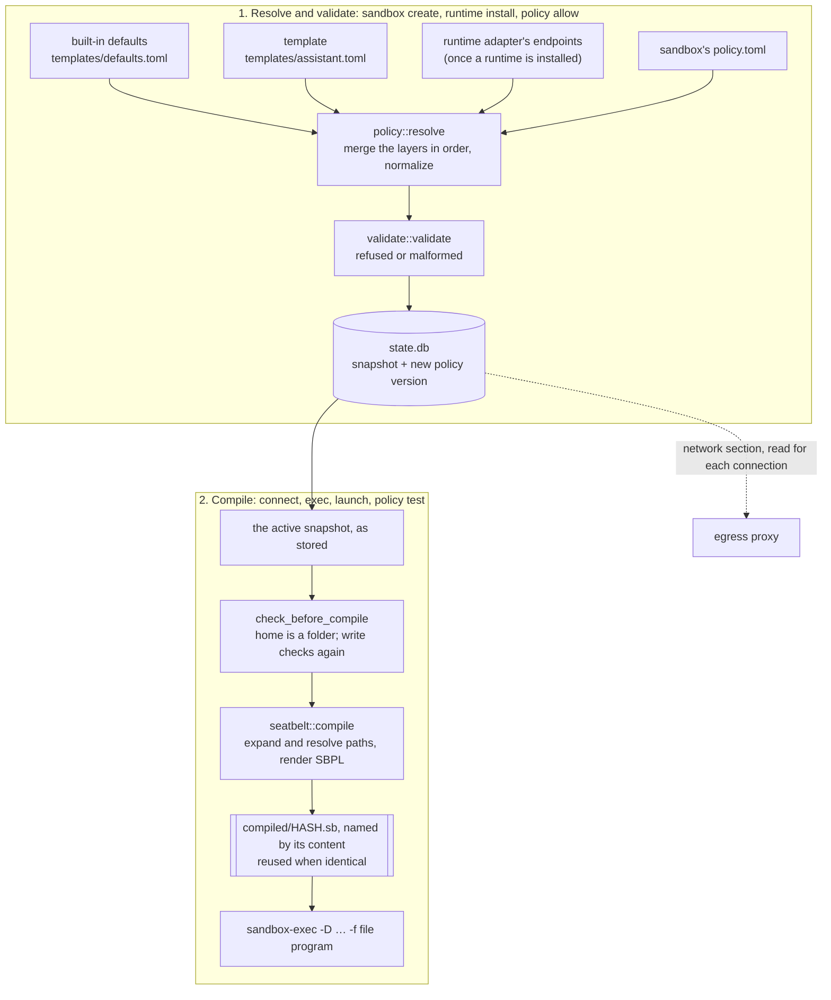

# Policy compilation

How a sandbox's `policy.toml` becomes the compiled policy that `sandbox-exec` applies to a session, in milestone 1 on the Seatbelt backend. The [design](design.md) (§5, §7, §8) says what the policy is meant to do and the [ADRs](adr/) record why; this page follows the code. Words such as policy snapshot, active policy, compiled policy, workspace and protected path are defined in the [glossary](../GLOSSARY.md).

## Overview

A policy goes through two stages, at two different times:

1. **Resolve and validate**, when the policy changes. The layers are merged into one policy, checked, and stored as an immutable policy snapshot that becomes the sandbox's active policy ([ADR 0018](adr/0018-immutable-policy-snapshots.md)). Paths stay as written (`~/…`, `{home}`), and nothing is written for the backend yet.
2. **Compile**, each time a program starts in the sandbox. The active snapshot's paths are expanded and resolved on the host as it is now, and the backend turns the policy into its own file: a Seatbelt `.sb` file under `~/.enclos/sandboxes/<name>/compiled/`.



The compiled policy does not hold the network allowlist. It only sends every connection to the sandbox's proxy, and the proxy reads the active snapshot's `[network]` section from `state.db` for each new connection. That is why a network change applies at once and a file change needs a new session.

| Stage | Runs when | Code | Result |
| --- | --- | --- | --- |
| Resolve | `sandbox create`, `runtime install`, `policy allow` | `src/policy/mod.rs`, `src/policy/file.rs` | a `PolicySnapshot` |
| Validate | the same, before anything is stored | `src/policy/validate.rs` | refused or malformed problems, or nothing |
| Store | the same | `Engine::store_policy` in `src/engine/policy.rs` | `policy.toml` written, a new policy version in `state.db` |
| Compile | `connect` and `exec`, `enclos launch` for a service, `policy test`; `sandbox show` in memory only | `src/engine/compile.rs`, `src/backend/seatbelt/compile.rs` | `compiled/<hash>.sb` |
| Apply | the same, right after compiling | `src/backend/seatbelt/wrap.rs` | `sandbox-exec` running the program |

## Stage 1: resolving the layers

`policy::resolve(overrides, adapter)` reads four layers, each a TOML file of the same shape (`PolicyFile`), and applies them in order on top of an empty policy:

| # | Layer | Where it comes from | What it may set |
| --- | --- | --- | --- |
| 1 | Built-in defaults | `src/policy/templates/defaults.toml`, compiled into enclos | everything: `write = ["{home}"]`, the sensitive read-deny list, `mode = "allowlist"`, `log = "metadata"` |
| 2 | Template | `src/policy/templates/<name>.toml`, compiled into enclos; milestone 1 ships `assistant` | everything but `extends` (a template cannot extend another) |
| 3 | Runtime adapter's endpoints | the installed runtime's adapter (`RuntimeAdapter::endpoints`) | only `[network] allow_add` and `listen` ([ADR 0028](adr/0028-a-runtime-listens-and-its-sessions-reach-its-service.md), proposed); anything else is refused |
| 4 | The sandbox's `policy.toml` | `~/.enclos/sandboxes/<name>/policy.toml` | everything; `extends` names the template, `assistant` when left out |

**How a layer applies** (`PolicyFile::apply`):

- A list written `name = [...]` replaces what the layers below set; `name_add = [...]` adds to it. If one layer writes both, the replacement comes first, then the additions. The lists are `filesystem.write`, `filesystem.read_deny`, `network.allow` and `network.private`.
- A single value (`network.mode`, `network.log`, `network.listen`) is set by the last layer that names it. So a sandbox's `policy.toml` with `listen = false` wins over the Hermes adapter's `listen = true`.
- Unknown keys and sections are errors (`deny_unknown_fields`). That is how milestone 1 refuses `[exec]`, `[resources]` and `[secrets]`, which it cannot enforce yet ([ADR 0009](adr/0009-refuse-what-cannot-be-enforced.md)), and how it catches a misspelling such as `alow`.

**Normalizing.** After the last layer, `normalize` puts the policy in one canonical form, so the same grants always give the same snapshot: each `network.allow` entry is rewritten in its canonical form (lowercase, default port dropped), each `network.private` entry the same way, and the four lists are sorted with repeats removed.

**The snapshot.** The result is a `PolicySnapshot`: the resolved `Policy`, the `PolicyInputs` it came from (enclos version, SHA-256 of the built-in defaults, the template's name and hash, the adapter's runtime, version and hash, and the hash of `policy.toml`), and an id, the SHA-256 of the JSON of both. Identical inputs and policy give the same id, so storing a policy equal to the active one records no new version.

Paths in a snapshot are kept as written: `~/work`, `{home}`, `{tmp}/cache`. They are expanded only when the policy is compiled, against the user's home and the sandbox home on the host then.

**Example.** A new sandbox starts with this `policy.toml` (`policy::initial_overrides`):

```toml
extends = "assistant"

[filesystem]
write_add = []
read_deny_add = []

[network]
allow_add = []
```

It resolves to `write = ["{home}"]`, the built-in read-deny list, `mode = "public"` (from the `assistant` template, [ADR 0025](adr/0025-public-web-by-default-for-assistants.md)) and an empty allowlist. Once Hermes is installed, its adapter adds its endpoints to `network.allow` and sets `listen = true`.

## Stage 2: validating

`validate::validate` checks the resolved policy against the sandbox's paths (`ValidationContext`: the user's home, the sandbox home, and enclos's data and config folders). Each problem it finds is one of two kinds:

- **Refused**: the policy is well written, but enclos does not grant it. When every problem is a refusal, the command exits 2 with `refused by policy:` (design §10).
- **Malformed**: an entry that does not parse, or one that contradicts another. Any malformed entry makes the whole result an error (`the policy is not valid:`), since what the policy means is not known until it is fixed.

| Check | Problem | Why |
| --- | --- | --- |
| A path does not start with `/`, `~`, `{home}` or `{tmp}`, or a placeholder is not followed by `/` | malformed | every path must be absolute once expanded |
| A write grant covers enclos's data or config folder, or sits inside it outside the sandbox's own home, also through `~`, `/`, `..` or a symlink | refused | protected paths ([ADR 0010](adr/0010-sqlite-state-and-jsonl-audit.md)) |
| A workspace inside the sandbox home or inside another workspace | refused | the compiled policy keeps only each granted folder's own path in place (below) |
| A workspace reached through a symlink that sits inside the home or a workspace | refused | the sandbox could point the link elsewhere, and the next compile would follow it |
| A path holding `"` or `\`, or not valid UTF-8 | refused | it cannot be put in a Seatbelt rule without changing the rule |
| `read_deny = [...]` that leaves out a built-in entry | refused | a policy may add to the sensitive list, never drop from it; use `read_deny_add` |
| A `network.allow` entry that does not parse (`exa mple.com`, port 0) | malformed | |
| A `network.allow` entry for loopback, link-local, `localhost`, `*` or a wildcard over a public suffix (`*.co.uk`) | refused | [ADR 0017](adr/0017-proxy-connects-only-to-validated-addresses.md) |
| A private address in `network.allow` without the same host in `network.private` | refused | private ranges need an explicit opt-in |
| A `network.private` entry whose host is not in `network.allow` | malformed | an opt-in that unlocks nothing |

**Where it runs.** `Engine::checked_policy_with` resolves and validates, and `Engine::store_policy` stores:

- `sandbox create` resolves the initial `policy.toml` against the template, with no adapter.
- `runtime install` resolves the sandbox's `policy.toml` as it is on disk now, with the new runtime's adapter, and shows the destinations it adds and any other difference before installing.
- `policy allow` adds the entry to `[network] allow_add` (keeping the file's comments), then resolves the whole file against the current template and adapter. When the result changes more than that entry (edits to `policy.toml` not stored yet, or a newer template or built-in defaults), it lists each change and asks first.
- `policy edit` opens a copy of `policy.toml` (`policy.toml.edit`, beside it, with the file it started from in `policy.toml.edit.base`) in the user's editor, then resolves the copy. An edit not applied (refused, an editor that failed, a dry run) stays, and the next `policy edit` opens it again, unless `policy.toml` changed since it began: then it is refused, as it would undo that change, and so is an edit whose `policy.toml` changed while the editor was open. `policy discard` drops a kept edit.

`allow` and `edit` record the result through `Engine::propose` (`src/engine/pending.rs`): it becomes the active version at once, unless it changes the rules a session keeps from its start (`Policy::same_at_launch`: the filesystem rules and `listen`) while a session runs under a compiled policy. Then it is saved as the pending policy, beside the active one; a change of network rules alone (a destination `policy allow` adds, or a `policy edit` that touches only the network while a change waits) still applies at once, resolved from the active snapshot's `policy.toml` with that change, provided the result differs from the active policy by exactly it; it is part of the pending one too. Without `--yes` nothing is asked interactively, so such a change waits; with `--yes`, a change that itself brings the rules sessions keep restarts the sandbox into it (`Engine::restart_into`: `sandbox stop`, then the pending policy made active, then `sandbox start` when services were installed). `policy apply` does the same for a change already waiting, and `policy discard` drops it, writing back the `policy.toml` the active snapshot was resolved from (each snapshot keeps that text) and keeping the replaced file as `policy.toml.discarded`. `runtime install` is refused while a change waits, since it resolves `policy.toml` on its own. `store_policy` writes `policy.toml` first and records the version second; if recording fails, the file goes back to what it was.

## Stage 3: compiling

`Engine::compile_policy(name, proxy_port)` in `src/engine/compile.rs` runs every time a program starts in the sandbox: `connect` and `exec` (`start_in_sandbox`), a runtime service (`enclos launch`), and `policy test` before its probes. `sandbox show` calls `compiled_file`, the same steps without writing, to tell which sessions run under an older compiled policy.

1. **Pick the backend.** The sandbox's recorded backend must be in this build and its probe must say it runs on this host; otherwise the command fails, with no override ([ADR 0009](adr/0009-refuse-what-cannot-be-enforced.md)).
2. **Load the active snapshot as stored.** The policy is not resolved again: a newer template or enclos version changes no grant until a command stores a new snapshot (design §7, Updates).
3. **Check the paths as they are now** (`check_before_compile`). The sandbox home must still be a real folder, not a symlink, a file or missing. The write checks of stage 2 run again (`validate_writes`), because a symlink on the way to a workspace may have changed since the policy was stored. The other checks are not repeated.
4. **Build the context** (`SandboxContext::new`): the sandbox's name, folder and home, the user's home, the protected folders, the files and folders no sandbox may read (`state.db`, `state.lock`, `audit.jsonl`, `config.toml`, `run/`), the folder of all sandboxes, and the sandbox's proxy port.
5. **Compile** (`Backend::compile`, pure). Seatbelt first expands every path and resolves it to where it really is (`FsPaths::of`, `real_path`): symlinks followed, a dangling link followed to what it points to, `..` taken after resolving. Seatbelt matches real paths, so `/tmp` must be written `/private/tmp`. Then it renders the file (next section).
6. **Store by content.** The file is named after the first 16 hex digits of the SHA-256 of its text: `compiled/<hash>.sb`. A file already there is reused only when it holds exactly that text, since a cut-off Seatbelt file can still load and leave out every rule after the cut. Otherwise the text is written to a temporary file (mode `0600`), synced, and renamed into place. Older files are left where they are: sessions started under them still name them.
7. **Wrap** (`Backend::wrap`). The session runs `/usr/bin/sandbox-exec -f <file> <program> <args>` with an emptied environment (design §5). Two values that differ between sessions are passed as parameters, not compiled in, so every session of a sandbox runs under one file:
   - `-D ENCLOS_TERMINAL=<device>`: the terminal the session runs in, for a session started in a terminal.
   - `-D ENCLOS_SERVICE=localhost:<port>`: the port where the runtime's service listens, for a session started while it listens (ADR 0028).

The session record keeps the snapshot and the compiled file it started under. `sandbox show` flags a session as needing a restart when that file differs from the one the active policy compiles to now.

Since the file is named by its content, a new file appears whenever any input to the text changes: a new snapshot, a new enclos version whose rules differ, a different proxy port, or a symlink that now resolves elsewhere. An upgrade that tightens enclos's own rules therefore reaches new sessions without a policy change (design §8, step 2).

## The Seatbelt file, section by section

`src/backend/seatbelt/compile.rs` writes the sections below in this order. Order matters: in Seatbelt's language the last rule that matches an operation decides it, so each deny that must hold whatever the policy grants comes after the allows it overrides. Every deny carries `(with message "enclos:<sandbox>")`, which the macOS unified log repeats, so a denial can be traced to its sandbox (design §5, Denials).

| # | Section | Rules | From the policy? |
| --- | --- | --- | --- |
| 1 | Header | `(version 1)`, `(allow default)`: milestone 1 starts from allow and denies what it must. [ADR 0006](adr/0006-seatbelt-deny-by-default.md) (proposed) would start from `(deny default)`; milestone 2 decides on evidence. | no |
| 2 | Writes | `(deny file-write*)`, then allow the sandbox home, each `filesystem.write` path, and the device files every runtime writes (`/dev/null`, `/dev/tty`, `/dev/fd/N`, …). | `filesystem.write` |
| 3 | Terminals | Deny every `/dev/ttysN`, then allow back only the session's own (the `ENCLOS_TERMINAL` parameter) and those the sandbox opens itself through `/dev/ptmx`; the sandbox may not issue itself the pty extension for another one. Then allow reading the home. | no |
| 4 | Sensitive paths | `(deny file-read* file-write*)` on every `filesystem.read_deny` path, after every allow above, so no write grant reopens one. An entry that holds the home (such as `~`) leaves the home out. | `filesystem.read_deny` |
| 5 | Folders that cannot move | `(deny file-write-unlink file-clone)` on the exact path of the home, each workspace, and each folder inside them that holds a deny-list entry. Deny rules match paths, so a renamed or cloned folder would carry a denied file to a path no rule names. Files and folders inside still work as usual. | `filesystem.write`, `filesystem.read_deny` |
| 6 | Network | The proxy port must be in enclos's range (41000 to 41999), or compiling fails. `(deny network*)`, then allow outbound TCP to `localhost:<proxy port>` only, and Unix sockets inside the home. With `listen = true`: allow binding TCP on any port, deny binding each of the 1000 proxy-range ports again (one rule a port, since Seatbelt has no ranges), and allow outbound to the `ENCLOS_SERVICE` port on 127.0.0.1. | `network.listen` only |
| 7 | Host services | `host-services.sb`, copied in with the sandbox's tag: LaunchServices, Apple Events, launchd jobs, preference writes, synthetic input and the pasteboard, login items, the Keychain services, DNS-SD, `TIOCSTI`, and signals outside the sandbox ([ADR 0016](adr/0016-seatbelt-blocks-host-service-delegation.md)). | no |
| 8 | enclos's own files | Deny writes under the data and config folders except the sandbox's own home; deny reads of `state.db`, `state.lock`, `audit.jsonl` and `config.toml` (each with every file whose name starts with it, such as `state.db-wal`) and of `run/`; deny reads inside other sandboxes' folders. Last but one, so no rule above overrides them. | no |
| 9 | The home and workspaces themselves | `(deny file-write-unlink file-write-create)` on the exact path of the home and each workspace: the sandbox may change what is inside, never remove, rename or replace the folder, which stays the one this file was compiled for. So a workspace must exist before the sandbox uses it. | `filesystem.write` |

`network.mode`, `network.allow`, `network.private` and `network.log` do not appear in the file: the proxy enforces them from the active snapshot.

A path is put in a rule between double quotes and never escaped: a path holding `"` or `\` is refused, by validation when the policy is stored and by the compiler again, since a mistake there would change the rule.

### Example

The policy of a sandbox `lab` for the user `alice`, with the built-in defaults, a workspace and one extra deny entry inside it:

```toml
[filesystem]
write = ["{home}", "~/work"]
read_deny_add = ["~/work/project/secrets"]
```

compiles to this file, shortened where marked with `…` (generated by `seatbelt::compile`; the home is listed twice in the write grants because the policy lists `{home}` and the compiler always adds the home, which Seatbelt accepts):

```scheme
;; enclos compiled policy for sandbox lab. Generated: edit policy.toml instead.
(version 1)
(allow default)

;; ---- Writes: the sandbox home, granted workspaces and device files
(deny file-write* (with message "enclos:lab"))
(allow file-write*
  (subpath "/Users/alice/.enclos/sandboxes/lab/home")
  (subpath "/Users/alice/.enclos/sandboxes/lab/home")
  (subpath "/Users/alice/work")
  (literal "/dev/null")
  …
  (regex #"^/dev/fd/[0-9]+$"))

;; ---- Terminals: the session's own and those the sandbox opens, no other
(deny file-read* file-write* (with message "enclos:lab") (regex #"^/dev/ttys[0-9]+$"))
(deny file-issue-extension (with message "enclos:lab") (extension-class "com.apple.sandbox.pty"))
(allow file-read* file-write* (require-all (regex #"^/dev/ttys[0-9]+$") (extension "com.apple.sandbox.pty")))
(if (param "ENCLOS_TERMINAL")
  (allow file-read* file-write* (require-all (regex #"^/dev/ttys[0-9]+$") (literal (param "ENCLOS_TERMINAL")))))
(allow file-read* (subpath "/Users/alice/.enclos/sandboxes/lab/home"))

;; ---- Sensitive paths: neither read nor written, whatever a grant covers (ADR 0015)
(deny file-read* file-write* (with message "enclos:lab")
  (subpath "/Users/alice/.ssh")
  (subpath "/Users/alice/.gnupg")
  …
  (subpath "/Users/alice/work/project/secrets"))

;; ---- Writable folders that cannot move, so no rename or clone carries a denied path elsewhere
(deny file-write-unlink file-clone (with message "enclos:lab")
  (literal "/Users/alice/.enclos/sandboxes/lab/home")
  (literal "/Users/alice/work")
  (literal "/Users/alice/work/project"))

;; ---- Network: only the sandbox's proxy, and Unix sockets in its home (ADR 0007)
(deny network* (with message "enclos:lab"))
(allow network-outbound (remote tcp "localhost:41000"))
(allow network-bind network-inbound (local unix-socket (subpath "/Users/alice/.enclos/sandboxes/lab/home")))
(allow network-outbound (remote unix-socket (subpath "/Users/alice/.enclos/sandboxes/lab/home")))

;; ---- Host services (design §5, ADR 0016)
(deny lsopen (with message "enclos:lab"))
…
(deny signal (with message "enclos:lab"))
(allow signal (target same-sandbox))

;; ---- enclos's own files, whatever the policy says (ADR 0010)
(deny file-write* (with message "enclos:lab")
  (require-all (subpath "/Users/alice/.enclos") (require-not (subpath "/Users/alice/.enclos/sandboxes/lab/home"))))
(deny file-read* (with message "enclos:lab")
  (regex #"^/Users/alice/\.enclos/state\.db")
  (regex #"^/Users/alice/\.enclos/state\.lock")
  (regex #"^/Users/alice/\.enclos/audit\.jsonl")
  (regex #"^/Users/alice/\.enclos/config\.toml")
  (subpath "/Users/alice/.enclos/run"))
(deny file-read* (with message "enclos:lab")
  (require-all (subpath "/Users/alice/.enclos/sandboxes") (require-not (literal "/Users/alice/.enclos/sandboxes")) (require-not (subpath "/Users/alice/.enclos/sandboxes/lab"))))

;; ---- The home and each workspace themselves: never removed, renamed or replaced
(deny file-write-unlink file-write-create (with message "enclos:lab")
  (literal "/Users/alice/.enclos/sandboxes/lab/home")
  (literal "/Users/alice/work"))
```

## When a change reaches a sandbox

| Change | New sessions | Sessions already running |
| --- | --- | --- |
| `network.allow`, `network.private`, `network.mode` | the new active snapshot | at once: the proxy reads the active snapshot for each new connection |
| `filesystem.*`, `network.listen` | a new compiled file, once the change is active: while sessions run, it waits as the pending policy | keep the file they started with until `policy apply` restarts them; `sandbox show` flags them when the active policy compiles to another file than the one they started with |
| A new enclos version with changed compiler rules | a new compiled file, from the same snapshot | keep the file they started with |
| A new enclos version with a changed template or built-in defaults | nothing until a command stores a new snapshot, which lists the change | nothing |

A change to the filesystem rules or `listen` reaches running sessions only through `policy apply`, or the change made with `--yes`; `sandbox restart` restarts them under the active policy, leaving a pending change waiting. After an upgrade, `policy refresh` resolves the active policy's `policy.toml` again against the new templates, defaults and adapter, and lists what that changes before applying it; until then, or until another command stores a new snapshot (which lists the change), nothing changes. `policy rollback --to <version>` makes an earlier snapshot active again as a new version, through the same restart rules.

## Errors

| Message starts with | Stage | Cause |
| --- | --- | --- |
| `cannot read the <layer> policy` | resolve | TOML that does not parse, an unknown key, or a section milestone 1 does not enforce |
| `unknown template` | resolve | `extends` names a template this build does not ship |
| `a template cannot extend another` | resolve | a template layer sets `extends` |
| `the <runtime> adapter's layer may only add network destinations` | resolve | an adapter's layer sets more than `allow_add` and `listen` |
| `refused by policy:` | validate | every problem is a refusal (exit 2) |
| `the policy is not valid:` | validate | at least one entry is malformed |
| ``sandbox `<name>` uses the <backend> backend, which this host cannot run`` | compile | the sandbox's backend is not in this build or does not run on this host |
| ``the home of sandbox `<name>` is not a real folder`` | compile | the sandbox home was removed, or replaced by a file or a symlink |
| ``the active policy of sandbox `<name>` no longer passes enclos's write checks`` | compile | a write check fails on the paths as they are now, usually a symlink changed after the policy was stored |
| `cannot compile the policy for seatbelt` | compile | a path the file cannot hold, or a proxy port outside 41000 to 41999 |

## Looking at a compiled policy

- `enclos policy show <sandbox>` prints the active snapshot: its version, short id, template, write grants, deny list and network.
- `ls ~/.enclos/sandboxes/<sandbox>/compiled/` lists the compiled files: the one the active policy compiles to, and those older sessions started under. `enclos sandbox show <sandbox>` says which sessions need a restart to run under the active one.
- `enclos policy test <sandbox>` compiles the active policy and runs the escape probes against it from inside the sandbox; `--host-services` also probes the host-service routes.
- `log stream --predicate 'sender == "Sandbox" AND eventMessage CONTAINS "enclos:<sandbox>"'` shows the denials as they happen (admin users only).

## Changing the compiler

- **A new built-in deny entry**: add it to `src/policy/templates/defaults.toml` and to the list in the test `the_defaults_hide_…` in `src/policy/mod.rs`, which guards against an entry being dropped.
- **A new policy field**: the model in `src/model/policy.rs`; the layer field and `apply` in `src/policy/file.rs`, and `beyond_destinations` if an adapter may not set it; `normalize` if it is a list; its checks in `src/policy/validate.rs`; its rules in `src/backend/seatbelt/compile.rs`, or the proxy if it is a network rule; how a change is worded in `differences` (`src/engine/policy.rs`); and its line in `policy show`. A field the backend cannot enforce is refused, never stored and ignored ([ADR 0009](adr/0009-refuse-what-cannot-be-enforced.md)).
- **A new rule**: place it by the last-rule-wins order above, and give each deny the tag. `src/backend/seatbelt/compile.rs` tests the order of the sections; `src/backend/seatbelt/tests.rs` runs rules under `sandbox-exec`. Security behavior counts as enforced only once a backend test or an escape probe shows it (CLAUDE.md).
- **A new backend**: implement `Backend::compile` and `Backend::wrap` in `src/backend/`. Start from `FsPaths::of`, which both the compiler and `policy test` use, so the probes check the paths the rules name.
